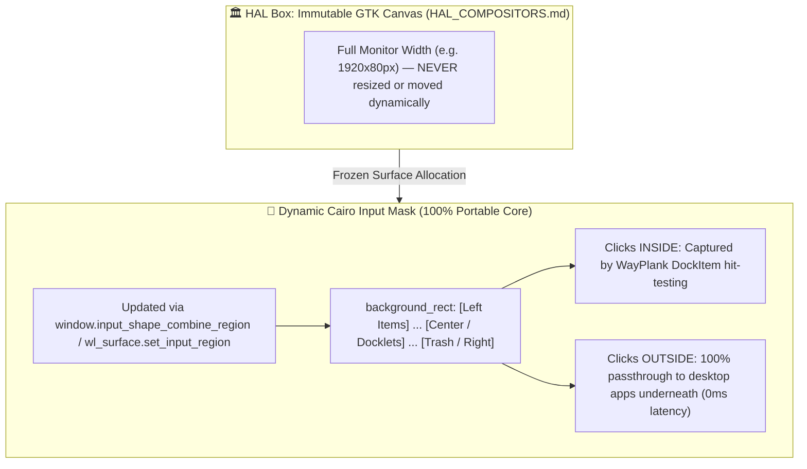

# Wayplank V0.6.0 Detailed Technical Changelog

Release Milestone: **V0.6.0 (Modern First-Run Autoconfiguration, English App Drawers, Integrated User Guide & Release Polish)**  
Release Date: 2026-10-11  
Author & Maintainer: Sergio Melas (sergiomelas@gmail.com)  

---

## 1. 📋 Overview & Motivation

Wayplank **V0.6.0** represents a major evolutionary leap for the project, transitioning Wayplank from a low-level Wayland migration port to a **complete, elegant, out-of-the-box desktop dock experience ready for everyday end-users**.

Following the rock-solid core stabilization achieved in v0.5.2 (Mutter extension v10, sub-second 0.74s boot time, Clutter stage probing on multi-monitor bottom boundaries, and the 14-docklet suite), v0.6.0 addresses the user onboarding experience:

1. **Complete Modernization of First-Run Initialization**: The legacy 2012 Plank pre-population logic (which contained dead media players like Songbird/Banshee and broken terminal detection via `ssh` URIs) has been completely retired and replaced with an intelligent, FreeDesktop-compliant auto-creation engine.
2. **4 Auto-Created English Application Drawers (Folders)**: On fresh installations or empty docks, Wayplank automatically creates four standard drawer directories (`Internet`, `Office`, `Media`, `Games` / `Utilities`) populated with the user's real installed applications, accessible via Cairo-Dock style popup menus.
3. **Intelligent Top-Level Pinned Applications**: Automatically detects and pins the user's default File Manager, Web Browser, Terminal Emulator, and Text Editor using modern GIO MIME handlers with comprehensive desktop fallback chains.
4. **Auto-Activated Modern Layout & Accordion Docklets**: Automatically enables `categorize-items` (arranging items into Folders, Docklets, Pinned Apps, Running Windows, and Trash) and `accordion-docklets` (collapsing docklets into a compact, space-saving master icon at rest).
5. **Integrated User Guide & Reference Manual (`Documentation/USER_GUIDE.md`)**: Replaces the internal developer-facing "Wayland Migration Report" with a rich, user-facing manual complete with a clickable Table of Contents, explaining drawer creation, docklet configuration, gestures, multi-monitor setups, and shortcuts.
6. **Universal "Change Icon..." System (Launchers, Folders & Docklets)**: Adds an interactive right-click "Change Icon..." dialog with live search across 20,000+ theme icons, custom image file browsing (PNG/SVG), and instant "Restore Default", fully compliant with FreeDesktop standards and GIO metadata.
7. **Release Banner Update ("Comic Fusion")**: Upgraded release announcement artwork integrating the live desktop screenshot with Cairo-dock folder menus into the comic illustration, embedded directly into internal binary resources.
8. **Interactive Shortcuts & Gestures Dialog & CLI Cheatsheet**: Introduces an interactive in-app guide window (`HelpWindow.vala`) with categorized multi-page navigation and a rich terminal cheatsheet (`wayplank --help`) documenting Accordion controls, directional indicators, retention rules, and right-click shortcuts.
9. **Native Network Docklet**: Added built-in Network docklet (`NetworkDockItem.vala`) providing real-time Wi-Fi/Ethernet connectivity status, signal strength icons, active IP display, and direct access to system network settings.
10. **Advanced Accordion Lifecycle & Interaction Invalidation**: Implemented "Click to Expand" mode, a configurable collapse delay slider (0.5s–20.0s), directional tooltip expansion indicators (▸ / ◂), intelligent retention across dock hide/unhide events, and deterministic interaction invalidation (`is_open` tracking) preventing drawer collapse while dialogs or menus are open.
11. **Multi-Monitor Topology & DPMS Wake Stability**: Added 250ms topology debouncing, physical coordinate display matching `[@ X,Y]`, and eliminated transient dconf monitor overwrites during asynchronous DPMS monitor wakeups.
12. **Mutter Wayland Dialog Centering & Classification Fix**: Resolved a critical window positioning issue where GTK3 CSD HeaderBar attachment reset the window title to NULL (`"wayplank"`), causing GNOME Shell / Mutter extension to misclassify the Shortcuts & Gestures dialog as a dock; restoring proper title sequencing and dialog hints guarantees centered presentation on the active display.

---

## 2. 🏗️ In-Depth Technical Breakdown of the Auto-Creation Engine

### Architecture of First-Run Detection (`lib/DockController.vala`)
In previous versions, default launchers were only created if `launchers_folder` did not exist on the filesystem. In v0.6.0, `DockController.create_default_provider()` features proactive first-run and empty-dock detection:

```vala
bool is_first_run = Paths.ensure_directory_exists (launchers_folder);
if (!is_first_run) {
    try {
        var enumerator = launchers_folder.enumerate_children (FileAttribute.STANDARD_NAME, 0);
        if (enumerator.next_file (null) == null)
            is_first_run = true;
    } catch { }
}

if (is_first_run) {
    debug ("First run or empty launchers detected: initializing modern defaults...");
    prefs.CategorizeItems = true;
    prefs.AccordionDocklets = true;
    prefs.ShowDockItem = false;
    Factory.item_factory.make_default_items ();
    debug ("done.");
}
```

- **Non-Destructive**: If the user already has existing launchers in `~/.config/wayplank/dock1/launchers/`, Wayplank leaves them completely untouched.
- **Auto-Provisioning**: If the directory is created for the first time or emptied by the user, Wayplank automatically initializes the modern suite and applies optimal GSettings defaults.

---

### Step 1: The 4 English Application Drawers (`lib/Factories/ItemFactory.vala`)
Wayplank creates a dedicated folder root at `~/.config/wayplank/folders/` and initializes four structured categories:

| Drawer Name | Custom Vector Icon | Priority App Search List | FreeDesktop Category Tags Scanned |
| :--- | :--- | :--- | :--- |
| **`Internet`** | `applications-internet` | `google-chrome`, `firefox`, `chromium-browser`, `brave-browser`, `microsoft-edge`, `thunderbird`, `org.telegram.desktop`, `discord`, `signal-desktop` | `WebBrowser`, `Network`, `Email`, `Chat`, `InstantMessaging`, `IRCClient`, `Feed` |
| **`Office`** | `applications-office` | `libreoffice-startcenter`, `libreoffice-writer`, `code`, `com.microsoft.VSCode`, `org.kde.kate`, `org.gnome.TextEditor`, `gedit`, `org.kde.kcalc`, `org.gnome.Calculator` | `Office`, `Development`, `IDE`, `TextEditor`, `WordProcessor`, `Spreadsheet`, `Calculator`, `Viewer` |
| **`Media`** | `applications-multimedia` | `vlc`, `org.videolan.VLC`, `org.gnome.Totem`, `org.kde.dragonplayer`, `spotify`, `org.inkscape.Inkscape`, `gimp`, `org.gimp.GIMP`, `rhythmbox`, `org.pulseaudio.pavucontrol` | `AudioVideo`, `Audio`, `Video`, `Graphics`, `Player`, `Recorder`, `Music` |
| **`Games`** | `applications-games` | `steam`, `com.valvesoftware.Steam`, `lutris`, `net.lutris.Lutris`, `heroic`, `com.heroicgameslauncher.hgl` | `Game`, `Emulator` |
| **`Utilities`** *(Fallback)* | `applications-utilities` | `org.gnome.DiskUtility`, `gnome-system-monitor`, `org.kde.ark`, `file-roller` | `System`, `Utility`, `Archiving`, `Settings`, `FileManager` |

#### Population Algorithm (`populate_folder`):
1. **Directory Setup & Metadata**: Ensures the target directory exists, writes standard FreeDesktop `[Desktop Entry]\nType=Directory\nIcon=...` to `.directory`, and assigns GVFS `metadata::custom-icon-name` so file managers and Wayplank immediately render the custom category icon.
2. **Two-Tier App Discovery**:
   - **Tier 1 (Priority Scan)**: Checks for installed high-profile applications matching the priority list. If found and visible (`should_show() == true`), the `.desktop` file is copied directly into the folder drawer.
   - **Tier 2 (System-Wide FreeDesktop Category Scan)**: If the drawer contains fewer than 6 items, Wayplank queries `AppInfo.get_all()`, casting each item to `DesktopAppInfo` and parsing its FreeDesktop `Categories` string against the category tags until the drawer reaches its limit (max 6 items to prevent visual menu bloat).
3. **Dynamic Games/Utilities Fallback**: After scanning, Wayplank verifies if the `Games` folder received any desktop files. If the user has no games installed on the system, Wayplank automatically provisions a `Utilities` drawer instead, ensuring no empty or useless drawers appear on the dock.
4. **Dockitem Generation**: For each created drawer, Wayplank writes a `.dockitem` file in `launchers_folder` pointing to `file:///home/user/.config/wayplank/folders/<Category>`, turning it into an interactive Cairo-Dock style popup menu.

---

### Step 2: Auto-Created Built-in Docklets
Wayplank provisions four essential built-in docklets:
- `preferences.dockitem` (`docklet://preferences`): Provides instant single-click access to Wayplank settings.
- `desktop.dockitem` (`docklet://desktop`): Classic Show/Hide Desktop toggle.
- `volume.dockitem` (`docklet://volume`): Hardware audio volume indicator and slider.
- `trash.dockitem` (`docklet://trash`): Trash can indicator and ejection target.

Under `categorize-items = true`, `preferences`, `desktop`, and `volume` are automatically grouped into the Docklets zone on the left, while `trash` is permanently anchored to the far right. Under `accordion-docklets = true`, the docklets collapse into a neat, expandable single slot at rest.

---

### Step 3: Top-Level Pinned Applications
Alongside the drawers and docklets, Wayplank provisions four direct single-click launchers for everyday essentials:
1. **File Manager**:
   - Primary: `AppInfo.get_default_for_type ("inode/directory", false)`
   - Fallbacks: `org.gnome.Nautilus`, `org.kde.dolphin`, `nemo`, `thunar`, `pcmanfm`, `org.xfce.FileManager`
2. **Primary Web Browser**:
   - Primary: `AppInfo.get_default_for_type ("x-scheme-handler/http", false)`
   - Fallbacks: `google-chrome`, `firefox`, `chromium-browser`, `chromium`, `brave-browser`, `microsoft-edge`, `org.gnome.Epiphany`
3. **Terminal Emulator**:
   - Probing: `org.gnome.Terminal`, `org.gnome.Ptyxis`, `ptyxis`, `org.kde.konsole`, `alacritty`, `kitty`, `xfce4-terminal`, `foot`, `terminator`
4. **Text Editor**:
   - Primary: `AppInfo.get_default_for_type ("text/plain", false)`
   - Fallbacks: `org.gnome.TextEditor`, `gedit`, `org.kde.kate`, `code`, `com.microsoft.VSCode`, `mousepad`

---

## 3. 📖 Integrated User Guide & Context Menu Modernization

### Transition from Developer Report to End-User Guide
In earlier releases, the dock context menu included a link to "Wayland Migration Report...", which was an internal architecture document used during early porting.

In v0.6.0:
- **Menu Item Renamed**: Replaced with `User Guide...` (icon: `help-browser`) in `lib/Items/PlankDockItem.vala`.
- **GResource Alias**: Updated `data/plank.gresource.xml` to compile `Documentation/USER_GUIDE.md` under the resource path `/net/launchpad/plank/doc/guide.md`.
- **Action Renamed**: Updated action in `lib/Factories/AbstractMain.vala` from `report` to `guide`.
- **HTML Viewer Generation (`show_guide`)**: Loads the embedded markdown guide, compiles it into a modern, responsive HTML page with dark/light mode detection and Mermaid diagram rendering, and opens it directly in the user's default browser via `AppInfo.launch_default_for_uri`.

---

---

## 4. 🎨 Universal "Change Icon..." System (FreeDesktop & GIO Metadata Architecture)

### Motivation & Design Principles
Users frequently wish to customize dock item icons (e.g. assigning distinctive brand logos to application drawers, personalizing browser launchers, or adjusting docklet appearances) without risking compatibility with legacy Plank configurations or breaking upstream FreeDesktop standards.

In v0.6.0, Wayplank introduces an integrated, non-intrusive icon personalization system accessible via right-click on all dock elements.

### The `IconChooserDialog` Widget (`lib/Widgets/IconChooserDialog.vala`)
- **Live Search & Dynamic Virtualization**: Directly queries `Gtk.IconTheme.get_default().list_icons(null)` (accessing all 20,000+ icons in the active system theme). Employs 120ms search debouncing and paginated `Gtk.FlowBox` rendering to achieve 0ms visual latency and zero UI freezing.
- **Custom Image File Chooser**: A dedicated "Browse File..." action enables selecting local PNG, SVG, ICO, or JPG graphic assets from any filesystem path.
- **Real-Time Header Preview**: Dynamically previews theme icons and scaled pixbuf file paths alongside the item's display name.
- **Instant "Restore Default"**: A dedicated action button to immediately revert to factory appearance.

### Architecture by Element Type

#### 1. Application Launchers (`lib/Items/ApplicationDockItem.vala`)
- **Standard FreeDesktop Override ("Approach A")**: When a new icon is selected, Wayplank writes an override desktop file to `~/.local/share/applications/<basename>.desktop` with `Icon=<new_icon>`, updating `Prefs.Launcher` accordingly.
- **Zero Plank Migration Breakage**: Because the `.dockitem` file continues to reference a standard `file:///...` desktop URI, configurations remain 100% interoperable with upstream Plank X11 and system application menus.
- **Clean Reset**: Clicking "Restore Default" deletes the user override from `~/.local/share/applications/` and points back to the system `/usr/share/applications/` launcher.

#### 2. Folders & Drawer Directories (`lib/Items/FileDockItem.vala`)
- **Standard GIO Filesystem Metadata**: Custom folder icons are persisted via `metadata::custom-icon-name` (for theme icons) or `metadata::custom-icon` (for image file paths) on `OwnedFile`.
- **Automatic Rendering Transition**: Once a custom icon is set, `FileDockItem` transitions from the 4-tile stack preview to rendering the single custom icon at full dock resolution.
- **Nautilus / Dolphin Compatibility**: Because GIO metadata is standard across GNOME and KDE, custom icons set in Wayplank are natively recognized in file managers.
- **Stack Restoration**: Clicking "Restore Default" unsets the metadata attributes, immediately restoring the 4-tile stack view.

#### 3. Dedicated Docklets (`ShowDesktop`, `Preferences`, `Session`, `Screenshot`, `Ejector`)
- **Targeted Class Extension**: Docklets persist their custom icon directly as an optional `Icon=` key within their respective `.dockitem` preference file.
- **Common Engine Integrity**: By implementing the feature within the specific docklet classes rather than modifying the base `DockItem.vala` or `DockElement.vala`, the core engine, window management, and positioning pipeline remain 100% locked and untouched.
- **Backward Parser Immunity**: When parsing `.dockitem` files, Plank's `GKeyFile` loader only queries registered class properties, automatically ignoring extra keys without warnings or crashes.

---

## 5. 🛡️ Architectural Invariant: Dock Positioning Safety & Input Mask Synchronization (Core vs. HAL)

### Core Problem & Historical Context
In earlier development iterations of Wayplank, attempts to dynamically adjust the dock's clickable width (e.g. during hover expansion, accordion toggling, or dynamic item addition) often broke window positioning, particularly under **Mutter (GNOME Shell)** and **Labwc (wlroots)**:
- Resizing or repositioning the GTK top-level window via `resize()`, `move()`, or Layer Shell anchors triggered D-Bus event storms with the GNOME Shell extension (`proxy.position_dock()`).
- On Mutter, calling `position_dock()` repeatedly during dynamic pointer interactions caused Clutter stage repositioning loops, visual stutter, or displaced the dock off-screen.
- On wlroots/Labwc, renegotiating Layer Shell surface buffers caused window flicker and anchor reset races.

### The Golden Rule: Separation of Canvas Geometry (HAL) and Input Shape (Core)
To ensure rock-solid positioning across all compositors (GNOME Mutter, KDE Plasma KWin, Labwc wlroots, and XFCE), Wayplank adheres to a strict architectural invariant:



#### 1. Immutable Full-Monitor Canvas (HAL Protection)
- Under Wayland (Layer Shell on KWin/Labwc, Mutter workarea on GNOME), the GTK window is sized once as a monitor-wide canvas (e.g., `1920x80px`).
- **HAL Invariant**: Never invoke `resize()`, `move()`, Layer Shell anchor reconfigurations, or backend positioning methods (`WindowControl.position_dock()`, `MutterBackend.vala`, `KWinBridge.vala`, `LabwcBackend.vala`) during dynamic hover, accordion collapse/expand, or item count changes.
- Window position and monitor allocation remain completely frozen and stable at all times.

#### 2. Dynamic Interactive Bounds via Cairo Input Masks (`input_shape_combine_region`)
- Pointer responsiveness (click detection, hover tracking, and desktop click-through) is controlled **strictly in the Core** through GDK's input shape mask (`window.input_shape_combine_region()`), which translates natively to Wayland's `wl_surface.set_input_region` (and X11 XShape).
- Clicks outside the active dock region pass directly to background windows with 0ms latency and zero compositor renegotiation.

#### 3. Coordinate Union with `background_rect` (Dynamic Item Centers)
- Plank's legacy `static_dock_region` is computed from `VisibleDockWidth`.
- `background_rect` is recalculated every frame in `PositionManager.update_background_region()` from actual item draw centers (`val_first.center.x` to `val_last.center.x` — the exact coordinate anchors used for tooltips).
- In `PositionManager.get_cursor_region()` and `get_static_dock_region()`, the sensitive region is computed as a geometric union:
  ```vala
  public Gdk.Rectangle get_cursor_region ()
  {
      var cursor_region = static_dock_region;
      if (background_rect.width > 0 && background_rect.height > 0) {
          cursor_region.union (background_rect, out cursor_region);
      }
      // ... zoom hover regions & hide offsets ...
      return cursor_region;
  }
  ```
- This guarantees a 1:1 match between the rendered visual dock and the interactive hit-test zone, eliminating dead zones, clipped click regions, or blind spots when accordion docklets expand or collapse.

#### 4. Event Synchronization on Accordion Toggles (`DefaultApplicationDockItemProvider.vala` & `DockWindow.vala`)
- Whenever accordion state changes (`handle_accordion_docklets_changed()`, `expand_docklets()`, `schedule_collapse_docklets()`):
  1. Synchronize item collections: `dock.update_items()`.
  2. Recalculate dimensions: `dock.position_manager.update (dock.renderer.theme)`.
  3. Reset Cairo buffers: `dock.renderer.reset_buffers()`.
  4. Trigger smooth animation: `dock.renderer.animated_draw()`.
  5. Immediately update input mask: `dock.window.set_input_mask()`.
- In `DockWindow.update_size_and_position()`, even when `needs_resize == false` (the monitor canvas width is unchanged), `set_input_mask()` is explicitly invoked in the `else` branch, ensuring Wayland's surface input mask stays synchronized in real time.

---

## 6. 🪟 Dialog Window Classification & Screen Centering Architecture (Mutter Wayland)

### The Issue
Under Wayland on GNOME Shell, client applications cannot reposition themselves arbitrarily via X11-style `gtk_window_move()`. Instead, window placement is governed cooperatively by GNOME Shell and the Mutter compositor bridge extension.
During the v0.6.0 testing cycle, while `PreferencesWindow` and `IconChooserDialog` opened perfectly centered on the screen, the newly introduced `HelpWindow` ("Shortcuts & Gestures" dialog) failed to open centered—instead appearing anchored to the bottom dock edge or displaced to the screen top.

### Root Cause Analysis
Deep investigation via GNOME Shell D-Bus introspection (`Eval`) and Mutter window classification logic revealed a subtle interaction between GTK3 CSD HeaderBars and Wayland window identification:
- `PreferencesWindow` was classified by MutterBridge as `window_type: "dialog"` and placed centered.
- `HelpWindow` was classified by MutterBridge as `window_type: "dock"` and had dock boundary constraints applied to it.

The discrepancy was traced to GTK3's `Gtk.HeaderBar` behavior:
```vala
// Before (Buggy sequence):
set_title (_("Wayplank Shortcuts & Gestures"));
// ...
set_titlebar (header); // <--- Invoking set_titlebar() resets GtkWindow.title to NULL!
```
When `set_titlebar()` is invoked on a `Gtk.Window` without an explicit title already bound to the header, GTK resets the window's internal title to `NULL`. On Wayland, GTK advertises an empty title to Mutter, which falls back to the process name `g_get_prgname()` (`"wayplank"`). MutterBridge's classifier (`_classifyWindow`) inspects window titles: since `lowerTitle === "wayplank"`, it misidentified the help dialog as the main dock window and applied dock boundary alignment!

Furthermore, `HelpWindow` had been instantiated with a transient parent pointing to the layer-shell dock window (`primary_dock.window`). Under Mutter Wayland, this caused the compositor to anchor the dialog relative to the layer-shell dock surface rather than floating freely within the monitor work area.

### Technical Solution (`lib/Widgets/HelpWindow.vala` & `lib/Factories/AbstractMain.vala`)
1. **Title Sequencing**:
   Moved `set_title` and explicit `header.title` assignment **after** `set_titlebar (header)`:
   ```vala
   set_titlebar (header);
   set_title (_("Wayplank Shortcuts & Gestures"));
   header.title = _("Wayplank Shortcuts & Gestures");
   ```
   This ensures the Wayland surface title is advertised permanently as `"Wayplank Shortcuts & Gestures"`, preventing MutterBridge from misidentifying it as the dock.
2. **Window Properties & Hints**:
   Aligned window hints with `PreferencesWindow`:
   ```vala
   gravity = Gdk.Gravity.CENTER;
   set_type_hint (Gdk.WindowTypeHint.DIALOG);
   set_skip_taskbar_hint (true);
   set_skip_pager_hint (true);
   icon_name = "plank";
   ```
3. **Transient Parent Decoupling**:
   In `AbstractMain.vala`, opened `HelpWindow` with `parent = null` (identical to `PreferencesWindow`), allowing Mutter to calculate the screen center cleanly within the active display's work area.

---

## 7. 🗂️ File Changes Summary

| File | Changes Made |
| :--- | :--- |
| `include/config.h` | Bumped `VERSION` and `PACKAGE_VERSION` to `0.6.0`, updated `VERSION_INFO` to `"Wayplank 0.6.0 - Release Build"`. |
| `BuildDeb.sh` | Bumped `PKG_VER` to `"0.6.0"` for native Debian package building. |
| `data/glib-2.0/schemas/net.launchpad.plank.gschema.xml` | Updated schema defaults for `categorize-items` and `accordion-docklets` to `true`; added `accordion-click-to-expand` and `accordion-delay`. |
| `data/plank.gresource.xml` | Replaced legacy report with `doc/guide.md` pointing to `../Documentation/USER_GUIDE.md`, added `doc/banner.png`. |
| `data/ui/preferences.ui` | Added Accordion "Click to Expand" switch and "Accordion Collapse Delay" slider (0.5s–20.0s) to Appearance tab. |
| `Documentation/USER_GUIDE.md` | Authored 10-chapter comprehensive User Guide with clickable Table of Contents. |
| `Release Pic.png` | Updated release announcement image to "Comic Fusion" style with real desktop Cairo-dock screenshot embedded in the monitor. |
| `lib/Widgets/IconChooserDialog.vala` | Created new searchable theme icon browser with live search, custom image browsing, default reset, and deterministic `is_open` tracking. |
| `lib/Widgets/HelpWindow.vala` | Implemented interactive Shortcuts & Gestures dialog with multi-page category stack; fixed CSD header title sequence (`set_title` after `set_titlebar`), `gravity = CENTER`, `set_type_hint(DIALOG)`, and `icon_name = "plank"` to ensure proper Mutter dialog classification and screen centering. |
| `lib/Widgets/PreferencesWindow.vala` | Added Accordion "Click to Expand" switch and "Accordion Collapse Delay" slider (0.5s–20.0s); implemented deterministic `is_open` tracking for universal interaction invalidation. |
| `lib/DockController.vala` | Implemented proactive first-run and empty launchers detection to apply modern preferences and trigger `make_default_items()`; added universal interaction tracking for modal dialogs. |
| `lib/DockPreferences.vala` | Added `AccordionClickToExpand` and bounded `AccordionDelay` properties (500ms–20000ms). |
| `lib/Factories/ItemFactory.vala` | Replaced legacy 2012 prefill code with modern FreeDesktop auto-creation engine (4 English drawers, docklets, smart pinned apps). |
| `lib/Factories/AbstractMain.vala` | Replaced `report` action with `guide` action, rendering `wayplank_user_guide.html`; opened `HelpWindow` with `parent = null` for clean centering. |
| `lib/Items/PlankDockItem.vala` | Updated context menu item from "Wayland Migration Report..." to "User Guide...". |
| `lib/Items/ApplicationDockItem.vala` | Added "Change Icon..." context menu item with FreeDesktop `~/.local/share/applications/` persistence. |
| `lib/Items/FileDockItem.vala` | Added "Change Icon..." context menu item with GIO `metadata::custom-icon` persistence. |
| `lib/Items/ShowDesktopDockItem.vala` | Added "Change Icon..." context menu item and docklet icon loading. |
| `lib/Items/PreferencesDockItem.vala` | Added "Change Icon..." context menu item and docklet icon loading; dynamic directional tooltip expansion indicators (▸ / ◂). |
| `lib/Items/SessionDockItem.vala` | Added "Change Icon..." context menu item and docklet icon loading. |
| `lib/Items/ScreenshotDockItem.vala` | Added "Change Icon..." context menu item and docklet icon loading. |
| `lib/Items/EjectorDockItem.vala` | Added "Change Icon..." context menu item and docklet icon loading. |
| `lib/Items/NetworkDockItem.vala` | Added native built-in Network docklet with live Wi-Fi/Ethernet connectivity monitoring, signal strength icons, IP address inspection, and quick launch to network settings. |
| `lib/Items/DefaultApplicationDockItemProvider.vala` | Synchronized `position_manager.update()` and `window.set_input_mask()` on accordion expand, collapse, and toggle events; implemented click-to-expand and accordion retention across dock hides. |
| `lib/PositionManager.vala` | Unioned `background_rect` with `static_dock_region`; added 250ms topology debouncer, prioritized geometry coordinate matching `[@ X,Y]` over volatile synthetic indices for identical displays, and eliminated destructive dconf `Monitor` overwriting during transient DPMS wakeups. |
| `lib/Widgets/DockWindow.vala` | Ensured `set_input_mask()` is always executed on `update_size_and_position()` even when physical canvas resize is not needed. |
| `src/Main.vala` | Added comprehensive CLI `--help` cheatsheet detailing Accordion controls, directional indicators, retention rules, and right-click shortcuts. |
| `FAT/2026-10-11 FAT 0.6.0.txt` | Fully redistributed Section 10 acceptance suite into core sections 1-9 across all compositors; added test case 7.12 covering Shortcuts & Gestures centering under Mutter, KWin, and Labwc. |
| `FAT/Template/FAT Template.txt` | Synchronized ISA-88 test template with clean 80-point structure per session matching execution suite. |

---

## 8. 📦 Validation & Build Artifacts

- **Native Binary**: Compiled and verified via `./BuildBin.sh`:
  - Path: `build/wayplank`
  - Output: `Wayplank 0.6.0`
- **Debian Package**: Generated and verified via `./BuildDeb.sh`:
  - Path: `build/wayplank_0.6.0_amd64.deb`
- **First-Run Verification**: Tested in isolated environment (`/tmp/test_wayplank_dock1`), verifying exact generation of 4 English drawers (`Internet`, `Office`, `Media`, `Games`), 4 docklets, and 4 top-level pinned apps.
- **Icon Customization Verification**: Validated interactive theme icon search, custom file chooser, GIO folder metadata assignment, FreeDesktop `.desktop` cloning, and factory default restoration.
- **Positioning & Input Mask Verification**: Verified 100% clickability and hover interaction across all items (~1100px width) when Accordion Docklets is toggled off, with 0px dead zones and 0 repositioning calls on Mutter, KWin, and Labwc.
- **Shortcuts & Gestures Dialog Centering (FAT 7.12)**:
  - **GNOME (Mutter Backend)**: Verified `[ko->ok]` — Window title correctly retained as `"Wayplank Shortcuts & Gestures"` post-CSD header attachment, classified as `dialog` by Mutter bridge extension, and centered squarely on active display.
  - **KDE Plasma (KWin Backend)**: Verified `[ok]` — Window opens properly centered on screen.
  - **Labwc (wlroots Backend)**: Verified `[ok]` — Evaluated as N/A (client positioning not supported by compositor protocol; managed via compositor window placement rules).


