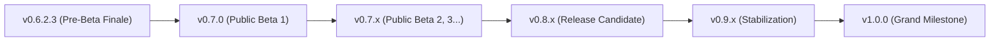

# WayPlank V0.7.0 (Public Beta 1) Detailed Technical Changelog

Release Series: **V0.7.x Series (The Public Beta Milestone)**  
Current Milestone: **V0.7.0 (Public Beta 1: Monolithic Embedded Localization Engine, Complete V0.6.2.3 Feature & HAL Consolidation, GNOME Bridge v4 & 379-Point Multi-Compositor FAT Protocol)**  
Target Release Date: **Week 45 (Wednesday, November 4, 2026)**  
Maintainer: **Sergio Melas** (sergiomelas@gmail.com, GitHub: [@sergiomelas](https://github.com/sergiomelas))  
Collaborators & Contributors:
- **史有虎 (IFtiger-hu)** (Collaborator & Simplified Chinese Reviewer, GitHub: [@IFtiger-hu-hub](https://github.com/IFtiger-hu-hub))
- **Renate Schwiedernoch** (German `de` Localization Contributor)
- **Michailo Buchko** (Ukrainian `uk` Localization Contributor)

---

## 1. 📋 Overview & Motivation

Following the formal closure of the **Alpha & Pre-Beta development cycle (`v0.1.0` $\longrightarrow$ `v0.6.2.3`)** with **100% Factory Acceptance Testing qualification (`368/368` applicable test points passed, `107` lifetime bugs squashed, `145` multi-compositor verifications, `0` open defects)** across **KDE Plasma 6 (KWin)**, **GNOME Shell (Mutter)**, and **Labwc (wlroots)**, WayPlank officially enters its **Public Beta 1 (`v0.7.0`)**.

**WayPlank `v0.7.0`** consolidates the entire architectural and functional foundation built through **`v0.6.2.3`** and activates four Public Beta milestones:
1. **100% Monolithic Embedded Localization Engine (`GResource` in RAM)**: Compiles all **7 complete language catalogs (`487 / 487` strings — 100%)** directly into the single ELF executable (`/usr/bin/wayplank`) via `data/plank.gresource.xml` with an in-memory GNU `.mo` resolver (`wayplank_i18n_init()` / `wayplank_i18n_get()` in `lib/gtk-compat.c`), achieving **Zero Host Pollution** (`0` files in `/usr/share/locale/`).
2. **GNOME Shell Companion Extension Version `4` (`wayplank-bridge@wayplank.org`)**: Increments `metadata.json` `version` from `3` (pre-beta `v0.6.2.x` series) to **`4`** for the Public Beta milestone.
3. **379-Point Public Beta 1 FAT Protocol, Hotfix & Deep Audit (`FAT/2026-11-05 FAT 0.7.0.txt`)**: Evaluates **379 test points** across GNOME Shell, KDE Plasma 6, and Labwc (`344/377` applicable passed — **91.2% PASS**: `324 [ok]` baseline + `20 [ko->ok]` squashed, `2 [NA]`, `33 [ko]` instances across 7 non-critical post-release audit issues [#19](https://github.com/sergiomelas/WayPlank/issues/19)–[#25](https://github.com/sergiomelas/WayPlank/issues/25) queued for `v0.7.1`).
4. **Full Binary & Distribution Packaging Parity (`0.7.0`)**: Synchronized standalone binary (`build/wayplank`), Debian/Ubuntu package (`build/wayplank_0.7.0_amd64.deb` with `Posix.Signal.WINCH` live re-exec on upgrade), and openSUSE/Fedora/RHEL package (`build/wayplank-0.7.0-1.x86_64.rpm`).

---

## 2. 🌍 100% Monolithic Embedded Localization Engine (New in V0.7.0)

### 2.1. Architectural Design & Zero Host Pollution Philosophy
Unlike traditional Unix applications that scatter locale catalogs across `/usr/share/locale/<lang>/LC_MESSAGES/wayplank.mo`, WayPlank adheres strictly to its **Monolithic Standalone Executable Guarantee**:
- **Zero Runtime Filesystem Dependency**: All `.mo` binary catalogs are compiled at build time (`msgfmt -c`) and embedded directly inside `build/wayplank` as `GResource` byte streams (`/net/launchpad/plank/locale/<lang>/wayplank.mo`).
- **In-Memory $O(\log N)$ Binary-Search Resolution (`lib/gtk-compat.c`)**:
  - `wayplank_i18n_init()` detects the active system locale via `LANGUAGE`, `LC_ALL`, `LC_MESSAGES`, `LANG`, and `setlocale(LC_MESSAGES, "")`, matches it against `WAYPLANK_EMBEDDED_LANGS`, looks up the embedded `.mo` resource in RAM (`g_resources_lookup_data`), and validates its binary header (`0x950412de`) and string offset tables with zero heap duplication.
  - `wayplank_i18n_get(const char *msgid)` performs a zero-allocation binary search directly over the sorted `.mo` byte table in RAM (paired with `wayplank_i18n_translate_widget()` for GtkBuilder UI trees) and falls back instantaneously to the original English `msgid` pointer when running under `en`, `C`, or `POSIX` locales without disk I/O.
- **Vala & C Translation Interception (`include/config.h`)**:
  ```c
  const char* wayplank_i18n_get (const char* msgid);
  #undef _
  #define _(String) wayplank_i18n_get(String)
  ```
- **Zero Host Pollution in `.deb` & `.rpm`**: Neither `BuildDeb.sh` nor `BuildRpm.sh` installs any files under `/usr/share/locale/`. Moving `/usr/bin/wayplank` alone to any compatible Linux machine preserves all 7 languages, 16 docklets, and UI layouts out of the box.

### 2.2. Supported Language Catalogs (`487 / 487` Strings Qualified — 100%)
All **487 UI `msgid`s** covering the Preferences dialog (Appearance, Behaviour, Apps & Layout, Docklets), dock context menus, tooltips, Weather forecast dialogs, Session confirmation dialogs, and CLI help are 100% translated and verified with `msgfmt -c -v`:
1. **简体中文 (Simplified Chinese, `zh_CN`)** — Contributor & Reviewer: **史有虎 (IFtiger-hu)** (`487/487`, 100%)
2. **Italiano (Italian, `it`)** — Author & Maintainer: **Sergio Melas** (`487/487`, 100%)
3. **Español (Spanish, `es`)** — Maintainer: **Sergio Melas** (`487/487`, 100%)
4. **Français (French, `fr`)** — Maintainer: **Sergio Melas** (`487/487`, 100%)
5. **Català (Catalan, `ca`)** — Maintainer: **Sergio Melas** (`487/487`, 100%)
6. **Deutsch (German, `de`)** — Contributor: **Renate Schwiedernoch** (`487/487`, 100%)
7. **Українська (Ukrainian, `uk`)** — Contributor: **Michailo Buchko** (`487/487`, 100%)
8. **English (`en` / `C` / `POSIX`)** — Native in-source fallback language (zero overhead).

### 2.3. Community Translation Generator (`po/generate_translations.py`)
- Self-contained Python utility maintaining the master dictionary of all 487 UI strings across all 7 languages and automatically compiling/validating `.po` and `.mo` catalogs via GNU `msgfmt`.

---

## 3. 🏛️ Consolidated Architecture & Features (Inherited from V0.6.2.1 – V0.6.2.3)

WayPlank `v0.7.0` includes the complete set of features, docklets, and HAL engineering developed and qualified across the `v0.6.2` series:

### 3.1. Native RPM & DEB Multi-Distribution Packaging (`BuildDeb.sh`, `BuildRpm.sh`)
- **Debian / Ubuntu / Linux Mint (`BuildDeb.sh`)**: Automated native compilation, `GResource` embedding, GSettings schema compilation, and `.deb` packaging (`build/wayplank_0.7.0_amd64.deb`).
- **openSUSE / Fedora / RHEL (`BuildRpm.sh`)**: Standalone RPM packaging authored by **史有虎 (IFtiger-hu)** and refined for upstream, supporting openSUSE (Tumbleweed, Leap), Fedora (40+), and RHEL/CentOS with isolated `_dbpath` builds (`build/wayplank-0.7.0-1.x86_64.rpm`).

### 3.2. Launcher Deduplication, Ghost Window Shielding & Application Identity Engine
- **Canonical Launcher Deduplication (`ItemFactory.vala`, `DockItemProvider.vala`)**: Resolves symlinks (`Posix.realpath`), percent-encoding (`GLib.File.equal`), and desktop IDs via `DockItemProvider.uri_matches()`, reusing existing `.dockitem` files and pruning duplicate definitions on load.
- **Ghost Window & Screen-Sharing Bridge Filtering (`ApplicationDiscovery.vala`)**: Filters auxiliary 1×1 surfaces such as `xwaylandvideobridge` and internal `wayplank` surfaces.
- **Recursive Command Unwrapping & Wrapper Engine (`ApplicationIdentity.vala`)**:
  - Unwraps `sh -c`, `bash -c`, `env VAR=val`, `firejail`, `flatpak-spawn`, `flatpak run`, `pkexec`, `sudo`, and `systemd-inhibit` to identify target binaries.
  - Dynamically indexes custom category drawer folders (`~/.config/wayplank/dock*/launchers/`).
  - Inspects user `.sh` launcher scripts (<4 KB, shell shebang enforced) for profile flags (`--profile-directory=...`, `--class=...`) with score **110** prioritization and strict `0` score isolation on non-matching generic windows.
- **Chromium PWA Isolation & Word-Boundary Token Matching (Issue #6 / FAT Point 2.14)**:
  - Exact primary matching on `DesktopFileName`, `ApplicationId`, and `StartupWMClass` (`crx_<id>`) plus Unicode word-boundary matching (`contains_word`), preventing false-positive hijacking and ensuring standalone PWAs instantiate distinct dock items.
- **Pure FreeDesktop Exec-Less Template Guard, Labwc `/proc` Resolver & Synthetic Launcher GC (Issue #14 / FAT Point 2.15)**:
  - Restricted `synthesize_fallback_desktop_file()` in `v0.6.2.3` to windows matching an installed Exec-less desktop template (`matched_exec_less_desktop` — subsequently generalized in Section 4.2 of the `v0.7.0` hotfix into zero-hardcoding `WindowInfo.IsDialog` + XDG `NoDisplay=true` `Exec=` dialog masking), preventing transient CLI utilities (`zenity`, `kdialog`) from spawning dock icons.
  - Implements `resolve_toplevel_process()` in `LabwcBackend.vala` ($O(1)$-cached `/proc` PID and command-line resolution) and self-healing `wayplank-app-*.desktop` launchers so multiple distinct CLI QEMU VMs pin, isolate, and cold-relaunch 100% across KWin, Mutter, and Labwc.
  - Automatically purges unpinned `wayplank-app-*.desktop` files via `gc_synthetic_launchers()` when their windows close.

### 3.3. Dock Overflow Smooth Scrolling & Tachometer Capacity Indicator
- **Boundary Clamping & Interpolated Wheel Scrolling (`PositionManager.vala`, `DockRenderer.vala`, `DockWindow.vala`)**: Clamps dock geometry to monitor width/height and interpolates mouse wheel scrolling (`scroll_offset += (target_scroll_offset - scroll_offset) * 0.35`) when pinned/running items exceed available screen span.
- **Tachometer Redline Slider (`PreferencesWindow.vala`)**: Real-time capacity feedback on the Icon Size slider using a custom red SVG teardrop marker (`slider-marks-below-red.svg`) when `scroll-on-overflow` is disabled and icons exceed monitor bounds.

### 3.4. Drag-and-Drop (DND) Remote Web URLs, MIME Validation & Hover Window Raising
- **Remote Web URL Delivery (`DragManager.vala`, `System.vala`)**: Supports `text/uri-list`, `text/x-moz-url`, `UTF8_STRING`, `text/plain`, `text/html`, and UTF-16LE clipboard decoding; dropping URLs on the dock background opens the default browser, while dropping onto a browser icon opens a new tab. Parses `.desktop` (`Type=Link`) and `.url` internet shortcuts.
- **Hover Window Activation During Drag (`DragManager.vala`)**: Pausing cursor hover over a running dock icon for >500 ms during an active drag raises the target window via `WindowManager.activate()`.
- **Strict FreeDesktop MIME Drop Validation (`ApplicationDockItem.vala`)**: Enforces `Gio.ContentType` compatibility against `.desktop` `MimeType=` declarations so incompatible drops bounce cleanly.
- **Instant Drag-Off Removal & Poof Animation**: Dragging an unrunning pinned icon off the dock deletes its `.dockitem` immediately and triggers the Cairo `PoofWindow` animation.

### 3.5. Universal Multi-Window Preview Cards (`WindowCard.vala`, `WindowCardsWindow.vala`)
- **Cairo Elevated Card Popup**: Clicking a multi-window application icon opens `WindowCardsWindow` anchored over the dock item (while hovering shows the text tooltip). Configurable via **Preferences $\rightarrow$ Behaviour $\rightarrow$ Window Preview Cards**.
- **Live Compositor Thumbnails & Graceful Fallback**:
  - **KDE Plasma 6 (KWin)**: Live window pipe capture via `org.kde.KWin.ScreenShot2` (`KWinThumbnailService.vala`) with forced full opacity (`buffer[i + 3] = 255`) and `X-KDE-DBUS-Restricted-Interfaces` autostart whitelist.
  - **GNOME Shell (Mutter)**: Live window capture via the companion extension D-Bus bridge (`CaptureWindowPreview`).
  - **Labwc (wlroots)**: High-contrast vector application icon card fallback with full window titles and close/focus actions.

### 3.6. True Dynamic System Theme Switching, Interactive Theme Manager & 6 Stock Themes
- **Multi-Protocol Dark/Light Detection (`SystemTheme.vala`, `DrawingService.vala`)**: Listens simultaneously to FreeDesktop Portal (`org.freedesktop.portal.Settings` `color-scheme`), GNOME `org.gnome.desktop.interface`, and KDE `~/.config/kdeglobals` inotify events, automatically swapping counterpart themes (*Arian Theme Light* $\leftrightarrow$ *Dark*, *IFtiger Theme Light* $\leftrightarrow$ *Dark*) or refreshing the adaptive `Default` theme in real time.
- **Interactive Theme Manager (`ThemeManager.vala`, `PreferencesWindow.vala`)**: Native `Gtk.FileChooserNative` portal installer (`+`) and uninstaller (`Trash`) supporting `.zip`, `.tar.gz`, `.tar.xz`, `.tar.bz2`, and `.theme` archives into `~/.local/share/wayplank/themes/`.
- **6 Built-In Themes (`data/themes/`)**: `Default` (adaptive GTK+), `Arian Theme Dark`, `Arian Theme Light`, `IFtiger Theme Dark`, `IFtiger Theme Light`, and `Transparent` (`TopPadding = -11`).

### 3.7. Folder Drawers, Running Indicator Dots & Recent Files Jump List
- **Folder Running Indicator Dots (`FileDockItem.vala`, `FolderMenuWindow.vala`, `DockRenderer.vala`)**: Renders 1 or 2 illuminated running dots on pinned folder icons when apps inside the folder are running, plus per-row running indicator dots inside open folder popups with anti-clipping reverse-roundness geometry.
- **Folder Drawer UX Parity (`FolderMenuWindow.vala`)**: Full click behavior compliance (`Smart`, `Focus`, `Cycle`), `Ctrl+Left Click` / `Middle Click` new instance launch, mouse wheel window cycling, and attached row context menus with `context_menu_active` guard.
- **Recent Files Jump List (`RecentFilesService.vala`)**: Native `Gtk.RecentManager` submenu in application right-click context menus filtered by desktop ID and MIME type.

### 3.8. 16 Built-In Zero-Dependency Docklets, 7×2 Grid & 4-Mode System Menu Access
- **16 Embedded Docklets**:
  - **14 in the symmetric 7×2 Docklets Grid (`Preferences -> Docklets`)**: `Clock` (`docklet://clock`), `Digital Clock` (`docklet://digital-clock`), `Battery` (`docklet://battery`), `CPU / System Pressure` (`docklet://cpu`), `Show Desktop` (`docklet://desktop`), `MPRIS` (`docklet://mpris` — Media Player with Album Art), `Volume` (`docklet://volume`), `Screenshot` (`docklet://screenshot`), `Session` (`docklet://session` — 3×3 Session & Power control center with `Lock Screen`, `Switch User`, `Log Out`, `Suspend`, `Hibernate`, `Hybrid Sleep`, `Restart`, `UEFI / BIOS`, and `Shut Down` + automatic `systemd-logind` capability detection), `Brightness` (`docklet://brightness`), `Removable Drive Ejector` (`docklet://ejector`), `Weather` (`docklet://weather`), `Network` (`docklet://network` — Wi-Fi/Ethernet monitor), and `Do Not Disturb` (`docklet://dnd`).
  - **2 Edge-Anchored System Docklets (`Preferences -> Apps & Layout`)**: `Trash` (`docklet://trash`, controlled via `Show Trash`) and `Preferences` (`docklet://preferences`, controlled via `System Menu Access` Mode 4 or `WayPlank Always Left`).
- **4-Position System Menu Access & Category Layout Engine (`Preferences -> Apps & Layout`)**:
  - Consolidated **Categories & Layout** into the third Preferences tab (**Apps & Layout**), streamlining the **Behaviour** and **Appearance** tabs.
  - Added **`Docklets on Right` (`docklets-on-right`)**: Allows moving the Docklets group to the right side immediately before Trash (System Tray style, after unpinned running apps) while keeping Pinned and Unpinned Apps strictly adjacent so drag-to-pin/unpin across their divider remains 100% intact.
  - Paired **`WayPlank Always Left` (`anchor-always-left`)** and **`Show Trash` (`show-trash`)** side-by-side as symmetric far-left and far-right dock anchors: `WayPlank Always Left` permanently anchors the dedicated WayPlank icon at index `0` (far left) with its own vertical separator (`[WayPlank] | [Folders] | ...`), even when folders are present or when Docklets are placed on the right.
  - **System Menu Access**: `Docklets Only`, `Docklets Only (Auto Fallback)`, `All Icons`, or `Dedicated Preferences Icon` (with `Ctrl + Right Click` always available on any icon).
- **HAL Multi-Monitor Brightness Sync (`BrightnessControl.vala`, `BrightnessDockItem.vala`)**: Decouples hardware `/sys/class/backlight` polling (500 ms heartbeat) and multi-monitor DDC/CI (`kscreen-doctor` on KWin, `ddcutil` on Mutter/Labwc) into `lib/Services/BrightnessControl.vala` with a 350 ms inbound settle debounce and SP/PV anti-echo decoupling.
- **Volume Overamplification Guard (`VolumeDockItem.vala`)**: Enforces a strict 150% hardware cap (`wpctl set-volume -l 1.5` / `pactl`).

### 3.9. HAL Window Management, Panel Mode, Fullscreen Inhibit & Input Mask Hysteresis
- **Zero Async Timers & Peer Dialog Stacking (`AbstractMain.vala`, `SessionWindow.vala`, `WeatherWindow.vala`)**: Eliminated asynchronous presentation timers (`GLib.Timeout.add`) to prevent Mutter `meta_window_unmanage` `SIGABRT` crashes; removed artificial `transient_for` on independent dialogs for natural bidirectional stacking and native Mutter CSD HeaderBars.
- **Cross-Compositor Show Desktop & Workspace Visibility (Issues #11 & #13 / FAT Points 4.1 & 6.1)**:
  - Synchronizes `showingDesktopChanged` on KWin, `showing-desktop-changed` + `workspace-changed` + `hide_from_window_list()` on GNOME Mutter, and `t->active` filtering in `wlr-toplevel-bridge.c` on Labwc.
- **Cold-Start HiDPI Fractional Scaling Sync (Issue #5 / FAT Point 7.7)**: Listens to `notify["scale-factor"]` in `PositionManager.vala` to reset Cairo buffers and recompute layout when fractional scaling settles on cold start.
- **HoverWindow Popup Standardization & Exact Mutter Classification (FAT Points 5.1 & 0.4)**: Uses `set_role("popup-menu")` and `Gdk.WindowTypeHint.POPUP_MENU` across all floating dock popups (`HoverWindow`, `FolderMenuWindow`, `WindowCardsWindow`) and enforces strict `===` title matching in `MutterBackend.vala` (`_classifyWindow`).
- **Two-Stage Hysteresis Input Mask & Transparent Passthrough (Issue #12 / FAT Point 5.4)**:
  - Configurable **Anticipate Icon Zoom** (`anticipate-zoom`, default `true`) in **Preferences $\rightarrow$ Behaviour**. When disabled, the layer-shell input region strictly hugs the 60 px visual dock pill at rest so 100% of clicks above the dock pass through to underlying windows, dynamically expanding upward by `hover_region` only while an icon is actively hovered.
- **Reserve Screen Space / Panel Mode (Issue #9 / FAT Point 3.10)**:
  - Configurable **Reserve Screen Space** (`reserve-space`) in **Preferences $\rightarrow$ Behaviour** (mutually exclusive with Auto-Hide and Icon Zoom). Uses `GtkLayerShell.set_exclusive_zone` on KWin/Labwc and physical-monitor-anchored (`monGeo`) chrome struts (`affectsStruts: true`) with dynamic content-hashed ES module reloading (`impl-<hash>.js`, `version: 4`) and unconstrained `user_op = true` positioning on GNOME Shell.
- **Fullscreen Window Inhibit & 0px Edge Click Passthrough (Issue #10 / FAT Point 3.9)**:
  - Detects direct unmaximized-to-fullscreen transitions (`Fullscreen` state and `fullscreen_window_intersects()`) across KWin, Mutter, and Labwc, hides the dock across all `HideMode`s (including `HideType.NONE`) via `FullscreenInhibit`, and sets `get_cursor_region()` to `{ 0, 0, 0, 0 }` so 100% of `0px` screen-edge clicks pass through to fullscreen apps (Remmina, MPV, browsers, games).

---

## 4. 🚑 V0.7.0 Post-Launch Hotfix & Bug Wall Consolidation (`[ko->ok]`)

1. **Folder Drawer Web-App Isolation, `.sh` Wrapper Scoring, Sibling `WMClass` Parity & Folder DnD (FAT Point `1.11` `[ko->ok]`)**:
   - **URI-Keyed Identity Cache & Reverse Canonical Guard (`ApplicationDiscovery.vala`)**: Keyed launcher identities by full `File.get_uri()` (`uri_identities`), added recursive drawer subdirectory indexing (`ensure_folder_monitors()`), indexed `NoDisplay=true` web-app `.desktop` entries (`chrome-*-Profile_*.desktop`), added `pinned_launcher_uris` & `drawer_file_uris` priority ranking, and enforced `has_specialized_override` (`>= 115`) so normal browser windows never light up `--app=URL` folder shortcuts.
   - **`.sh` / `#!` Wrapper, Multi-PWA & Sibling Binary Parity (`ApplicationIdentity.vala`)**: Added shell control-flow filtering and `exec`/`snap`/`gtk-launch` unwrapping inside `.sh` wrappers, raised specialized `args_matched` score to **`116`** (`>= 115`), supported multi-profile (`" - Google Chrome - "`) and Incognito (`" - Google Chrome ("`) browser tab titles, guarded plain wrappers (`chrome-private.sh`) against `crx_*` PWAs via `has_explicit_webapp_window_id`, implemented bidirectional PWA ↔ `--app=URL` co-matching (`matches_web_app_identity`) with `crx_*` → `--app=URL` fallthrough, and added `shares_application_with` + `inherit_sibling_wm_classes` so pinned and folder sibling launchers (`com.microsoft.VSCode.desktop` ↔ `code.desktop`, `MATLAB`, `Scilab`) illuminate simultaneously.
   - **Folder & Open-Popup Drag-and-Drop (`DragManager.vala`, `FileDockItem.vala`, `FolderMenuWindow.vala`)**: Tracked exact icon hit testing (`drop_was_directly_on_item`) and `is_directory_uri` pinning into `[Folders]` (preserving `11.6` direct app drops), added `FolderMenuWindow.setup_drag_dest()` so folders, `.desktop` launchers, and files dropped directly onto an open folder popup copy into `current_dir`, and wired `ApplicationDiscovery.refresh_index_now()` → `WindowManager.refresh_windows()` for instant live updates.
2. **CLI-Launched GUI Apps, AppImages & Zero-Hardcoding Dialog Masking (Issues `#14`, `#16` / FAT Point `2.15` `[ko->ok]`)**:
   - Expanded `Paths.DataDirFolders` with Snap (`/var/lib/snapd/desktop`) and Flatpak (`exports/share`) paths, resolved CLI AppImage FUSE paths via `/proc/<pid>/environ` (`APPIMAGE=`), stabilized synthetic launcher binding across dynamic title changes (`has_startup_wm_class`), prioritized main non-`--type=`/non-`crashpad` PIDs (`+25` score) in `LabwcBackend.resolve_toplevel_process()`, filtered untracked `"window:*"` fallback IDs in `MutterBackend`, and replaced `matched_exec_less_desktop` with zero-hardcoding dialog masking (`WindowInfo.IsDialog` + XDG `NoDisplay=true` entries carrying `Exec=`).
3. **Clickable SR Flip-Flop for `Reserve Screen Space`, `Hide Dock` & `Icon Zoom` (Issue `#17` / FAT Point `3.10` `[ko->ok]`)**:
   - Replaced sensitivity grey-out locking on `Reserve Screen Space` with a deterministic edge-triggered SR Flip-Flop in `DockPreferences.vala` (`S = ↑ReserveSpace` disables `Hide Dock` and `Icon Zoom`; `R = ↑HideDock ∨ ↑IconZoom` disables `ReserveSpace`), keeping all three toggles clickable in GUI Preferences and responsive to CLI `gsettings set`, backed by 3-way idempotence caching in `DockWindow.update_exclusive_zone()`.
4. **Screen Lock / Unlock, Idle, DPMS Sleep/Wake Self-Healing & Seamless `SIGWINCH` Upgrade Reload (Issue `#18` / FAT Point `9.9/9.10` `[ko->ok]`)**:
   - Cached `_lastDockGeo` in `MutterBackend` JS `PositionDock()` to break the `unlock-dialog` `DockWindow.hide()` Catch-22 deadlock, connected `Main.layoutManager` `monitors-changed` + `WindowControl.bridge_reconnected` + `org.gnome.ScreenSaver` + `org.freedesktop.login1.Session.Unlock` to `schedule_dock_refresh()`, added `dock_unmapped` recovery in `PositionManager.screen_changed()`, and added `Posix.Signal.WINCH` live re-exec in `AbstractMain.vala` triggered automatically by `DEBIAN/postinst` (`BuildDeb.sh`) upon `sudo dpkg -i` upgrades.
5. **HAL `SurfaceCoordinateService` & VSync 3-Beat Unpin Pipeline (FAT Point `11.8` `[ko->ok]`)**:
   - Extracted compositor-isolated overlay positioning into `lib/Services/SurfaceCoordinateService.vala`, implemented VSync 3-Beat drag-off and `_Keep in Dock` unpin destruction routing, and eliminated running-app transient ghosting.
6. **Permanent `Icons Visual Effects` Suite (26 Styles) & `300–1500 ms` `Effect Duration` (FAT Point `13.8` — `PoofWindow` `1500 ms` clamp polish tracked in Issue `#24`)**:
   - Graduated the 3-chooser `Icons Visual Effects` bar—`Launch Effect` (`Bounce` default, `Elastic`, `Pulse`, `Spring`, `Ripple`, `Flip`, `Swing`, `Flash`, `None`), `Focused App` (`Classic Box` default, `Icon Glow`, `Spotlight`, `Rounded Card`, `Accent Bar`, `Rim Halo`, `Floor Reflection`, `None`), and `Unpin Effect` (`Poof Cloud` default, `Shrink & Fade`, `Implode Spin`, `Shatter Burst`, `Vaporize`, `3D Tumble`, `Shockwave`, `Pixel Dissolve`, `None`)—and auto-hiding `300–1500 ms` `Effect Duration` slider permanently into **Preferences $\rightarrow$ Behaviour** alongside a compact `2×3` `Item Management` switch grid.
7. **60 FPS Hover Smoothness, HAL Popup Event Filtering & Multi-Size `SurfaceCache` (FAT Points `0.1/0.3` `[ko->ok]`)**:
   - Filtered internal WayPlank popups (`HoverWindow`, `FolderMenuWindow`, `WindowCardsWindow`, `PoofWindow`) out of KWin (`isWayplankOrIgnoredClient`), Mutter (`_classifyWindow === 'other'`), and Labwc (`is_wayplank_toplevel`) window-list callbacks, added JSON state deduplication and `__wayplank_primary_panel__` geometry guards, upgraded `DockItem.foreground_buffer` to `SurfaceCache<DockItem>`, cached master folder tile pixbufs in `FileDockItem`, and added a `50 ms` VSync motion hold in `DockRenderer` (`<= 5%` active CPU, `0.1%` idle CPU).
8. **Labwc / `wlroots-0.20` Monitor Label Normalization (`PositionManager.vala`)**:
   - Normalizes legacy `wl_output` `"Unknown"` model placeholders emitted by `wlroots-0.20` / Labwc on the fly to `"Monitor"` (`Monitor [WxH @ X,Y]` on single screen and `Monitor (1)`, `Monitor (2)`, `Monitor (3)` on multi-monitor) without touching compositor HAL backends or altering real EDID labels on KWin and GNOME Mutter.

---

## 5. 🧪 Public Beta 1 Factory Acceptance Testing & Post-Release Audit (`FAT/2026-11-05 FAT 0.7.0.txt`)

- **379 Total Qualification Test Points Defined (`344/377` Applicable Passed — **91.2% PASS**, `33` Open `[ko]` Instances Queued for `v0.7.1`)**:
  - **Session 1 (GNOME Shell / Mutter)**: `128` tests | `111 [ok]` | `6 [ko->ok]` | `0 [NA]` | `11 [ko]` (`91.4% PASS`)
  - **Session 2 (KDE Plasma 6 / KWin)**: `126` tests | `108 [ok]` | `7 [ko->ok]` | `0 [NA]` | `11 [ko]` (`91.3% PASS`)
  - **Session 3 (Labwc / wlroots)**: `125` tests | `105 [ok]` | `7 [ko->ok]` | `2 [NA]` | `11 [ko]` (`91.1% PASS`)
  - **Scoreboard**: `324 [ok]` Consolidated Baseline, `20 [ko->ok]` Squashed, `2 [NA]` Protocol Limitations (`2.7`, `10.6`), `33 [ko]` Open Instances across GitHub Issues [#19](https://github.com/sergiomelas/WayPlank/issues/19)–[#25](https://github.com/sergiomelas/WayPlank/issues/25) targeted for `v0.7.1`.

---

## 6. 🗺️ Master Release Trajectory



- **v0.7.x (Active Public Beta Series — `v0.7.1` Consolidation Next, `v0.7.2+` `hal/` & Windows | Community-Driven Window up to Dec 31, 2026)**: Monolithic localization engine, `v0.7.1` post-audit bug consolidation (`#19`–`#25`) & Smart Usage-Adaptive Accordion (`#26`), community-driven feature additions, new language catalogs, UX refinements, broadened field testing across KWin, Mutter, Labwc, Sway, and Hyprland, and dedicated **`v0.7.2+`** physical `hal/` extraction ([HAL_ARCHITECTURE.md](../Documentation/HAL_ARCHITECTURE.md)) & preliminary native Windows preview ([WinPlank](../Documentation/WINPLANK_PORT_BATTLE_PLAN.md))—remaining open until the community says we are ready for the `v0.8.x` freeze (upper deadline: **December 31, 2026**).
- **v0.8.x (Release Candidate Series)**: Following the completion of the `v0.7.x` Public Beta cycle, strict feature freeze, memory leak profiling (Valgrind), and packaging stabilization.
- **v0.9.x (Long-Term Production Stabilization)**: The official battle-tested production milestone for daily driving across all Linux distributions and Windows 10/11+.
- **v1.0.0 (Grand Milestone Horizon — ~2 Years)**: Definitive landmark release celebrating multi-year proven stability and mature Wayland protocol standards.
