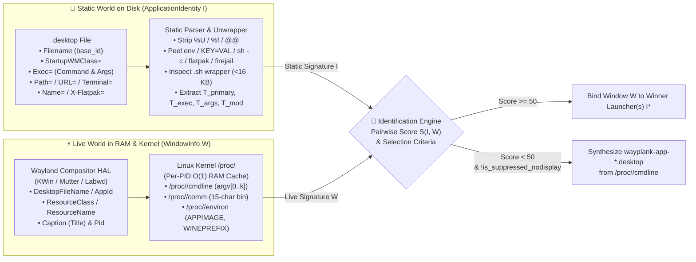
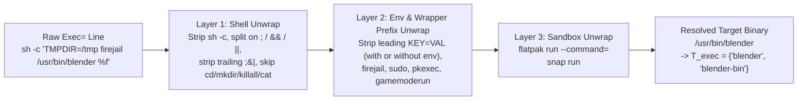

# 🏛️ WAYPLANK APPLICATION IDENTIFICATION & DISCOVERY ENGINE SPECIFICATION

> **Formal Software Architecture Specification for Window-to-Launcher Resolution, Process Introspection, Scoring & Selection Criteria**  
> **Author & Maintainer:** Sergio Melas (<sergiomelas@gmail.com>) © 2026  
> **Target Modules (`Tier 2 — 100% Portable Core HAL-Consumer`):** [`lib/Services/ApplicationIdentity.vala`](../lib/Services/ApplicationIdentity.vala), [`lib/Services/ApplicationDiscovery.vala`](../lib/Services/ApplicationDiscovery.vala), [`lib/Services/WindowManager.vala`](../lib/Services/WindowManager.vala)  
> **Companion Architecture Specifications:** [Documentation/HAL_ARCHITECTURE.md](HAL_ARCHITECTURE.md) • [Documentation/DBUS_ARCHITECTURE.md](DBUS_ARCHITECTURE.md)  
> **Compliance & Verification Baseline:** [CONTRIBUTING.md](../CONTRIBUTING.md) • [FAT/WAYPLANK_LIFETIME_BUG_REGISTER.md](../FAT/WAYPLANK_LIFETIME_BUG_REGISTER.md) • [Changelogs/CHANGELOG_v0.1.0.md](../Changelogs/CHANGELOG_v0.1.0.md) $\longrightarrow$ [Changelogs/CHANGELOG_v0.7.1.md](../Changelogs/CHANGELOG_v0.7.1.md) • Verified via 10-Iteration Top-Down / Bottom-Up / Tera Logical Simulator ($65,025$ pairwise cross-product evaluations, $0$ failures)

---

## 📌 Table of Contents

- [1. Architectural Concept & Model (The Idea)](#1-architectural-concept--model-the-idea)
  - [1.1 System Purpose & Scope](#11-system-purpose--scope)
  - [1.2 The Dual-Entity Model: Static Identity ($I$) vs. Live Window Descriptor ($W$)](#12-the-dual-entity-model-static-identity-i-vs-live-window-descriptor-w)
  - [1.3 3-Compositor Telemetry Contract & End-to-End Pipeline](#13-3-compositor-telemetry-contract--end-to-end-pipeline)
- [2. The Standard Identification Engine (Normal `.desktop` ↔ `Exec` & Process Matching)](#2-the-standard-identification-engine-normal-desktop--exec--process-matching)
  - [2.1 `.desktop` Discovery, Search Hierarchy & Visibility Dispositions](#21-desktop-discovery-search-hierarchy--visibility-dispositions)
  - [2.2 `Exec=` Command Grammar, Wrapper Unwrapping & Binary Tokenization](#22-exec-command-grammar-wrapper-unwrapping--binary-tokenization)
  - [2.3 Live Process Introspection (`/proc/<pid>` ↔ `WindowInfo`)](#23-live-process-introspection-procpid--windowinfo)
  - [2.4 The 5-Stage Standard Matching Algorithm (`Exec` ↔ Process & Window)](#24-the-5-stage-standard-matching-algorithm-exec--process--window)
  - [2.5 Multi-Launcher Equivalence & Sibling Co-Illumination (`shares_application_with`)](#25-multi-launcher-equivalence--sibling-co-illumination-shares_application_with)
  - [2.6 Unmatched Process Fallback Synthesis (`wayplank-app-*.desktop`) & Garbage Collection](#26-unmatched-process-fallback-synthesis-wayplank-app-desktop--garbage-collection)
- [3. The Specialized & Multiplexed Runtime Engine (Advanced Isolation, Scoring & Selection)](#3-the-specialized--multiplexed-runtime-engine-advanced-isolation-scoring--selection)
  - [3.1 Specialization Model (`is_specialized`) & The `>= 115` Canonical Override Rule](#31-specialization-model-is_specialized--the--115-canonical-override-rule)
  - [3.2 Single-Process Browser & Web-Application Isolation Specification](#32-single-process-browser--web-application-isolation-specification)
  - [3.3 Terminal-Hosted Command Execution Specification (`-e`, `--`, `-x`, `Terminal=true`)](#33-terminal-hosted-command-execution-specification--e-----x-terminaltrue)
  - [3.4 Generic Runtime & Container Specification (Interpreters, VMs, Wine/Win32)](#34-generic-runtime--container-specification-interpreters-vms-winewin32)
  - [3.5 Master Scoring Function $S(I, W)$, Effective Score $S_{\text{eff}}(I, W)$ & Selection Criteria](#35-master-scoring-function-si-w-effective-score-s_texteffi-w--selection-criteria)
  - [3.6 Normative Compliance & 10-Iteration Invariant Verification Matrix](#36-normative-compliance--10-iteration-invariant-verification-matrix)

---

## 1. Architectural Concept & Model (The Idea)

### 1.1 System Purpose & Scope

In a Wayland desktop environment, there is no global X11 window property tree linking a surface back to the `.desktop` launcher file that started it. When a window appears on screen, the dock must deterministically answer three questions:
1. **Window-to-Launcher Binding (`best_desktop_file_for_window`):** Which `.desktop` file owns this window so the dock can display the right icon, title, and running indicator?
2. **Dock Item Ownership & Co-Illumination (`is_best_launcher_for_window`):** For each pinned icon on the dock or inside a Folder Drawer, does this window belong to that icon?
3. **Unmatched CLI Synthesis (`synthesize_fallback_desktop_file`):** If the window was launched directly from a command-line shell without any installed `.desktop` file, how does the dock construct a temporary launcher that can also be pinned (`Keep in Dock`) and cold-relaunched?

---

### 1.2 The Dual-Entity Model: Static Identity ($I$) vs. Live Window Descriptor ($W$)

The Identification Engine models application matching as a deterministic mathematical evaluation between two normalized structures:

1. **The Static Launcher Identity ($I \in \mathcal{I}$ — `ApplicationIdentity`):**
   Extracted once when indexing a `.desktop` file on disk (and updated only when `inotify` signals a file change). It represents **what the `.desktop` file declares it will launch**:
   $$I = \langle \text{uri}, \text{base\_id}, \text{normalized\_id}, T_{\text{primary}}, T_{\text{wmclass}}, T_{\text{exec}}, T_{\text{dedicated}}, T_{\text{words}}, T_{\text{args}}, T_{\text{mod}}, \Phi_{\text{spec}} \rangle$$
   where:
   - $T_{\text{primary}}$: Structural identifiers (`.desktop` filename stem, `StartupWMClass`, `X-Flatpak` / `X-Flatpak-RenamedFrom` / `X-SnapInstanceName` IDs, `steam_app_<id>`, and dedicated binary stems).
   - $T_{\text{wmclass}}$: Explicit `StartupWMClass=` values declared in the `.desktop` file (plus synthesized component classes such as `libreoffice-writer` for `libreoffice --writer`).
   - $T_{\text{exec}}$: All executable binary names extracted from `Exec=` (including unwrapped inner binaries, `-bin` variants, and canonical vendor aliases).
   - $T_{\text{dedicated}} \subseteq T_{\text{exec}}$: Non-generic, non-browser application binaries that uniquely identify an application family.
   - $T_{\text{words}}$: Non-generic Unicode word-boundary tokens ($\ge 5$ characters) extracted from `Name=`, `Exec=`, and `StartupWMClass=`.
   - $T_{\text{args}}, T_{\text{mod}}, \Phi_{\text{spec}}$: Instance-isolating target arguments (`argument_tokens`), engine mod flags (`required_mod_tokens`, e.g. `+set game rogue`), browser profile/flag requirements (`required_browser_args`, `pwa_id`, `web_app_host`), or container prefixes (`wine_prefix`).

2. **The Live Window & Process Descriptor ($W$ — `WindowInfo`):**
   Assembled at runtime from the active Wayland compositor HAL (`KWin`, `Mutter`, or `Labwc`) combined with kernel `/proc/<pid>` introspection. It represents **what is actually running in memory**:
   $$W = \langle \text{id}, \text{desktop\_file}, \text{app\_id}, \text{res\_class}, \text{res\_name}, \text{caption}, \text{is\_dialog}, \text{pid}, \text{comm}, \text{cmdline}, \text{children}, \text{environ} \rangle$$
   where:
   - $\text{desktop\_file}, \text{app\_id}, \text{res\_class}, \text{res\_name}$: Surface identifiers reported by the Wayland compositor (`xdg_toplevel.app_id`, KWin `desktopFileName`, XWayland `WM_CLASS`).
   - $\text{comm}$: Kernel executable name read from `/proc/<pid>/comm` (up to 15 bytes, `TASK_COMM_LEN - 1`).
   - $\text{cmdline}$: Full NUL-separated argument vector $\text{argv}[0 \dots k]$ read from `/proc/<pid>/cmdline`.
   - $\text{children}$: Immediate child process command lines (`/proc/<pid>/task/<pid>/children`) inspected only for D-Bus terminal servers (`gnome-terminal-server`).
   - $\text{environ}$: Process environment variables (`APPIMAGE=`, `WINEPREFIX=`) read from `/proc/<pid>/environ`.

---

### 1.3 3-Compositor Telemetry Contract & End-to-End Pipeline

#### 3-Compositor Signal Availability & Degradation Matrix:
Per the HAL Prime Directive ([Documentation/HAL_ARCHITECTURE.md](HAL_ARCHITECTURE.md)), the engine never assumes that a field populated on KWin exists identically on Mutter or Labwc:

| `WindowInfo` Field | KDE Plasma 6 (`KWinBridge`) | GNOME Shell (`MutterBackend`) | Labwc / wlroots (`LabwcBackend`) | Engine Graceful Degradation Rule |
| :--- | :--- | :--- | :--- | :--- |
| **`DesktopFileName`** | Populated (`client.desktopFileName`) | Populated via `Shell.WindowTracker` (may be `""` on custom scripts/Wine) | `""` (not in `wlr-foreign-toplevel`) | Treated as optional; falls back seamlessly to `ApplicationId` / `ResourceClass` / `/proc/<pid>`. |
| **`ApplicationId`** | Populated (`client.resourceClass` / Wayland `app_id`) | Populated (`meta_window_get_gtk_application_id` / `wm_class`) | Populated (`zwlr_foreign_toplevel_handle_v1.app_id`) | Normalized with `.desktop` & `.exe` stripping and `_` $\leftrightarrow$ `-` canonicalization. |
| **`ResourceClass` / `ResourceName`** | Populated (`resourceClass` / `resourceName`) | Populated (`get_wm_class` / `get_wm_class_instance`) | Mirrors `app_id` | Checked alongside `ApplicationId` in $W_{\text{ids}}$. |
| **`Pid`, `Executable`, `Cmdline`** | Direct compositor `pid` $\rightarrow$ `/proc/<pid>` | Direct compositor `get_pid()` $\rightarrow$ `/proc/<pid>` | Heuristic `/proc` scan (`resolve_toplevel_process`); `0` if unmatched | If `Pid == 0` or `Cmdline == ""`, relies on compositor surface IDs ($W_{\text{ids}}$) and `Caption`. |

#### The Four Sequential Pipeline Phases:
1. **Phase 0 (Surface Gatekeeping):** Rejects internal dock surfaces (`is_ignored_app`: `wayplank`, `plank`, `xwaylandvideobridge`) and modal dialogs (`W.IsDialog`).
   - *Note:* `suppressed_nodisplay_tokens` is **never** evaluated in Phase 0, because system packages (such as Debian's `com.google.Chrome.desktop` or `org.kde.gwenview_importer.desktop`) often ship `NoDisplay=true` alias files carrying `StartupWMClass=google-chrome` or `StartupWMClass=gwenview` alongside the visible `google-chrome.desktop` / `org.kde.gwenview.desktop`.
2. **Phase 1 (Pairwise Scoring $S(I, W)$):** Computes the intrinsic match score $S(I, W) \in [0, 124]$ between $W$ and candidate identities $I \in \mathcal{I}$, then applies cross-candidate normalization to obtain the effective score $S_{\text{eff}}(I, W)$.
3. **Phase 2 (Selection & Co-Illumination):** Selects the winning launcher $I^*$ (via Canonical Fast-Path when no candidate achieves $\ge 115$, or via full maximization with priority tie-breaking) and illuminates running dots on all pinned/drawer launchers $I$ satisfying `is_best_launcher_for_window(I, W)`.
4. **Phase 3 (Fallback Synthesis Gate & GC):** If $\max_{I \in \mathcal{I}_{\text{exec}}} S_{\text{eff}}(I, W) < 50$ **and** $\neg\text{is\_suppressed\_nodisplay\_window}(W)$, synthesizes a fallback `.desktop` file from $W$'s `/proc/<pid>/cmdline` and garbage-collects unpinned synthetic files when their windows close.

---

## 2. The Standard Identification Engine (Normal `.desktop` ↔ `Exec` & Process Matching)

### 2.1 `.desktop` Discovery, Search Hierarchy & Visibility Dispositions

`ApplicationDiscovery` indexes `.desktop` files across the following ordered directory hierarchy (`application_folders()`), where earlier directories take precedence on duplicate desktop IDs:
1. **Directly Pinned Dock Launchers:** Every `.desktop` file explicitly referenced by `~/.config/wayplank/dock*/launchers/*.dockitem` (indexed first so pinned launchers always win tie-breaks).
2. `~/.local/share/applications` (User overrides, Chrome PWAs, and synthesized launchers)
3. `~/.local/share/flatpak/exports/share/applications` and `/var/lib/flatpak/exports/share/applications` (Flatpak exports)
4. `/usr/local/share/applications` and `/usr/share/applications` (System XDG directories)
5. `/var/lib/snapd/desktop/applications` (Snap exports)
6. **Pinned Folder Drawer Directories:** Every directory pointed to by a `FileDockItem` drawer in `~/.config/wayplank/dock*/launchers/*.dockitem` (and its 1st-level non-hidden subdirectories).

#### Indexing & `NoDisplay` Partitioning Dispositions:
Each discovered `.desktop` file is classified into one of four dispositions:
- **Disposition A (Standard Visible Application):** `Hidden != true`, `NoDisplay != true`, and has a non-empty `Exec=` (or `Type=Link` with `URL=`). Indexed with `has_exec = true`, `is_nodisplay = false`.
- **Disposition B (Indexed `NoDisplay=true` WebApp):** `NoDisplay=true` with `--app-id=`, `--app=`, or `StartupWMClass` starting with `crx_`/`chrome-`/`brave-`/`msedge-`. Indexed with `has_exec = true`, `is_nodisplay = true`.
- **Disposition C (Indexed Exec-Less Template):** `NoDisplay=true` and **no `Exec=` key** (e.g. `/usr/share/applications/qemu.desktop`). Indexed with `has_exec = false` so CLI processes matching its ID inherit its icon while triggering Phase 3 fallback synthesis.
- **Disposition D (Suppressed Helper Utility):** `NoDisplay=true` **with** an `Exec=` key (e.g. `org.gnome.Zenity.desktop`, `org.kde.kdialog.desktop`). Excluded from `identities`, and inserts into `suppressed_nodisplay_tokens`:
  1. `norm_base = normalize(basename)` and `normalize(StartupWMClass)`;
  2. The `Exec=` binary name `bin_name`, **strictly guarded by**:
     $$\text{norm\_base} == \text{bin\_name} \;\lor\; \text{norm\_base}.\text{has\_suffix}(\text{"."} + \text{bin\_name})$$
     *(This guard prevents `NoDisplay=true` sub-helpers such as `libreoffice-xsltfilter.desktop`, `okularApplication_pdf.desktop`, `vlc-openbd.desktop`, `kcm_*.desktop`, `gnome-*-panel.desktop`, and `com.microsoft.VSCode.UrlHandler.desktop` from adding shared parent binaries `libreoffice`, `okular`, `vlc`, `systemsettings`, `gnome-control-center`, or `code` to `suppressed_nodisplay_tokens`.)*
  3. **Post-Index Pruning:** After all visible Disposition A identities are indexed, every token present in any visible identity's $T_{\text{primary}}$ is removed from `suppressed_nodisplay_tokens` (`suppressed_nodisplay_tokens -= visible_primary_tokens`).

---

### 2.2 `Exec=` Command Grammar, Wrapper Unwrapping & Binary Tokenization

#### Step 1: Lexical Tokenization, Metadata Extraction & Field Code Removal
1. Reads `Name=`, `StartupWMClass=`, `Exec=`, `Path=`, `URL=`, `Terminal=`, and sandbox keys `X-Flatpak=`, `X-Flatpak-RenamedFrom=`, `X-SnapInstanceName=`.
2. For Snap desktop files named `<snap>_<app>.desktop` where `<snap> == <app>` (e.g. `firefox_firefox.desktop`), inserts `<snap>` into $T_{\text{primary}}$.
3. Tokenizes `Exec=` using POSIX shell quoting rules (`GLib.Shell.parse_argv`), stripping FreeDesktop field codes (`%f`, `%F`, `%u`, `%U`, `%i`, `%c`, `%k`, `%d`, `%D`, `%n`, `%N`, `%v`, `%m`) and Flatpak forwarding markers (`@@`, `@@u`).

#### Step 2: Recursive Wrapper Unwrapping (`unwrap_command_string`)
The engine recursively unwraps up to 6 layers of command prefixes:

1. **Leading `KEY=VALUE` Assignment Stripping (With or Without `env`):** Any leading token containing `'='` that does not start with `'-'` (e.g. `TMPDIR=$HOME/.cache/matlab-tmp`, `BAMF_DESKTOP_FILE_HINT=...`, `WINEPREFIX=...`) is stripped at every unwrapping layer ( capturing `WINEPREFIX` into `I.wine_prefix`).
2. **Shell Wrappers (`sh`, `bash`, `zsh`, `dash` with `-c`):** Splits the inner command string on `;`, `&&`, and `||`, strips trailing shell control characters (`;`, `&`, `|`, fixing `xinput_calibrator; cat`), skips leading `KEY=VALUE` assignments and preparatory utility commands (`cd`, `mkdir`, `export`, `sleep`, `pidof`, `pgrep`, `killall`, `pkill`, `rm`, `touch`, `true`, `false`, `test`, `[`, `echo`, `exit`, `cat`), and promotes the primary execution statement.
3. **Execution & Sandbox Wrappers (`env`, `exec`, `sudo`, `pkexec`, `gksu`, `kdesu`, `nohup`, `setsid`, `nice`, `ionice`, `chrt`, `systemd-inhibit`, `firejail`, `bwrap`, `prime-run`, `gamemoderun`, `mangohud`, `optirun`, `primusrun`, `snap`, `flatpak-spawn`, `distrobox-enter`, `toolbox`, `gtk-launch`):** Strips the wrapper binary and its leading option flags.
4. **Flatpak (`flatpak run`):** Extracts `--command=<cmd>` via `add_executable_token(<cmd>)` and promotes the Flatpak application ID as the unwrapped command token.
5. **User `.sh` Wrapper Inspection (`inspect_script_file`):**
   - **Strict `.sh` Extension Gate (`v0.6.2.1` Invariant):** Only when the unwrapped executable path ends with **`.sh`** (`raw_exe.has_suffix(".sh")`) and is $< 16\text{ KB}$ does the engine inspect the script body. Extensionless system startup scripts (`/opt/google/chrome/google-chrome`, `/usr/bin/firefox`, `/usr/local/SCILAB/.../bin/scilab`, `/usr/games/quake2`) are **never** opened as user wrapper scripts.

#### Step 3: Binary Stem Normalization & Alias Expansion (`add_executable_token`)
1. **Universal Slash & Backslash Basename Extraction (`basename_any_slash`):** Normalizes Windows backslashes (`\` $\rightarrow$ `/`) and strips trailing `;`, `&`, `|` before extracting the lowercase filename after the last `/`.
2. **Extension, Architecture & Version Stripping (`strip_script_ext`):**
   - Strips `.sh`, `.py`, `.pl`, `.rb`, `.lua`, `.js`, `.mjs`, `.cjs`, `.jar`, `.asar`, `.appimage`, `.flatpak`, `.snap`, `.desktop`, `.lnk`, `.url`, `.exe`, `.msi`, `.bat`, `.cmd`, `.run`, `.bin`, `.vmx`, `.vbox`, `.ova`, `.ovf`, `.iso`.
   - Strips architecture suffixes (`-x86_64`, `-amd64`, `-arm64`, `-aarch64`, `-i386`, `-linux`, `-appimage`) and version suffixes (`[-_vV]+[0-9]+(\.[0-9]+)*.*$`).
3. **`-bin` Bidirectional Pairing & Underscore/Hyphen Canonicalization (`canon_sep`):**
   - Pairs `<stem>` $\leftrightarrow$ `<stem>-bin`.
   - Treats `_` and `-` as equivalent separators (`canon_sep(s) = s.replace("_", "-")`) when comparing reverse-DNS Wayland `app_id`s against binary/desktop stems (resolving e.g. `com.calibre_ebook.calibre.ebook_viewer` $\leftrightarrow$ `ebook-viewer`).
4. **Canonical Vendor Alias Table & Multi-Component Suite Flags:**
   - `code` $\leftrightarrow$ `com.microsoft.vscode`, `vscode`
   - `codium` $\leftrightarrow$ `vscodium`, `com.vscodium.codium`
   - `soffice.bin` / `soffice` $\leftrightarrow$ `libreoffice` (and when `Exec=` passes `--writer`, `--calc`, `--impress`, `--draw`, `--math`, or `--base`, synthesizes `libreoffice-<component>` into $T_{\text{wmclass}}$ and $T_{\text{primary}}$)
   - `steam://rungameid/<id>` $\rightarrow$ inserts `steam_app_<id>` into $T_{\text{primary}}$ and $T_{\text{args}}$.
   - `+set <var> <mod>` (idTech / Quake engine mod selector, where `<mod> != "base"`) $\rightarrow$ inserts `<mod>` into `required_mod_tokens` ($T_{\text{mod}}$), while skipping `-datadir <path>` and Java `-cp` / `-classpath <path>` values so shared data paths never pollute $T_{\text{args}}$.
   - Generic desktop category dispatchers (`exo-open --launch FileManager|WebBrowser|TerminalEmulator|MailReader`) are ignored as specialization arguments.

---

### 2.3 Live Process Introspection (`/proc/<pid>` ↔ `WindowInfo`)

1. **Per-PID Cached `/proc/<pid>/cmdline` (`get_process_cmdline`):** Reads `/proc/<pid>/cmdline` once per PID (`pid_cmdline_cache`), converting NUL separators into spaces and quoting arguments containing whitespace.
2. **Per-PID Cached `/proc/<pid>/comm` (`get_process_comm`):** Reads `/proc/<pid>/comm` once per PID (`pid_comm_cache`). Because the Linux kernel truncates `comm` to 15 bytes (`TASK_COMM_LEN - 1`), any `Executable` of length $\ge 15$ is compared as a 15-character prefix against $T_{\text{exec}}$.
3. **Per-PID Cached `/proc/<pid>/environ` (`get_process_environ`):** Reads `/proc/<pid>/environ` at most once per PID (`pid_environ_cache`), caching `APPIMAGE=` and `WINEPREFIX=`.

---

### 2.4 The 5-Stage Standard Matching Algorithm (`Exec` ↔ Process & Window)

For a standard unspecialized launcher $I$ (`!I.is_specialized()` and `!I.has_browser_executable`), `match_score(W)` first applies the **Multi-Component Suite Disjointness Guard** and then evaluates five stages:

- **Pre-Stage Multi-Component Suite Disjointness Guard (`LibreOffice`):**
  If $I$ is a component of a multi-component suite (`"libreoffice"` or `"soffice.bin"` $\in I.T_{\text{exec}}$) and declares `StartupWMClass` ($I.T_{\text{wmclass}} \neq \emptyset$), and $W$ reports a non-generic component ID $w \in W_{\text{ids}} \setminus \{\texttt{"soffice"}, \texttt{"soffice.bin"}, \texttt{"libreoffice"}\}$ that does not intersect $I.T_{\text{wmclass}}$, then **`S(I, W) = 0`** immediately (preventing `libreoffice-calc.desktop` from scoring `90` via shared `soffice.bin` on a `libreoffice-writer` window, while never penalizing single-app binaries like `code` or `MATLAB` whose X11/Java `WM_CLASS` differs from `StartupWMClass`).
- **Stage 1 — Structural Surface Identity (`Score 95–100`):**
  If any $w \in W_{\text{ids}}$ (with `.exe` stripped and `_` $\leftrightarrow$ `-` canonicalized) or reverse-DNS base segment matches $I.\text{normalized\_id}$, $I.\text{base\_id}$, or any $p \in I.T_{\text{primary}}$: **`S(I, W) = 100`** (or **`95`** on $\ge 4$-char hyphen/dot prefix match).
- **Stage 2 — `Exec=` Binary vs. Window Class (`Score 90`):**
  If any $w \in W_{\text{ids}}$ (or its `-bin` stripped / `_` $\leftrightarrow$ `-` canonicalized stem) is in $I.T_{\text{exec}}$: **`best = max(best, 90)`**.
- **Stage 3 — `Exec=` Binary vs. Process `/proc/<pid>/cmdline` (`Score 85–90`):**
  Unwraps $W.\text{Cmdline}$ via `unwrap_command_string()`. If the unwrapped primary binary basename $b_0 \in I.T_{\text{exec}}$: **`best = max(best, 90)`** (or **`85`** for a non-generic secondary token $b_i \in I.T_{\text{exec}}$).
- **Stage 4 — `Exec=` Binary vs. Kernel `/proc/<pid>/comm` (`Score 80`):**
  If $\text{normalize}(W.\text{Executable}) \in I.T_{\text{exec}}$ (or matches by 15-character kernel truncation prefix): **`best = max(best, 80)`**.
- **Stage 5 — Unicode Word-Boundary Title Match (`Score 60–90`):**
  - Requires that $I.\text{Name}$ is not in the generic desktop noun stopword set:
    $$G_{\text{stop}} = \{ \texttt{application}, \texttt{app}, \texttt{desktop}, \texttt{window}, \texttt{viewer}, \texttt{player}, \texttt{client}, \texttt{editor}, \texttt{manager}, \texttt{settings}, \texttt{preferences}, \texttt{configuration}, \texttt{system}, \texttt{utility}, \texttt{tool}, \texttt{terminal}, \texttt{console}, \texttt{browser}, \texttt{web}, \texttt{internet}, \texttt{network}, \texttt{file}, \texttt{files}, \texttt{folder}, \texttt{document}, \texttt{documents}, \texttt{media}, \texttt{video}, \texttt{audio}, \texttt{music}, \texttt{image}, \texttt{photo}, \texttt{camera}, \texttt{disks}, \texttt{game}, \texttt{games}, \texttt{launcher}, \texttt{server}, \texttt{service}, \texttt{helper}, \texttt{daemon} \}$$
  - Exact `normalize(W.Caption) == normalize(I.Name)` ($\ge 4$ chars, $\notin G_{\text{stop}}$) $\rightarrow$ **`90`**.
  - Multi-word `I.Name` matched at non-alphanumeric boundaries (`contains_word`) $\rightarrow$ **`75`**.
  - Distinctive word token $w \in I.T_{\text{words}}$ ($\ge 5$ chars, $\notin G_{\text{stop}}$) matched via `contains_word` $\rightarrow$ **`60`**.

---

### 2.5 Multi-Launcher Equivalence & Sibling Co-Illumination (`shares_application_with`)

Two identities $I_1, I_2$ represent the same underlying application ($\text{shares\_application\_with}(I_1, I_2) = \text{true}$) if and only if **all three** conditions hold:

1. **Unspecialized Invariant:**
   $$\neg I_1.\text{is\_specialized}() \;\land\; \neg I_2.\text{is\_specialized}()$$
2. **`StartupWMClass` Cross-Primary Compatibility Guard:**
   If both $I_1$ and $I_2$ explicitly declare `StartupWMClass` ($I_1.T_{\text{wmclass}} \neq \emptyset \land I_2.T_{\text{wmclass}} \neq \emptyset$), at least one's `StartupWMClass` must intersect the other's `StartupWMClass` **or `primary_tokens`**:
   $$(I_1.T_{\text{wmclass}} \cap (I_2.T_{\text{wmclass}} \cup I_2.T_{\text{primary}}) \neq \emptyset) \;\lor\; (I_2.T_{\text{wmclass}} \cap (I_1.T_{\text{wmclass}} \cup I_1.T_{\text{primary}}) \neq \emptyset)$$
   *(This guarantees that `code.desktop` [`StartupWMClass=Code`] and `com.microsoft.VSCode.desktop` [`StartupWMClass=com.microsoft.VSCode`, where `"code"` and `"com.microsoft.vscode"` are in $T_{\text{primary}}$] merge as siblings, while `libreoffice-writer.desktop` [`StartupWMClass=libreoffice-writer`] and `libreoffice-calc.desktop` [`StartupWMClass=libreoffice-calc`] or distinct Wine games [`pinball.exe` vs `rayman3.exe`] remain strictly disjoint!)*
3. **Shared Dedicated Binary, Class, or Plain Browser Witness:**
   $$(I_1.T_{\text{dedicated}} \cap I_2.T_{\text{dedicated}} \neq \emptyset) \;\lor\; (I_1.T_{\text{wmclass}} \cap I_2.T_{\text{wmclass}} \neq \emptyset) \;\lor\; (\text{both are plain unspecialized browsers sharing } b \in I_1.T_{\text{exec}} \cap I_2.T_{\text{exec}})$$

---

### 2.6 Unmatched Process Fallback Synthesis (`wayplank-app-*.desktop`) & Garbage Collection

When $\max_{I \in \mathcal{I}_{\text{exec}}} S_{\text{eff}}(I, W) < 50$ and $\neg\text{is\_suppressed\_nodisplay\_window}(W)$:
1. Resolves FUSE AppImage mounts (`/tmp/.mount_*`) to the permanent host path via cached `APPIMAGE=` in `pid_environ_cache[W.Pid]`.
2. Synthesizes `~/.local/share/applications/wayplank-app-<slug>.desktop` (with `per_instance = true` when $W$ matched an Exec-less template like `qemu.desktop` or carries `-name <instance>`, and `per_instance = false` with `StartupWMClass=<W.ResourceClass>` otherwise).
3. Automatically garbage-collects unpinned `wayplank-app-*.desktop` files when their window count drops to `0`.

---

## 3. The Specialized & Multiplexed Runtime Engine (Advanced Isolation, Scoring & Selection)

### 3.1 Specialization Model (`is_specialized`) & The `>= 115` Canonical Override Rule

#### Static Specialization (`I.is_specialized()`):
$$\text{is\_specialized}(I) \iff (I.\text{pwa\_id} \neq \text{""}) \lor (I.\text{web\_app\_host} \neq \text{""}) \lor I.\text{is\_browser\_url\_bookmark} \lor I.\text{is\_non\_app\_desktop} \lor (|I.T_{\text{args}}| > 0) \lor (|I.T_{\text{mod}}| > 0) \lor (|I.\text{required\_browser\_args}| > 0) \lor I.\text{requires\_incognito} \lor (I.\text{wine\_prefix} \neq \text{""})$$

#### Dynamic Terminal-Hosted Override (`window_has_terminal_command(W)`):
When a terminal emulator window is invoked with a command payload (e.g. `konsole ... -e /bin/bash /usr/share/updatesys/UpdateSys.sh`), even an **unspecialized** launcher $I$ (`updatesys.desktop` with `Exec=updatesys`, $T_{\text{args}} = \emptyset$) dynamically scores **`118` (`>= 115`)** when its dedicated binary or stem matches the terminal's hosted payload. Therefore, whenever `window_has_terminal_command(W)` is `true`, `ApplicationDiscovery` scans **all** non-terminal identities (not only static `specialized_exec_identities`) for scores $\ge 115$.

---

### 3.2 Single-Process Browser & Web-Application Isolation Specification

1. **Five Disjoint Browser Launcher Classes:**
   - **Class B1 (URL Bookmark):** `Type=Link` / `URL=` or positional URL without `--app=`/`--app-id=`/profile flags $\rightarrow$ **$S(I, W) = 0$ always**.
   - **Class B2 (Standalone PWA / Extension):** `--app-id=<id>`, `StartupWMClass=crx_<id>` / `chrome-<id>-*`, or **`--app=chrome-extension://<id>/...`** (`extension://`, `moz-extension://`, extracting `<id>` into `pwa_id` and clearing `required_browser_args`) $\rightarrow$ matches chromeless windows ($\neg\text{is\_plain\_browser\_window}(W)$) with **`124`** (exact profile match on $W$'s window ID), **`119`** (shared-PID profile mismatch fallback, resolved in $S_{\text{eff}}$ to `0` if a `124` launcher exists on disk or promoted to `120` otherwise), or **`120`** (profile-neutral).
   - **Class B3 (`--app=URL` Web-App):** `--app=http(s)://<host>/...` $\rightarrow$ matches chromeless windows by host (`120`) or brand/title (`118`), and is promoted in $S_{\text{eff}}$ to `direct_owner_score` (`120` or `124`) when co-matching (`matches_web_app_identity`) a Class B2 owner.
   - **Class B4 (Specialized Browser Wrapper & Multi-Profile Isolation):** `!is_web_app()` with `required_browser_args` (`--profile-directory=`, `--user-data-dir=`, `-P`, `--profile=`, `--user-agent=`, `--class=`), `requires_incognito`, or `.dockitem` `BrowserProfile` $\rightarrow$ requires $\text{is\_plain\_browser\_window}(W) = \text{true}$ **AND** every required browser flag (`Score = 118` / `120`, else `0`). When multiple Chrome/Chromium/Brave windows share a single browser PID across different profiles (`Default`, `Profile 1`, etc.), `ApplicationIdentity` resolves each window's profile via event-driven `com.canonical.dbusmenu` introspection (`list_all_chrome_menu_paths()`, sorting menu paths directly inside `Gee.ArrayList<string>` without nullable `uint64?` boxed-key maps), `/proc/<pid>/fd` lock/DB descriptors, and `~/.config/google-chrome/Local State`, locking the resolved `window_id -> profile` mapping and formatting dock hover tooltips as `Chrome:<ProfileName>`.
   - **Class B5 (Standard Plain Browser):** `!is_web_app()` with zero isolating flags $\rightarrow$ requires $\text{is\_plain\_browser\_window}(W) = \text{true}$ (`Score = 100`, else `0`).

---

### 3.3 Terminal-Hosted Command Execution Specification (`-e`, `--`, `-x`, `Terminal=true`)

1. **Canonical Terminal Emulator Binary Set $B_{\text{term}}$:**
   `konsole`, `gnome-terminal`, `gnome-terminal-server`, `xfce4-terminal`, `ptyxis`, `kgx`, `foot`, `footclient`, `ghostty`, `alacritty`, `kitty`, `tilix`, `terminator`, `xterm`, `uxterm`, `koi8rxterm`, `urxvt`, `rxvt`, `wezterm`, `wezterm-gui`, `mate-terminal`, `lxterminal`, `qterminal`, `sakura`, `guake`, `yakuake`, `terminology`, `deepin-terminal`, `st`, `x-terminal-emulator`, `tilda`, `contour`, `rio`, `warp-terminal`.
2. **Multi-Terminal Payload Extraction (`extract_terminal_command_payload`):**
   - Inspects $W.\text{Cmdline}$ after `-e`, `--command`, `--command=*`, `-e=*`, `-x`, `--`, or positional command arguments in `foot`/`kitty`.
   - For D-Bus single-instance terminal servers (`gnome-terminal-server` where `/proc/<pid>/cmdline` has no `-e` flag), inspects immediate child processes (`/proc/<pid>/task/<pid>/children`) when the server hosts a non-interactive script command.
   - Peels intermediate `sh`, `bash`, `zsh`, `dash`, `fish`, `env`, `sudo`, `pkexec`, `nohup`, `-c` tokens to extract `(payload_base, payload_stem)`.
3. **Scoring Rule:**
   - **Interactive Terminal (`payload_stem == ""`):** Non-terminal launchers score **`0`**; Pure Terminal Launcher (`org.kde.konsole.desktop`) scores **`100`**.
   - **Hosted Command Terminal (`payload_stem != ""`):** Any non-terminal launcher $I$ (`!I.is_terminal_launcher()`) whose $T_{\text{dedicated}} \cup T_{\text{args}} \cup \{I.\text{base\_id}, I.\text{normalized\_id}\}$ contains `payload_stem` or `payload_base` scores **`118` (`>= 115`)**, overriding the terminal emulator (`100`).

---

### 3.4 Generic Runtime & Container Specification (Interpreters, VMs, Wine/Win32)

For any specialized runtime/container launcher $I$ invoking $b \in B_{\text{runtime}}$ (`wine`, `wine-stable`, `wine-staging`, `wine-devel`, `wine32`, `wine64`, `start.exe`, `explorer.exe`, `playonlinux`, `bottles`, `bottles-cli`, `umu-run`, `proton`, `python*`, `java*`, `vmware`, `vmplayer`, `virtualboxvm`, `qemu-system-*`):
1. **Guard 1 (`base_app_matches`):** $W$ must match $I$'s runtime/binary family (including 15-char `wine64-preloade` prefix).
2. **Guard 2 (`required_mod_tokens` Conjunction):** If $I.T_{\text{mod}} \neq \emptyset$ (e.g. `+set game rogue`), **all** $m \in I.T_{\text{mod}}$ must appear in $W.\text{Cmdline}$ (`Score = 118`, else `0`).
3. **Tier 1 — Explicit `StartupWMClass` Match (`Score = 120`):** Any $w \in W_{\text{ids}}$ (with `.exe` stripped) matches $I.T_{\text{wmclass}}$ (`alliance.exe`, `pinball.exe`, `rayman3.exe`, `burracoepinelle.exe`).
4. **Tier 2 — Disjunctive Target Stem / `Path=` Leaf Match (`Score = 116..118`):** Any $a \in I.T_{\text{args}}$ (either the `\`-normalized `.exe`/`.lnk`/`.vmx` stem **or** the `Path=` leaf directory name, e.g. `"burracoepinelle"`) matches $W.\text{Cmdline}$ or $W_{\text{ids}}$ (**`118`**) or word-bounded $W.\text{Caption}$ (**`116`**).
5. **Tier 3 — Per-PID Cached `WINEPREFIX` Match (`Score = 116`):** $I.\text{wine\_prefix}$ equals `WINEPREFIX=` in `pid_environ_cache[W.Pid]`.
6. **Rejection (`Score = 0`):** If none of Tiers 1–3 hold, returns **`0`**.

---

### 3.5 Master Scoring Function $S(I, W)$, Effective Score $S_{\text{eff}}(I, W)$ & Selection Criteria

#### 3.5.1 Complete Hierarchy of Scores $S(I, W) \in [0, 124]$

| Score $S(I, W)$ | Category | Triggering Condition |
| :---: | :--- | :--- |
| **`124`** | **PWA + Exact Window Profile** | $I.\text{pwa\_id}$ matches $W$, and $\text{eff\_profile}(I)$ matches $W$'s compositor window ID profile suffix |
| **`120`** | **Exact Specialized Match** | • PWA match with no profile conflict (or promoted from `119` when sole launcher) • `--app=URL` host match in $W_{\text{ids}}$ / $W.\text{Cmdline}$ • Specialized runtime/Wine `StartupWMClass` match (`explicit_wm_class_matched`) |
| **`119`** | **PWA Shared-PID Profile Fallback** | $I.\text{pwa\_id}$ matches $W$ with different window profile suffix (resolved in $S_{\text{eff}}$ to `0` if a `124` launcher exists, else `120`) |
| **`118`** | **Verified Wrapper / Payload / Arg** | • Specialized browser wrapper ($B4$) matching **ALL (`AND`)** `required_browser_args` on a plain browser window • Terminal `-e` / `--` / `-x` / child-PID `<payload>` match on a non-terminal launcher • `--app=URL` chromeless title/brand match • Specialized runtime/Wine/VM target stem or `Path=` leaf match in $W.\text{Cmdline}$ / $W_{\text{ids}}$ |
| **`116`** | **Specialized Title / `WINEPREFIX`** | • Specialized runtime target stem match in word-bounded $W.\text{Caption}$ • Wine launcher `I.wine_prefix` match against `/proc/<pid>/environ` `WINEPREFIX=` |
| **`100`** | **Stage 1 Canonical Primary Match** | Unspecialized launcher matching $W_{\text{ids}}$ on `normalized_id`, `base_id`, `primary_tokens`, or `startup_wm_classes` |
| **`90`–`95`** | **Stage 1b / Stage 2 / Stage 3** | Prefix/suffix match on $W_{\text{ids}}$ (`95`), $W_{\text{ids}} \cap I.T_{\text{exec}} \neq \emptyset$ (`90`), or unwrapped `argv[0]` basename in $I.T_{\text{exec}}$ (`90`) |
| **`80`–`85`** | **Stage 3b / Stage 4 Process Match** | Secondary `Cmdline` token in $I.T_{\text{exec}}$ (`85`) or `/proc/<pid>/comm` (including 15-char prefix) in $I.T_{\text{exec}}$ (`80`) |
| **`60`–`90`** | **Stage 5 Title Word-Boundary Match** | Non-generic `Caption == Name` (`90`), multi-word `Name` via `contains_word` (`75`), or $\ge 5$-char word token via `contains_word` (`60`) |
| **`0`** | **Rejected (`< 50` or Guard Failure)** | Unmet specialization constraint, multi-component `StartupWMClass` conflict, URL bookmark ($B1$), or score $< 50$ |

#### 3.5.2 Effective Score $S_{\text{eff}}(I, W)$ & Priority Tie-Break Rank $\text{Rank}(I)$
1. **Cross-Candidate Effective Score $S_{\text{eff}}(I, W)$:**
   - Resolves `119` $\rightarrow$ `0` (if $\exists J$ with $S(J, W) \ge 124$) or `120` (if no `124` launcher exists).
   - Propagates `direct_owner_score = max(120, S(J, W))` (`120` or `124`) to any `--app=URL` launcher $I$ that satisfies `I.matches_web_app_identity(J)`.
2. **Priority Tie-Break Rank $\text{Rank}(I) \in \{0, 1, 2, 3\}$:**
   $$\text{Rank}(I) = \begin{cases} 3 & \text{if } I.\text{uri} \in \text{pinned\_launcher\_uris} \text{ (Pinned on Main Dock)} \\ 2 & \text{if } I.\text{uri} \in \text{drawer\_file\_uris} \text{ (Inside a Pinned Folder Drawer)} \\ 1 & \text{if } \neg I.\text{is\_nodisplay} \text{ (Standard Visible XDG `.desktop`)} \\ 0 & \text{if } I.\text{is\_nodisplay} \text{ (Hidden `NoDisplay=true` `.desktop`)} \end{cases}$$
3. **Universal Override Probe in `best_desktop_file_for_window(W)`, `active_launcher_ids()`, and `is_best_launcher_for_window(I_my, W)`:**
   - Checks `specialized_exec_identities` (plus all non-terminal identities when `window_has_terminal_command(W)` is `true`) for $S_{\text{eff}}(J, W) \ge 115$. When `true`, preempts the $O(1)$ `100`-point Canonical Fast-Path.

---

### 3.6 Normative Compliance & 10-Iteration Invariant Verification Matrix

| # | Invariant / Community Reference | Formal Mechanism in This Specification | 10-Iteration Simulator Status |
| :-: | :--- | :--- | :---: |
| **1** | **[Issue #6](https://github.com/sergiomelas/WayPlank/issues/6)** — Word-boundary title matching (*Gram* vs *Instagram*) & generic noun stopword filter (*Find in Files* vs *GNOME Files*) | Stage 5 `contains_word()` non-alphanumeric boundary + expanded $G_{\text{stop}}$ (`files`, `settings`, `terminal`, `disks`, `camera`). | ✅ **Verified (`0` errors)** |
| **2** | **[Issue #9](https://github.com/sergiomelas/WayPlank/issues/9) & [#20](https://github.com/sergiomelas/WayPlank/issues/20)** — Browser profiles (`--profile-directory`, `--user-data-dir`, `-P`, `--profile`, `--class`, `--user-agent`) & URL bookmarks | Class B1 (`0` score) + Class B4 strict `AND` conjunction across all `required_browser_args` + `.dockitem` `BrowserProfile`. | ✅ **Verified (`0` errors)** |
| **3** | **[Issue #14](https://github.com/sergiomelas/WayPlank/issues/14)** — CLI QEMU Multi-VM discovery, instance isolation & garbage collection | Disposition C Exec-less template (`qemu.desktop`) + Section 2.6 `per_instance = true` synthesis + `gc_synthetic_launchers()`. | ✅ **Verified (`0` errors)** |
| **4** | **[PR #15](https://github.com/sergiomelas/WayPlank/pull/15)** — Flatpak `@@` delimiters, `--command=` unwrapping, `X-Flatpak` & `-bin` pairing | Section 2.2 Step 1–3 Flatpak unwrapper + `X-Flatpak` primary token + bidirectional `-bin` registration. | ✅ **Verified (`0` errors)** |
| **5** | **[Issue #16](https://github.com/sergiomelas/WayPlank/issues/16)** — CLI GUI (`Obsidian`), AppImage `APPIMAGE=` FUSE resolution & Phase 3 `NoDisplay=true` helper suppression | Phase 3 `is_suppressed_nodisplay_window(W)` gate + Disposition D `norm_base == bin_name` guard & visible pruning + per-PID cached `APPIMAGE=`. | ✅ **Verified (`0` errors)** |
| **6** | **`v0.6.2.1` Invariant** — System startup scripts (`/opt/google/chrome/google-chrome`, `firefox`, `scilab`, `quake2`) never opened as user `.sh` wrappers | Section 2.2 Step 2 strict `.sh` suffix gate (`raw_exe.has_suffix(".sh")`) preserved 100% intact. | ✅ **Verified (`0` errors)** |
| **7** | **`FAT 1.11` Sibling Co-Illumination & Multi-Component Isolation** — `code.desktop` ↔ `com.microsoft.VSCode.desktop`, `MATLAB` ↔ `MATLAB R2024a`, `LibreOffice Writer` $\neq$ `Calc`, `Quake 2` mods | Section 2.2 leading `KEY=VAL` unwrap + Section 2.4 Pre-Stage suite guard + Section 2.5 Cross-Primary `StartupWMClass` compatibility guard + `required_mod_tokens`. | ✅ **Verified (`0` errors)** |
| **8** | **Shared-PID Browser Wrapper vs. PWA (`winchrome-syensqo.sh` vs `YouTube` / `Gmail`)** | Section 3.2 `is_plain_browser_window` gate (`0` for B4/B5 on chromeless windows) + `119` $\rightarrow$ `120` shared-PID fallback + `direct_owner_score = 124` co-match symmetry + `Rank(Drawer) = 2 > Rank(NoDisplay) = 0`. | ✅ **Verified (`0` errors)** |
| **9** | **Browser Extension Popups (`--app=chrome-extension://<id>/...` — `ExpressVpn`, `Norton`, `SurfShark`)** | Section 3.2 Class B2 extraction of `<id>` from `chrome-extension://` into `pwa_id` and clearing of `required_browser_args`. | ✅ **Verified (`0` errors)** |
| **10** | **Terminal-Hosted Scripts (`updatesys.desktop` / `konsole -e`, `gnome-terminal --`, `xfce4-terminal -x`, `foot`, `Terminal=true`) vs. Interactive `Konsole`** | Section 3.3 multi-terminal & child-PID payload extraction scoring `118 >= 115` with universal override probe vs `0` on interactive terminals. | ✅ **Verified (`0` errors)** |
| **11** | **Wine, PlayOnLinux, Bottles & VMware Containers (`Burraco`, `Rayman 3`, `X-Wing`, `3DPinball`, `NFS III`)** | Section 3.4 $B_{\text{runtime}}$ expansion + Tier 1 `StartupWMClass` (`120`) + Tier 2 disjunctive `\`-normalized stem / `Path=` leaf (`118`) + Tier 3 cached `WINEPREFIX` (`116`). | ✅ **Verified (`0` errors)** |
