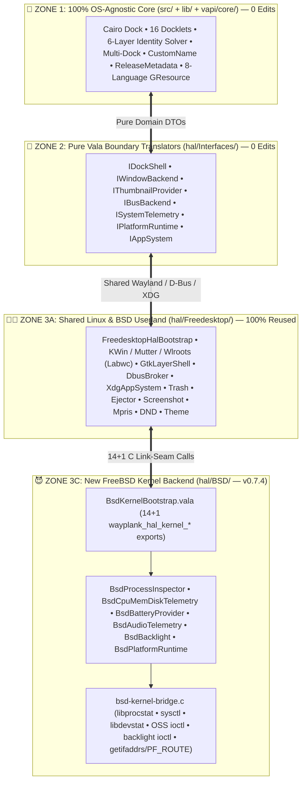

# 😈 WAYPLANK FREEBSD KERNEL BACKEND ARCHITECTURE (`HAL_BSD_BACKEND`)

> **Design-Before-Build Engineering Blueprint for the Native FreeBSD Kernel Driver Plug-In (`hal/BSD/`) Sharing 100% of Zone 1 Core, Zone 2 Translators & Zone 3A Freedesktop Userland**  
> **Pedigree:** WayPlank 3-Zone Dichotomic HAL (`v0.7.2` Linux Freeze) ➔ Native Windows Plug-In (`v0.7.3.2` Qualified) ➔ Native FreeBSD Plug-In (`v0.7.4` Public Beta 5)  
> **Target OS:** Stock **FreeBSD `14.x` / `15.x-RELEASE`** & **GhostBSD** (`x86_64` / `aarch64`, Wayland compositors: **Labwc / wlroots**, **KDE Plasma 6 / KWin**, **GNOME Shell / Mutter**)  
> **Target Assets:** Native ELF Monolith (`build/wayplank`) & Native FreeBSD Package (`build/wayplank-<ver>.pkg`)  
> **Author & Maintainer:** Sergio Melas (<sergiomelas@gmail.com>) © 2026  
> **ISA-88 Document Control & MOC:** `DOC-ARCH-BSD-006` • **Revision `1.0`** (`2026-11-22` • **`MOC-0.7.4-BSD-001`** — *Design-Before-Build Specification for `v0.7.4` Public Beta 5, awaiting live VM build & 5-Platform FAT Qualification*)  
> **Companion Master Specifications:** [Master Architecture Overview (`README.md`)](README.md) • [HAL_COMPOSITORS.md](HAL_COMPOSITORS.md) • [HAL_BUSES.md](HAL_BUSES.md) • [APPLICATION_IDENTITY_ENGINE.md](APPLICATION_IDENTITY_ENGINE.md) • [HAL_LINUX_BACKEND.md](HAL_LINUX_BACKEND.md) *(Peer As-Built Contract)* • [HAL_WINDOWS_BACKEND.md](HAL_WINDOWS_BACKEND.md)

---

## 📌 Table of Contents

- [1. ISA-88 MOC Governance (`MOC-0.7.4-BSD-001`) & 3-Zone Architectural Reuse](#1-isa-88-moc-governance-moc-074-bsd-001--3-zone-architectural-reuse)
  - [1.1 Document Revision History](#11-document-revision-history)
  - [1.2 Zero-Hack Mandate & 100% Official FreeBSD Kernel APIs](#12-zero-hack-mandate--100-official-freebsd-kernel-apis)
  - [1.3 3-Zone Reuse Map (Linux vs. FreeBSD vs. Windows)](#13-3-zone-reuse-map-linux-vs-freebsd-vs-windows)
- [2. Complete Kernel Link-Seam Contract (`hal/Linux/` ⟷ `hal/BSD/`)](#2-complete-kernel-link-seam-contract-hallinux--halbsd)
- [3. Native C Kernel Bridge Specification (`hal/BSD/bsd-kernel-bridge.{c,h}` & `vapi/bsd/`)](#3-native-c-kernel-bridge-specification-halbsdbds-kernel-bridgech--vapibsd)
  - [3.1 Process Inspection (`libprocstat(3)` & `sysctl(3)`)](#31-process-inspection-libprocstat3--sysctl3)
  - [3.2 CPU, RAM & Disk I/O Telemetry (`sysctl(3)` & `libdevstat(3)`)](#32-cpu-ram--disk-io-telemetry-sysctl3--libdevstat3)
  - [3.3 Battery & AC Power (`sysctl(3)` ACPI)](#33-battery--ac-power-sysctl3-acpi)
  - [3.4 Audio Control (`wpctl`/`pactl` + Native FreeBSD OSS `<sys/soundcard.h>`)](#34-audio-control-wpctlpactl--native-freebsd-oss-syssoundcardh)
  - [3.5 Hardware Backlight (`<sys/backlight.h>` `ioctl` + `hw.acpi.video.*`)](#35-hardware-backlight-sysbacklighth-ioctl--hwacpivideo)
  - [3.6 Network Fallback (`getifaddrs(3)` + `SIOCGIFMEDIA` + `IEEE80211_IOC_SSID` + `PF_ROUTE`)](#36-network-fallback-getifaddrs3--siocgifmedia--ieee80211_ioc_ssid--pf_route)
  - [3.7 Platform Runtime (`setproctitle`, `KERN_PROC_PATHNAME`, `fork()`, `SIGWINCH`)](#37-platform-runtime-setproctitle-kern_proc_pathname-fork-sigwinch)
- [4. Minimal Freedesktop Userland Coordination (`hal/Freedesktop/`)](#4-minimal-freedesktop-userland-coordination-halfreedesktop)
- [5. Complete 16-Docklet FreeBSD Portability Matrix](#5-complete-16-docklet-freebsd-portability-matrix)
- [6. Native FreeBSD Build (`BuildBsd.sh`), 8-Gate Firewall & Packaging (`BuildPkg.sh`)](#6-native-freebsd-build-buildbsdsh-8-gate-firewall--packaging-buildpkgsh)
- [7. Staged Milestone Execution Plan (`B1` ➔ `B5`) & ISA-88 Qualification Gates](#7-staged-milestone-execution-plan-b1--b5--isa-88-qualification-gates)

---

## 1. ISA-88 MOC Governance (`MOC-0.7.4-BSD-001`) & 3-Zone Architectural Reuse

| MOC Control Attribute | Normative Engineering Specification |
| :--- | :--- |
| **MOC Identifier & Revision** | **`MOC-0.7.4-BSD-001` (`Rev 1.0` — 2026-11-22)** • Approval Authority: **Sergio Melas** (Maintainer) |
| **Architectural Objective** | Deliver first-class native **FreeBSD** support (`v0.7.4` Public Beta 5) by plugging **`hal/BSD/`** (Zone 3C) directly into the existing **`wayplank_hal_kernel_*`** link-seam below **`hal/Freedesktop/`** (Zone 3A), with **zero edits to Zone 1 (`src/`, `lib/`, `vapi/core/`)** and **zero edits to Zone 2 (`hal/Interfaces/`)**. |
| **Zone Purity & Isolation Law** | `hal/BSD/` **MUST NEVER** import `DbusBroker`, `DBus*`, `Xdg*`, `GtkLayerShell`, `KWin`, `Mutter`, `Labwc`, `/proc/`, `/sys/`, or `Win32`. `hal/Freedesktop/` **MUST NEVER** import `Bsd*` or `Linux*` classes directly. `hal/Linux/` **MUST** remain untouched except for a 1-line `false` stub if the optional network fallback link-seam (`#15`) is added. |
| **GPLv3 File Header Law** | Every new file created under `hal/BSD/`, `vapi/bsd/`, `BuildBsd.sh`, and `BuildPkg.sh` is 100% original WayPlank code and **MUST** carry **ONLY** `Copyright (C) 2026 Sergio Melas` under GPLv3+ (never legacy 2011–2012 Plank copyright lines). |
| **FAT Qualification Standard** | Every milestone `B1`–`B5` passes automated Gate 1 (8-Gate Firewall + `0` warnings + `0` Pitfall #14 UAFs) before live human Gate 2 verification on a FreeBSD Wayland session (`Labwc` and/or `KDE Plasma Wayland`) plus zero regression across Linux (`KWin`, `Mutter`, `Labwc`) and Windows 11. |

### 1.1 Document Revision History

| Revision | Date | Author | Summary of Architectural Changes (`MOC-0.7.4-BSD-001`) |
| :---: | :---: | :--- | :--- |
| **`1.0`** | `2026-11-22` | Sergio Melas | **Initial Design-Before-Build Blueprint (`DOC-ARCH-BSD-006`):** Defined the complete Zone 3C `hal/BSD/` kernel backend mirroring [`HAL_LINUX_BACKEND.md`](HAL_LINUX_BACKEND.md), all 14+1 `wayplank_hal_kernel_*` link-seams, the native C `bsd-kernel-bridge.{c,h}` API surface (`libprocstat`, `sysctl`, `libdevstat`, OSS `<sys/soundcard.h>`, `<sys/backlight.h>`, `getifaddrs`), `ConsoleKit2`/`acpiconf` session-power coordination, `BuildBsd.sh` / `BuildPkg.sh`, and Milestones `B1`–`B5`. |

### 1.2 Zero-Hack Mandate & 100% Official FreeBSD Kernel APIs

Per [`Documentation/Architecture/README.md §1.1`](README.md):
1. **Never rely on `procfs(5)` (`/proc`):** Stock FreeBSD does not mount `/proc` by default. Every process query MUST use official **`libprocstat(3)`** and **`sysctl(3)`** (`CTL_KERN`, `KERN_PROC`).
2. **Never scrape `ps`, `top`, `vmstat`, `ifconfig`, or `mixer` text output when a C syscall/ioctl exists:** Process inspection, CPU/RAM/Disk metrics, battery ACPI state, OSS audio volume, hardware backlight, and network interface addresses/SSIDs MUST use their official FreeBSD C headers (`<sys/sysctl.h>`, `<libprocstat.h>`, `<devstat.h>`, `<sys/soundcard.h>`, `<sys/backlight.h>`, `<ifaddrs.h>`, `<net80211/ieee80211_ioctl.h>`, `<net/route.h>`).
3. **Never assume Linux GNU coreutils (`pidof`, `killall -q` GNU flags, `prctl`):** Replace `pidof` with `libprocstat` PID enumeration and replace Linux `prctl(PR_SET_NAME)` with native FreeBSD `setproctitle("%s", title)` from `<unistd.h>`.

### 1.3 3-Zone Reuse Map (Linux vs. FreeBSD vs. Windows)



---

## 2. Complete Kernel Link-Seam Contract (`hal/Linux/` ⟷ `hal/BSD/`)

`hal/BSD/BsdKernelBootstrap.vala` exports the exact same C link-seam symbols as [`hal/Linux/LinuxKernelBootstrap.vala`](../../hal/Linux/LinuxKernelBootstrap.vala) (documented in [`HAL_LINUX_BACKEND.md §2`](HAL_LINUX_BACKEND.md)), plus one optional network fallback seam (`#15`):

| # | C Link-Seam Symbol | `hal/Linux/` Implementation | `hal/BSD/` Implementation (`v0.7.4`) |
| :---: | :--- | :--- | :--- |
| 1 | `wayplank_hal_kernel_get_runtime` | `LinuxPlatformRuntime` | `BsdPlatformRuntime` (`setproctitle`, `KERN_PROC_PATHNAME`, `fork`, `SIGWINCH`) |
| 2 | `wayplank_hal_kernel_get_battery` | `LinuxBatteryProvider` (`/sys/class/power_supply`) | `BsdBatteryProvider` (`sysctl hw.acpi.battery.*`, `hw.acpi.acline`) |
| 3 | `wayplank_hal_kernel_get_cpu_memory` | `LinuxCpuMemDiskTelemetry` (`/proc/{stat,meminfo,diskstats}`) | `BsdCpuMemDiskTelemetry` (`sysctl kern.cp_time`, `vm.stats.vm.*`, `libdevstat`) |
| 4 | `wayplank_hal_kernel_get_audio` | `LinuxAudioTelemetry` (`wpctl`/`pactl`/`amixer`) | `BsdAudioTelemetry` (`wpctl`/`pactl` + native OSS `<sys/soundcard.h>` `/dev/mixer`) |
| 5 | `wayplank_hal_kernel_inspect_process` | `LinuxProcessInspector` (`/proc/<pid>`) | `BsdProcessInspector` (`libprocstat` + `sysctl` + 512-entry `pid_snapshot_cache`) |
| 6 | `wayplank_hal_kernel_is_process_alive` | `FileUtils.test("/proc/%d")` | `bsd_kernel_is_process_alive(pid)` (`kill(pid, 0) == 0 \|\| errno == EPERM`) |
| 7 | `wayplank_hal_kernel_scan_user_processes` | `Dir.open("/proc")` | `bsd_kernel_scan_user_pids()` (`procstat_getprocs(KERN_PROC_UID, getuid())`) |
| 8 | `wayplank_hal_kernel_find_pid_by_app_hint` | `/proc` scan + reverse-DNS tail | `BsdProcessInspector.find_pid_by_app_hint()` (`procstat` + reverse-DNS tail) |
| 9 | `wayplank_hal_kernel_clear_process_caches` | Clear 5 `HashMap`s | Clear 5 `HashMap`s (`cache_mutex`-protected) |
| 10 | `wayplank_hal_kernel_backlight_detect_devices` | `/sys/class/backlight` | `/dev/backlight/*` (`<sys/backlight.h>`) + `hw.acpi.video.*` |
| 11 | `wayplank_hal_kernel_backlight_has_internal_panel` | `/sys/class/drm/*-eDP-*` | Active `/dev/backlight/*` or `hw.acpi.video.lcd0.*` + lid state `hw.acpi.lid_switch_state` |
| 12 | `wayplank_hal_kernel_backlight_read_raw` | `actual_brightness` | `ioctl(fd, BACKLIGHTGETSTATUS, &props)` (`0..100`) or `sysctl` |
| 13 | `wayplank_hal_kernel_backlight_write_raw` | Write `brightness` | `ioctl(fd, BACKLIGHTUPDATESTATUS, &props)` (`0..100`) or `sysctl` |
| 14 | `wayplank_hal_kernel_backlight_monitor_device` | `inotify` on `brightness` | Returns `null` (cleanly triggers `BrightnessControl`'s built-in periodic sync) |
| **15** *(New — MOC)* | `wayplank_hal_kernel_probe_network_fallback` | Returns `false` (`0` behavior change on Linux) | `bsd_kernel_probe_network()` (`getifaddrs` + `SIOCGIFMEDIA` + `IEEE80211_IOC_SSID` + `PF_ROUTE`) |

---

## 3. Native C Kernel Bridge Specification (`hal/BSD/bsd-kernel-bridge.{c,h}` & `vapi/bsd/`)

All FreeBSD kernel syscalls and struct layouts are encapsulated cleanly in a single pure-C translation unit **`hal/BSD/bsd-kernel-bridge.c`** (with header `bsd-kernel-bridge.h` and Vala binding `vapi/bsd/bsd-kernel-bridge.vapi`), returning GLib-allocated (`g_strdup` / `GStrv`) UTF-8 strings and flat POD structs to Vala.

### 3.1 Process Inspection (`libprocstat(3)` & `sysctl(3)`)
- **Link library:** `-lprocstat -lkvm` (stock FreeBSD base system libraries in `/usr/lib/`).
- **Functions exported:**
  - `gboolean bsd_kernel_is_process_alive (int pid)` — `kill(pid, 0) == 0 || errno == EPERM`.
  - `gboolean bsd_kernel_get_proc_basic (int pid, int *out_uid, char **out_comm, char **out_exe_path, char **out_cwd)` — opens `procstat_open_sysctl()`, fetches `kinfo_proc` (`ki_uid`, `ki_comm`), `procstat_getpathname()` (or `sysctl(CTL_KERN, KERN_PROC, KERN_PROC_PATHNAME, pid)`), and `procstat_getfiles()` filtering `PS_FST_UFLAG_CWD` for `working_dir`.
  - `char **bsd_kernel_get_proc_argv (int pid)` — `procstat_getargv(prstat, kp, 0)` copied into a `NULL`-terminated `GStrv` (`g_strdupv` safety).
  - `gboolean bsd_kernel_get_proc_env_hints (int pid, char **out_appimage, char **out_wineprefix)` — `procstat_getenvv(prstat, kp, 0)` scanning for `APPIMAGE=` and `WINEPREFIX=`.
  - `int *bsd_kernel_get_child_pids (int pid, int *out_len)` — `procstat_getprocs(KERN_PROC_PROC, 0)` filtering `kp[i].ki_ppid == pid`.
  - `char **bsd_kernel_get_open_fd_paths (int pid)` — `procstat_getfiles()` collecting regular-file vnode paths (`PS_FST_TYPE_VNODE`, `fs_path != NULL`).
  - `int *bsd_kernel_list_user_pids (int *out_len)` — `procstat_getprocs(KERN_PROC_UID, getuid())`.
- **Caching & Concurrency:** `BsdProcessInspector.vala` mirrors `LinuxProcessInspector.vala`'s 5 mutex-guarded 512-entry caches (`pid_cmdline_cache`, `pid_comm_cache`, `pid_cwd_cache`, `pid_exe_cache`, `pid_snapshot_cache`) for $O(1)$ repeat queries and zero idle CPU overhead.

### 3.2 CPU, RAM & Disk I/O Telemetry (`sysctl(3)` & `libdevstat(3)`)
- **CPU (`kern.cp_time`):** `sysctlbyname("kern.cp_time", cp_time, &sz, NULL, 0)` returning `long[CPUSTATES]` (`CP_USER`, `CP_NICE`, `CP_SYS`, `CP_INTR`, `CP_IDLE`). Differential busy percentage matches Linux formula.
- **RAM (`hw.physmem` & `vm.stats.vm.*`):**
  - `hw.physmem` (bytes total) and `hw.pagesize` (or `vm.stats.vm.v_page_size`).
  - Available bytes = `(v_free_count + v_inactive_count + v_cache_count) * page_size` (falling back safely if `v_cache_count` is absent on FreeBSD 14+/15, plus ZFS ARC reclaimable floor `vfs.zfs.arc.size - vfs.zfs.arc.min` when ZFS is active so ZFS systems don't falsely display 95% RAM usage!).
- **Disk I/O (`libdevstat(3)` — `-ldevstat`):** Calls `devstat_getdevs(NULL, &sinfo)` to sum `busy_time` (converted to milliseconds via `bintime` / `devstat_compute_etime`) across direct-attached block devices (`DEVSTAT_TYPE_DIRECT`), computing differential busy percentage over monotonic elapsed ms.
- **Global System Pressure:** Identical `0.60 * max(cpu, ram, io) + 0.40 * mean(cpu, ram, io)` formula.

### 3.3 Battery & AC Power (`sysctl(3)` ACPI)
- **`hw.acpi.battery.units`:** If `<= 0` or `ENOENT`, `has_battery() == false` (desktop / VM without battery).
- **`hw.acpi.battery.life`:** Integer `0..100` percentage.
- **`hw.acpi.battery.state`:** Official FreeBSD ACPI bitmask (`0` = full/idle, `1` = discharging, `2` = charging, `4` = critical, `7` = absent/invalid).
- **`hw.acpi.acline`:** `1` = AC connected, `0` = on battery.
- Maps cleanly to `BatteryState { has_battery, percentage, is_charging, is_full, raw_status }`.

### 3.4 Audio Control (`wpctl`/`pactl` + Native FreeBSD OSS `<sys/soundcard.h>`)
- **Priority 1 — PipeWire (`wpctl`) / PulseAudio (`pactl`):** Reuses the exact `LC_ALL=C` cached probe when a FreeBSD desktop runs PipeWire or PulseAudio (standard on FreeBSD KDE Plasma / GNOME).
- **Priority 2 — Native FreeBSD OSS (`/dev/mixer` via `<sys/soundcard.h>`):**
  - `open("/dev/mixer", O_RDWR)` $\rightarrow$ `ioctl(fd, SOUND_MIXER_READ_VOLUME, &vol)` (low byte = left `0..100`, high byte = right `0..100`; average = `volume_percent`; `0` = muted, with `last_nonzero_vol` stored in RAM for clean `toggle_mute()`).
  - Writes via `ioctl(fd, SOUND_MIXER_WRITE_VOLUME, &packed)` (clamped to `0..100` on pure OSS; `0..150` on PipeWire/PulseAudio).

### 3.5 Hardware Backlight (`<sys/backlight.h>` `ioctl` + `hw.acpi.video.*`)
- **Primary — Official FreeBSD Backlight Subsystem (`/dev/backlight/backlight*`):**
  - Enumerates `/dev/backlight/` for `backlight*` device nodes (e.g. `backlight0` backed by `drm-kmod` `i915kms`/`amdgpu`).
  - `open("/dev/backlight/<dev>", O_RDWR)` (fallback `O_RDONLY` for reads):
    - `ioctl(fd, BACKLIGHTGETSTATUS, &props)` $\rightarrow$ `props.brightness` (`0..BACKLIGHTMAXLEVELS`, i.e. `0..100`).
    - `ioctl(fd, BACKLIGHTUPDATESTATUS, &props)` $\rightarrow$ writes brightness `0..100`.
- **Fallback — ACPI Video (`sysctl hw.acpi.video.lcd0.brightness`):** Read/write integer `0..100` when `acpi_video(4)` is loaded without `drm-kmod` `/dev/backlight`.
- **Clamshell Guard:** Checks `sysctl hw.acpi.lid_switch_state` if present (`0` = closed).

### 3.6 Network Fallback (`getifaddrs(3)` + `SIOCGIFMEDIA` + `IEEE80211_IOC_SSID` + `PF_ROUTE`)
- Invoked by `NetworkManagerDbusService.probe_state_sync()` **only** when `org.freedesktop.NetworkManager` D-Bus is absent (always `false` on Linux where NetworkManager or `GLib.NetworkMonitor` applies; active on FreeBSD!).
- Enumerates active `IFF_UP | IFF_RUNNING` non-loopback (`!IFF_LOOPBACK`) IPv4 interfaces via `getifaddrs(3)`, extracts IPv4 address via `inet_ntop(AF_INET, ...)`, inspects media type via `ioctl(sock, SIOCGIFMEDIA, &ifmr)` (`IFM_IEEE80211` $\rightarrow$ `"wifi"`, else `"ethernet"`), queries Wi-Fi SSID and RSSI/signal percentage via `ioctl(sock, SIOCG80211, &ireq)` (`IEEE80211_IOC_SSID`, `IEEE80211_IOC_SCAN_RESULTS` / `STA_INFO`), and reads the default IPv4 gateway via `sysctl(CTL_NET, PF_ROUTE, 0, AF_INET, NET_RT_DUMP, 0)` (zero `ifconfig`/`netstat` subprocess spawns!).

### 3.7 Platform Runtime (`setproctitle`, `KERN_PROC_PATHNAME`, `fork()`, `SIGWINCH`)
- **`set_process_title(title)`:** Calls native FreeBSD libc `setproctitle("%s", title)` (safe format string, zero `prctl`).
- **`replace_running_instances(target_dock_name)`:** Uses `bsd_kernel_list_user_pids()` + `bsd_kernel_get_proc_argv()` instead of Linux `pidof` + `/proc/<pid>/cmdline`, matching `wayplank`/`plank` and `-n`/`--name`, sending `SIGTERM` (200 ms) then `SIGKILL`.
- **`install_session_and_upgrade_watchers()` (`SIGWINCH`):** Captures own executable path at startup via `sysctl(CTL_KERN, KERN_PROC, KERN_PROC_PATHNAME, -1)` (and `stat()` inode/dev pair). On `SIGWINCH`, compares `stat(startup_exe_path)` `(st_dev, st_ino)` against startup `(dev, ino)` — if the binary on disk was replaced by `pkg upgrade`, emits `binary_upgrade_detected(startup_exe_path)`!
- **`http_get_sync()`:** Uses FreeBSD base `/usr/bin/fetch -q -T <sec> -o - <url>` (always present in stock FreeBSD base!) with `curl` fallback.
- **`extract_archive()`:** Uses FreeBSD base **libarchive `bsdtar` (`tar -xf`)**, which natively extracts `.zip`, `.tar.gz`, `.tar.xz`, and `.tar.bz2` out of the box without needing external `unzip`!
- **`get_extra_schema_dirs()`:** Returns `{ Build.DATADIR + "/glib-2.0/schemas", "/usr/local/share/glib-2.0/schemas", "/usr/share/glib-2.0/schemas" }` (critical on FreeBSD where all `pkg` ports install under `/usr/local/share/`!).
- **`validate_keyfile_isolated()`:** Identical POSIX `fork()` + `waitpid()` (`EINTR`-safe) child probe.

---

## 4. Minimal Freedesktop Userland Coordination (`hal/Freedesktop/`)

Only **two** targeted, Linux-regression-free extensions are required in `hal/Freedesktop/`:
1. **`hal/Freedesktop/Dbus/NetworkManagerDbusService.vala`:** When `probe_network_manager()` returns `false`, call `hal_kernel_probe_network_fallback(...)` before falling back to generic `GLib.NetworkMonitor`. On Linux, `LinuxKernelBootstrap` returns `false` (100% zero behavior change); on FreeBSD, `BsdKernelBootstrap` returns real `ethernet`/`wifi`, SSID, signal strength, IPv4, and gateway.
2. **`hal/Freedesktop/Dbus/FreedesktopSessionPower.vala`:** Add standard Freedesktop **ConsoleKit2** (`org.freedesktop.ConsoleKit` `/org/freedesktop/ConsoleKit/Manager`: `CanSuspend`, `CanHibernate`, `Suspend`, `Hibernate`, `Restart`, `Stop`) after `org.freedesktop.login1`, plus final CLI fallbacks `acpiconf -s 3` (Suspend), `shutdown -r now` (Restart), and `shutdown -p now` (Shutdown) when `systemctl`/`loginctl` are absent.
3. **`vapi/freedesktop/unix-compat.vapi`:** Already uses `#if HAVE_SYS_PRCTL_H ... #else setproctitle ... #endif`! Ensure `setproctitle` takes `(string fmt, ...)` and is invoked as `setproctitle ("%s", title)`.

---

## 5. Complete 16-Docklet FreeBSD Portability Matrix

| # | Docklet (`lib/Items/` — 0 Edits) | Shared `hal/Freedesktop/` | Native FreeBSD `hal/BSD/` Support (`v0.7.4`) |
| :-: | :--- | :--- | :--- |
| 1–2 | **Analog & Digital Clocks** | Pure GLib/Cairo + `DesktopUtilityKind` | 100% Native |
| 3 | **Trash** | `FreedesktopTrashProvider` (GVFS `trash:///`, `~/.local/share/Trash`) | 100% Native (`gvfs` pkg) |
| 4 | **Removable Drive Ejector** | `FreedesktopEjectorProvider` (`GLib.VolumeMonitor` + `/media` / `/mnt`) | 100% Native (`bsdisks` / `gvfs` / `automount`) |
| 5 | **Battery Monitor** | `IBatteryProvider` | Native `sysctl hw.acpi.battery.*` + `hw.acpi.acline` |
| 6 | **System Pressure (CPU/RAM/IO)** | `ICpuMemoryProvider` | Native `sysctl kern.cp_time` + `vm.stats.vm.*` (ZFS ARC-aware) + `libdevstat` |
| 7 | **Network Monitor** | `NetworkManagerDbusService` + fallback seam | Native `getifaddrs` + `SIOCGIFMEDIA` + `IEEE80211_IOC_SSID` + `PF_ROUTE` |
| 8 | **Volume Control** | `IAudioProvider` | PipeWire `wpctl` / PulseAudio `pactl` + Native FreeBSD OSS `/dev/mixer` `ioctl` |
| 9 | **Brightness Control** | `BrightnessControl` (KWin/GNOME D-Bus + kernel seam + `ddcutil`) | Native `/dev/backlight/*` `<sys/backlight.h>` `ioctl` + `hw.acpi.video.*` |
| 10 | **Media Player (MPRIS)** | `MprisDbusService` (`org.mpris.MediaPlayer2.*`) | 100% Native (identical D-Bus spec on FreeBSD) |
| 11 | **Do Not Disturb (DND)** | `NotificationDbusService` (Plasma / GNOME / `dunstctl` / `swaync-client`) | 100% Native |
| 12 | **Screenshot** | `FreedesktopScreenshotProvider` (`grim` / `spectacle` / `ScreenShot2`) | 100% Native |
| 13 | **Show Desktop** | `IWindowBackend.toggle_show_desktop()` (`KWin`/`Mutter`/`Labwc`) | 100% Native |
| 14 | **Weather Forecast** | `IPlatformRuntime.http_get_sync()` | Native FreeBSD base `/usr/bin/fetch` (+ `curl` fallback) |
| 15 | **Session & Power** | `FreedesktopSessionPower` + `ConsoleKit2` | `ConsoleKit2` D-Bus + `swaylock`/`waylock` + `acpiconf -s 3` + `shutdown -p/-r now` |
| 16 | **WayPlank Preferences** | Pure GTK3/Cairo + `latch-state.ini` | 100% Native |

---

## 6. Native FreeBSD Build (`BuildBsd.sh`), 8-Gate Firewall & Packaging (`BuildPkg.sh`)

### 6.1 Host Dependencies on FreeBSD (`pkg install`)
```sh
sudo pkg install -y \
    git vala pkgconf gmake gettext-tools python3 \
    gtk3 gtk-layer-shell libgee json-glib wayland wayland-protocols
```
*(Optional desktop/runtime tools for full FAT testing: `labwc`, `seatd`, `dbus`, `gvfs`, `grim`, `slurp`, `swaylock`, `dunst`.)*

### 6.2 `BuildBsd.sh` — Native FreeBSD Compiler & 8-Gate Firewall
- Pure POSIX `/bin/sh` or `#!/usr/bin/env bash` compatible script (detecting `uname -s == FreeBSD`).
- **8-Gate HAL Purity Firewall (FreeBSD Mirror of `BuildBin.sh`):**
  - **Gates 1 & 2:** Identical regex scan over `src/`, `lib/`, `hal/Interfaces/`, `vapi/core/` (`0` leaks).
  - **Gate 3:** `hal/Interfaces/` standalone `valac -C` (`0` OS pkgs).
  - **Gate 4:** `hal/Freedesktop/` standalone `valac -C` without `hal/BSD/` or `hal/Linux/`.
  - **Gate 5:** `hal/BSD/` standalone `valac -C` without `hal/Freedesktop/` or `hal/Linux/`.
  - **Gates 6A & 6B:** Zero horizontal leaks between `hal/Freedesktop/`, `hal/BSD/`, and `hal/Linux/` (plus zero `/proc/` or `/sys/` leaks inside `hal/BSD/`).
  - **Gate 7:** `DbusBroker.vala` sole `GLib.Bus.*` entry point.
  - **Gate 8:** `llvm-objdump -d` / `objdump -d` Pitfall #14 closure UAF verification (`0` non-`_full` `gdk_threads_add_*`).
- **Link Command:** Compiles `hal/Interfaces/` + `hal/Freedesktop/` + `hal/BSD/` + `lib/` + `src/` + `lib/resources.c` + `lib/gtk-compat.c` + `hal/Freedesktop/Wlroots/*.c` + `hal/BSD/bsd-kernel-bridge.c` with **NO** `-Dsetproctitle(x)=` and **NO** `-D HAVE_SYS_PRCTL_H`, linking `-lprocstat -lkvm -ldevstat -lm -lwayland-client` into `build/wayplank` (`PREFIX=/usr/local`).

### 6.3 `BuildPkg.sh` — Native FreeBSD `.pkg` Packager
- Invokes `BuildBsd.sh`, stages `build/wayplank`, `wayplank.desktop`, `wayplank.svg`, `net.launchpad.plank.gschema.xml` under `/usr/local/{bin,share/applications,share/icons/hicolor/scalable/apps,share/glib-2.0/schemas}`, generates FreeBSD `+MANIFEST` (with `post-install: glib-compile-schemas /usr/local/share/glib-2.0/schemas` and `SIGWINCH` live reload hook), and runs `pkg create` to produce **`build/wayplank-<ver>.pkg`**.

---

## 7. Staged Milestone Execution Plan (`B1` ➔ `B5`) & ISA-88 Qualification Gates

- [ ] **Milestone `B1` — FreeBSD Skeleton, `bsd-kernel-bridge.{c,h}`, `BsdKernelBootstrap`, `BuildBsd.sh` & First Boot on FreeBSD/Labwc:**
  - Create `hal/BSD/` + `vapi/bsd/bsd-kernel-bridge.vapi` + `BuildBsd.sh`, pass all 8 Firewall Gates on FreeBSD, compile `build/wayplank` with `0` warnings/errors, and boot the live translucent Cairo dock on FreeBSD + `Labwc` (or KDE Plasma Wayland).
- [ ] **Milestone `B2` — Full `BsdProcessInspector` (`libprocstat` / `sysctl`) & `BsdPlatformRuntime`:**
  - Complete `ProcessSnapshot` (`cmdline`, `comm`, `exe_realpath`, `working_dir`, `env_appimage`/`env_wineprefix`, `child_pids`, `open_fd_targets`), `512`-entry `pid_snapshot_cache`, reverse-DNS `find_pid_by_app_hint`, `--replace`, and `SIGWINCH` `KERN_PROC_PATHNAME` upgrade hot-reload. Verify `FAT` groups 1, 2, 11, 14 on FreeBSD.
- [ ] **Milestone `B3` — Hardware Telemetry, OSS Audio, Backlight, Network & ConsoleKit2 Session Power:**
  - Implement `BsdCpuMemDiskTelemetry` (ZFS ARC-aware RAM + `libdevstat`), `BsdBatteryProvider` (ACPI `sysctl`), `BsdAudioTelemetry` (`wpctl`/`pactl` + OSS `/dev/mixer` `ioctl`), `BsdBacklight` (`/dev/backlight/*` `ioctl` + `hw.acpi.video.*`), `wayplank_hal_kernel_probe_network_fallback` (`getifaddrs`/`IEEE80211_IOC_SSID`/`PF_ROUTE`), and `ConsoleKit2`/`acpiconf` fallbacks in `FreedesktopSessionPower`. Verify all 16 docklets live on FreeBSD.
- [ ] **Milestone `B4` — Native FreeBSD `.pkg` Packaging (`BuildPkg.sh`), Regression Audit & Multi-OS Build Parity:**
  - Deliver `BuildPkg.sh` $\rightarrow$ `build/wayplank-<ver>.pkg`, verify Linux (`BuildDeb.sh` + `BuildRpm.sh`) and Windows (`BuildWin.sh` + `BuildNsis.sh`) remain `100% GREEN` with zero regressions, and run the 5-Pillar Pre-Push Forensic Scan.
- [ ] **Milestone `B5` — Live 5-Platform ISA-88 FAT Qualification (`FAT 0.7.4`) & Release Closeout:**
  - Extend `FAT/Template/FAT Template.txt` and cut `FAT/YYYY-MM-DD FAT 0.7.4.txt` adding the **FreeBSD** platform column, execute live human Gate 2 testing on FreeBSD (`Labwc` / `KDE Plasma Wayland`) + zero-regression verification on Linux & Windows, freeze at `100.0%` (`0 [ko]`), and sync 4-way atomic docs.
