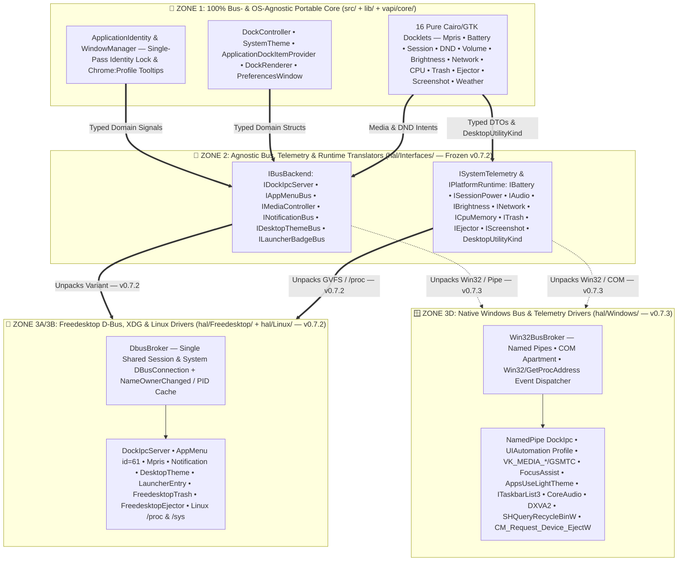
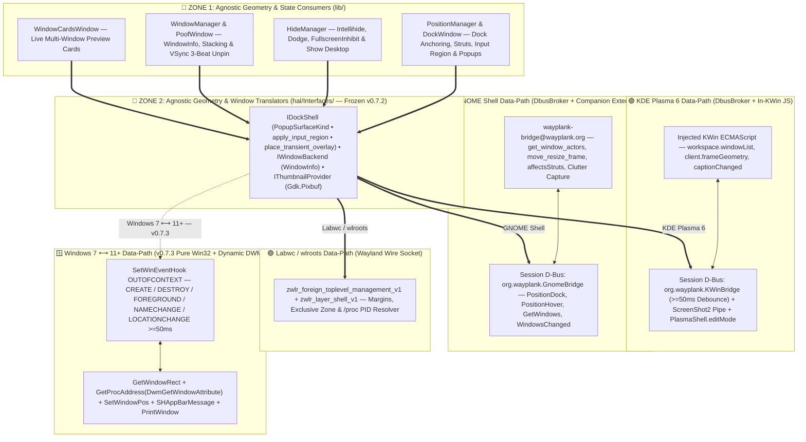
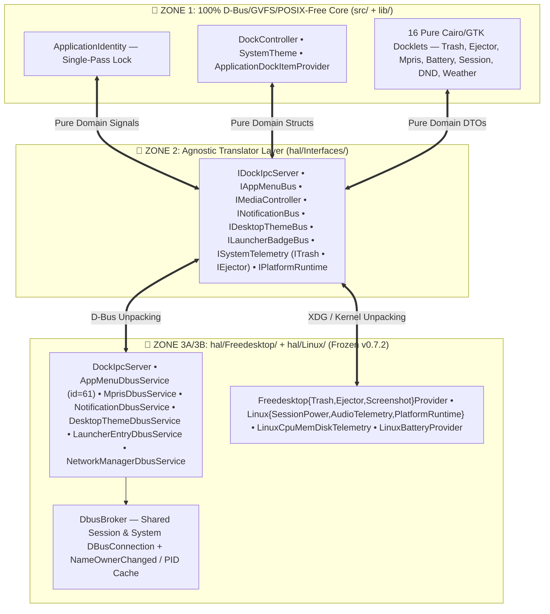
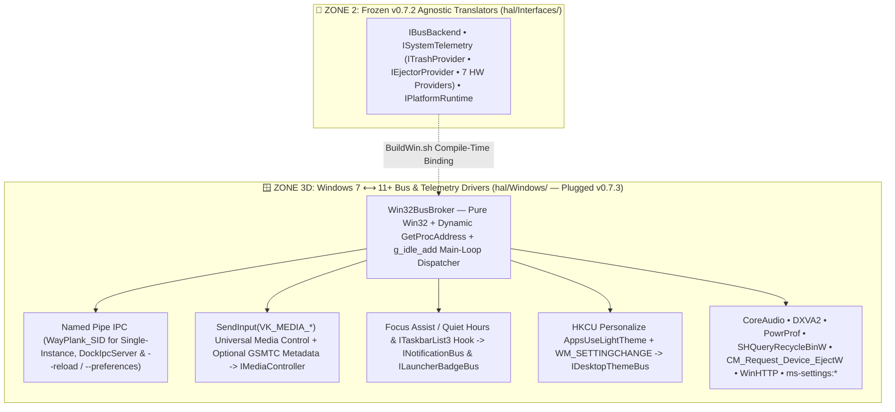

# 🚌 WAYPLANK MASTER IPC & SYSTEM BUS ABSTRACTION LAYER (`HAL_BUSES`)

> **Canonical Specification for the Agnostic IPC, Event Bus & Telemetry Boundary Translator (`hal/Interfaces/`) — `D-Bus` ➔ Translator ➔ `Windows Bus`**  
> **Pedigree:** Scattered Per-Widget `GLib.Bus.get_sync` & `/proc` Calls (`v0.7.0`–`v0.7.1.2`) ➔ Frozen Agnostic Bus/Telemetry Translators + `hal/{Freedesktop,Linux}/` (`v0.7.2` Public Beta 3) ➔ Native `hal/Windows/{Bus,Telemetry}/` Plug-In (`v0.7.3` Public Beta 4)  
> **Author & Maintainer:** Sergio Melas (<sergiomelas@gmail.com>) © 2026  
> **ISA-88 Document Control & MOC:** `DOC-ARCH-BUS-003` • **Revision `2.0`** (`MOC-0.7.2-HAL-001` — Wire-to-Domain Payload Translator, `IDesktopThemeBus` Rename, `ITrashProvider` / `IEjectorProvider` & `IPlatformRuntime` Purification)  
> **Companion Architecture Specifications:** [Master Architecture Overview (`README.md`)](README.md) • [HAL_COMPOSITORS.md](HAL_COMPOSITORS.md) *(Compositor & Surface Translator: `KWin`, `Mutter`, `Labwc`, `Windows Compositor`)* • [APPLICATION_IDENTITY_ENGINE.md](APPLICATION_IDENTITY_ENGINE.md) *(`IAppSystem` Data Translator & 6-Layer Identity Engine)* • [HAL_WINDOWS_BACKEND.md](HAL_WINDOWS_BACKEND.md) *(Windows Compositor/Bus Backend & Zero-DLL `wayplank.exe` Cross-Build)*  
> **Single Source of Truth:** Master System & IPC Bus HAL reference linked by [README.md](../../README.md), [CONTRIBUTING.md](../../CONTRIBUTING.md), [HAL_COMPOSITORS.md](HAL_COMPOSITORS.md), [APPLICATION_IDENTITY_ENGINE.md](APPLICATION_IDENTITY_ENGINE.md), and [HAL_WINDOWS_BACKEND.md](HAL_WINDOWS_BACKEND.md)  
> **Staged Execution & Freeze Schedule (`v0.7.1.2` ➔ `v0.7.2` ➔ `v0.7.3`):**
> - **Active Public Baseline `v0.7.1.2` (Public Beta 2 Hotfix — Concluded 2026-11-14, 100.0% FAT Qualified):** Core window identity is resolved and locked once per window lifecycle inside `ApplicationIdentity` (including event-driven `com.canonical.dbusmenu` submenu `id=61` + `Local State` Chrome multi-profile isolation), while raw D-Bus, GVFS `trash:///`, `VolumeMonitor`, `/proc`, and `/sys` calls remain diffused across `lib/`.
> - **Next Beta `v0.7.2` (Public Beta 3 — Agnostic Bus/Telemetry Translator & Linux Freeze ~Nov 14–30, 2026):** Unpacks and translates 100% of D-Bus `GLib.Variant` payloads, GVFS/XDG protocols, and Linux `/proc`/`/sys` telemetry behind pure OS-blind domain contracts (`IBusBackend`, `ISystemTelemetry`, `IPlatformRuntime`) in `hal/Interfaces/`. **All bus/telemetry translator contracts are frozen at the end of `v0.7.2`.**
> - **Subsequent Beta `v0.7.3` (Public Beta 4 — Native `Windows Bus` Plug-In for `Win 7 ⟷ 11+` ~Dec 2026):** Implements `hal/Windows/{Bus,Telemetry}/` using **Pure Baseline Win32 C APIs + Dynamic `GetProcAddress`** (Win32 Named Pipes, `VK_MEDIA_*` / optional GSMTC, Registry `AppsUseLightTheme`, CoreAudio, `DXVA2`, `PowrProf`, `SHQueryRecycleBinW`, `CM_Request_Device_EjectW`, `WinHTTP`) hooking directly into the frozen `v0.7.2` translators.

---

## 📌 Table of Contents

- [1. ISA-88 MOC Governance & Prime Directive for System/IPC Bus Translation](#1-isa-88-moc-governance--prime-directive-for-systemipc-bus-translation)
  - [1.1 Document Revision History (`MOC-0.7.2-HAL-001`)](#11-document-revision-history-moc-072-hal-001)
  - [1.2 Single-Pass Window Identification & Immutable Lock in `ApplicationIdentity`](#12-single-pass-window-identification--immutable-lock-in-applicationidentity)
  - [1.3 Strict Wire-Free Translator Boundary (`Zero D-Bus / Variant / GVFS / POSIX Above hal/Interfaces/`)](#13-strict-wire-free-translator-boundary-zero-d-bus--variant--gvfs--posix-above-halinterfaces)
- [2. The Agnostic Bus, Telemetry & Runtime Translators (`hal/Interfaces/`)](#2-the-agnostic-bus-telemetry--runtime-translators-halinterfaces)
  - [2.1 Normative Wire-to-Domain Payload Translation Matrix](#21-normative-wire-to-domain-payload-translation-matrix)
- [3. Compositor Scene-Graph, Geometry & Positioning Data-Path Buses (KWin JS, GNOME Shell Extension, Labwc Wire & Windows DWM/WinEventHook)](#3-compositor-scene-graph-geometry--positioning-data-path-buses-kwin-js-gnome-shell-extension-labwc-wire--windows-dwmwineventhook)
  - [3.1 Why WayPlank Needs a Compositor Geometry Bus (Wayland Coordinate Blindness vs Windows)](#31-why-wayplank-needs-a-compositor-geometry-bus-wayland-coordinate-blindness-vs-windows)
  - [3.2 KDE Plasma 6 Data-Path: In-Compositor KWin ECMAScript (`KWinBridge.vala` ⟷ `org.wayplank.KWinBridge`)](#32-kde-plasma-6-data-path-in-compositor-kwin-ecmascript-kwinbridgevala--orgwayplankkwinbridge)
  - [3.3 GNOME Shell Data-Path: Companion JS Extension (`wayplank-bridge@wayplank.org` ⟷ `org.wayplank.GnomeBridge`)](#33-gnome-shell-data-path-companion-js-extension-wayplank-bridgewayplankorg--orgwayplankgnomebridge)
  - [3.4 Labwc / wlroots Data-Path: Direct Wayland Wire Protocol (`zwlr_foreign_toplevel_management_v1` & `gtk-layer-shell`)](#34-labwc--wlroots-data-path-direct-wayland-wire-protocol-zwlr_foreign_toplevel_management_v1--gtk-layer-shell)
  - [3.5 Windows 7 ⟷ 11+ Data-Path (`v0.7.3`): Pure Baseline `Win32` + Dynamic `GetProcAddress(DWM)` Scene-Graph Bus (`hal/Windows/`)](#35-windows-7--11-data-path-v073-pure-baseline-win32--dynamic-getprocaddressdwm-scene-graph-bus-halwindows)
  - [3.6 4-Way Compositor Geometry & Positioning Data-Path Matrix](#36-4-way-compositor-geometry--positioning-data-path-matrix)
- [4. Driver 1: Freedesktop `D-Bus` & Linux Telemetry Backend (`hal/Freedesktop/` + `hal/Linux/` — Frozen in `v0.7.2`)](#4-driver-1-freedesktop-d-bus--linux-telemetry-backend-halfreedesktop--hallinux--frozen-in-v072)
  - [4.1 Shared Connection Pool & `NameOwnerChanged` / PID Cache (`DbusBroker`)](#41-shared-connection-pool--nameownerchanged--pid-cache-dbusbroker)
  - [4.2 Event-Driven Chrome/Chromium Multi-Profile Introspection (`com.canonical.dbusmenu` `id=61` + `Local State`)](#42-event-driven-chromechromium-multi-profile-introspection-comcanonicaldbusmenu-id61--local-state)
  - [4.3 Complete Audit of Freedesktop D-Bus, XDG & Linux Telemetry Endpoints](#43-complete-audit-of-freedesktop-d-bus-xdg--linux-telemetry-endpoints)
- [5. Driver 2: Native `Windows Bus` & Telemetry Backend (`hal/Windows/{Bus,Telemetry}/` — Plugged in `v0.7.3`)](#5-driver-2-native-windows-bus--telemetry-backend-halwindowsbustelemetry--plugged-in-v073)
- [6. 1:1 Cross-OS Equivalence & Translator Hook-Up Matrix (`D-Bus/Linux` ⟷ `hal/Interfaces/` ⟷ `Windows Bus`)](#6-11-cross-os-equivalence--translator-hook-up-matrix-d-buslinux--halinterfaces--windows-bus)
- [7. Two-Phase Bus Consolidation Roadmap (`v0.7.2` Translator Freeze ➔ `v0.7.3` Windows Bus Plug-In)](#7-two-phase-bus-consolidation-roadmap-v072-translator-freeze--v073-windows-bus-plug-in)

---

## 1. ISA-88 MOC Governance & Prime Directive for System/IPC Bus Translation

### 1.1 Document Revision History (`MOC-0.7.2-HAL-001`)

| Revision | Date | Author | Summary of Architectural Changes (`MOC-0.7.2-HAL-001`) |
| :---: | :---: | :--- | :--- |
| **`1.0`** | `2026-11-14` | Sergio Melas | Initial IPC & system bus abstraction specification (`v0.7.1.2` baseline). |
| **`2.0`** | `2026-11-14` | Sergio Melas | **`MOC-0.7.2-HAL-001`:** Added formal **Wire-to-Domain Payload Translation Matrix (`§2.1`)**; purged Freedesktop naming bias (`IPortalThemeBus` $\rightarrow$ **`IDesktopThemeBus`**, `PortalDbusService` $\rightarrow$ `DesktopThemeDbusService`, `UnityClient` $\rightarrow$ `ILauncherBadgeClient` with `LauncherBadgeState` replacing raw `Variant` `'(sa{sv})'`); detailed full `ITrashProvider` (`trash:///` & `file.trash()` replacement), `IEjectorProvider` (`VolumeMonitor` & `/media` replacement), and `IPlatformRuntime` (`DesktopUtilityKind`, `parse_command_argv`, Unix `<unistd.h>`/`<sys/prctl.h>` removal from `vapi/core/`). |

> [!IMPORTANT]
> **THE SYSTEM BUS & AGNOSTIC TRANSLATOR PRIME DIRECTIVE:**  
> 1. **Identify Once in `ApplicationIdentity`, Broadcast Everywhere:** Every window is identified **exactly once** upon creation (`on_window_opened` / `scan_initial_windows`) inside `ApplicationIdentity`, locked immutably for the lifetime of `window.Id`, and removed strictly upon destruction (`on_window_closed`). No consumer (`WindowManager`, `ApplicationDiscovery`, `ApplicationDockItem`, `MprisDockItem`) may ever re-search or overwrite an already-identified window.
> 2. **Translate Every Wire Payload South of `hal/Interfaces/` (`MOC-0.7.2-HAL-001` Rule of Iron):** UI widgets, core services, and docklets in `src/` and `lib/` must **never** open `GLib.DBusConnection` handles, unpack raw D-Bus `GLib.Variant` wire tuples (`'(sa{sv})'`), mount GVFS `trash:///` URIs, instantiate `GLib.VolumeMonitor`, spawn hardcoded `kcmshell6`/`gnome-control-center` CLI commands, or invoke Win32 COM/WinRT APIs. Every wire message and kernel file is unpacked inside `hal/{Freedesktop,Linux,Windows}/` and translated into pure Vala domain structs and enums before crossing `hal/Interfaces/`.

### 1.2 Single-Pass Window Identification & Immutable Lock in `ApplicationIdentity`

In `ApplicationIdentity`, window identity resolution is strictly event-driven on window creation and destruction:
- **Window Creation (`on_window_opened` / `scan_initial_windows`):** Resolves `window_browser_profiles[window.Id]`, `window_locked_launcher_uris[window.Id]`, and `window_locked_display_names[window.Id]` **once**, locking them for the entire lifetime of `window.Id`.
- **Window Destruction (`on_window_closed`):** Purges `window.Id` from all identity maps.
- **Downstream Consumers (`WindowManager`, `ApplicationDiscovery`, `ApplicationDockItem`, `MprisDockItem`):** Read the locked identity in $O(1)$ via `ApplicationIdentity.get_locked_window_launcher_uri()`, `ApplicationIdentity.get_locked_window_display_name()`, and `ApplicationIdentity.get_identity_for_pid_or_bus()`.

### 1.3 Strict Wire-Free Translator Boundary (`Zero D-Bus / Variant / GVFS / POSIX Above hal/Interfaces/`)

In **Public Beta 3 (`v0.7.2`)**, all Session/System bus, storage-monitor, and runtime communication is consolidated behind `IBusBackend`, `ISystemTelemetry`, and `IPlatformRuntime` so that:
- On Linux/BSD, only **one shared Session `DBusConnection`** and **one shared System `DBusConnection`** exist per process (`DbusBroker`).
- On Windows (`v0.7.3`), only **one shared `Win32BusBroker`** (managing the STA/MTA COM apartment, event hooks, and Named Pipe RPC listener) exists per process.
- **Zero wire types (`GLib.Variant` tuples, `DBusConnection`, `UnixFDList`, `VolumeMonitor`, `trash:///`)** cross into `hal/Interfaces/`, `src/`, or `lib/`.

---

## 2. The Agnostic Bus, Telemetry & Runtime Translators (`hal/Interfaces/`)

The Zone 1 Core hooks into Zone 2 exclusively through pure, OS-blind Vala translator interfaces and normalized structs:

1. **`IDockIpcServer` & `IDockIpcTarget` (External Dock Automation RPC Translator):**
   - Replaces `lib/DBusManager.vala` and `lib/DBus/{Client,Interfaces}.vala`. `DockController` implements `IDockIpcTarget` (`add_item`, `remove_item`, `get_item_count`, `get_persistent_uris`, `get_transient_uris`, `get_item_hover_coords`).
   - Translated to `/net/launchpad/plank/dock1` (`net.launchpad.plank.Items`) D-Bus RPC on Freedesktop and `\\.\pipe\WayPlank_<SID>` Named Pipe RPC on Windows.
2. **`IAppMenuBus` (Browser Profile & Application Menu Translator):**
   - Signal: `menu_profile_discovered (int pid, string window_or_menu_token, string profile_display_name)`
   - Method: `resolve_window_browser_profile (WindowInfo w) -> string?`
   - Translates `com.canonical.dbusmenu` (`id=61`) + `/proc/<pid>/fd` + `Local State` on Linux and `UIAutomation` / `HWND` + `%LOCALAPPDATA%\...\Local State` on Windows into a clean profile display string (`Chrome:<ProfileName>`).
3. **`IMediaController` (Event-Driven Media Transport & Player Translator):**
   - Struct: `MediaPlayerSnapshot` (`player_id`, `bus_or_app_id`, `pid`, `identity_name`, `track_title`, `artist`, `art_pixbuf_or_uri`, `is_playing`, `can_next`, `can_prev`).
   - Signals: `players_changed (Gee.List<MediaPlayerSnapshot>)`, `active_player_updated (MediaPlayerSnapshot)`.
   - Methods: `play_pause (player_id)`, `next_track (player_id)`, `previous_track (player_id)`, `raise_player (player_id)`.
4. **`INotificationBus` (Do Not Disturb & Desktop Toast Translator):**
   - Signal: `dnd_state_changed (bool inhibited)`
   - Methods: `set_dnd_inhibited (bool inhibit) -> bool`, `get_dnd_inhibited () -> bool`, `send_toast (string title, string body, string icon_name)` *(replaces `notify-send` spawns in `EjectorDockItem` / `ScreenshotDockItem`)*.
5. **`IDesktopThemeBus` *(Replaces Freedesktop-Biased `IPortalThemeBus`)*:**
   - Signal: `color_scheme_changed (bool prefer_dark)`
   - Method: `prefers_dark_scheme () -> bool`, `get_desktop_font_scale () -> double`
   - Consumed by `SystemTheme` and `DockRenderer` (translating XDG Portal `color-scheme` + GNOME/Pantheon GSettings + `kdeglobals` on Freedesktop vs Registry `AppsUseLightTheme` + `WM_SETTINGCHANGE` on Windows).
6. **`ILauncherBadgeBus` & `ILauncherBadgeClient` *(Replaces `UnityClient` `GLib.Variant` Leak)*:**
   - Struct: `LauncherBadgeState` (`launcher_uri`, `count`, `count_visible`, `progress`, `progress_visible`, `urgent`).
   - Signal: `badge_state_changed (string sender_id, LauncherBadgeState state)`, `sender_vanished (string sender_id)`.
   - `ApplicationDockItemProvider` implements `ILauncherBadgeClient` receiving pre-unpacked `LauncherBadgeState` — **zero `'(sa{sv})'` `GLib.Variant` unpacking in `lib/`**.
7. **`ISystemTelemetry` (9 Pure Hardware, Storage & Session Providers for the 16 Docklets):**
   - `ISessionPowerProvider` (`SessionDockItem` + `SessionWindow` 3×3 power actions & `can_hibernate` / `can_hybrid_sleep` / `can_reboot_to_firmware` flags).
   - `IBatteryProvider`, `IAudioProvider`, `IBrightnessProvider`, `INetworkProvider`, `ICpuMemoryProvider`, `IScreenshotProvider`.
   - **`ITrashProvider`** (`TrashItemInfo` struct: `id`, `display_name`, `original_path`, `deletion_date`, `is_directory`; `trash_changed ()`, `get_item_count ()`, `list_items ()`, `move_uri_to_trash (uri)`, `restore_item (id)`, `empty_trash ()`, `open_trash_ui ()` — eliminates GVFS `trash:///`, `~/.local/share/Trash`, and `file.trash()` from `TrashDockItem.vala`).
   - **`IEjectorProvider`** (`RemovableDriveInfo` struct: `id`, `display_name`, `icon_name`, `mount_label`, `can_eject`; `drives_changed ()`, `get_removable_drives ()`, `eject_drive (id)`, `eject_all ()` — eliminates `GLib.VolumeMonitor` and `/media`/`/run/media`/`/mnt` from `EjectorDockItem.vala`).
8. **`IPlatformRuntime` (OS Lifecycle, Desktop Utilities, Safe Argv, HTTP & Archive Translator):**
   - `open_system_utility (DesktopUtilityKind)` where `DesktopUtilityKind = { CALENDAR, SYSTEM_MONITOR, NOTIFICATION_SETTINGS, POWER_SETTINGS, DISPLAY_SETTINGS, NETWORK_SETTINGS, SOUND_SETTINGS }` *(eliminates hardcoded `kcmshell6` / `gnome-control-center` / `xfce4-*` strings across 8 docklets/windows)*.
   - `parse_command_argv (string cmdline) -> string[]` *(preserves Windows `\` path separators unlike POSIX `GLib.Shell.parse_argv`)*.
   - `http_get_sync (url, timeout_sec)`, `open_uri (uri)`, `extract_archive (archive_path, dest_dir)` *(used by `Weather*` & `ThemeManager`)*.
   - `validate_keyfile_isolated (path)` *(isolates `fork()`/`waitpid()` on Linux vs `CreateProcessW("--validate-latch")` on Windows)*.
   - `get/set_autostart_enabled (bool)`, `replace_running_instances ()`, `get_current_pid ()`, `set_process_title (title)`, `termination_requested ()`, `system_resumed ()`.

### 2.1 Normative Wire-to-Domain Payload Translation Matrix

| Southbound Wire / OS Format (Forbidden in `src/`, `lib/`, `hal/Interfaces/`) | Southbound Driver Unpacker (`hal/*`) | Translated Northbound Domain Payload (`hal/Interfaces/`) |
| :--- | :--- | :--- |
| D-Bus `com.canonical.Unity.LauncherEntry.Update` `Variant` tuple `'(sa{sv})'` | `LauncherEntryDbusService` / `Win32TaskbarBadgeHook` | `struct LauncherBadgeState { launcher_uri, count, count_visible, progress, progress_visible, urgent }` |
| D-Bus `org.freedesktop.portal.Settings.SettingChanged` `('org.freedesktop.appearance', 'color-scheme', <uint32>)` | `DesktopThemeDbusService` / `Win32ThemeWatcher` | `IDesktopThemeBus.color_scheme_changed (bool prefer_dark)` |
| D-Bus `org.mpris.MediaPlayer2.Player` `Metadata` `a{sv}` (`xesam:title`, `xesam:artist`, `mpris:artUrl`) | `MprisDbusService` / `Win32MediaController` | `struct MediaPlayerSnapshot` |
| D-Bus `com.canonical.dbusmenu.GetLayout(61)` `(u(ia{sv}av))` + `Local State` JSON | `AppMenuDbusService` / `Win32AppMenuBus` | `IAppMenuBus.menu_profile_discovered (int pid, string token, string profile_name)` |
| GVFS `File.new_for_uri("trash:///")`, `~/.local/share/Trash/info/*.trashinfo`, `file.trash()` | `FreedesktopTrashProvider` / `Win32RecycleBinProvider` | `ITrashProvider` + `struct TrashItemInfo` |
| GIO `VolumeMonitor.get()`, `GMount`, `/media` / `/run/media` / `/mnt` filter | `FreedesktopEjectorProvider` / `Win32RemovableDriveProvider` | `IEjectorProvider` + `struct RemovableDriveInfo` |
| CLI spawns `kcmshell6 kcm_pulseaudio`, `gnome-control-center sound`, `plasma-systemmonitor`, etc. | `LinuxPlatformRuntime` / `Win32PlatformRuntime` | `IPlatformRuntime.open_system_utility (DesktopUtilityKind)` |

---

## 3. Compositor Scene-Graph, Geometry & Positioning Data-Path Buses (KWin JS, GNOME Shell Extension, Labwc Wire & Windows DWM/WinEventHook)

### 3.1 Why WayPlank Needs a Compositor Geometry Bus (Wayland Coordinate Blindness vs Windows)

Under X11, any client could query global screen coordinates `(x, y, width, height)` of foreign windows or move its own popup windows via `XMoveResizeWindow`. Under the **Wayland security model**, a standard GTK3 client (`wayplank`) is **completely isolated from global scene-graph coordinates**:
1. **No Foreign Window Coordinates for Intellihide / Dodge (`HideManager`):** Wayland clients cannot read the `(x, y, width, height)` rectangles of other desktop windows to test whether an active, maximized, or fullscreen window overlaps `PositionManager.get_dock_window_region()`.
2. **No Global Surface Positioning on Mutter (`PositionManager` & Floating Popups):** On compositors that do not implement `zwlr_layer_shell_v1` (**GNOME Shell / Mutter**), calling `Gtk.Window.move(x, y)` from the client is ignored by the compositor—meaning `DockWindow` and all floating popups (`HoverWindow`, `FolderMenuWindow`, `WindowCardsWindow`, `PoofWindow`) cannot position themselves without an in-compositor agent.
3. **No Direct Foreign Framebuffer Access (`WindowCardsWindow`):** Capturing live window thumbnails requires negotiating authenticated compositor pipes or shared-memory buffers.

Therefore, the southbound **Compositor Geometry Bus** bridges the compositor's internal window tree into the **Agnostic Boundary Translator (`IDockShell`, `IWindowBackend`, `IThumbnailProvider`)**:

---

### 3.2 KDE Plasma 6 Data-Path: In-Compositor KWin ECMAScript (`KWinBridge.vala` ⟷ `org.wayplank.KWinBridge`)

On KDE Plasma 6 (Wayland), KWin supports `zwlr_layer_shell_v1` for anchoring `DockWindow`, `HoverWindow`, `FolderMenuWindow`, and `WindowCardsWindow`, **but restricts global window coordinates `(x, y, width, height)` and foreign window actions to KWin's internal scene graph**:

1. **Dynamic Script Injection (`org.kde.kwin.Scripting`):**
   - At startup, `KWinBridge.vala` writes a compact ECMAScript file and registers it with KWin via `org.kde.kwin.Scripting.loadScript` and `Script.run`, while exporting `org.wayplank.KWinBridge` (`/org/wayplank/KWinBridge`) on `DbusBroker.session`.
2. **Real-Time Scene-Graph & Coordinate Extraction inside KWin JS:**
   - Inside KWin, the JS script iterates `workspace.windowList()` and reads `client.frameGeometry` (`x, y, width, height`), `client.internalId` (UUID), `client.pid`, `client.resourceClass`, `client.desktopFileName`, `client.caption`, `client.minimized`, `client.fullScreen`, `client.active`, `client.demandsAttention`, and `client.desktops`.
   - Every window geometry/focus/state signal (`frameGeometryChanged`, `activeChanged`, `minimizedChanged`, `fullScreenChanged`, `demandsAttentionChanged`, `window.captionChanged`) triggers a **$\ge 50\text{ ms}$ debounced** intersection check (`rectsIntersect(client.frameGeometry, dockRect)`) and pushes normalized `WindowInfo` records + intersection booleans (`0.0%` idle CPU polling).
3. **Transient Overlay Positioning (`IDockShell.place_transient_overlay`):**
   - When an icon is unpinned, `LayerShellDockShell` arms a one-shot listener inside KWin JS (`PositionHover("WayPlank Poof", x, y)`) via `SurfaceCoordinateService` so KWin places `PoofWindow` at `(x, y)` before revealing `Opacity = 1.0`.
4. **KDE Plasma Edit Mode Coexistence (`org.kde.PlasmaShell.editMode` — Issue #27):**
   - Subscribes to `PropertiesChanged` on `org.kde.plasmashell`: on `Super + D` (`editMode == false`), keeps the dock visible; in Desktop/Panel **Edit Mode** (`editMode == true`), sets `fullscreen_window_intersects = true` so `HideManager` hides the dock cleanly.
5. **Authenticated Raw Pipe Thumbnail Capture (`org.kde.KWin.ScreenShot2`):**
   - `KWinThumbnailService.vala` passes a pipe write FD (`GLib.UnixFDList`) to `ScreenShot2.CaptureWindow` and converts BGRA $\rightarrow$ RGBA on a worker thread with mandatory `buffer[i + 3] = 255`.

---

### 3.3 GNOME Shell Data-Path: Companion JS Extension (`wayplank-bridge@wayplank.org` ⟷ `org.wayplank.GnomeBridge`)

On GNOME Shell (Mutter 45–48+), the companion extension **`wayplank-bridge@wayplank.org` (`v5`)** provides both scene-graph events and global surface placement behind `IDockShell` and `IWindowBackend`:

1. **Dock Surface Placement & Synthetic Strut Negotiation (`PositionDock`):**
   - Anchors strictly to physical **`monitor_geometry`** (`monGeo`, applying `Main.panel.height` on `TOP` — **never** `work_area`), calls `meta_window.move_resize_frame(true, x, y, width, height)`, and manages the `affectsStruts: true` chrome actor behind a **3-way idempotence guard** (`_lastReserve`, `_lastThickness`, `_lastPos`).
2. **Global Popup & Overlay Placement (`PositionHover`):**
   - Matches `HoverWindow`, `FolderMenuWindow`, `WindowCardsWindow`, and `PoofWindow` by **exact window title equality (`win.get_title() === title`)**, elevates above normal windows, hides from the window list, and calls `win.move_frame(true, x, y)`.
3. **Scene-Graph Extraction (`GetWindows` & `WindowsChanged`):**
   - Pushes `WindowsChanged` signals on window/workspace/title/urgent changes, populating `WindowInfo` (including monotonic `minimizedSequence`).
4. **Live Actor Texture Thumbnail Capture (`CaptureWindowPreview`):**
   - Writes `/dev/shm/wayplank_thumb_<id>.png` (`RAM tmpfs`), loaded into `Gdk.Pixbuf` and immediately `unlink()`ed.

---

### 3.4 Labwc / wlroots Data-Path: Direct Wayland Wire Protocol (`zwlr_foreign_toplevel_management_v1` & `gtk-layer-shell`)

- **Dock & Popup Positioning (`LayerShellDockShell`):** Uses `gtk-layer-shell` anchors, margins, and `set_exclusive_zone(thickness)`.
- **Window State Stream (`wlr-toplevel-bridge.c`):** Streams `title`, `app_id`, `activated`, `minimized`, `maximized`, and `fullscreen`.
- **Capabilities & Compensation:** Resolves `PID` via `LinuxProcessInspector`, gates overlap checks on `t->active`, and sets `supports_live_thumbnails = false` and `supports_poof_overlay = false` in `PlatformCapabilities`.

---

### 3.5 Windows 7 ⟷ 11+ Data-Path (`v0.7.3`): Pure Baseline `Win32` + Dynamic `GetProcAddress(DWM)` Scene-Graph Bus (`hal/Windows/`)

Because WayPlank renders **100% of its dock graphics, parabolic zoom, 26 visual effects, badges, tooltips, folder drawers, and preview cards in software via Cairo**, `hal/Windows/` requires **zero version-locked UI frameworks** (no WPF, no UWP XAML, no WinUI 3), running a single `wayplank.exe` binary unmodified across **`Windows 7 ⟷ 11+ & Future Windows`** via baseline Win32 APIs + dynamic `GetProcAddress`:

1. **Event-Driven Scene-Graph Push Bus (`SetWinEventHook` with `WINEVENT_OUTOFCONTEXT | WINEVENT_SKIPOWNPROCESS`):**
   - Subscribes to `EVENT_OBJECT_CREATE`/`DESTROY`/`SHOW`/`HIDE`, `EVENT_SYSTEM_FOREGROUND`, `EVENT_OBJECT_NAMECHANGE`, `EVENT_SYSTEM_MINIMIZESTART`/`END`, and `EVENT_OBJECT_LOCATIONCHANGE` ($\ge 50\text{ ms}$ debounce).
2. **Exact Visible Window Bounds (`GetWindowRect` + Dynamic `GetProcAddress("DwmGetWindowAttribute")`):**
   - Queries `DWMWA_EXTENDED_FRAME_BOUNDS` (`9`) to strip the invisible $7\text{ px}$ DWM shadow border on Windows 8/10/11+, falling back to `GetWindowRect` on classic themes.
3. **Dock, Input Region & Struts (`Win32Shell` $\rightarrow$ `IDockShell`):**
   - Maps `apply_input_region` to `SetWindowRgn` / `WM_NCHITTEST -> HTTRANSPARENT` on `WS_EX_LAYERED | WS_EX_TOOLWINDOW | WS_EX_TOPMOST`, `update_exclusive_zone` to `SHAppBarMessage(ABM_NEW / ABM_SETPOS)` (3-way idempotent), and `position_popup_surface` / `place_transient_overlay` to `SetWindowPos(HWND_TOPMOST, x, y, ..., SWP_NOACTIVATE)`.
4. **Live Window Thumbnails (`Win32ThumbnailProvider` $\rightarrow$ `IThumbnailProvider`):**
   - `PrintWindow(hwnd, hdcMem, PW_RENDERFULLCONTENT)` with fallback to `PrintWindow(..., 0)` / `BitBlt` and `alpha = 255` enforcement.

---

### 3.6 4-Way Compositor Geometry & Positioning Data-Path Matrix

| Translator Operation (`hal/Interfaces/`) | KDE Plasma 6 (`KWinBridge` JS + D-Bus) | GNOME Shell (`wayplank-bridge` JS + D-Bus) | Labwc / wlroots (Wayland Wire Socket) | Windows `7 ⟷ 11+` (`v0.7.3` Pure Win32 + Dynamic `DWM`) |
| :--- | :--- | :--- | :--- | :--- |
| **`IDockShell.configure_dock_geometry`** | `gtk-layer-shell` (`TOP` layer + edge anchors) | Extension `PositionDock()` (`move_resize_frame` on `monitor_geometry`) | `gtk-layer-shell` (`TOP` layer + edge anchors) | `SetWindowPos(HWND_TOPMOST, x, y, w, h, SWP_NOACTIVATE)` |
| **`IDockShell.update_exclusive_zone`** | `gtk_layer_shell_set_exclusive_zone(thickness)` | Extension `Main.layoutManager.addChrome({ affectsStruts: true })` | `gtk_layer_shell_set_exclusive_zone(thickness)` | `SHAppBarMessage(ABM_NEW / ABM_SETPOS)` |
| **`IDockShell.apply_input_region` (`#34`)** | `window.input_shape_combine_region(region)` | `window.input_shape_combine_region(region)` | `window.input_shape_combine_region(region)` | `SetWindowRgn` + `WM_NCHITTEST` (`HTTRANSPARENT`) |
| **`IDockShell.position_popup_surface` & `place_transient_overlay`** | `gtk-layer-shell` margins + `PositionHover` (`PoofWindow` VSync 3-Beat) | Extension `PositionHover(exact_title, x, y)` (`move_frame`) | `gtk-layer-shell` edge anchors + margins (`supports_poof_overlay = false`) | `SetWindowPos(popup_hwnd, HWND_TOPMOST, x, y, ...)` |
| **`IWindowBackend` Foreign Window Rect** | KWin JS `client.frameGeometry` | Extension JS `win.get_frame_rect()` | Active-output approximation (`t->active`) | `DwmGetWindowAttribute(DWMWA_EXTENDED_FRAME_BOUNDS)` / `GetWindowRect` |
| **`IThumbnailProvider` Live Capture** | `org.kde.KWin.ScreenShot2` UNIX pipe (`alpha = 255`) | Extension `CaptureWindowPreview` via `/dev/shm/*.png` | Disabled (`supports_live_thumbnails = false` $\rightarrow$ icon cards) | `PrintWindow(PW_RENDERFULLCONTENT)` / `BitBlt` (`alpha = 255`) |

---

## 4. Driver 1: Freedesktop `D-Bus` & Linux Telemetry Backend (`hal/Freedesktop/` + `hal/Linux/` — Frozen in `v0.7.2`)

### 4.1 Shared Connection Pool & `NameOwnerChanged` / PID Cache (`DbusBroker`)
- Opens a single `BusType.SESSION` connection and a single `BusType.SYSTEM` connection for the entire `wayplank` process.
- Subscribes once to `org.freedesktop.DBus.NameOwnerChanged` and caches `unique_bus_name (:1.xxx) <-> unix_pid` via `org.freedesktop.DBus.GetConnectionUnixProcessID`.

### 4.2 Event-Driven Chrome/Chromium Multi-Profile Introspection (`com.canonical.dbusmenu` `id=61` + `Local State`)
Extracted from `ApplicationIdentity.vala` into `hal/Freedesktop/Dbus/AppMenuDbusService.vala` in `v0.7.2`:
1. Listens to `com.canonical.AppMenu.Registrar` and enumerates `/com/canonical/menu/<HEX>` object paths on the browser's unique D-Bus connection (`list_all_chrome_menu_paths()`, sorting menu paths directly in `Gee.ArrayList<string>` without nullable `uint64?` boxed-key maps).
2. Invokes `com.canonical.dbusmenu.GetLayout(61, ...)` and correlates open profile lock/DB descriptors in `/proc/<pid>/fd` with `~/.config/google-chrome/Local State` (`profile.info_cache`), emitting clean profile strings over `IAppMenuBus`.

### 4.3 Complete Audit of Freedesktop D-Bus, XDG & Linux Telemetry Endpoints

| Diffused `v0.7.1.2` Source | Coupling Extracted (`MOC-0.7.2-HAL-001`) | `v0.7.2` Southbound Driver (`hal/`) | Zone 2 Translator (`hal/Interfaces/`) |
| :--- | :--- | :--- | :--- |
| `lib/Services/ApplicationIdentity.vala` | `com.canonical.AppMenu.Registrar`, `dbusmenu` `id=61`, `GetConnectionUnixProcessID` | `Freedesktop/Dbus/AppMenuDbusService.vala` | `IAppMenuBus` |
| `lib/Items/MprisDockItem.vala` | `org.mpris.MediaPlayer2.Player` (`Metadata` `a{sv}`, `PropertiesChanged`) | `Freedesktop/Dbus/MprisDbusService.vala` | `IMediaController` |
| `lib/Items/DoNotDisturbDockItem.vala` | `org.kde.plasmashell`, `org.freedesktop.Notifications`, `dunstctl`/`swaync-client` | `Freedesktop/Dbus/NotificationDbusService.vala` | `INotificationBus` |
| `lib/Services/SystemTheme.vala`, `EnvironmentSettings.vala`, `DockRenderer.vala`, `Theme.vala` | `org.freedesktop.portal.Desktop` (`color-scheme`), GNOME/Pantheon GSettings, `kdeglobals` | `Freedesktop/Dbus/DesktopThemeDbusService.vala` | **`IDesktopThemeBus`** |
| `lib/Services/Unity.vala`, `ApplicationDockItemProvider.vala` | `com.canonical.Unity.LauncherEntry` (`Variant` `'(sa{sv})'`) | `Freedesktop/Dbus/LauncherEntryDbusService.vala` | `ILauncherBadgeBus` (`LauncherBadgeState`) |
| `lib/DBusManager.vala`, `lib/DBus/{Client,Interfaces}.vala`, `DockController.vala` | `net.launchpad.plank` (`/net/launchpad/plank/dock1` `Items` RPC) | `Freedesktop/Dbus/{DockIpcServer,DockIpcClient}.vala` | `IDockIpcServer` & `IDockIpcTarget` |
| `lib/Items/TrashDockItem.vala` | GVFS `trash:///`, `~/.local/share/Trash/{files,info}`, `file.trash()`, `KWinTrashBridge`, `kioclient` | `Freedesktop/Xdg/FreedesktopTrashProvider.vala` | **`ITrashProvider`** (`TrashItemInfo`) |
| `lib/Items/EjectorDockItem.vala` | GIO `VolumeMonitor`, `/media`/`/run/media`/`/mnt`, `notify-send` | `Freedesktop/Xdg/FreedesktopEjectorProvider.vala` | **`IEjectorProvider`** (`RemovableDriveInfo`) |
| `lib/Items/{Session,Battery,Brightness,Cpu,Network,Volume,Screenshot}DockItem.vala`, `SessionWindow` | `login1`, `UPower`, `/proc/{stat,meminfo,diskstats}`, `/sys/class/*`, `wpctl`/`pactl`, `grim`/`spectacle` | `Freedesktop/Dbus/NetworkManagerDbusService.vala`, `Linux/{LinuxSessionPower,LinuxAudioTelemetry}.vala`, `Linux/{ProcFs,SysFs}/*`, `Xdg/FreedesktopScreenshotProvider.vala` | `ISystemTelemetry` (`7` hardware providers) |
| `Weather*`, `ThemeManager`, `Main`, `AbstractMain`, `PreferencesWindow`, `8` Docklets | `curl`, `show_uri`, `unzip`/`tar`, `Posix.fork`/`kill`, `Unix.signal_add`, `~/.config/autostart`, `kcmshell6`/`gnome-control-center` | `Linux/LinuxPlatformRuntime.vala` + `Xdg/XdgAutostart.vala` | **`IPlatformRuntime`** (`DesktopUtilityKind`) |

---

## 5. Driver 2: Native `Windows Bus` & Telemetry Backend (`hal/Windows/{Bus,Telemetry}/` — Plugged in `v0.7.3`)

---

## 6. 1:1 Cross-OS Equivalence & Translator Hook-Up Matrix (`D-Bus/Linux` ⟷ `hal/Interfaces/` ⟷ `Windows Bus`)

| Zone 1 Core Consumer (`src/` + `lib/`) | Zone 2 Translator Contract (`hal/Interfaces/`) | `v0.7.2` Linux / BSD Driver (`hal/Freedesktop/` & `hal/Linux/`) | `v0.7.3` Windows `7 ⟷ 11+` Driver (`hal/Windows/{Bus,Telemetry}/`) |
| :--- | :--- | :--- | :--- |
| **`Main`, `AbstractMain` & `DockController`** | `IPlatformRuntime` & `IDockIpcServer` | `DockIpcServer` (`/net/launchpad/plank/dock1`) + `Unix.signal_add` + `/proc/self/exe` | Win32 Named Mutex + Named Pipe `\\.\pipe\WayPlank_<SID>` + `GetModuleFileNameW` |
| **`ApplicationIdentity` (Browser Profile)** | `IAppMenuBus` | `com.canonical.dbusmenu` (`id=61`) + `/proc/<pid>/fd` + `~/.config/google-chrome/Local State` | `UIAutomation` / `HWND` property + `%LOCALAPPDATA%\Google\Chrome\User Data\Local State` |
| **`MprisDockItem` (`docklet://mpris`)** | `IMediaController` (`MediaPlayerSnapshot`) | `org.mpris.MediaPlayer2.Player` (`NameOwnerChanged` + `PropertiesChanged`) | `SendInput(VK_MEDIA_*)` + optional WinRT `GSMTC` metadata via `GetProcAddress` |
| **`DoNotDisturbDockItem` (`docklet://dnd`)** | `INotificationBus` | `org.freedesktop.Notifications` / KDE `plasmashell` / `dunstctl` | Windows Focus Assist (`WNF_SHEL_QUIETHOURS`) / `WpnNotifications` |
| **`SystemTheme` & `DockRenderer`** | **`IDesktopThemeBus`** | XDG Portal `color-scheme` + GNOME/Pantheon GSettings + `kdeglobals` | `WM_SETTINGCHANGE` (`ImmersiveColorSet`) + Registry `AppsUseLightTheme` |
| **`DockController` & `ApplicationDockItemProvider`** | `ILauncherBadgeBus` (`LauncherBadgeState`) | `com.canonical.Unity.LauncherEntry` (`'(sa{sv})'` unpacked in `LauncherEntryDbusService`) | `ITaskbarList3::SetOverlayIcon` / `SetProgressValue` + UWP Badge notifications |
| **`TrashDockItem` (`docklet://trash`)** | **`ITrashProvider`** (`TrashItemInfo`) | GVFS `trash:///`, `~/.local/share/Trash/{files,info}`, `file.trash()`, `KWinTrashBridge` | `SHQueryRecycleBinW`, `SHEmptyRecycleBinW`, `SHFileOperationW(FO_DELETE \| FOF_ALLOWUNDO)` |
| **`EjectorDockItem` (`docklet://ejector`)** | **`IEjectorProvider`** (`RemovableDriveInfo`) | GIO `VolumeMonitor` + `/media` / `/run/media` / `/mnt` filter | `GetLogicalDrives` (`DRIVE_REMOVABLE`) + `CM_Request_Device_EjectW` + `WM_DEVICECHANGE` |
| **`Session`, `Battery`, `Volume`, `Brightness`, `Network`, `Cpu`, `Screenshot` Docklets** | `ISystemTelemetry` + `DesktopUtilityKind` | `LinuxSessionPower`, `LinuxBatteryProvider`, `LinuxAudioTelemetry`, `BrightnessControl`, `NetworkManagerDbusService`, `LinuxCpuMemDiskTelemetry`, `FreedesktopScreenshotProvider`, `LinuxPlatformRuntime` | `ExitWindowsEx`/`PowrProf`, `GetSystemPowerStatus`, CoreAudio, `dxva2.dll`, `iphlpapi`, `GetSystemTimes`, `BitBlt`, `ms-settings:*` |
| **`Weather*` & `ThemeManager`** | `IPlatformRuntime` (`http_get_sync`, `open_uri`, `extract_archive`) | `curl` / `Gtk.show_uri_on_window` / `unzip` & `tar` (`LinuxPlatformRuntime`) | Stock `WinHTTP.dll` / `ShellExecuteW` / native static `libz` ZIP & TAR |

---

## 7. Two-Phase Bus Consolidation Roadmap (`v0.7.2` Translator Freeze ➔ `v0.7.3` Windows Bus Plug-In)

### Phase 1 — `v0.7.2` (Public Beta 3): Agnostic Bus/Telemetry Translators & Linux Freeze (`MOC-0.7.2-HAL-001`)
1. **[x] Step B1 (`hal/Interfaces/{IBusBackend,ISystemTelemetry,IPlatformRuntime}.vala` — Move 3, *Implemented & 3-Compositor Smoke-Checked at `21e2fb0`, `backup/0.7.2-move-3`*):** Freeze all pure Vala bus, telemetry, and runtime translator contracts (`IDockIpcServer`, `IAppMenuBus`, `IMediaController`, `INotificationBus`, `IDesktopThemeBus`, `ILauncherBadgeBus`, `ITrashProvider`, `IEjectorProvider`, 7 hardware providers, and `DesktopUtilityKind`).
2. **[x] Step B2 (`hal/Freedesktop/Dbus/DbusBroker.vala` & Bus/Telemetry Drivers — Move 3, *Implemented & 3-Compositor Smoke-Checked at `21e2fb0`, `backup/0.7.2-move-3`*):** Implement `DbusBroker`, `DockIpc{Server,Client}`, `MprisDbusService`, `NotificationDbusService`, `DesktopThemeDbusService`, `LauncherEntryDbusService`, `NetworkManagerDbusService`, `Freedesktop{Trash,Ejector,Screenshot}Provider`, `Linux{SessionPower,AudioTelemetry,PlatformRuntime}`, `LinuxCpuMemDiskTelemetry`, and `LinuxBatteryProvider` *(formal ISA-88 `FAT 0.7.2` qualification pending in Step B4)*.
3. **[ ] Step B3 (`hal/Freedesktop/Dbus/AppMenuDbusService.vala` — Move 4):** Extract `com.canonical.AppMenu.Registrar` and `/com/canonical/menu/<HEX>` (`id=61`) Chrome multi-profile introspection behind `IAppMenuBus`.
4. **[ ] Step B4 (Dual-Zone Firewall & Formal `FAT 0.7.2` Qualification):** Activate the `BuildBin.sh` Dual-Zone HAL Purity Firewall forbidding any D-Bus, Variant-wire, GVFS, POSIX, `/proc`, or `/sys` reference inside `src/`, `lib/`, `hal/Interfaces/`, and `vapi/core/`, and submit for formal human `FAT 0.7.2` qualification at `100.0%` across KWin, Mutter, and Labwc.

### Phase 2 — `v0.7.3` (Public Beta 4): Native `Windows Bus` Plug-In (`hal/Windows/{Bus,Telemetry}/`)
5. **[ ] Step B5 (`Win32BusBroker.vala` & `Win32Telemetry.vala`):** Plug Named Pipe RPC, `UIAutomation` Chrome profile inspection, `VK_MEDIA_*`/GSMTC, Focus Assist, `AppsUseLightTheme`, `ITaskbarList3`, CoreAudio, `DXVA2`, `PowrProf`, `SHQueryRecycleBinW`, `CM_Request_Device_EjectW`, and `WinHTTP` directly into the frozen `v0.7.2` translators ([HAL_WINDOWS_BACKEND.md](HAL_WINDOWS_BACKEND.md)).
