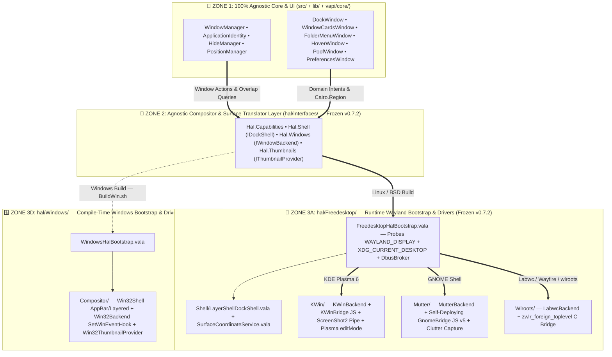
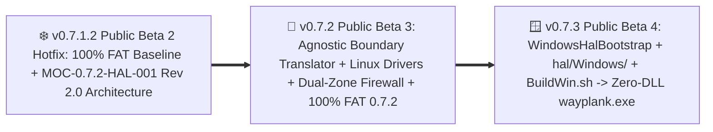

# 🏛️ WAYPLANK MASTER HARDWARE & COMPOSITOR ABSTRACTION LAYER (`HAL_COMPOSITORS`)

> **Canonical Specification for the Agnostic Compositor/Surface Boundary Translator (`hal/Interfaces/`) & Multi-OS Compositor Isolation**  
> **Pedigree:** Plank (Legacy X11) ➔ WayPlank (Wayland: KWin / Mutter / Labwc) ➔ Unified Multi-Compositor & Multi-OS Engine (Linux / BSD / Windows)  
> **Author & Maintainer:** Sergio Melas (<sergiomelas@gmail.com>) © 2026  
> **ISA-88 Document Control & MOC:** `DOC-ARCH-COMP-002` • **Revision `2.0`** (`MOC-0.7.2-HAL-001` — Compositor/Surface Boundary Translator, `FreedesktopHalBootstrap` Isolation & Dual-Zone Firewall)  
> **Companion Architecture Specifications:** [Master Architecture Overview (`README.md`)](README.md) • [HAL_BUSES.md](HAL_BUSES.md) *(IPC & System Bus Translator: `D-Bus` vs `Windows Bus`)* • [APPLICATION_IDENTITY_ENGINE.md](APPLICATION_IDENTITY_ENGINE.md) *(`IAppSystem` Data Translator: `.desktop` & `/proc` vs `.lnk` & `AUMID` + 6-Layer Identity Engine)* • [HAL_WINDOWS_BACKEND.md](HAL_WINDOWS_BACKEND.md) *(Windows Compositor/Bus Backend & Zero-DLL `wayplank.exe` Cross-Build)*  
> **Single Source of Truth:** Master Compositor & Shell HAL reference linked by [README.md](../../README.md), [CONTRIBUTING.md](../../CONTRIBUTING.md), [USER_GUIDE.md](../USER_GUIDE.md), [WAYPLANK_FORK_INTEGRATION_ROADMAP.md](../Historic/WAYPLANK_FORK_INTEGRATION_ROADMAP.md), [WAYPLANK_COMPOSITORS_CHEATSHEET.md](../../FAT/Test%20Files/WAYPLANK_COMPOSITORS_CHEATSHEET.md), and [WAYPLANK_LIFETIME_BUG_REGISTER.md](../../FAT/WAYPLANK_LIFETIME_BUG_REGISTER.md)  
> **Staged Execution & Freeze Schedule (`v0.7.1.2` ➔ `v0.7.2` ➔ `v0.7.3`):**
> - **Active Public Baseline `v0.7.1.2` (Public Beta 2 Hotfix — Concluded 2026-11-14, 100.0% FAT Qualified):** Wayland 3-compositor HAL active on `main` (`KWin`, `Mutter`, `Labwc`).
> - **Next Beta `v0.7.2` (Public Beta 3 — Agnostic Boundary Translator & Linux HAL/Bus Freeze ~Nov 14–30, 2026):** Introduces the 100% OS-blind **Agnostic Boundary Translator Layer (`hal/Interfaces/`)** and physically concentrates all Wayland, D-Bus, XDG, and Linux drivers into `hal/{Freedesktop,Linux}/` with an automated Dual-Zone HAL Purity Firewall. **In `v0.7.2`, only the Linux/Freedesktop side is implemented and qualified so `hal/Interfaces/` is 100% frozen before adding Windows.**
> - **Subsequent Beta `v0.7.3` (Public Beta 4 — Native Windows Plug-In ~Dec 2026):** Plugs `hal/Windows/{WindowsHalBootstrap,Compositor,Bus,AppSystem,Telemetry}/` and `./BuildWin.sh` ([HAL_WINDOWS_BACKEND.md](HAL_WINDOWS_BACKEND.md)) directly into the frozen `v0.7.2` `hal/Interfaces/` translators (`build/wayplank.exe`) with zero modifications to Core or Linux backends.

---

## 📌 Table of Contents

- [1. ISA-88 MOC Governance, Prime Directive & 3-Zone Compositor Boundary](#1-isa-88-moc-governance-prime-directive--3-zone-compositor-boundary)
  - [1.1 Document Revision History (`MOC-0.7.2-HAL-001`)](#11-document-revision-history-moc-072-hal-001)
  - [1.2 The Compositor & Surface Boundary Translator Principle (`hal/Interfaces/`)](#12-the-compositor--surface-boundary-translator-principle-halinterfaces)
- [2. The 7 Canonical Agnostic Translator Contracts (`hal/Interfaces/`)](#2-the-7-canonical-agnostic-translator-contracts-halinterfaces)
  - [2.1 Exact Surface, Window & Capability Translation Matrix](#21-exact-surface-window--capability-translation-matrix)
- [3. The 4 Compositor Drivers & OS Bootstraps Below the Translator Layer](#3-the-4-compositor-drivers--os-bootstraps-below-the-translator-layer)
  - [3.1 4-Compositor Contract Matrix & Non-Negotiable Safety Invariants](#31-4-compositor-contract-matrix--non-negotiable-safety-invariants)
- [4. Compile-Time Target Matrix & Automated Dual-Zone HAL Purity Firewall](#4-compile-time-target-matrix--automated-dual-zone-hal-purity-firewall)
- [5. Two-Phase Beta Consolidation Roadmap (`v0.7.2` Translator Freeze ➔ `v0.7.3` Windows Plug-In)](#5-two-phase-beta-consolidation-roadmap-v072-translator-freeze--v073-windows-plug-in)

---

## 1. ISA-88 MOC Governance, Prime Directive & 3-Zone Compositor Boundary

### 1.1 Document Revision History (`MOC-0.7.2-HAL-001`)

| Revision | Date | Author | Summary of Architectural Changes (`MOC-0.7.2-HAL-001`) |
| :---: | :---: | :--- | :--- |
| **`1.0`** | `2026-11-14` | Sergio Melas | Initial multi-compositor & multi-OS HAL specification (`v0.7.1.2` baseline). |
| **`2.0`** | `2026-11-14` | Sergio Melas | **`MOC-0.7.2-HAL-001`:** Formalized the **Compositor & Surface Boundary Translator (`hal/Interfaces/`)**; purged `DBusConnection` from `IWindowBackend`; moved runtime Wayland compositor probe out of `hal/Interfaces/` into `hal/Freedesktop/FreedesktopHalBootstrap.vala` (paired with `WindowsHalBootstrap.vala`); added `PopupSurfaceKind.POOF_ANIMATION`, `IDockShell.place_transient_overlay`, `IDockShell.apply_input_region` (`#34`), and `PlatformCapabilities.{supports_quit_action,supports_poof_overlay}`; renamed `IPortalThemeBus` $\rightarrow$ `IDesktopThemeBus`; expanded `BuildBin.sh` firewall to guard both `src/ lib/` and `hal/Interfaces/ vapi/core/`. |

> [!IMPORTANT]
> **THE HAL PRIME DIRECTIVE & BOUNDARY TRANSLATOR LAW:**  
> `HAL = Any part of the repository that depends on, communicates with, or negotiates with the OS kernel, desktop session, IPC bus, window manager, or display compositor.`  
> *(For the complete 3-Zone architecture, canonical directory tree, and 112-file / 74-chunk migration map, see [**Master Architecture Overview (`README.md` §1–§6)**](README.md).)*

### 1.2 The Compositor & Surface Boundary Translator Principle (`hal/Interfaces/`)

Because **`hal/Interfaces/` is compiled unmodified into both `build/wayplank` (Linux/BSD) and `build/wayplank.exe` (Windows)**, `hal/Interfaces/` cannot reference `GtkLayerShell`, `DBusConnection`, `XdgSessionDesktop`, `KWinBackend`, `MutterBackend`, `LabwcBackend`, or `HWND`. Instead, WayPlank enforces a strict **3-Zone Dichotomic Architecture**:

1. **Zone 1 — 100% OS-Agnostic Portable Core (`src/` + `lib/` + `vapi/core/`):**
   - Written purely against cross-platform **Vala + GLib/GObject/GIO + Gee + Json-GLib + Cairo + Pango + GdkPixbuf + GTK3**.
   - Zero `#ifdef` platform conditionals in Vala, zero compositor checks (`is_kwin()`, `is_mutter()`, `is_labwc()`), zero `GtkLayerShell.*` calls, zero `window.input_shape_combine_region()` calls, zero `/proc` or `/sys` reads, zero D-Bus types, and zeroUnix `<unistd.h>` / `<sys/prctl.h>` headers in `vapi/core/`.
2. **Zone 2 — The Agnostic Boundary Translator Layer (`hal/Interfaces/` — Frozen in `v0.7.2`):**
   - Exposes `Hal` (`Hal.Capabilities`, `Hal.Shell`, `Hal.Windows`, `Hal.Thumbnails`, `Hal.Bus`, `Hal.Apps`, `Hal.Telemetry`, `Hal.Runtime`) as a pure semantic translator accepting **domain intents** (`PopupSurfaceKind`, `WindowAction`, `Cairo.Region`, `DesktopUtilityKind`) and emitting **normalized domain DTOs** (`WindowInfo`, `AppDescriptor`, `ProcessSnapshot`, `Gdk.Pixbuf`).
3. **Zone 3 — Physically Isolated Southbound Bootstraps & Compositor Drivers (`hal/*/`):**
   - **`FreedesktopHalBootstrap`** (`hal/Freedesktop/FreedesktopHalBootstrap.vala`) — probes `WAYLAND_DISPLAY`, `XDG_CURRENT_DESKTOP`, and D-Bus names at startup to bind `Hal.*` to:
     - **`KWin`** (`hal/Freedesktop/KWin/` — KDE Plasma 6 + `LayerShellDockShell`)
     - **`Mutter`** (`hal/Freedesktop/Mutter/` — GNOME Shell + Embedded JS Bridge `v5` + `LayerShellDockShell` IPC path)
     - **`Labwc / wlroots`** (`hal/Freedesktop/Wlroots/` — `zwlr_foreign_toplevel_management_v1` C Bridge + `LayerShellDockShell`)
   - **`WindowsHalBootstrap`** (`hal/Windows/WindowsHalBootstrap.vala` — `v0.7.3`) — binds `Hal.*` at startup on Windows to **`Windows Compositor`** (`hal/Windows/Compositor/` — `Win32Shell` `SHAppBarMessage`/`WS_EX_LAYERED` + `Win32Backend` `SetWinEventHook` + `Win32ThumbnailProvider`).

---

## 2. The 7 Canonical Agnostic Translator Contracts (`hal/Interfaces/`)

All communication from Zone 1 (`src/` + `lib/`) into Zone 3 (`hal/*/`) flows exclusively through **`Hal`** (`hal/Interfaces/Hal.vala`) and **7 pure Vala translator contracts** plus **`PlatformCapabilities`**:

1. **`PlatformCapabilities` (Capability-Driven Honest UI Translator):**
   - Immutable struct queried by `PreferencesWindow`, `HideManager`, `WindowCardsWindow`, `PoofWindow`, `PlankDockItem`, and `PreferencesDockItem`:
     - `supports_live_thumbnails`, `supports_panel_struts`, `supports_primary_display`, `supports_dodge_active`, `supports_dodge_all`, `supports_pressure_reveal`, `supports_poof_overlay`, `supports_quit_action`, `supports_hardware_brightness`, `fallback_hide_mode`.
   - Eliminates `WindowControl.is_labwc()`, `WindowControl.is_mutter()`, `GtkLayerShell.is_supported()`, and `environment_is_session_desktop(PANTHEON)` from all Core/UI widgets.
2. **`IDockShell` (Surface, Strut, Popup & Input-Region Translator):**
   - `init_dock_surface (Gtk.Window)`
   - `init_popup_surface (Gtk.Window, PopupSurfaceKind)` where `PopupSurfaceKind = { TOOLTIP, FOLDER_MENU, PREVIEW_CARDS, POOF_ANIMATION }`
   - `configure_dock_geometry (Gtk.Window, Gtk.PositionType, Gdk.Rectangle dock_rect, int monitor_num, bool auto_pinned)`
   - `update_exclusive_zone (Gtk.Window, bool enabled, int thickness, Gtk.PositionType pos, int monitor_num)`
   - `apply_input_region (Gtk.Window, Cairo.Region? region)` *(abstracts Wayland/GTK `input_shape_combine_region` `#34` vs Windows `SetWindowRgn` / `WM_NCHITTEST -> HTTRANSPARENT`)*
   - `position_popup_surface (Gtk.Window, PopupSurfaceKind, Gdk.Rectangle anchor_or_dock, Gtk.PositionType pos, int x, int y)`
   - `place_transient_overlay (Gtk.Window, string role_title, int global_x, int global_y, owned OverlayPlacedFunc on_placed)` *(abstracts VSync 3-beat `PoofWindow` placement across KWin, Mutter, and Win32 `SetWindowPos`)*
3. **`IWindowBackend` (100% Bus-Free Foreign Window Translator):**
   - **Zero `DBusConnection` parameters** in `hal/Interfaces/` (southbound bus handles are injected inside `FreedesktopHalBootstrap`).
   - Signals: `state_changed ()`, `bridge_reconnected ()`.
   - Intersection state queries: `active_window_intersects ()`, `maximized_window_intersects ()`, `fullscreen_window_intersects ()`, `is_showing_desktop ()`.
   - Methods: `get_windows () -> Gee.ArrayList<WindowInfo>`, `get_active_window () -> WindowInfo?`, `update_dock_rect (int x, int y, int w, int h)`, `perform_window_action (string window_id, WindowAction)`, `activate_uri_windows (Gee.ArrayList<string> window_ids)`, `minimize_windows (Gee.ArrayList<string> window_ids)`, `toggle_show_desktop ()`.
4. **`IThumbnailProvider` (Live Window Frame Capture Translator):**
   - Signal: `thumbnail_ready (string window_id)`.
   - Methods: `get_cached_thumbnail (string window_id, int target_w, int target_h) -> Gdk.Pixbuf?`, `request_thumbnail (WindowInfo w, int target_w, int target_h)`, `evict_window (string window_id)`, `prune_stale (Gee.Collection<string> live_ids)`.
   - Enforces mandatory opaque alpha normalization (`buffer[i + 3] = 255`) across `KWin` `ScreenShot2` pipes, `Mutter` `/dev/shm` actor textures, and `Windows` `PrintWindow(PW_RENDERFULLCONTENT)` DIBs.
5. **`IBusBackend` (Unified IPC & Session/Desktop Event Translator — [HAL_BUSES.md](HAL_BUSES.md)):**
   - Sub-translators: `IDockIpcServer`, `IAppMenuBus`, `IMediaController`, `INotificationBus`, **`IDesktopThemeBus`** *(OS-agnostic replacement for `IPortalThemeBus`)*, and `ILauncherBadgeBus` (`LauncherBadgeState` typed struct — zero `GLib.Variant` in Core).
6. **`IAppSystem` (Launcher, Process & Recent-Document Data Translator — [APPLICATION_IDENTITY_ENGINE.md](APPLICATION_IDENTITY_ENGINE.md)):**
   - Translates `.desktop` + `/proc/<pid>` + `RecentManager` on Linux/BSD and `.lnk` (`IShellLinkW`) + UWP `AUMID` + Process PEB + `Recent\*.lnk` on Windows into `AppDescriptor`, `ProcessSnapshot`, and `RecentDocInfo`.
7. **`ISystemTelemetry` & `IPlatformRuntime` (16-Docklet Hardware Telemetry & OS Runtime Translators — [HAL_BUSES.md](HAL_BUSES.md)):**
   - 9 hardware/storage/session providers (`ICpuMemoryProvider`, `IBatteryProvider`, `INetworkProvider`, `IAudioProvider`, `IBrightnessProvider`, `ITrashProvider`, `IEjectorProvider`, `IScreenshotProvider`, `ISessionPowerProvider`) plus `IPlatformRuntime` (`DesktopUtilityKind`, `parse_command_argv`, `http_get_sync`, `open_uri`, `extract_archive`, `validate_keyfile_isolated`, `set_autostart_enabled`, `replace_running_instances`, `get_current_pid`, `set_process_title`, `system_resumed`).

### 2.1 Exact Surface, Window & Capability Translation Matrix

| Core Intent (`src/` + `lib/`) | Zone 2 Translator Call (`hal/Interfaces/`) | Wayland Layer-Shell (`KWin` / `Labwc`) | GNOME Shell (`Mutter` JS Extension `v5`) | Windows `7 ⟷ 11+` (`Win32Shell` / `Win32Backend`) |
| :--- | :--- | :--- | :--- | :--- |
| **Dock Surface Realize** | `Hal.Shell.init_dock_surface (win)` | `GtkLayerShell.init_for_window`, `LAYER_TOP`, `KEYBOARD_MODE_NONE` | Marks `DOCK` typehint + awaits `PositionDock` IPC | `WS_EX_LAYERED \| WS_EX_TOOLWINDOW \| WS_EX_TOPMOST` |
| **Panel Strut (`ReserveSpace`)** | `Hal.Shell.update_exclusive_zone (...)` | `GtkLayerShell.set_exclusive_zone (thickness)` | `PositionDock(..., reserve=true)` $\rightarrow$ `affectsStruts` actor | `SHAppBarMessage (ABM_NEW / ABM_QUERYPOS / ABM_SETPOS)` |
| **Click-Through Padding (`#34`)** | `Hal.Shell.apply_input_region (win, region)` | `win.input_shape_combine_region (region)` (`wl_surface.set_input_region`) | `win.input_shape_combine_region (region)` | `SetWindowRgn` + `WM_NCHITTEST` $\rightarrow$ `HTTRANSPARENT` |
| **Tooltip / Drawer / Cards** | `Hal.Shell.position_popup_surface (...)` | `GtkLayerShell` edge anchors + margins (`OVERLAY` for drawer) | `PositionHover (exact_title, x, y)` (`move_frame`) | `SetWindowPos (hwnd, HWND_TOPMOST, x, y, 0, 0, SWP_NOACTIVATE)` |
| **Unpin Smoke (`PoofWindow`)** | `Hal.Shell.place_transient_overlay (...)` | `KWinBridge.PositionHover("WayPlank Poof", x, y)` (`disabled` on Labwc) | `GnomeBridge.PositionHover("WayPlank Poof", x, y)` | `SetWindowPos` before `Opacity = 1.0` reveal |
| **Preference Capability Gating** | `Hal.Capabilities.supports_*` | All `true` on KWin; `live_thumbnails`/`dodge_active`/`poof` `false` on Labwc | `pressure_reveal = false`, `live_thumbnails = true` | All `true` (`AppBar` struts + `PrintWindow` + `SetWinEventHook`) |

---

## 3. The 4 Compositor Drivers & OS Bootstraps Below the Translator Layer



### 3.1 4-Compositor Contract Matrix & Non-Negotiable Safety Invariants

| Subsystem | KDE Plasma 6 (`KWin`) | GNOME Shell (`Mutter`) | Labwc / `wlroots` | `Windows Compositor` (`Win 7 ⟷ 11+` Pure Win32 + Dynamic DWM) |
| :--- | :--- | :--- | :--- | :--- |
| **Physical HAL Path** | `hal/Freedesktop/KWin/` *(`v0.7.2`)* | `hal/Freedesktop/Mutter/` *(`v0.7.2`)* | `hal/Freedesktop/Wlroots/` *(`v0.7.2`)* | `hal/Windows/Compositor/` *(`v0.7.3`)* |
| **Window Tracking & Actions (`IWindowBackend`)** | Dynamic ECMAScript bridge over `org.kde.KWin /Scripting` (`0%` polling, auto-heals on `kwin_wayland --replace`) | Embedded `wayplank-bridge@wayplank.org` (`v5`) over `org.wayplank.GnomeBridge` (auto-resets `ExtensionState.ERROR`) | Native `libwayland-client` C bridge (`wlr-toplevel-bridge.c`) implementing `zwlr_foreign_toplevel_manager_v1` | Out-of-context `SetWinEventHook` (`EVENT_SYSTEM_FOREGROUND` .. `EVENT_OBJECT_NAMECHANGE` + `LOCATIONCHANGE` $\ge 50\text{ ms}$) + `AttachThreadInput` |
| **Dock, Input Mask & Popup Anchoring (`IDockShell`)** | `gtk-layer-shell` (`TOP`/`BOTTOM` + margins + exclusive zone) + `input_shape_combine_region` (`#34`) | Physical `monitor_geometry` (`monGeo`) + `PositionDock` / `PositionHover` + synthetic `affectsStruts` actor + `input_shape_combine_region` | `gtk-layer-shell` (`TOP`/`BOTTOM`/`OVERLAY` + native exclusive zone) + `input_shape_combine_region` | `SHAppBarMessage` (`ABM_NEW`/`ABM_SETPOS`) + `WS_EX_LAYERED \| WS_EX_TOOLWINDOW` + `SetWindowRgn` / `WM_NCHITTEST` (`HTTRANSPARENT`) |
| **PID, CLI & Launcher Identity (`IAppSystem`)** | Exact per-window `pid` + `desktopFileName` $\rightarrow$ `/proc/<pid>` (`LinuxProcessInspector`) | Exact `win.get_pid()` + `Shell.WindowTracker` $\rightarrow$ `/proc/<pid>` (`LinuxProcessInspector`) | Heuristic $O(1)$ cached `/proc` matcher (`resolve_toplevel_process`) disambiguated by `app_id` & title | `GetWindowThreadProcessId` $\rightarrow$ `QueryFullProcessImageNameW`, PEB `CommandLine` & COM `PKEY_AppUserModel_ID` (`AUMID`) |
| **Live Window Previews (`IThumbnailProvider`)** | `org.kde.KWin.ScreenShot2` raw pipe capture (BGRA $\rightarrow$ RGBA with forced `alpha = 255`, `2.5s` TTL) | Extension Clutter actor texture capture (`/dev/shm/wayplank_thumb_*.png`) over IPC | Clean Cairo fallback cards with high-DPI app icon & live title (`supports_live_thumbnails = false`) | `PrintWindow(PW_RENDERFULLCONTENT)` with automatic fallback to `PrintWindow(..., 0)` / `BitBlt` $\rightarrow$ `GdkPixbuf` (`alpha = 255`) |
| **Show Desktop & Edit Mode Coexistence** | Tracks `org.kde.PlasmaShell.editMode`: allows `showingDesktop` + `FullscreenInhibit` in Edit Mode; keeps dock visible on `Super+D` (`#27`) | Intercepts `showing-desktop-changed` outside `Main.overview.visible` to keep dock visible on `Super+D` | Gates intersection checks on `t->active` so `Show Desktop` never hides the dock | Shell COM `IShellDispatch4::ToggleDesktop()` + `ABN_FULLSCREENAPP` game/fullscreen auto-hide |
| **Critical Safety Invariants** | Autostart `.desktop` must whitelist `ScreenShot2`; $\ge 50\text{ ms}$ debounce on `captionChanged` | **Zero async presentation timers** (`Pitfall #1`); **exact `===` title matching** on internal surfaces; `!win.mapped` guard before `move_frame` | Never invoke KWin/Mutter D-Bus methods; normalize `"Unknown"` output labels to `"Monitor"` | Resolve optional Vista/8/10/11+ APIs (`DwmGetWindowAttribute`, `SetProcessDpiAwarenessContext`) via `GetProcAddress` so one binary runs across **`Windows 7 ⟷ 11+ & Future Windows`** |

> [!WARNING]
> **Universal Anti-Message-Rush & Idempotence Law (All 4 Compositors):**  
> Never invoke IPC/D-Bus calls, strut updates, or exclusive-zone mutations inside `draw()`, pointer-motion handlers, or geometry ticks (`update_size_and_position()`). All shell/chrome mutations must be strictly event-driven (on preference change or initial map) and guarded by a 3-way idempotence check (`enabled == last_enabled && thickness == last_thickness && position == last_position`).

---

## 4. Compile-Time Target Matrix & Automated Dual-Zone HAL Purity Firewall

Each platform builder compiles the **exact same Zone 1 (`src/`, `lib/`, `vapi/core/`) and Zone 2 (`hal/Interfaces/`) sources**, pairing them solely with that platform's southbound Zone 3 `hal/` driver directories:

| Build Script | Target Milestone | Output Artifact | Compiled Source Directories | Linked Platform Libraries |
| :--- | :---: | :--- | :--- | :--- |
| **`./BuildDeb.sh` / `./BuildRpm.sh`** | **`v0.7.2` (Public Beta 3 — Translator Freeze)** | `wayplank` (`.deb` / `.rpm`) | `src/` + `lib/` + `vapi/core/` + `hal/Interfaces/` + `hal/Freedesktop/` + `hal/Linux/` + `vapi/freedesktop/` | `gtk+-3.0`, `gtk-layer-shell-0`, `gio-unix-2.0`, `wayland-client` |
| **`./BuildWin.sh`** *(See [HAL_WINDOWS_BACKEND.md](HAL_WINDOWS_BACKEND.md))* | **`v0.7.3` (Public Beta 4 — Windows Plug-In)** | `wayplank.exe` (Zero-DLL PE32+) | `src/` + `lib/` + `vapi/core/` + `hal/Interfaces/` + `hal/Windows/` + `vapi/windows/` | Static GTK3/Cairo/GLib `.a` group + stock Win32 OS DLLs (`user32`, `gdi32`, `shell32`, `dwmapi`, `ole32`, `dxva2`, `winhttp`) |
| **`./BuildBsd.sh`** *(Future Horizon)* | **`v0.7.x+` (Contributor Track)** | `wayplank` (BSD pkg) | `src/` + `lib/` + `vapi/core/` + `hal/Interfaces/` + `hal/Freedesktop/` + `hal/BSD/` + `vapi/freedesktop/` | `gtk+-3.0`, `gtk-layer-shell-0`, `gio-unix-2.0`, `wayland-client`, `kvm` |

### Automated Dual-Zone HAL Purity Firewall (`BuildBin.sh` — Enforced in `v0.7.2+`)
Once Move 4 completes on `hal-v0.7.2`, `BuildBin.sh` enforces a strict pre-compile firewall over **both Zone 1 (`src/`, `lib/`, `vapi/core/`) and Zone 2 (`hal/Interfaces/`)** — alongside `#ifndef _WIN32` guarding weak ELF symbol probes in `lib/gtk-compat.c` and Unix install prefixes in `include/config.h`, `vapi/freedesktop/unix-compat.vapi` isolating `<unistd.h>`/`<sys/prctl.h>`, and `GLib.Memory.set()` replacing `Posix.memset` in `lib/Drawing/Surface.vala`:

```bash
# Enforced automatically in BuildBin.sh before valac runs (starting in v0.7.2):
FORBIDDEN_ABOVE_DRIVERS='GtkLayerShell|GdkWayland|GdkX11|GdkWin32|Posix\.|GLib\.Unix|UnixFDList|UnixInputStream|sys/prctl\.h|unistd\.h|DesktopAppInfo|GDesktopAppInfo|VolumeMonitor|RecentManager|show_uri|\[DBus|DBusConnection|DBusProxy|DBusManager|DBusClient|BusType\.|Bus\.(get|own_name|watch_name)|UnityClient|IPortalThemeBus|/proc/|/sys/|/dev/i2c|trash://|WindowControl|WindowCapabilities|KWin|MutterBackend|LabwcBackend|WlrBridge|SurfaceCoordinateService|BrightnessControl|XdgSession|environment_is_session_|Shell\.parse_argv|has_prefix\s*\(\s*"/"|Win32|HWND'

if grep -rnE "$FORBIDDEN_ABOVE_DRIVERS" src/ lib/ hal/Interfaces/ vapi/core/; then
    echo "❌ HAL FIREWALL VIOLATION: OS/Compositor/Bus/Path leak detected in Core or Agnostic Translator Layer!"
    exit 1
fi
```

---

## 5. Two-Phase Beta Consolidation Roadmap (`v0.7.2` Translator Freeze ➔ `v0.7.3` Windows Plug-In)



### Phase 1 — `v0.7.2` (Public Beta 3): Agnostic Boundary Translator & Linux Freeze (`MOC-0.7.2-HAL-001`)
- [x] **Move 1 — Physical Directory Skeleton & Zero-Logic Driver Relocation *(Implemented & Smoke-Checked at `938d3be`, `backup/0.7.2-move-1`)*:** Create `hal/{Interfaces,Freedesktop,Linux}/` & `vapi/{core,freedesktop}/`, relocate `21` existing backend/protocol/VAPI files, wire `BuildBin.sh` & `po/generate_translations.py`, and verify `.deb` build (`0` warnings).
- [x] **Move 2 — Compositor Shell, Input-Region, Thumbnail & Capability Translators (`[M2-01]`–`[M2-16]`, *Implemented & 3-Compositor Smoke-Checked at `73da67d`, `backup/0.7.2-move-2`)*:** Freeze pure `Hal`, `PlatformCapabilities`, `IDockShell` (incl. `apply_input_region`, `PopupSurfaceKind`, `place_transient_overlay`), `IWindowBackend` (purged of `DBusConnection`), and `IThumbnailProvider`; extract Wayland probe into `FreedesktopHalBootstrap.vala` and `LayerShellDockShell.vala`; purify all `13` Core widget/layout/controller callers *(formal ISA-88 `FAT 0.7.2` qualification pending in Move 4)*.
- [x] **Move 3 — Bus, Telemetry, 16-Docklet, C/VAPI & Runtime Translators (`[M3-01]`–`[M3-30]`, *Implemented & 3-Compositor Smoke-Checked at `21e2fb0`, `backup/0.7.2-move-3`)*:** Freeze `IBusBackend` (`IDockIpcServer`, `IMediaController`, `INotificationBus`, `IDesktopThemeBus`, `ILauncherBadgeBus`), `ISystemTelemetry` (`9` providers incl. `ITrashProvider` & `IEjectorProvider`), and `IPlatformRuntime` (`DesktopUtilityKind`, HTTP, archive, isolated KeyFile validator, autostart, signals); relocate `<unistd.h>`/`<sys/prctl.h>` to `vapi/freedesktop/unix-compat.vapi`; retire `Unity.vala`/`DBusManager.vala`/`lib/DBus/`; purify all docklets, dialogs, `SystemTheme`, `Main`, and `AbstractMain` *(formal ISA-88 `FAT 0.7.2` qualification pending in Move 4)*.
- [ ] **Move 4 — `IAppSystem` Data Translator, Cross-OS Path/Argv Purity & Firewall (`[M4-01]`–`[M4-19]`):** Freeze `IAppSystem` (`AppDescriptor`, `ProcessSnapshot`, `RecentDocInfo`) and `IAppMenuBus`; replace POSIX `Shell.parse_argv` (`\` trap) with `Hal.Runtime.parse_command_argv()` and Unix `has_prefix("/")` with `GLib.Path.is_absolute()`; activate the **Dual-Zone HAL Purity Firewall** in `BuildBin.sh` and submit for formal human **`FAT 0.7.2`** qualification at **`100.0%` (`0 [ko]`)** across KWin, Mutter, and Labwc.

### Phase 2 — `v0.7.3` (Public Beta 4): Native Windows Southbound Plug-In (`hal/Windows/`)
5. **Move W1–W6 — `WindowsHalBootstrap` & `hal/Windows/` Plug-In:** Implement `hal/Windows/{WindowsHalBootstrap,Compositor,Bus,AppSystem,Telemetry}/` against the frozen `v0.7.2` `hal/Interfaces/` translators and enable `./BuildWin.sh` ([HAL_WINDOWS_BACKEND.md](HAL_WINDOWS_BACKEND.md)) without modifying a single line of Zone 1 Core or Zone 2 Translator code.
