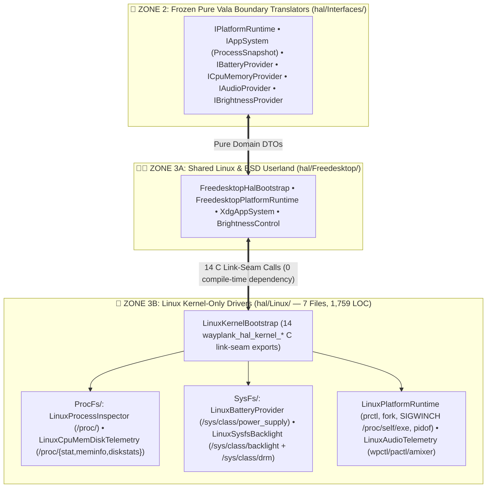

# 🐧 WAYPLANK LINUX KERNEL BACKEND ARCHITECTURE (`HAL_LINUX_BACKEND`)

> **As-Built Specification for the Southbound Linux Kernel & OS Plumbing Layer (`hal/Linux/`) Behind the Freedesktop Shared Userland (`hal/Freedesktop/`) and Agnostic Boundary Translators (`hal/Interfaces/`)**  
> **Pedigree:** Scattered `/proc` & `/sys` Calls (`v0.2.0`–`v0.7.1.2`) ➔ Concentrated Linux Kernel Driver Layer (`v0.7.2` Public Beta 3) ➔ Qualified Production Baseline (`v0.7.3.2` Public Beta 4 Hotfix)  
> **Author & Maintainer:** Sergio Melas (<sergiomelas@gmail.com>) © 2026  
> **ISA-88 Document Control & MOC:** `DOC-ARCH-LIN-007` • **Revision `1.0`** (`2026-11-22` — **As-Built Baseline** matching `v0.7.3.2` / `main` `7a5bdb6`, `100.0%` 4-Platform FAT Qualified `529/529`, 8/8 HAL Purity Firewall `GREEN`)  
> **Companion Master Specifications:** [Master Architecture Overview (`README.md`)](README.md) • [HAL_COMPOSITORS.md](HAL_COMPOSITORS.md) • [HAL_BUSES.md](HAL_BUSES.md) • [APPLICATION_IDENTITY_ENGINE.md](APPLICATION_IDENTITY_ENGINE.md) • [HAL_WINDOWS_BACKEND.md](HAL_WINDOWS_BACKEND.md) • [HAL_BSD_BACKEND.md](HAL_BSD_BACKEND.md)  
> **Single Source of Truth:** Canonical **As-Built** reference for Zone 3B (`hal/Linux/`) and its `14` C link-seam exports (`wayplank_hal_kernel_*`) consumed by `hal/Freedesktop/`. Serves as the exact behavioral contract mirrored by [`HAL_BSD_BACKEND.md`](HAL_BSD_BACKEND.md) (`DOC-ARCH-BSD-006`) for `v0.7.4`.

---

## 📌 Table of Contents

- [1. ISA-88 Document Governance & 3-Zone Boundary Position](#1-isa-88-document-governance--3-zone-boundary-position)
  - [1.1 Document Revision History](#11-document-revision-history)
  - [1.2 Dichotomic Split: Shared `hal/Freedesktop/` vs. Kernel-Only `hal/Linux/`](#12-dichotomic-split-shared-halfreedesktop-vs-kernel-only-hallinux)
- [2. The 14 Kernel Link-Seam Exports (`LinuxKernelBootstrap.vala`)](#2-the-14-kernel-link-seam-exports-linuxkernelbootstrapvala)
- [3. As-Built Module-by-Module Technical Specification (`7` Files, `1,759` LOC)](#3-as-built-module-by-module-technical-specification-7-files-1759-loc)
  - [3.1 `hal/Linux/ProcFs/LinuxProcessInspector.vala` (`524` LOC)](#31-hallinuxprocfslinuxprocessinspectorvala-524-loc)
  - [3.2 `hal/Linux/ProcFs/LinuxCpuMemDiskTelemetry.vala` (`172` LOC)](#32-hallinuxprocfslinuxcpumemdisktelemetryvala-172-loc)
  - [3.3 `hal/Linux/SysFs/LinuxBatteryProvider.vala` (`121` LOC)](#33-hallinuxsysfslinuxbatteryprovidervala-121-loc)
  - [3.4 `hal/Linux/SysFs/LinuxSysfsBacklight.vala` (`181` LOC)](#34-hallinuxsysfslinuxsysfsbacklightvala-181-loc)
  - [3.5 `hal/Linux/LinuxAudioTelemetry.vala` (`152` LOC)](#35-hallinuxlinuxaudiotelemetryvala-152-loc)
  - [3.6 `hal/Linux/LinuxPlatformRuntime.vala` (`496` LOC)](#36-hallinuxlinuxplatformruntimevala-496-loc)
  - [3.7 `hal/Linux/LinuxKernelBootstrap.vala` (`113` LOC)](#37-hallinuxlinuxkernelbootstrapvala-113-loc)
- [4. Native Linux Build, 8-Gate HAL Purity Firewall & Packaging Pipeline](#4-native-linux-build-8-gate-hal-purity-firewall--packaging-pipeline)
- [5. Qualification Status & Non-Negotiable Invariants](#5-qualification-status--non-negotiable-invariants)

---

## 1. ISA-88 Document Governance & 3-Zone Boundary Position

### 1.1 Document Revision History

| Revision | Date | Author | Summary of Architectural Changes |
| :---: | :---: | :--- | :--- |
| **`1.0`** | `2026-11-22` | Sergio Melas | **Initial As-Built Specification (`DOC-ARCH-LIN-007`):** Formally documented the qualified `v0.7.2`–`v0.7.3.2` Zone 3B Linux kernel backend (`hal/Linux/`, 7 files / 1,759 LOC), all 14 `wayplank_hal_kernel_*` link-seam contracts, `BuildBin.sh` 8-Gate HAL Purity Firewall, and `.deb`/`.rpm` packaging invariants as the peer reference for [`HAL_BSD_BACKEND.md`](HAL_BSD_BACKEND.md). |

### 1.2 Dichotomic Split: Shared `hal/Freedesktop/` vs. Kernel-Only `hal/Linux/`

Under **`MOC-0.7.2-HAL-001`**, Linux-specific kernel interfaces are strictly isolated from Freedesktop desktop standards (`Wayland`, `gtk-layer-shell`, `D-Bus`, `XDG`):

**Horizontal Isolation Law (Enforced by Gate 4, Gate 5, Gate 6A & Gate 6B in [`BuildBin.sh`](../../BuildBin.sh)):**
- `hal/Freedesktop/` **MUST NEVER** reference any `Linux*` class name, `/proc/`, `/sys/`, or `/dev/i2c`. It compiles standalone (`Gate 4`) without `hal/Linux/`.
- `hal/Linux/` **MUST NEVER** reference `DbusBroker`, `DBus*`, `Xdg*`, `GtkLayerShell`, `KWin`, `Mutter`, or `Labwc`. It compiles standalone (`Gate 5`) without `hal/Freedesktop/`.
- The **sole bridge** between `hal/Freedesktop/` and `hal/Linux/` is the 14-symbol C link-seam declared `extern` in [`hal/Freedesktop/FreedesktopHalBootstrap.vala`](../../hal/Freedesktop/FreedesktopHalBootstrap.vala) and exported by [`hal/Linux/LinuxKernelBootstrap.vala`](../../hal/Linux/LinuxKernelBootstrap.vala).

---

## 2. The 14 Kernel Link-Seam Exports (`LinuxKernelBootstrap.vala`)

| # | C Link-Seam Symbol | Signature | Concrete Linux Implementation | Primary Consumer in `hal/Freedesktop/` |
| :---: | :--- | :--- | :--- | :--- |
| 1 | `wayplank_hal_kernel_get_runtime` | `IPlatformRuntime ()` | `LinuxPlatformRuntime.get_default ()` | `FreedesktopPlatformRuntime` |
| 2 | `wayplank_hal_kernel_get_battery` | `IBatteryProvider ()` | `LinuxBatteryProvider.get_default ()` | `FreedesktopTelemetryProvider` |
| 3 | `wayplank_hal_kernel_get_cpu_memory` | `ICpuMemoryProvider ()` | `LinuxCpuMemDiskTelemetry.get_default ()` | `FreedesktopTelemetryProvider` |
| 4 | `wayplank_hal_kernel_get_audio` | `IAudioProvider ()` | `LinuxAudioTelemetry.get_default ()` | `FreedesktopTelemetryProvider` |
| 5 | `wayplank_hal_kernel_inspect_process` | `ProcessSnapshot (int pid, bool include_children_and_fds)` | `LinuxProcessInspector.inspect_process ()` | `XdgAppSystem` |
| 6 | `wayplank_hal_kernel_is_process_alive` | `bool (int pid)` | `LinuxProcessInspector.is_process_alive ()` | `XdgAppSystem` |
| 7 | `wayplank_hal_kernel_scan_user_processes` | `Gee.ArrayList<ProcessSnapshot> ()` | `LinuxProcessInspector.scan_user_processes ()` | `XdgAppSystem` |
| 8 | `wayplank_hal_kernel_find_pid_by_app_hint` | `int (string app_hint, string caption_hint)` | `LinuxProcessInspector.find_pid_by_app_hint ()` | `XdgAppSystem` / `LabwcBackend` |
| 9 | `wayplank_hal_kernel_clear_process_caches` | `void ()` | `LinuxProcessInspector.clear_all_caches ()` | `XdgAppSystem` |
| 10 | `wayplank_hal_kernel_backlight_detect_devices` | `Gee.ArrayList<string> (out string? preferred_device, out uint32 max_raw)` | `LinuxSysfsBacklight.detect_devices ()` | `BrightnessControl` |
| 11 | `wayplank_hal_kernel_backlight_has_internal_panel` | `bool (string? backlight_device)` | `LinuxSysfsBacklight.has_internal_panel ()` | `BrightnessControl` |
| 12 | `wayplank_hal_kernel_backlight_read_raw` | `int64 (string backlight_device)` | `LinuxSysfsBacklight.read_raw ()` | `BrightnessControl` |
| 13 | `wayplank_hal_kernel_backlight_write_raw` | `bool (string backlight_device, uint32 raw_value)` | `LinuxSysfsBacklight.write_raw ()` | `BrightnessControl` |
| 14 | `wayplank_hal_kernel_backlight_monitor_device` | `GLib.FileMonitor? (string backlight_device)` | `LinuxSysfsBacklight.monitor_device ()` | `BrightnessControl` |

---

## 3. As-Built Module-by-Module Technical Specification (`7` Files, `1,759` LOC)

### 3.1 `hal/Linux/ProcFs/LinuxProcessInspector.vala` (`524` LOC)
- **Kernel Sources:** `/proc/<pid>/{cmdline,comm,cwd,exe,environ,fd,children,task/<pid>/children}` + `Posix.stat("/proc/<pid>")` (`st_uid == Posix.getuid()`).
- **Concurrency & Bounded Caches:** Protected by `static GLib.Mutex cache_mutex`. Maintains 5 bounded `Gee.HashMap` caches (`MAX_PID_CACHE_ENTRIES = 512` hard cap to prevent long-session RAM growth): `pid_cmdline_cache`, `pid_comm_cache`, `pid_cwd_cache`, `pid_exe_cache`, and `pid_snapshot_cache` (mandated by [`APPLICATION_IDENTITY_ENGINE.md §2.3`](APPLICATION_IDENTITY_ENGINE.md)).
- **Live vs. Cached Snapshots:** When `include_children_and_fds == false`, returns cached `ProcessSnapshot` after an $O(1)$ `is_process_alive(pid)` guard (invalidating stale entries if the PID exited). When `include_children_and_fds == true`, reads live child PIDs + open FD symlink targets (used for terminal-hosted children and browser profile lock files).
- **Environment & Portable Bundles:** Parses `NUL`-delimited `/proc/<pid>/environ` to populate `env_appimage` (`APPIMAGE=` verified with `FileUtils.test(..., EXISTS)`) and `env_wineprefix` (`WINEPREFIX=`). Strips `" (deleted)"` suffix from `/proc/<pid>/exe` readlinks.
- **Reverse-DNS PID Resolution (`find_pid_by_app_hint`):** Used by `LabwcBackend` (where `zwlr_foreign_toplevel` does not expose PID). Matches both full `app_id` (respecting Linux's 15-byte `TASK_COMM_LEN` truncation) and reverse-DNS tail segments (e.g. `org.kde.kate` $\rightarrow$ `kate`, `chrome-*` $\rightarrow$ `chrome`), boosting main processes (`!contains("--type=") && !contains("crashpad")`) and caption token hits (`+50` per token for multi-VM QEMU isolation).

### 3.2 `hal/Linux/ProcFs/LinuxCpuMemDiskTelemetry.vala` (`172` LOC)
- **CPU (`cpu_pct`):** Differential sampling of first `cpu ` aggregate line in `/proc/stat` (`user + nice + system + idle + iowait + irq + softirq + steal`, with `idle_all = idle + iowait`).
- **RAM (`ram_pct`, `ram_used_gb`, `ram_total_gb`):** Parses `MemTotal:` and `MemAvailable:` from `/proc/meminfo` (accurate reclaimable-cache accounting).
- **Disk I/O (`io_pct`):** Differential `io_ticks` (field 12, milliseconds busy) across whole block devices (`sd?`, `vd?`, `nvme*` without `p`, `mmcblk*` without `p`) in `/proc/diskstats` divided by monotonic elapsed ms.
- **Global System Pressure Formula:** Bottleneck-dominant blend `round(0.60 * max(cpu, ram, io) + 0.40 * mean(cpu, ram, io))` clamped to `[0, 100]`.

### 3.3 `hal/Linux/SysFs/LinuxBatteryProvider.vala` (`121` LOC)
- **Discovery:** Scans `/sys/class/power_supply/*` for `type == "Battery"` (fallback `BAT0`..`BAT3`), caching the resolved directory path and re-probing automatically if hot-unplugged.
- **Query:** Reads `capacity` (`0..100`) and `status` (`"Charging"`, `"Full"`, `"Discharging"`, `"Not charging"`). Returns `has_battery = false, percentage = 100, is_full = true` on desktop workstations without batteries.

### 3.4 `hal/Linux/SysFs/LinuxSysfsBacklight.vala` (`181` LOC)
- **Device Discovery:** Enumerates `/sys/class/backlight/*` requiring both `max_brightness` and `brightness`, prioritizing native GPU drivers (`amdgpu_bl*`, `intel_backlight`) over generic `acpi_video*`.
- **Internal Panel & Clamshell Guard:** Cross-checks `/sys/class/backlight/<dev>/device/enabled` and `/sys/class/drm/*-{eDP,LVDS,DSI}-*/{status,enabled}` so closed-lid laptops using external monitors correctly report `has_internal_panel() == false`.
- **I/O & Monitoring:** Reads `actual_brightness` (fallback `brightness`), writes raw integers to `brightness`, and attaches a `GLib.FileMonitor` (`inotify`) for zero-polling external brightness sync.

### 3.5 `hal/Linux/LinuxAudioTelemetry.vala` (`152` LOC)
- **Backend Cascade:**
  1. **PipeWire (`wpctl`):** Caches binary path + `LC_ALL=C` environment behind `GLib.Mutex` (eliminating comma-decimal locale bugs); runs `wpctl get-volume @DEFAULT_AUDIO_SINK@`, `set-mute`, `set-volume -l 1.5` (0–150%).
  2. **PulseAudio (`pactl`):** Runs `LC_ALL=C pactl get-sink-mute` / `get-sink-volume` and `set-sink-*`.
  3. **ALSA (`amixer`):** Write fallback (`amixer set Master ...`).

### 3.6 `hal/Linux/LinuxPlatformRuntime.vala` (`496` LOC)
- **Process Identity & Signals:** `getpid()`, `set_process_title()` (`prctl(PR_SET_NAME)` when `HAVE_SYS_PRCTL_H`, else `setproctitle()` via [`vapi/freedesktop/unix-compat.vapi`](../../vapi/freedesktop/unix-compat.vapi)), `Posix.utsname().release`, and `GLib.Unix.signal_add` handlers for `SIGINT`, `SIGTERM`, `SIGHUP` (cleaned up on `cleanup()`).
- **Instance Replacement (`--replace`):** Enumerates `wayplank`/`plank` PIDs via `pidof`, filters strictly by `st_uid == Posix.getuid()` and matching `-n`/`--name` dock argument parsed from `/proc/<pid>/cmdline`, sends `SIGTERM` (200 ms grace) then `SIGKILL`.
- **Hot-Reload on Package Upgrade (`SIGWINCH`):** Records initial `FileUtils.read_link("/proc/self/exe")` at startup; on `SIGWINCH`, checks if `/proc/self/exe` now ends with `" (deleted)"` while `startup_exe_path` exists and is executable, emitting `binary_upgrade_detected()` $\rightarrow$ `reexec_self_on_upgrade()`.
- **Fault-Tolerant KeyFile Probe (`validate_keyfile_isolated`):** Uses `Posix.fork()` + `Posix.waitpid()` (`EINTR`-safe) to parse `latch-state.ini` in a disposable child process so corrupt files can never crash the parent dock.
- **Process Environment & Utilities:** Sets `GTK_USE_PORTAL=0` inside WayPlank's own GTK3 process (preventing 25 s portal freezes on Labwc/minimal desktops), implements `Posix.realpath()` canonicalization, `$HOME`/`$XDG_*`/`~` variable expansion, `curl` HTTPS GET, `unzip`/`tar` archive extraction, `Gtk.show_uri_on_window` / `xdg-open` URI launch, and POSIX `Shell.parse_argv()` tokenization.

### 3.7 `hal/Linux/LinuxKernelBootstrap.vala` (`113` LOC)
- Pure link-seam export facade binding the 14 `wayplank_hal_kernel_*` C symbols to the 6 modules above. Zero business logic.

---

## 4. Native Linux Build, 8-Gate HAL Purity Firewall & Packaging Pipeline

- **Build Mandate:** Always package via `WAYPLANK_NO_PROMPT=1 ./builders/linux/BuildDeb.sh` (Debian/Ubuntu `.deb`) and sequentially `WAYPLANK_NO_PROMPT=1 ./builders/linux/BuildRpm.sh` (openSUSE/Fedora/RHEL `.rpm`), both of which invoke [`builders/linux/BuildBin.sh`](../../builders/linux/BuildBin.sh) internally (outputs under `build/linux/`).
- **8-Gate Automated Firewall (`BuildBin.sh`):**
  - **Gates 1 & 2:** Zero OS/compositor/D-Bus/POSIX/Win32/path leaks in Zone 1 (`src/`, `lib/`, `vapi/core/`) and Zone 2 (`hal/Interfaces/`).
  - **Gate 3:** `hal/Interfaces/` compiles standalone with 0 OS packages.
  - **Gate 4:** `hal/Freedesktop/` compiles standalone without `hal/Linux/`.
  - **Gate 5:** `hal/Linux/` compiles standalone without `hal/Freedesktop/`.
  - **Gates 6A & 6B:** Zero horizontal symbol/path leaks between `hal/Freedesktop/` and `hal/Linux/`.
  - **Gate 7:** `DbusBroker.vala` is the sole `GLib.Bus.*` entry point across all of `hal/`.
  - **Gate 8:** Post-link `objdump -d build/wayplank` verification proving `0` Pitfall #14 closure UAF patterns (`gdk_threads_add_{timeout,timeout_seconds,idle}` without `_full`).
- **Monolithic Delivery (`"Il Monolito di Kubrick"`):** Single ELF binary `build/wayplank` (`~13.3 MB`) statically embedding `104` SVGs, `6` stock themes, `8` compiled `.mo` locales (`572/572` messages), `VERSION` (`meta/VERSION`), and `USER_GUIDE.md` (`doc/guide.md`) via `GResource` — zero `libplank.so`, zero host pollution.

---

## 5. Qualification Status & Non-Negotiable Invariants

- **Current Qualification (`v0.7.3.2` — `2026-11-22`):** `100.0%` 3-Compositor Linux FAT Qualified (`393/393` applicable: GNOME `Mutter` `133/133`, KDE Plasma 6 `KWin` `133/133`, `Labwc` `127/127`, `5 [NA]`, `0 [ko]`) in [`FAT/2026-11-22 FAT 0.7.3.txt`](../../FAT/2026-11-22%20FAT%200.7.3.txt).
- **Zero-Regression Freeze for `v0.7.4`:** Plugging `hal/BSD/` in `v0.7.4` **MUST NOT** regress any Linux FAT point, **MUST** keep `BuildBin.sh` 8/8 Gates `GREEN`, and **MUST** keep `hal/Linux/` completely free of BSD symbols (`Gate 6B`).
