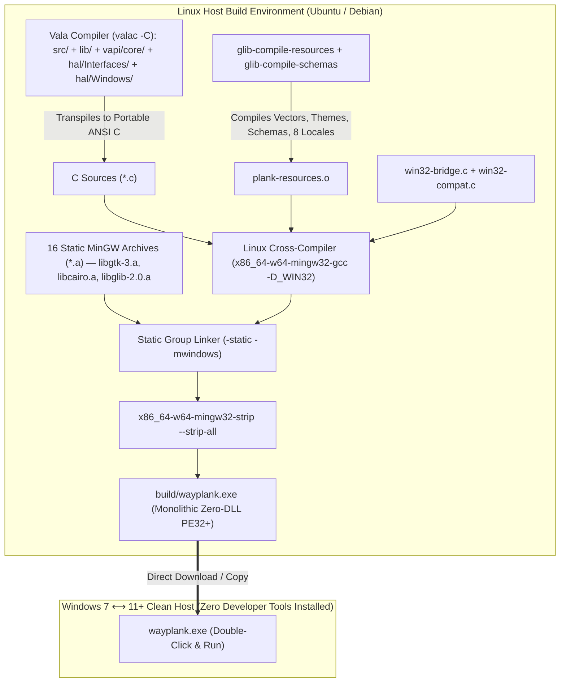
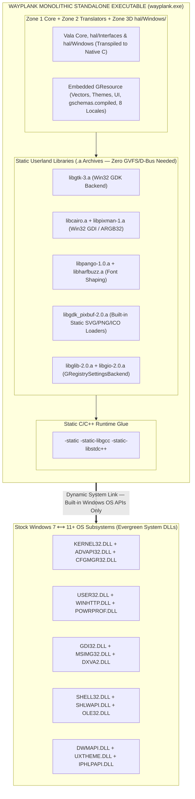
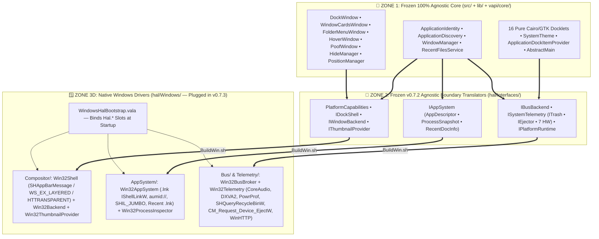
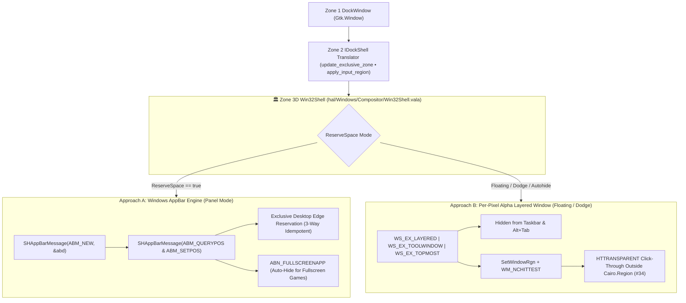
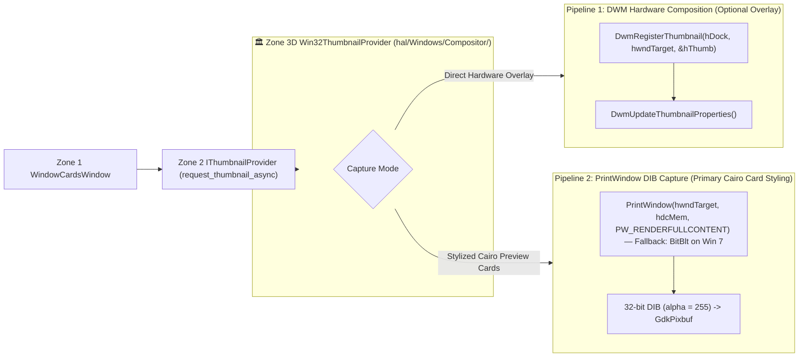
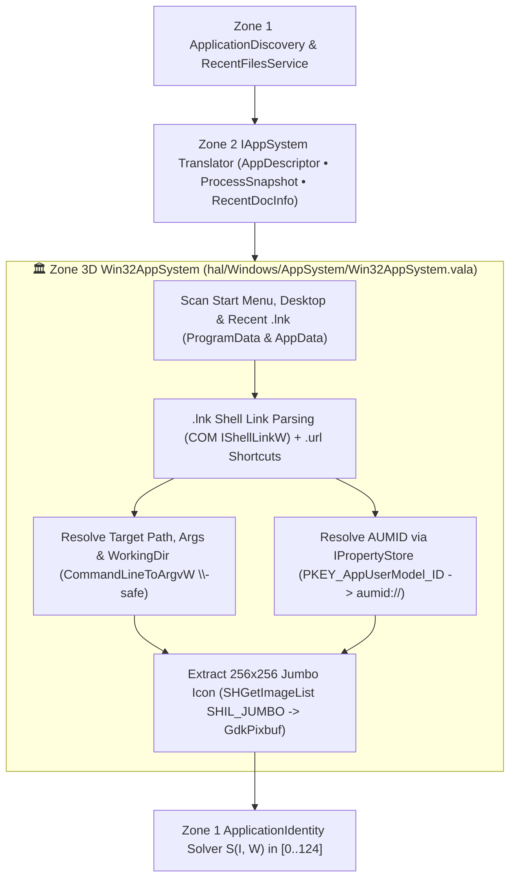
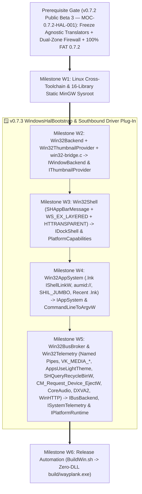

# 🪟 WAYPLANK WINDOWS COMPOSITOR & BUS BACKEND ARCHITECTURE (`HAL_WINDOWS_BACKEND`)

> **Architectural Specification & Linux Cross-Compilation Blueprint for Native Windows (`Win 7 ⟷ 11+ & Future Windows`) Behind the Agnostic Boundary Translator (`hal/Interfaces/`)**  
> **Pedigree:** Plank (X11) ➔ WayPlank (Wayland: KWin / Mutter / Labwc) ➔ WayPlank on Windows (`Win 7 ⟷ 11+` Unified Multi-Compositor Engine)  
> **Mandate:** Compiled 100% on Linux — Zero Compilers or Runtimes Needed on Windows  
> **Target Asset:** Single Monolithic Standalone Executable (`build/wayplank.exe`) with **ZERO External DLLs**  
> **Author & Maintainer:** Sergio Melas (<sergiomelas@gmail.com>) © 2026  
> **ISA-88 Document Control & MOC:** `DOC-ARCH-WIN-005` • **Revision `2.0`** (`MOC-0.7.2-HAL-001` — `WindowsHalBootstrap`, Agnostic Translator Alignment, `IDesktopThemeBus`, `ITrashProvider` / `IEjectorProvider` GVFS Elimination & `\`-Safe `CommandLineToArgvW`)  
> **Companion Master Specifications:** [Master Architecture Overview (`README.md`)](README.md) • [Repository `README.md`](../../README.md) • [CONTRIBUTING.md](../../CONTRIBUTING.md) • [HAL_COMPOSITORS.md](HAL_COMPOSITORS.md) *(Compositor & Shell Translator)* • [HAL_BUSES.md](HAL_BUSES.md) *(IPC & System Bus Translator)* • [APPLICATION_IDENTITY_ENGINE.md](APPLICATION_IDENTITY_ENGINE.md) *(`IAppSystem` Data Translator & 6-Layer Identity Engine)* • [USER_GUIDE.md](../USER_GUIDE.md)  
> **Status:** Staged Two-Beta Execution Plan — **`v0.7.2` (Public Beta 3): Agnostic Boundary Translator & Linux Freeze** $\longrightarrow$ **`v0.7.3` (Public Beta 4): Native `hal/Windows/` Driver Plug-In & `wayplank.exe`** (Active Public Linux Baseline: `v0.7.1.2` Public Beta 2 Hotfix)  

---

> [!CAUTION]
> # 🛑 PUBLIC REPOSITORY NOTICE — TWO-STAGE BETA GATE (`v0.7.2` TRANSLATOR FREEZE ➔ `v0.7.3` WINDOWS PLUG-IN)
> ## IN `v0.7.2` (PUBLIC BETA 3), WAYPLANK IMPLEMENTS AND FREEZES THE `hal/Interfaces/` AGNOSTIC BOUNDARY TRANSLATOR CONTRACTS ON LINUX ONLY ([HAL_COMPOSITORS.md](HAL_COMPOSITORS.md) & [HAL_BUSES.md](HAL_BUSES.md)). PUBLIC `wayplank.exe` INTEGRATION IS SCHEDULED FOR `v0.7.3` (PUBLIC BETA 4), PLUGGING `hal/Windows/` DIRECTLY INTO THE FROZEN `v0.7.2` TRANSLATOR LAYER.
> ### ISSUE TRACKER POLICY: UNTIL `./BuildWin.sh` AND `wayplank.exe` ARE PUBLISHED AS OFFICIAL `v0.7.3+` GITHUB RELEASE ASSETS, DO NOT OPEN GITHUB ISSUES OR DISCUSSIONS ASKING FOR WINDOWS SUPPORT OR ETAS. ANY PREMATURE REQUESTS WILL BE CLOSED WITHOUT DISCUSSION.

---

## 📌 Document Revision History (`MOC-0.7.2-HAL-001`)

| Revision | Date | Author | Summary of Architectural Changes (`MOC-0.7.2-HAL-001`) |
| :---: | :---: | :--- | :--- |
| **`1.0`** | `2026-11-14` | Sergio Melas | Initial Windows compositor/bus backend & Zero-DLL `./BuildWin.sh` blueprint (`v0.7.1.2` baseline). |
| **`2.0`** | `2026-11-14` | Sergio Melas | **`MOC-0.7.2-HAL-001`:** Synchronized all contracts and Mermaid schemes with the **Agnostic Boundary Translator Layer (`hal/Interfaces/`)** and `WindowsHalBootstrap.vala`; renamed `IPortalThemeBus` $\rightarrow$ **`IDesktopThemeBus`**; documented full Win32 `ITrashProvider` (`SHQueryRecycleBinW` + `FO_DELETE\|FOF_ALLOWUNDO` replacing non-existent static Win32 GVFS `trash:///`) and `IEjectorProvider` (`GetLogicalDrives` + `CM_Request_Device_EjectW` replacing `VolumeMonitor`); documented `Recent\*.lnk` Jump-List parsing, `aumid://` URI validation, `DesktopUtilityKind` $\rightarrow$ `ms-settings:*`, `CommandLineToArgvW` backslash preservation, and `vapi/core/compat.vapi` + `#ifndef _WIN32` C/VAPI purifications. |

---

## 🎯 Executive Summary & Architectural Objective

WayPlank is engineered around a strict **3-Zone Dichotomic Architecture** specified across [Architecture/README.md](README.md), [HAL_COMPOSITORS.md](HAL_COMPOSITORS.md), [HAL_BUSES.md](HAL_BUSES.md), and [APPLICATION_IDENTITY_ENGINE.md](APPLICATION_IDENTITY_ENGINE.md):
* **Zone 1 — 100% OS-Agnostic Core (`src/` + `lib/` + `vapi/core/`):** Cairo rendering engine, icon layout, item models, 16 docklets UI, animations, drag-and-drop, theme manager, folder menus, and 6-Layer Identity math are **100% blind** to Linux, BSD, Wayland, D-Bus, XDG, POSIX, GVFS, and Windows.
* **Zone 2 — Agnostic Boundary Translator Layer (`hal/Interfaces/` — Frozen in `v0.7.2`):** Pure Vala domain interfaces, DTO structs, and enums compiled identically into both `wayplank` and `wayplank.exe`.
* **Zone 3 — Native Windows Southbound Drivers (`hal/Windows/` — Plugged in `v0.7.3`):** `WindowsHalBootstrap` + `hal/Windows/{Compositor,Bus,AppSystem,Telemetry}/` translating Win32, DWM, AppBar, Named Pipes, COM `IShellLinkW`, UWP `AUMID`, CoreAudio, `DXVA2`, and `WinHTTP` into Zone 2 contracts.

### The Objective — Unified `WayPlank` on Windows (`Windows 7 ⟷ 11+ & Future Windows`):
1. **Compile Exclusively on Linux (`./BuildWin.sh`):** Everything is cross-compiled directly on Linux using `x86_64-w64-mingw32-gcc`, producing `build/wayplank.exe` with zero compilers or MSYS2 runtimes needed on Windows.
2. **Official Unified Repository Asset:** `build/wayplank.exe` is generated alongside `wayplank` (`.deb` / `.rpm`) from the **exact same Zone 1 + Zone 2 Vala files**.
3. **Zero External DLL Dependencies (`Win 7 ⟷ 11+` Universal Binary):** Runs immediately on any stock **Windows 7, 8, 8.1, 10, 11, or 12+** machine upon double-click.
4. **Pure Baseline Win32 HAL + Dynamic `GetProcAddress`:** Uses `user32.dll`, `gdi32.dll`, `kernel32.dll`, `shell32.dll` + dynamic `GetProcAddress` for `dwmapi.dll`/HiDPI enhancements. *(Note: only Windows XP `NT 5.1` fails at OS load time without recompiling libraries because modern 64-bit `libglib-2.0` imports `NT 6.1+` `AcquireSRWLockExclusive` / `GetTickCount64` from `KERNEL32.dll`.)*
5. **100% Internal Cairo Rendering & Animations:** All 26 icon animations, parabolic zoom, badges, tooltips, folder drawers, and preview cards render internally via **Cairo** onto a 32-bit ARGB layered surface (`WS_EX_LAYERED`).

---

## 🏗️ 1. Linux Cross-Compilation Pipeline & Zero-DLL Strategy

### 1.1 The Cross-Compilation Pipeline (`./BuildWin.sh`)



### 1.2 Binary Architecture of `wayplank.exe`



---

## 🏛️ 2. Hooking Up `hal/Windows/` to the Frozen `v0.7.2` Agnostic Boundary Translators

In `v0.7.3`, `WindowsHalBootstrap.vala` binds the four Windows driver sub-packages (`hal/Windows/{Compositor,Bus,AppSystem,Telemetry}/`) directly into the **frozen `v0.7.2` `hal/Interfaces/` translators** with zero modifications to `src/` or `lib/`:



### 2.0 Translator Hook-Up & Windows OS / Static-GIO Limitation Guards

| Zone 1 Consumer (`src/` + `lib/`) | Zone 2 Translator (`hal/Interfaces/`) | Windows Driver (`hal/Windows/`) | Win32 / Static-GIO Limitation & Translator Guard |
| :--- | :--- | :--- | :--- |
| **`DockWindow`, `HideManager`, `PositionManager`, `PoofWindow`** | `IDockShell` & `PlatformCapabilities` | `Compositor/Win32Shell.vala` | Maps `update_exclusive_zone` to `SHAppBarMessage(ABM_SETPOS)` (3-way idempotent), `apply_input_region` (`#34`) to `SetWindowRgn` + `WM_NCHITTEST -> HTTRANSPARENT` on `WS_EX_LAYERED \| WS_EX_TOOLWINDOW`, and `place_transient_overlay` to `SetWindowPos`. |
| **`WindowManager`** | `IWindowBackend` (`WindowInfo` — zero `DBusConnection`) | `Compositor/Win32Backend.vala` + `win32-bridge.c` | Formats 64-bit `HWND` as opaque string `Id = "hwnd:0x%016llx"`. Marshals out-of-context `SetWinEventHook` via `g_idle_add` and filters cloaked UWP background windows (`DWMWA_CLOAKED != 0`). |
| **`WindowCardsWindow`** | `IThumbnailProvider` | `Compositor/Win32ThumbnailProvider.vala` | GDI `PrintWindow(PW_RENDERFULLCONTENT)` leaves `alpha = 0` on GDI controls; enforces `buffer[i + 3] = 255` before returning `Gdk.Pixbuf`. |
| **`ApplicationIdentity`, `ApplicationDiscovery`, `DockItem`, `RecentFilesService`** | `IAppSystem` + `Hal.Runtime.parse_command_argv` | `AppSystem/Win32AppSystem.vala` + `Win32PlatformRuntime.vala` | **1) UWP Host:** Unwraps `ApplicationFrameHost.exe` child `CoreWindow` `PID` and `PKEY_AppUserModel_ID` (`aumid://` supported by `launcher_exists`).<br>**2) Elevated Admin Processes:** `PROCESS_QUERY_LIMITED_INFORMATION` (`QueryFullProcessImageNameW`) always succeeds when `PROCESS_VM_READ` is denied (`full_cmdline = ""`).<br>**3) Backslash Safety:** `parse_command_argv` uses `CommandLineToArgvW` grammar so Windows `\` path separators are never stripped!<br>**4) Recent Jump-Lists:** `get_recent_documents()` parses `%APPDATA%\Microsoft\Windows\Recent\*.lnk`. |
| **`SystemTheme`, `ApplicationDockItemProvider`, `MprisDockItem`, `DoNotDisturbDockItem`** | `IDesktopThemeBus`, `ILauncherBadgeBus`, `IMediaController`, `INotificationBus` | `Bus/Win32BusBroker.vala` | Translates `AppsUseLightTheme` + `WM_SETTINGCHANGE` $\rightarrow$ `IDesktopThemeBus`, `ITaskbarList3` $\rightarrow$ `LauncherBadgeState`, `VK_MEDIA_*`/GSMTC $\rightarrow$ `MediaPlayerSnapshot`, Focus Assist $\rightarrow$ `INotificationBus`. |
| **`TrashDockItem` & `EjectorDockItem`** | `ITrashProvider` & `IEjectorProvider` | `Telemetry/Win32Telemetry.vala` | **Static GIO on Windows has NO `trash:///` VFS and NO `UDisks2` `VolumeMonitor`!** `ITrashProvider` translates Recycle Bin count/items/restore/empty/trash via `SHQueryRecycleBinW`, `SHEmptyRecycleBinW`, and `SHFileOperationW(FO_DELETE \| FOF_ALLOWUNDO)`. `IEjectorProvider` enumerates removable drives via `GetLogicalDrives` + `GetDriveTypeW` and ejects via `CM_Request_Device_EjectW`. |
| **8 Docklets, `Weather*`, `ThemeManager`, `PreferencesWindow`** | `IPlatformRuntime` (`DesktopUtilityKind`) | `Telemetry/Win32PlatformRuntime.vala` | Maps `DesktopUtilityKind` to `ms-settings:sound`, `ms-settings:network`, `ms-settings:powersleep`, `ms-settings:display`, `ms-settings:dateandtime`, `taskmgr.exe`, and `outlookcal:`; implements `http_get_sync` via `WinHTTP.dll`, `open_uri` via `ShellExecuteW`, autostart via `HKCU\...\Run`, and isolated KeyFile validation via `CreateProcessW(..., "--validate-latch")`. |

### 2.1 Real-Time Window Event Tracking (Zero Polling)
`win32-bridge.c` installs an out-of-context Win32 Event Hook via `SetWinEventHook`:

```c
HWINEVENTHOOK hook = SetWinEventHook(
    EVENT_SYSTEM_FOREGROUND,      // Range start
    EVENT_OBJECT_NAMECHANGE,      // Range end
    NULL,
    WinEventProcCallback,
    0, 0,
    WINEVENT_OUTOFCONTEXT | WINEVENT_SKIPOWNPROCESS
);
```

* `EVENT_SYSTEM_FOREGROUND`: Updates active window focus.
* `EVENT_OBJECT_CREATE` / `EVENT_OBJECT_DESTROY`: Adds or removes running dock items.
* `EVENT_SYSTEM_MINIMIZESTART` / `EVENT_SYSTEM_MINIMIZEEND`: Tracks monotonic `MinimizedSequence`.
* `EVENT_OBJECT_NAMECHANGE`: Updates window titles and tooltips immediately.
* `EVENT_OBJECT_LOCATIONCHANGE`: Coalesced with a $\ge 50\text{ ms}$ debounce to evaluate Intellihide/Dodge overlaps.

### 2.2 Window Control Actions (`IWindowBackend`)
* **Activate / Focus:** Uses `AttachThreadInput` + `SetForegroundWindow(hwnd)` + `BringWindowToTop(hwnd)`.
* **Toggle Minimize / Restore:** `ShowWindowAsync(hwnd, IsIconic(hwnd) ? SW_RESTORE : SW_MINIMIZE)`.
* **Close Window:** `PostMessage(hwnd, WM_CLOSE, 0, 0)`.

---

## 🪟 3. Desktop Dock Shell & Window Integration on Windows (`IDockShell`)



---

## 🖼️ 4. Universal Live Window Previews on Windows (`IThumbnailProvider`)



---

## 🔍 5. Windows Shortcut, UWP `aumid://` & Recent-File Discovery (`IAppSystem`)



---

## 🧩 6. Monolithic 16-Docklet Portability Matrix (Via `ISystemTelemetry` & `IBusBackend`)

| Docklet (`lib/Items/` — Zero OS Code) | Zone 2 Translator (`hal/Interfaces/`) | `v0.7.2` Linux Driver (`hal/Freedesktop/` & `hal/Linux/`) | `v0.7.3` Windows `7 ⟷ 11+` Driver (`hal/Windows/`) |
| :--- | :--- | :--- | :--- |
| **Trash** (`docklet://trash`) | `ITrashProvider` (`TrashItemInfo`) | `FreedesktopTrashProvider` (GVFS `trash:///`, `.trashinfo`, `file.trash()`) | `SHQueryRecycleBinW` + `SHEmptyRecycleBinW` + `SHFileOperationW(FO_DELETE \| FOF_ALLOWUNDO)` |
| **Removable Drive Ejector** (`docklet://ejector`) | `IEjectorProvider` (`RemovableDriveInfo`) | `FreedesktopEjectorProvider` (`VolumeMonitor` + `/media` filter) | `GetLogicalDrives` (`DRIVE_REMOVABLE`) + `CM_Request_Device_EjectW` + `DeviceIoControl` |
| **Analog & Digital Clocks (2)** | `IPlatformRuntime` (`DesktopUtilityKind`) | Pure GLib `DateTime` + Cairo (`CALENDAR`) | Pure GLib `DateTime` + Cairo (`ms-settings:dateandtime` / `outlookcal:`) |
| **Battery Monitor** | `IBatteryProvider` | `LinuxBatteryProvider` (UPower + `/sys/class/power_supply`) | `GetSystemPowerStatus` + `WM_POWERBROADCAST` |
| **System Pressure (CPU/RAM)** | `ICpuMemoryProvider` | `LinuxCpuMemDiskTelemetry` (`/proc/{stat,meminfo,diskstats}`) | `GetSystemTimes` + `GlobalMemoryStatusEx` + `IOCTL_DISK_PERFORMANCE` |
| **Network Monitor** (`docklet://network`) | `INetworkProvider` | `NetworkManagerDbusService` (`/sys/class/net`, `/proc/net/wireless`, `nmcli`) | `GetAdaptersAddresses` / `NotifyIpInterfaceChange` (`iphlpapi.dll`) + `wlanapi.dll` |
| **Volume Control** | `IAudioProvider` | `LinuxAudioTelemetry` (`wpctl` / `pactl` / `amixer`) | CoreAudio (`IAudioEndpointVolume` + `IAudioEndpointVolumeCallback`) |
| **Brightness Control** | `IBrightnessProvider` | `BrightnessControl` (KWin DRM, GNOME D-Bus, `/sys/class/backlight`, `ddcutil`) | `dxva2.dll` (`GetMonitorBrightness` / `SetMonitorBrightness`) + WMI |
| **Do Not Disturb (DND)** | `INotificationBus` | `NotificationDbusService` (`plasmashell` / `Notifications` / `dunstctl`) | Windows Focus Assist / Quiet Hours (`WpnNotifications`) |
| **Screenshot Tool** | `IScreenshotProvider` | `FreedesktopScreenshotProvider` (`grim` / `spectacle` / `ScreenShot2`) | Win32 GDI `BitBlt` screen/region capture or `ms-screenclip:` |
| **Show Desktop** | `IWindowBackend.toggle_show_desktop()` | KWin / Mutter / Labwc `toggle_show_desktop()` | Shell COM `IShellDispatch4::ToggleDesktop()` |
| **Session & Power** (`3×3`) | `ISessionPowerProvider` | `LinuxSessionPower` (`systemd-logind` / KDE / GNOME) | `ExitWindowsEx`, `LockWorkStation`, `WTSDisconnectSession`, `SetSuspendState` |
| **Media Player (MPRIS)** | `IMediaController` (`MediaPlayerSnapshot`) | `MprisDbusService` (`org.mpris.MediaPlayer2`) | `SendInput(VK_MEDIA_*)` + optional WinRT `GSMTC` via `GetProcAddress` |
| **Weather Forecast** | `IPlatformRuntime.http_get_sync` | `LinuxPlatformRuntime` (`curl`) | Stock Windows **`WinHTTP.dll`** (HTTPS REST) |
| **Preferences** | `IPlatformRuntime` | `GSettings` + isolated `fork()` KeyFile validator + `~/.config/autostart` | `GRegistrySettingsBackend` + `CreateProcessW("--validate-latch")` + `HKCU\...\Run` |

---

## 🛠️ 7. Linux Cross-Build Pipeline Architecture (Planned `./BuildWin.sh`)

### 7.1 4-Tier Source-Code Static Cross-Compilation DAG (`./deps/win32/sysroot`)
Cross-compiles all **16 upstream C/Vala libraries** from source tarballs on the Linux host using `x86_64-w64-mingw32-gcc`:
1. **Tier 1 — Foundational Primitives:** `zlib`, `libffi`, `libiconv`, `gettext-runtime`, `pcre2` (`--enable-unicode`).
2. **Tier 2 — GLib Ecosystem & Vala Models:** `glib-2.0` (`giowin32` + `GRegistrySettingsBackend`, `--default-library=static`), `libgee-0.8`, `json-glib-1.0`.
3. **Tier 3 — 2D Vector Graphics, Shaping & Static Loaders:** `libpng`, `pixman`, `freetype2`, `fribidi`, `harfbuzz`, `cairo` (`-Dwin32=enabled`), `pango` (`pangowin32`), `gdk-pixbuf-2.0` (`-Dbuiltin_loaders=png,bmp,ico,jpeg -Dgio_sniffing=false`), plus pure-C static SVG rasterizer (`librsvg-2.40.x` / `lunasvg`) for all embedded `plank.gresource.xml` vector icons.
4. **Tier 4 — Widget Toolkit:** `libepoxy`, `atk`, `gtk+-3.0` (`-Dwin32_backend=true -Dx11_backend=false -Dwayland_backend=false --default-library=static`).

### 7.2 Cross-Build C/VAPI Hygiene Enforced in `v0.7.2` (`MOC-0.7.2-HAL-001`):
1. **Pure `vapi/core/compat.vapi`:** Unix `<sys/prctl.h>` (`prctl`) and `<unistd.h>` (`getpid`, `setproctitle`) are stripped from `vapi/core/compat.vapi` into `vapi/freedesktop/unix-compat.vapi` during `v0.7.2` Move 3, so `valac -C` generates C code with zero Unix `#include` directives when compiling `src/` + `lib/` + `hal/Interfaces/` + `hal/Windows/`.
2. **`#ifndef _WIN32` C Guards:** `lib/gtk-compat.c` guards ELF `__attribute__((weak))` symbol probes under `#ifndef _WIN32`, `include/config.h` guards Unix `PREFIX`/`DATADIR`/`PKGDATADIR` defaults under `#ifndef _WIN32`, and `lib/Drawing/Surface.vala` uses `GLib.Memory.set()` instead of `Posix.memset()`.
3. **Zero-DLL `GSettings` Bootstrap:** `WindowsHalBootstrap` extracts embedded `gschemas.compiled` from `GResource` to `%LOCALAPPDATA%\WayPlank\glib-2.0\schemas\` and sets `G_SETTINGS_SCHEMA_DIR` before `DockPreferences` initializes.

---

## 🗺️ 8. Step-by-Step Implementation Roadmap (`v0.7.2` Translator Freeze ➔ `v0.7.3` Windows Plug-In)



---

## 🏆 Conclusion & Expected Outcome

By enforcing the **Agnostic Boundary Translator Layer (`hal/Interfaces/`)** in `v0.7.2` (`MOC-0.7.2-HAL-001`) and building `hal/Windows/` entirely from Linux in `v0.7.3`:
* **The Windows user experience is zero-friction:** Download `wayplank.exe` and double-click — zero installers, zero runtimes, zero external DLLs across `Windows 7 ⟷ 11+`.
* **The WayPlank engineering architecture is uncompromising:** One 100% OS-agnostic Core (`src/` + `lib/`), one frozen Translator layer (`hal/Interfaces/`), and clean native drivers producing `.deb`, `.rpm`, and `.exe` from a single Linux terminal.
