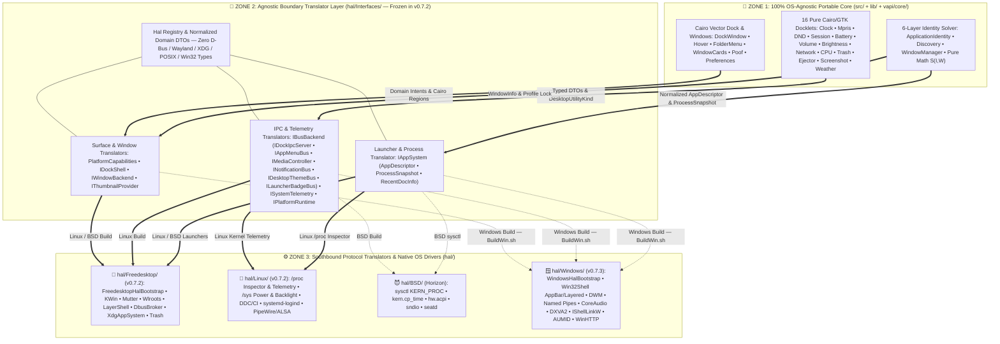

# 🏛️ WAYPLANK MASTER SYSTEM ARCHITECTURE OVERVIEW

> **Canonical Top-Level Engineering Blueprint for the Unified Multi-Compositor & Multi-OS WayPlank Codebase**  
> **Author & Maintainer:** Sergio Melas (<sergiomelas@gmail.com>) © 2026  
> **ISA-88 Document Control & MOC:** `DOC-ARCH-MASTER-001` • **Revision `2.5`** (`2026-11-16` • `MOC-0.7.2-HAL-001` — Moves 1–4 100% Implemented, Dual-Zone HAL Purity Firewall `GREEN` [`0` leaks], 65,025-Case Identity Matrix `100.0% PASS` at `backup/0.7.2-move-4`, Pending Formal `FAT 0.7.2` Qualification)  
> **Unified Brand & Executables:** **WayPlank** (`build/wayplank` on Linux / BSD • `build/wayplank.exe` on Windows `7 ⟷ 11+`)  
> **Active Public Baseline (`main`):** `v0.7.1.2` (Public Beta 2 Hotfix — `100.0%` FAT Qualified across KDE Plasma 6, GNOME Shell & Labwc)  
> **Staged Consolidation Gate:** **`v0.7.2` (Public Beta 3 — Agnostic Boundary Translator & Linux HAL/Bus Freeze)** $\longrightarrow$ **`v0.7.3` (Public Beta 4 — Native `hal/Windows/` Southbound Driver Plug-In)**  
> **Quick Links:** [Repository Root `README.md`](../../README.md) • [User Guide (`USER_GUIDE.md`)](../USER_GUIDE.md) • [Historic Archive (`Historic/`)](../Historic/README.md) • [Contributing (`CONTRIBUTING.md`)](../../CONTRIBUTING.md) • [Lifetime Bug Register](../../FAT/WAYPLANK_LIFETIME_BUG_REGISTER.md)

---

## 📌 Table of Contents

1. [ISA-88 Management of Change (MOC) Governance & Design-Before-Build Gate](#1-isa-88-management-of-change-moc-governance--design-before-build-gate)
2. [Executive Architectural Vision & The Agnostic Boundary Translator Layer](#2-executive-architectural-vision--the-agnostic-boundary-translator-layer)
   - [2.1 Formal Definition of the Agnostic Boundary Translator Layer (`hal/Interfaces/`)](#21-formal-definition-of-the-agnostic-boundary-translator-layer-halinterfaces)
   - [2.2 Master 3-Zone Dichotomic Architecture Scheme](#22-master-3-zone-dichotomic-architecture-scheme)
3. [Navigation Map of the Architecture Specification Suite](#3-navigation-map-of-the-architecture-specification-suite)
4. [Target Repository Layout & Physical Isolation (`v0.7.2` Freeze & `v0.7.3` Windows Plug-In)](#4-target-repository-layout--physical-isolation-v072-freeze--v073-windows-plug-in)
   - [4.1 Why `Freedesktop` + `Linux` + `BSD` + `Windows` (Instead of `POSIX`)](#41-why-freedesktop--linux--bsd--windows-instead-of-posix)
   - [4.2 Canonical Repository Directory Tree](#42-canonical-repository-directory-tree)
   - [4.3 Dichotomic Separation: Portable `src/` + `lib/` vs Translator `hal/Interfaces/` vs Drivers `hal/*/`](#43-dichotomic-separation-portable-src--lib-vs-translator-halinterfaces-vs-drivers-hal)
5. [Complete 112-File Diffused-to-Translated Migration Map (`v0.7.1.2` ➔ `v0.7.2` Freeze)](#5-complete-112-file-diffused-to-translated-migration-map-v0712--v072-freeze)
6. [Incremental Execution Plan & Automated Dual-Zone HAL Purity Firewall](#6-incremental-execution-plan--automated-dual-zone-hal-purity-firewall)

---

## 1. ISA-88 Management of Change (MOC) Governance & Design-Before-Build Gate

Every structural modification between the qualified **`v0.7.1.2`** baseline and the **`v0.7.2`** HAL freeze is governed under **ISA-88 Management of Change (`MOC-0.7.2-HAL-001`)**:

| MOC Control Attribute | Normative Engineering Specification |
| :--- | :--- |
| **MOC Identifier & Revision** | **`MOC-0.7.2-HAL-001` (`Rev 2.0` — 2026-11-14)** • Approval Authority: **Sergio Melas** (Maintainer) |
| **Change Rationale** | Establish a strict **dichotomic separation** between **100% OS-Agnostic Core (`src/` + `lib/`)** and **OS/Compositor/Bus Drivers (`hal/*`)** via an explicit **Agnostic Boundary Translator Layer (`hal/Interfaces/`)**, eliminating all Linux, BSD, Wayland, D-Bus, XDG, POSIX, and Windows assumptions above the translator prior to `v0.7.3` Windows integration. |
| **Mandatory Execution Sequence** | **1. Design & Document (`Documentation/Architecture/*.md`)** $\rightarrow$ **2. Human MOC Validation** $\rightarrow$ **3. Northbound Agnostic Translator (`hal/Interfaces/`)** $\rightarrow$ **4. Southbound Driver (`hal/{Freedesktop,Linux}/`)** $\rightarrow$ **5. Core Caller Purification (`src/` + `lib/`)** $\rightarrow$ **6. `WAYPLANK_NO_PROMPT=1 ./BuildDeb.sh` (`0` warnings)** $\rightarrow$ **7. Live 3-Compositor ISA-88 `FAT 0.7.2` Sign-Off (`100.0%`)**. |
| **Rule of Iron (*Translator Before Move*)** | **NEVER** raw-move an OS- or D-Bus-coupled class (`DBusManager`, `Unity`, `SystemTheme`, `Environment`, `Trash`, `Ejector`, etc.) into `hal/` while leaving D-Bus/Wayland/XDG/POSIX names, `GLib.Variant` wire tuples, Unix `has_prefix("/")` path checks, or POSIX `Shell.parse_argv` backslash stripping inside `src/`, `lib/`, `hal/Interfaces/`, or `vapi/core/`. Always create the **Agnostic Boundary Translator** first. |
| **Full 112-File Scope Accounting** | **`112 / 112` repository code/protocol/VAPI files audited** across 6 top-down + bottom-up passes: **`21`** driver/protocol/VAPI files relocated in Slice 1 (`Move 1`, with `4` boundary files scheduled for translator purification), **`28`** files verified 100.0% OS-agnostic Pure Core today (zero edits), and **`63`** files in `src/`+`lib/`+`include/` purified across **`74` discrete translator chunks**. |
| **ISA-88 Phase B FAT Reset Policy** | Any test point whose underlying window matching, surface geometry, input region, D-Bus broker, docklet telemetry, or autostart code path is touched by `MOC-0.7.2-HAL-001` is actively reset to **`[  ]`** for mandatory live re-qualification across **KDE Plasma 6 (`KWin`)**, **GNOME Shell (`Mutter`)**, and **Labwc** before `v0.7.2` merges to `main`. |

### Document Revision History (`MOC-0.7.2-HAL-001`)

| Revision | Date | Author | Summary of Architectural Changes |
| :---: | :---: | :--- | :--- |
| **`1.0`** | `2026-11-14` | Sergio Melas | Initial multi-compositor & multi-OS architecture specification suite (`v0.7.1.2` baseline). |
| **`2.0`** | `2026-11-14` | Sergio Melas | **`MOC-0.7.2-HAL-001`:** Formalized the **Agnostic Boundary Translator Layer (`hal/Interfaces/`)**; purged Freedesktop/D-Bus naming bias (`IPortalThemeBus` $\rightarrow$ `IDesktopThemeBus`, `UnityClient` $\rightarrow$ `ILauncherBadgeClient`, moved Wayland auto-router to `hal/Freedesktop/FreedesktopHalBootstrap.vala` and Unix `unistd.h`/`sys/prctl.h` out of `vapi/core/`); expanded migration scope to full **112-file / 74-chunk** rescan (`ITrashProvider` for `trash:///`, `IEjectorProvider` for `VolumeMonitor`, `IDockShell.apply_input_region`, cross-OS `Path.is_absolute()` & `parse_command_argv` preserving Windows `\`). |
| **`2.2`** | `2026-11-15` | Sergio Melas | **`MOC-0.7.2-HAL-001` Moves 1–3 Remediation Closure (`backup/0.7.2-move-3b`):** Completed 4-pass convergence audit across `140/140` files (`Delta = 0`) and closed all `33/33` Moves 1–3 remediation items across Sub-Gates A, B & C (`FAT 0.1`, `FAT 6.9`, portable Cairo `ImageSurface`, `g_ascii_formatd`, Win32/DOS path & theme guards, and `13` new WayPlank GResource fallback SVGs bringing embedded vector icons to `63`). |
| **`2.3`** | `2026-11-15` | Sergio Melas | **`MOC-0.7.2-HAL-001` Move 4 Sub-Gate M4-A (`backup/0.7.2-move-4a`):** Froze `IAppSystem`, `IAppMenuBus`, and `IPlatformRuntime` path/schema hooks (`0` leaks in `hal/Interfaces/` + `vapi/core/`), implemented `XdgAppSystem`, `AppMenuDbusService`, and expanded `LinuxProcessInspector`, and live-verified `3/3` compositors. |
| **`2.4`** | `2026-11-16` | Sergio Melas | **`MOC-0.7.2-HAL-001` Move 4 Sub-Gate M4-B (`backup/0.7.2-move-4b`):** Purified all `24` non-solver Core files in `src/` and `lib/` onto `Hal.Apps` and `Hal.Runtime`, remediated Mutter `v072_bridge_1` `move_frame` popup positioning, direct `org.gnome.Shell.Extensions` D-Bus activation (eliminating 25s portal timeout), and uniform `44px` tooltip clearance across KWin/Mutter/Labwc (`3/3` live smoke-verified). |
| **`2.5`** | `2026-11-16` | Sergio Melas | **`MOC-0.7.2-HAL-001` Move 4 Sub-Gate M4-C & `40/40` Closure (`backup/0.7.2-move-4`):** Purified `ApplicationIdentity`, `ApplicationDiscovery`, and `Matcher` (`0` Zone 1/Zone 2 leaks across `143/143` files), activated the pre-compile **Dual-Zone HAL Purity Firewall** in `BuildBin.sh` (`GREEN`), certified `100.0%` SHA-256 parity on the `65,025`-case Identity Engine Matrix, replaced browser session polling timers with zero-timer `inotify` (`IAppSystem.browser_sessions_changed`), hardened Mutter `v072_bridge_2` `BEFORE_REDRAW` hotplug safety, retained `PreferencesWindow` focus across edge/monitor switches, added multi-choice batched *Docklets* submenu selection, and reconciled `37 [ko->test]` remediations across `399` tests in `FAT/2026-11-15 FAT 0.7.2.txt`. |

---

## 2. Executive Architectural Vision & The Agnostic Boundary Translator Layer

WayPlank is engineered as a **single, monolithic, zero-host-pollution dock engine** partitioned into **three strictly isolated architectural zones**:

1. **Zone 1 — Northbound 100% Agnostic Portable Core (`src/` + `lib/` + `vapi/core/`):** Renders 100% of dock backgrounds, parabolic icon zoom, 26 visual effects, badges, tooltips (`HoverWindow`), smart folder drawers (`FolderMenuWindow`), window preview cards (`WindowCardsWindow`), **16 built-in docklets**, and the **6-Layer Mathematical Application Identity Solver** in software via **Cairo + Pango + GTK3**, with all stock themes, 63 vector icons, and 8 language catalogs compiled into RAM (`GResource`). **Zero Linux, BSD, Wayland, D-Bus, XDG, POSIX, or Windows calls, types, paths, or names exist in Zone 1.**
2. **Zone 2 — The Agnostic Boundary Translator Layer (`hal/Interfaces/` — Frozen in `v0.7.2`):** The **universal semantic & data translator** between Portable Core and native OS drivers. Core interacts **exclusively** with `Hal` (`Hal.Capabilities`, `Hal.Shell`, `Hal.Windows`, `Hal.Thumbnails`, `Hal.Bus`, `Hal.Apps`, `Hal.Telemetry`, `Hal.Runtime`) using pure Vala domain interfaces, normalized DTO structs, and OS-blind enums.
3. **Zone 3 — Southbound Native Platform Drivers (`hal/{Freedesktop,Linux,BSD,Windows}/`):** Interchangeable protocol/kernel translators and drivers implementing Zone 2 contracts on **KDE Plasma 6 (`KWin`)**, **GNOME Shell (`Mutter`)**, **Labwc / `wlroots`**, **BSD (`sysctl`/`acpi`)**, and **Windows (`Win 7 ⟷ 11+` Win32/DWM/AppBar/Named Pipes)** — producing `build/wayplank` (`.deb`, `.rpm`, BSD) and `build/wayplank.exe` (Zero-DLL PE32+) from the **exact same Zone 1 + Zone 2 sources**.

### 2.1 Formal Definition of the Agnostic Boundary Translator Layer (`hal/Interfaces/`)

> [!IMPORTANT]
> **DEFINITION — THE AGNOSTIC BOUNDARY TRANSLATOR LAYER (`hal/Interfaces/`):**  
> Moving an OS-specific file into `hal/` without translating its interface leaves Core coupled to that OS's concepts (for example, D-Bus does not exist on Windows, GVFS `trash:///` and `VolumeMonitor` do not exist in static Win32 builds, XDG `Portal` does not exist on Windows, and POSIX `GLib.Shell.parse_argv` corrupts Windows `C:\...` backslashes).  
> Therefore, **`hal/Interfaces/` is NOT a pass-through header folder — it is a strict Semantic & Payload Boundary Translator** governed by four non-negotiable invariants:
> 1. **Zero OS / Transport Vocabulary Above or Inside `hal/Interfaces/`:** No identifier, parameter, signal, or struct in `src/`, `lib/`, `vapi/core/`, or `hal/Interfaces/` may reference `DBus*`, `GLib.Variant` wire tuples (`'(sa{sv})'`), `GtkLayerShell`, `Wayland`, `KWin`, `Mutter`, `Labwc`, `Portal`, `Unity`, `Xdg*`, `Posix`, `Unix*`, `/proc`, `/sys`, `trash://`, or `Win32`/`HWND`.
> 2. **Normalized Domain DTOs & Enums Only:** All boundary crossings use pure domain types:
>    - *Commands Core $\rightarrow$ Driver:* Domain intents such as `Hal.Runtime.open_system_utility (DesktopUtilityKind.SOUND_SETTINGS)`, `Hal.Shell.apply_input_region (window, region)`, `Hal.Shell.position_popup_surface (window, PopupSurfaceKind.TOOLTIP, ...)`, `Hal.Windows.perform_window_action (id, WindowAction.ACTIVATE)`.
>    - *Events Driver $\rightarrow$ Core:* Pre-unpacked, normalized Vala structs & typed signals such as `LauncherBadgeState`, `MediaPlayerInfo`, `AppDescriptor`, `ProcessSnapshot`, `WindowInfo`, `TrashItemInfo`, `RemovableDriveInfo`, `color_scheme_changed (bool prefer_dark)`.
> 3. **Compile-Time & Runtime Bootstrap Isolation:** `hal/Interfaces/Hal.vala` holds only abstract interface slots; southbound bootstrap classes (`hal/Freedesktop/FreedesktopHalBootstrap.vala` vs `hal/Windows/WindowsHalBootstrap.vala`) probe the host OS/compositor and populate `Hal.*` at startup.
> 4. **Cross-OS Path & Command Grammar Safety:** Path checks use `GLib.Path.is_absolute()` (never Unix-only `has_prefix("/")`), and command-line tokenization routes through `Hal.Runtime.parse_command_argv()` (preserving Windows `\` separators while supporting POSIX quoting on Freedesktop).

### 2.2 Master 3-Zone Dichotomic Architecture Scheme



---

## 3. Navigation Map of the Architecture Specification Suite

All living architectural specifications reside in `Documentation/Architecture/`. Each document governs its northbound **Boundary Translator** contracts and southbound **Platform Drivers**:

| Specification Document | Architectural Scope | `hal/Interfaces/` Boundary Translators Governed | Physical Directories Owned |
| :--- | :--- | :--- | :--- |
| **[`README.md`](README.md)** *(This Document)* | ISA-88 MOC governance (`MOC-0.7.2-HAL-001`), formal definition of the Agnostic Boundary Translator Layer, repository layout, full 112-file migration map, and Dual-Zone HAL Purity Firewall. | `Hal` Registry + All 7 Translator Families | `src/`, `lib/`, `hal/`, `vapi/`, `include/`, `Build*.sh` |
| **[`HAL_COMPOSITORS.md`](HAL_COMPOSITORS.md)** | Surface anchoring, exclusive zones / struts, cross-OS input-region masking (`#34`), popup/poof placement, foreign window state/actions, live thumbnails, and 4-compositor safety invariants. | `PlatformCapabilities`<br>`IDockShell`<br>`IWindowBackend`<br>`IThumbnailProvider` | `hal/Freedesktop/{FreedesktopHalBootstrap,KWin,Mutter,Wlroots,Shell}/`<br>`hal/Windows/Compositor/` |
| **[`HAL_BUSES.md`](HAL_BUSES.md)** | Payload/wire translation from D-Bus `Variant` & Win32 IPC into typed Vala signals: dock RPC, `dbusmenu` (`id=61`) browser profiles, MPRIS/WinRT media, DND, desktop dark/light theme, launcher badges, 16-docklet hardware telemetry (`ITrashProvider`, `IEjectorProvider`, `IScreenshotProvider`), and `IPlatformRuntime`. | `IBusBackend` (`IDockIpcServer`, `IAppMenuBus`, `IMediaController`, `INotificationBus`, `IDesktopThemeBus`, `ILauncherBadgeBus`)<br>`ISystemTelemetry`<br>`IPlatformRuntime` | `hal/Freedesktop/Dbus/`<br>`hal/Freedesktop/Xdg/`<br>`hal/Linux/` (`*.vala` + `{ProcFs,SysFs}/`)<br>`hal/Windows/{Bus,Telemetry}/` |
| **[`APPLICATION_IDENTITY_ENGINE.md`](APPLICATION_IDENTITY_ENGINE.md)** | Multi-OS launcher, process & recent-files translation (`AppDescriptor`, `ProcessSnapshot`, `RecentDocInfo`), cross-OS command-line tokenization (`\`-safe), 6-Layer deterministic scoring matrix $S(I,W) \in [0..124]$, and CLI fallback launcher synthesis. | `IAppSystem` (`AppDescriptor`, `ProcessSnapshot`, `RecentDocInfo`) | `lib/Services/ApplicationIdentity.vala` *(Pure Solver)*<br>`hal/Freedesktop/Xdg/`<br>`hal/Linux/ProcFs/`<br>`hal/Windows/AppSystem/` |
| **[`HAL_WINDOWS_BACKEND.md`](HAL_WINDOWS_BACKEND.md)** | Native `Win 7 ⟷ 11+` southbound translator/driver implementation (`WindowsHalBootstrap`, `SetWinEventHook`, dynamic `GetProcAddress("DwmGetWindowAttribute")`, `SHAppBarMessage`, `WS_EX_LAYERED`, `IShellLinkW`, `AUMID`, `SHQueryRecycleBinW`, CoreAudio, `DXVA2`, `WinHTTP`) and Linux cross-build (`./BuildWin.sh` $\rightarrow$ `build/wayplank.exe`). | Implements all frozen `v0.7.2` `hal/Interfaces/` translators on Windows | `hal/Windows/{WindowsHalBootstrap,Compositor,Bus,AppSystem,Telemetry}/`<br>`vapi/windows/`<br>`./BuildWin.sh` |

---

## 4. Target Repository Layout & Physical Isolation (`v0.7.2` Freeze & `v0.7.3` Windows Plug-In)

### 4.1 Why `Freedesktop` + `Linux` + `BSD` + `Windows` (Instead of `POSIX`)

A naive `POSIX` vs `Windows` split fails in systems engineering for two concrete reasons:
1. **Linux Kernel Interfaces Are Not POSIX:** `/proc/<pid>/cmdline`, `/proc/stat`, `/proc/meminfo`, `/proc/diskstats`, `/proc/self/exe`, `/sys/class/backlight`, `/sys/class/power_supply`, `/dev/i2c-*`, `<sys/prctl.h>`, and `systemd-logind` are **Linux-kernel-specific** (FreeBSD and OpenBSD expose process arguments, CPU ticks, RAM pages, and battery state via `sysctl` and `acpi`).
2. **Zero Code Duplication Between Linux and BSD:** FreeBSD and OpenBSD run the exact same Wayland compositors (**KWin**, **Mutter**, **Labwc / wlroots**), Freedesktop D-Bus services (`MPRIS2`, `Notifications`, `UPower`, `dbusmenu`), GVFS/XDG Trash, and `.desktop` launchers. Placing Wayland compositors, the D-Bus broker, and XDG protocols inside `hal/Freedesktop/` lets Linux and BSD share 100% of that code while swapping only `hal/Linux/` vs `hal/BSD/` for kernel telemetry.

### 4.2 Canonical Repository Directory Tree

```text
WayPlank/
├── src/                            # 100% Agnostic entry point (delegates OS init/IPC to Hal.Runtime)
├── include/                        # Portable build/version macros (#ifndef _WIN32 guarded defaults)
├── lib/                            # 🎨 ZONE 1: 100% OS-Agnostic Core Engine (ZERO OS/Bus/Compositor calls!)
│   ├── Drawing/                    # Cairo surfaces, easing math, themes, HiDPI SurfaceCache
│   ├── Factories/                  # Portable dock/item factories (queries Hal.Apps for default roles)
│   ├── Items/                      # Pure UI/state models, ›| / «| expanders & 16 pure Cairo/GTK docklets
│   ├── Widgets/                    # Pure GTK3/Cairo windows (Dock, Cards, FolderMenu, Hover, Poof, Prefs)
│   └── Services/                   # ONLY 100% OS-neutral services (Logger, Worker, Settings, 6-Layer Identity math)
├── hal/                            # 🏛️ Physically Isolated Boundary Translator & Platform Drivers
│   ├── Interfaces/                 # 🔀 ZONE 2: Agnostic Boundary Translator Layer (100% OS-blind, Frozen v0.7.2)
│   │   ├── Hal.vala                # Pure static boundary accessor populated by OS bootstrap
│   │   ├── PlatformCapabilities.vala
│   │   ├── IDockShell.vala
│   │   ├── IWindowBackend.vala
│   │   ├── IThumbnailProvider.vala
│   │   ├── WindowInfo.vala         # Pure normalized window DTO
│   │   ├── IBusBackend.vala        # IDockIpcServer, IAppMenuBus, IMediaController, INotificationBus, IDesktopThemeBus, ILauncherBadgeBus
│   │   ├── IAppSystem.vala         # AppDescriptor, ProcessSnapshot, RecentDocInfo & launcher/process contract
│   │   ├── ISystemTelemetry.vala   # 9 hardware/storage/screenshot/session docklet contracts
│   │   └── IPlatformRuntime.vala   # DesktopUtilityKind, URI/HTTP/Archive, Autostart, KeyFile isolation, argv parser, signals
│   ├── Freedesktop/                # 🐧 ZONE 3A: Shared Wayland, D-Bus & XDG Translators (Frozen in v0.7.2)
│   │   ├── FreedesktopHalBootstrap.vala # Runtime Wayland compositor router & Hal.* binder
│   │   ├── Window{Backend,Capabilities,Control}.vala # Internal Freedesktop compositor facade & router
│   │   ├── KWin/                   # KWinBackend, KWinBridge, KWinDbus, KWinThumbnailService, KWinTrashBridge
│   │   ├── Mutter/                 # MutterBackend & embedded wayplank-bridge@wayplank.org JS extension (v5)
│   │   ├── Wlroots/                # LabwcBackend, wlr-toplevel-bridge.c & wlr-foreign-toplevel protocol
│   │   ├── Dbus/                   # DbusBroker, DockIpc{Server,Client}, AppMenu, Mpris, Notification, DesktopTheme, LauncherEntry, NetworkManager
│   │   ├── Shell/                  # LayerShellDockShell & SurfaceCoordinateService
│   │   └── Xdg/                    # XdgEnvironment, XdgAppSystem (.desktop/Recent), XdgAutostart, Freedesktop{Trash,Ejector,Screenshot}Provider
│   ├── Linux/                      # 🐧 ZONE 3B: Linux Kernel & Userland Drivers (Frozen in v0.7.2)
│   │   ├── LinuxPlatformRuntime.vala # DesktopUtilityKind, HTTP/Archive, Unix signals, fork KeyFile validator, /proc/self/exe restart
│   │   ├── LinuxSessionPower.vala  # systemd-logind / KDE / GNOME / ScreenSaver session & power provider
│   │   ├── LinuxAudioTelemetry.vala # wpctl / pactl / amixer audio volume & mute telemetry
│   │   ├── ProcFs/                 # LinuxProcessInspector (/proc/<pid>/* -> ProcessSnapshot), LinuxCpuMemDiskTelemetry (/proc/{stat,meminfo,diskstats})
│   │   └── SysFs/                  # BrightnessControl (/sys/class/backlight + DDC/CI), LinuxBatteryProvider (UPower + /sys/class/power_supply)
│   ├── BSD/                        # 😈 ZONE 3C: Future FreeBSD / OpenBSD Kernel Drivers (Contributor Plug-In)
│   │   ├── Sysctl/                 # KERN_PROC_ARGS / KERN_PROC_PATHNAME -> ProcessSnapshot, kern.cp_time, vm.stats
│   │   └── Hardware/               # hw.acpi.battery, getifaddrs/net80211, OSS/sndio, ConsoleKit2/seatd
│   └── Windows/                    # 🪟 ZONE 3D: Native Win32 Drivers (Plugged in v0.7.3 -> build/wayplank.exe)
│       ├── WindowsHalBootstrap.vala
│       ├── Compositor/             # Win32Backend, Win32Shell (AppBar/WS_EX_LAYERED), Win32ThumbnailProvider, win32-bridge.c
│       ├── Bus/                    # Win32BusBroker (Named Pipes DockIpc, UIAutomation AppMenu, Media, FocusAssist, Theme, Taskbar Badges)
│       ├── AppSystem/              # Win32AppSystem (.lnk IShellLinkW, UWP AUMID, SHIL_JUMBO, Process PEB, Recent .lnk)
│       └── Telemetry/              # Win32Telemetry (CoreAudio, DXVA2, PowrProf, GetSystemTimes, SHQueryRecycleBinW, CM_Request_Device_EjectW, WinHTTP)
├── vapi/
│   ├── core/                       # 100% OS-Neutral VAPIs ONLY (config.vapi, pure GLib/GTK compat.vapi — ZERO unistd.h/prctl.h!)
│   ├── freedesktop/                # wlr-bridge.vapi, unix-compat.vapi (unistd.h/sys/prctl.h)
│   └── windows/                    # win32-bridge.vapi (v0.7.3)
└── Documentation/
    ├── USER_GUIDE.md               # End-user manual (embedded in data/plank.gresource.xml)
    ├── Architecture/               # Living ISA-88 architecture suite (5 `.md` specs + 3 `MOC-0.7.2-HAL-001` `.txt` audit protocols)
    └── Historic/                   # Completed foundational migration & fork-integration reports
```

### 4.3 Dichotomic Separation: Portable `src/` + `lib/` vs Translator `hal/Interfaces/` vs Drivers `hal/*/`

| Stays in Zone 1 (`src/` + `lib/` — 100% OS-Agnostic) | Zone 2 Boundary Translator (`hal/Interfaces/`) | Zone 3 Southbound Drivers (`hal/Freedesktop/`, `hal/Linux/`, `hal/Windows/`) |
| :--- | :--- | :--- |
| `Logger`, `Worker`, `Settings`, `Preferences`, `AppUsageService` (using `Path.is_absolute`), `Paths` & `Utils` (querying `Hal` for extra OS dirs) | `IPlatformRuntime` & `IAppSystem` | `LinuxPlatformRuntime` + `XdgAppSystem` vs `Win32PlatformRuntime` + `Win32AppSystem` |
| `DockWindow`, `HoverWindow`, `FolderMenuWindow`, `WindowCardsWindow`, `PoofWindow`, `PositionManager`, `HideManager`, `DragManager` | `PlatformCapabilities`, `IDockShell`, `IWindowBackend`, `IThumbnailProvider` | `FreedesktopHalBootstrap` (`KWin`, `Mutter`, `Labwc`, `LayerShellDockShell`) vs `WindowsHalBootstrap` (`Win32Shell`, `Win32Backend`, `Win32ThumbnailProvider`) |
| `DockController`, `DockRenderer`, `Theme`, `SystemTheme` (pure luminance + `Hal.Bus.Theme`), `ApplicationDockItemProvider` (`ILauncherBadgeClient`) | `IBusBackend` (`IDockIpcServer`, `IDesktopThemeBus`, `ILauncherBadgeBus`, `INotificationBus`) | `DbusBroker`, `DockIpcServer`, `DesktopThemeDbusService`, `LauncherEntryDbusService`, `NotificationDbusService` vs `Win32BusBroker` |
| `ApplicationIdentity` (pure 6-Layer math solver $S(I,W)$), `ApplicationDiscovery`, `Matcher`, `WindowManager`, `RecentFilesService`, `System` facade | `IAppSystem` (`AppDescriptor`, `ProcessSnapshot`, `RecentDocInfo`), `IAppMenuBus`, `parse_command_argv` | `XdgAppSystem` (`.desktop`, `RecentManager`) + `LinuxProcessInspector` (`/proc`) + `AppMenuDbusService` (`id=61`) vs `Win32AppSystem` (`.lnk`, `AUMID`, PEB, `Recent\*.lnk`) |
| All **16 Docklets** (`lib/Items/*DockItem.vala`), `SessionWindow`, `CalendarWindow`, `WeatherWindow`, `WeatherCityDialog`, `ThemeManager` | `ISystemTelemetry` (`9` typed providers incl. `ITrashProvider`, `IEjectorProvider`, `IScreenshotProvider`), `IMediaController`, `DesktopUtilityKind` | `MprisDbusService`, `NetworkManagerDbusService`, `Freedesktop{Trash,Ejector,Screenshot}Provider`, `Linux{SessionPower,AudioTelemetry,PlatformRuntime}`, `LinuxCpuMemDiskTelemetry`, `LinuxBatteryProvider` vs `Win32Telemetry` |

---

## 5. Complete 112-File Diffused-to-Translated Migration Map (`v0.7.1.2` ➔ `v0.7.2` Freeze)

Across all **112 code/protocol/VAPI files** in the repository (`28` already 100% Pure Core + `21` relocated in Slice 1 + `63` `src/lib/include` files containing diffused OS couplings), every single platform touchpoint is routed through an **Agnostic Boundary Translator** in **`v0.7.2`**:

| Diffused Source(s) Audited (`MOC-0.7.2-HAL-001`) | OS / Bus / Path Coupling Today | Zone 2 Northbound Boundary Translator (`hal/Interfaces/`) | `v0.7.2` Freedesktop / Linux Driver (`hal/`) | `v0.7.3` Windows Driver (`hal/Windows/`) |
| :--- | :--- | :--- | :--- | :--- |
| `hal/Interfaces/{WindowControl,WindowCapabilities,WindowBackend}.vala` *(Move-1 cleanup)* | Leaks `DBusConnection`, `GtkLayerShell`, `XdgSession*`, and `KWin`/`Mutter`/`Labwc` types inside `hal/Interfaces/` | `Hal`, `PlatformCapabilities`, `IDockShell`, `IWindowBackend` *(100% OS-blind)* | `Freedesktop/FreedesktopHalBootstrap.vala` | `Windows/WindowsHalBootstrap.vala` |
| `lib/Widgets/{Dock,Hover,FolderMenu,WindowCards,Poof}Window.vala`, `PositionManager`, `HideManager`, `DragManager`, `DockController`, `PreferencesWindow`, `{Plank,Preferences,ShowDesktop}DockItem`, `WindowManager` | `GtkLayerShell.*`, `input_shape_combine_region`, `SurfaceCoordinateService`, `KWinThumbnailService`, `WindowControl.is_*()`, `XdgSessionDesktop.PANTHEON` | `IDockShell` (`PopupSurfaceKind`, `apply_input_region`), `PlatformCapabilities`, `IWindowBackend`, `IThumbnailProvider` | `Freedesktop/Shell/LayerShellDockShell.vala` + `{KWin,Mutter,Wlroots}/` | `Compositor/{Win32Shell,Win32Backend,Win32ThumbnailProvider}.vala` |
| `lib/DBus/{Client,Interfaces}.vala`, `lib/DBusManager.vala`, `lib/DockController.vala` | Exported `net.launchpad.plank.Items` D-Bus RPC & `DBusManager` class coupling | `IDockIpcServer` & `IDockIpcTarget` (`IBusBackend`) | `Freedesktop/Dbus/{DockIpcServer,DockIpcClient}.vala` | `Bus/Win32NamedPipeIpc.vala` (`\\.\pipe\WayPlank_<SID>`) |
| `lib/Services/{SystemTheme,Unity,Environment,EnvironmentSettings}.vala`, `DockRenderer.vala`, `Theme.vala`, `ApplicationDockItemProvider.vala` | Portal `color-scheme` D-Bus, `Unity.LauncherEntry` `Variant` `'(sa{sv})'`, GNOME/Pantheon GSettings schemas, `XDG_*` env vars | `IDesktopThemeBus` *(replaces `IPortalThemeBus`)*, `ILauncherBadgeBus` (`LauncherBadgeState`), `INotificationBus` | `Freedesktop/Dbus/{DesktopTheme,LauncherEntry,Notification}DbusService.vala` + `Xdg/XdgEnvironment.vala` | `Bus/Win32BusBroker.vala` (`AppsUseLightTheme`, `ITaskbarList3`, Taskbar badge prefs) |
| `lib/Items/{Mpris,DoNotDisturb,Session,Battery,Brightness,Cpu,Network,Volume,Screenshot}DockItem.vala`, `SessionWindow`, `CalendarWindow` | Raw D-Bus proxies, `/proc/{stat,meminfo,diskstats}`, `/sys/class/*`, `wpctl`/`pactl`, `grim`/`spectacle`, `kcmshell6`/`gnome-control-center` CLI strings | `IMediaController`, `INotificationBus`, `ISystemTelemetry` (`ISessionPower`, `IBattery`, `IBrightness`, `ICpuMemory`, `INetwork`, `IAudio`, `IScreenshot`), `DesktopUtilityKind` | `Freedesktop/Dbus/{Mpris,Notification,NetworkManager}DbusService.vala`, `Freedesktop/Xdg/FreedesktopScreenshotProvider.vala`, `Linux/{LinuxSessionPower,LinuxAudioTelemetry}.vala`, `Linux/{ProcFs,SysFs}/*` | `Bus/*` + `Telemetry/Win32Telemetry.vala` (`VK_MEDIA_*`/GSMTC, CoreAudio, `DXVA2`, `PowrProf`, `BitBlt`, `ms-settings:*`) |
| `lib/Items/{Trash,Ejector}DockItem.vala` | GVFS `trash:///`, `~/.local/share/Trash`, `file.trash()`, `KWinTrashBridge`, `kioclient`, `VolumeMonitor`, `/media`/`/run/media`/`/mnt`, `notify-send` | `ITrashProvider` (`TrashItemInfo`), `IEjectorProvider` (`RemovableDriveInfo`), `INotificationBus` | `Freedesktop/Xdg/{FreedesktopTrash,FreedesktopEjector}Provider.vala` | `Telemetry/Win32Telemetry.vala` (`SHQueryRecycleBinW`, `SHEmptyRecycleBinW`, `CM_Request_Device_EjectW`) |
| `lib/Items/WeatherDockItem.vala`, `WeatherCityDialog`, `WeatherWindow`, `ThemeManager` | `curl` HTTP spawns, `Gtk.show_uri_on_window`, `unzip` / `tar` spawns | `IPlatformRuntime` (`http_get_sync`, `open_uri`, `extract_archive`) | `Linux/LinuxPlatformRuntime.vala` | `Telemetry/Win32HttpAndArchive.vala` (`WinHTTP` + native ZIP/TAR) |
| `vapi/core/compat.vapi`, `lib/Drawing/Surface.vala`, `lib/gtk-compat.c`, `include/config.h`, `DockPreferences`, `src/Main.vala`, `AbstractMain`, `PreferencesWindow` | `<sys/prctl.h>`, `<unistd.h>` (`getpid`, `setproctitle`), `Posix.{memset,fork,waitpid,kill,stat}`, `GLib.Unix.signal_add`, `/proc/self/exe`, `login1` sleep/unlock, `~/.config/autostart`, `killall` | `IPlatformRuntime` (`validate_keyfile_isolated`, `set_autostart_enabled`, `replace_running_instances`, `get_current_pid`, `set_process_title`, `system_resumed`), `GLib.Memory.set`, `#ifndef _WIN32` | `vapi/freedesktop/unix-compat.vapi`, `Linux/LinuxPlatformRuntime.vala`, `Freedesktop/Xdg/XdgAutostart.vala` | `Telemetry/Win32PlatformRuntime.vala` (`CreateProcessW`, Named Mutex/Pipe, `HKCU\...\Run`, `WM_POWERBROADCAST`) |
| `lib/Services/{ApplicationIdentity,ApplicationDiscovery,Matcher,System,RecentFilesService,Paths,Utils}.vala`, `ItemFactory`, `ApplicationDockItem*`, `DockItem*`, `FileDockItem`, `DragManager`, `FolderMenuWindow`, `IconChooserDialog`, `DrawingService`, `AppUsageService` | `DesktopAppInfo`, `/proc/<pid>/*`, `dbusmenu` `id=61`, `Gtk.RecentManager`, `/opt/google/chrome`, `/var/lib/{flatpak,snapd}`, `Posix.realpath`, POSIX `Shell.parse_argv` (`\` trap!), Unix `has_prefix("/")` | `IAppSystem` (`AppDescriptor`, `ProcessSnapshot`, `RecentDocInfo`), `IAppMenuBus`, `IPlatformRuntime.parse_command_argv()`, `GLib.Path.is_absolute()` | `Freedesktop/Xdg/XdgAppSystem.vala`, `Linux/ProcFs/LinuxProcessInspector.vala`, `Freedesktop/Dbus/AppMenuDbusService.vala` | `AppSystem/Win32AppSystem.vala` (`.lnk`, `AUMID`, PEB, `Recent\*.lnk`, `CommandLineToArgvW` grammar) + `Bus/Win32AppMenuBus.vala` |

---

## 6. Incremental Execution Plan & Automated Dual-Zone HAL Purity Firewall (Local to Sergio PC)

To prevent "Big-Bang" regressions across KDE Plasma 6, GNOME Shell, and Labwc during **`v0.7.2`**, implementation on `hal-v0.7.2` proceeds in **vertical, always-compilable moves** (each gated on `WAYPLANK_NO_PROMPT=1 ./BuildDeb.sh` with `0` warnings):

- [x] **Move 1 — Physical Directory Skeleton & Zero-Logic Driver Relocation *(Implemented & Smoke-Checked at `938d3be`, `backup/0.7.2-move-1`)*:** Create `hal/{Interfaces,Freedesktop,Linux}/` and `vapi/{core,freedesktop}/`, relocate `21` existing backend/protocol/VAPI files with zero logic modification, wire `BuildBin.sh` & `po/generate_translations.py`, and verify `.deb` build (`0` warnings).
- [x] **Move 2 — Compositor Shell, Input Region, Thumbnails & Capabilities Translator (`[M2-01]`–`[M2-25]`, *Implemented, Remediated & 3-Compositor Smoke-Checked at `73da67d` / `backup/0.7.2-move-3b`)*:** Define pure `Hal`, `PlatformCapabilities`, `IDockShell` (incl. `apply_input_region` & `PopupSurfaceKind`), `IWindowBackend`, and `IThumbnailProvider`; move the Wayland router into `FreedesktopHalBootstrap.vala`; purify all `13` Core window/layout/controller callers; verify developer smoke check across KWin, Mutter, and Labwc *(formal ISA-88 `FAT 0.7.2` qualification pending in Move 4)*.
- [x] **Move 3 — Bus, Telemetry, Docklets, C/VAPI, Runtime Translator & 33-Item ISA-88 Remediation (`[M3-01]`–`[M3-52]`, *Implemented, Remediated across Sub-Gates A/B/C & Live Smoke-Checked, `backup/0.7.2-move-3b`)*:** Define pure `IBusBackend` (`IDockIpcServer`, `IMediaController`, `INotificationBus`, `IDesktopThemeBus`, `ILauncherBadgeBus`), `ISystemTelemetry` (`9` providers incl. `ITrashProvider` & `IEjectorProvider`), and `IPlatformRuntime` (`DesktopUtilityKind`, `http_get_sync`, `extract_archive`, `validate_keyfile_isolated`, autostart, signals); purge `<sys/prctl.h>`/`<unistd.h>` from `vapi/core/compat.vapi`; retire `Unity.vala`/`DBusManager.vala`/`lib/DBus/`; close all `33/33` post-audit remediation items (`FAT 0.1`, `FAT 6.9`, portable Cairo `ImageSurface`, `g_ascii_formatd`, Win32/DOS path & theme guards, `13` new GResource vector fallback SVGs); verify live smoke check across KWin, Mutter, and Labwc *(formal ISA-88 `FAT 0.7.2` qualification pending in Move 4)*.
- [x] **Move 4 — `IAppSystem` Data Translator, Cross-OS Path/Argv Purity & Firewall (`[M4-01]`–`[M4-40]`, *All `40/40` Items Implemented across Sub-Gates M4-A, M4-B & M4-C, Dual-Zone Firewall `GREEN` [`0` leaks], 65,025-Case Identity Matrix `100.0% PASS` at `backup/0.7.2-move-4`; Ready for Formal `FAT 0.7.2` Qualification*):** Define `IAppSystem` (`AppDescriptor`, `ProcessSnapshot`, `RecentDocInfo`, zero-timer `browser_sessions_changed`) and `IAppMenuBus`; extract `.desktop`, `RecentManager`, `/proc/<pid>/*`, and `dbusmenu` (`id=61`); replace POSIX `Shell.parse_argv` (`\` trap) and Unix `has_prefix("/")` (`Path.is_absolute()`); activate the **Dual-Zone HAL Purity Firewall** in `BuildBin.sh` and submit for formal human **`FAT 0.7.2`** qualification (`399` tests defined) at **`100.0%` (`0 [ko]`)** across KWin, Mutter, and Labwc.

### Automated Pre-Compile Dual-Zone HAL Purity Firewall (`BuildBin.sh` — Enforced at Move 4 Completion)
Enforced on **both Zone 1 (`src/`, `lib/`, `vapi/core/`) and Zone 2 (`hal/Interfaces/`)** before `valac` executes:

```bash
# Enforced automatically in BuildBin.sh before valac runs (v0.7.2+):
FORBIDDEN_ABOVE_DRIVERS='GtkLayerShell|GdkWayland|GdkX11|GdkWin32|Posix\.|GLib\.Unix|UnixFDList|UnixInputStream|sys/prctl\.h|unistd\.h|DesktopAppInfo|GDesktopAppInfo|\bAppInfo\b|KeyFileDesktop|VolumeMonitor|RecentManager|show_uri|\[DBus|DBusConnection|DBusProxy|DBusManager|DBusClient|BusType\.|Bus\.(get|own_name|watch_name)|Dbusmenu|HAVE_DBUSMENU|UnityClient|IPortalThemeBus|/proc/|/sys/|/dev/i2c|/var/lib/|/usr/share|/usr/local/share|trash://|\.desktop\b|x-(desktop|gnome-app-info|kde-appmenu)|WindowControl|WindowCapabilities|\bWindowBackend\b|KWin|MutterBackend|LabwcBackend|WlrBridge|SurfaceCoordinateService|BrightnessControl|XdgSession|environment_is_session_|Shell\.(parse_argv|quote)|find_program_in_path|spawn_command_line|spawn_async|spawn_sync|has_prefix\s*\(\s*"/|has_prefix\s*\(\s*"~/|Win32|HWND'

if grep -rnE "$FORBIDDEN_ABOVE_DRIVERS" src/ lib/ hal/Interfaces/ vapi/core/; then
    echo "❌ HAL FIREWALL VIOLATION: OS/Compositor/Bus/Path leak detected in Core or Agnostic Translator Layer!"
    exit 1
fi
```
