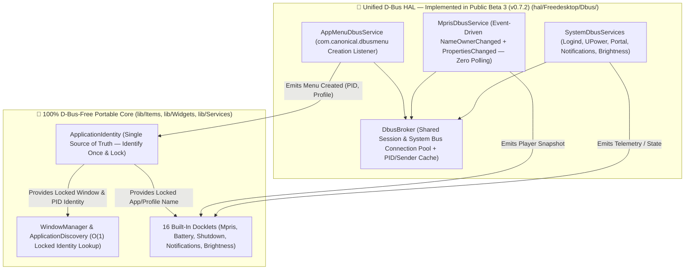

# 🚌 WAYPLANK MASTER D-BUS ABSTRACTION LAYER (DBUS-HAL) ARCHITECTURE

> **Canonical Specification for Unified Session & System D-Bus Isolation — Scheduled for Implementation in Public Beta 3 (`v0.7.2`)**  
> **Pedigree:** Scattered Per-Widget / Per-Service `GLib.Bus.get_sync` Calls (`v0.7.0`–`v0.7.1`) ➔ Unified `hal/Freedesktop/Dbus/` Broker (`v0.7.2` — Public Beta 3)  
> **Author & Maintainer:** Sergio Melas (<sergiomelas@gmail.com>)  
> **Single Source of Truth:** Master D-Bus HAL reference linked by [README.md](../README.md), [HAL_ARCHITECTURE.md](HAL_ARCHITECTURE.md), and [APPLICATION_IDENTITY_ENGINE.md](APPLICATION_IDENTITY_ENGINE.md)  
> **Architectural Status:**
> - **Active `v0.7.1` Baseline (Public Beta 2):** Core window identity is resolved and locked once per window lifecycle inside `ApplicationIdentity` (`get_locked_window_launcher_uri`, `get_locked_window_display_name`, `get_identity_for_pid_or_bus`), while raw D-Bus calls remain distributed across `lib/Services/` and `lib/Items/`.
> - **Scheduled `v0.7.2` Implementation (Public Beta 3 — Immediate Next Step):** Full migration of 100% of Session and System D-Bus calls out of `lib/Items/`, `lib/Widgets/`, and `lib/Services/` into the unified, event-driven D-Bus HAL layer (`hal/Freedesktop/Dbus/`).

---

## 📌 Table of Contents

- [1. Prime Architectural Directive for D-Bus & Identity (Public Beta 3 — `v0.7.2`)](#1-prime-architectural-directive-for-d-bus--identity-public-beta-3--v072)
  - [1.1 Single-Pass Window Identification & Immutable Lock](#11-single-pass-window-identification--immutable-lock)
  - [1.2 Strict D-Bus Isolation Boundary (Public Beta 3 — `v0.7.2`)](#12-strict-d-bus-isolation-boundary-public-beta-3--v072)
- [2. Forensic Audit of Scattered D-Bus Endpoints (To Be Migrated in Public Beta 3 — `v0.7.2`)](#2-forensic-audit-of-scattered-d-bus-endpoints-to-be-migrated-in-public-beta-3--v072)
- [3. Target Public Beta 3 (`v0.7.2`) Unified D-Bus HAL Architecture](#3-target-public-beta-3-v072-unified-d-bus-hal-architecture)
- [4. Mandatory Public Beta 3 (`v0.7.2`) Implementation Roadmap & Checklist](#4-mandatory-public-beta-3-v072-implementation-roadmap--checklist)

---

## 1. Prime Architectural Directive for D-Bus & Identity (Public Beta 3 — `v0.7.2`)

> [!IMPORTANT]
> **THE D-BUS & IDENTITY PRIME DIRECTIVE (IMPLEMENTED IN PUBLIC BETA 3 — `v0.7.2`):**  
> 1. **Identify Once in `ApplicationIdentity`, Broadcast Everywhere:** Every window is identified **exactly once** upon creation (`on_window_opened` / `scan_initial_windows`) inside `ApplicationIdentity`, locked immutably for the lifetime of `window.Id`, and removed strictly upon destruction (`on_window_closed`). No consumer (`WindowManager`, `ApplicationDiscovery`, `ApplicationDockItem`, `MprisDockItem`) may ever re-search or overwrite an already-identified window.
> 2. **Zero Direct `GLib.Bus` Calls in Core / Docklets (Public Beta 3 — `v0.7.2` Target):** UI widgets and docklets in `lib/Items/` and `lib/Widgets/` must never open raw D-Bus connections, poll `org.freedesktop.DBus.ListNames`, or parse raw `GLib.Variant` payloads directly. All D-Bus I/O will be physically isolated inside `hal/Freedesktop/Dbus/` in **Public Beta 3 (`v0.7.2`)**.

### 1.1 Single-Pass Window Identification & Immutable Lock

In `ApplicationIdentity`, window identity resolution is strictly event-driven on window creation and destruction:
- **Window Creation (`on_window_opened` / `scan_initial_windows`):** Resolves `window_browser_profiles[window.Id]`, `window_locked_launcher_uris[window.Id]`, and `window_locked_display_names[window.Id]` **once**, locking them for the entire lifetime of `window.Id`.
- **Window Destruction (`on_window_closed`):** Purges `window.Id` from all identity maps.
- **Downstream Consumers (`WindowManager`, `ApplicationDiscovery`, `ApplicationDockItem`, `MprisDockItem`):** Read the locked identity in $O(1)$ via `ApplicationIdentity.get_locked_window_launcher_uri()`, `ApplicationIdentity.get_locked_window_display_name()`, and `ApplicationIdentity.get_identity_for_pid_or_bus()`.

### 1.2 Strict D-Bus Isolation Boundary (Public Beta 3 — `v0.7.2`)

In **Public Beta 3 (`v0.7.2`)**, all Session and System D-Bus communication is consolidated into `hal/Freedesktop/Dbus/` so that:
- Only one shared Session `DBusConnection` and one shared System `DBusConnection` exist per process (`DbusBroker`).
- Every D-Bus consumer in `lib/` interacts exclusively with typed Vala signals and methods, never raw D-Bus strings or `GLib.Variant` trees.

---

## 2. Forensic Audit of Scattered D-Bus Endpoints (To Be Migrated in Public Beta 3 — `v0.7.2`)

| Current File (`v0.7.1` — Public Beta 2) | Bus Type | Target Service / Interface | Current Role | Public Beta 3 (`v0.7.2`) Target HAL Module |
| :--- | :--- | :--- | :--- | :--- |
| `lib/Services/ApplicationIdentity.vala` | Session | `com.canonical.AppMenu.Registrar`, `com.canonical.dbusmenu` (`/com/canonical/menu/<HEX>`), `org.freedesktop.DBus.GetConnectionUnixProcessID` | Event-driven Chromium/Chrome multi-profile creation menu capture | `hal/Freedesktop/Dbus/AppMenuDbusService.vala` *(Public Beta 3)* |
| `lib/Items/MprisDockItem.vala` | Session | `org.mpris.MediaPlayer2.*`, `org.freedesktop.DBus.Properties` | Media player discovery, metadata & Play/Pause/Next/Prev interlock | `hal/Freedesktop/Dbus/MprisDbusService.vala` *(Public Beta 3)* |
| `lib/Items/DoNotDisturbDockItem.vala` | Session | `org.kde.plasmashell`, `org.freedesktop.Notifications` | Do Not Disturb (DND) state & inhibition | `hal/Freedesktop/Dbus/NotificationDbusService.vala` *(Public Beta 3)* |
| `lib/Items/SessionDockItem.vala` | System / Session | `org.freedesktop.login1.Manager` (`systemd-logind`), `org.kde.LogoutPrompt`, `org.gnome.SessionManager` | Power/session capabilities (Hibernate, Hybrid Sleep, UEFI, Logout) | `hal/Freedesktop/Dbus/SessionPowerDbusService.vala` *(Public Beta 3)* |
| `lib/Items/BatteryDockItem.vala` | System | `org.freedesktop.UPower` | Battery percentage, charging state & time remaining | `hal/Freedesktop/Dbus/UPowerDbusService.vala` *(Public Beta 3)* |
| `lib/Services/BrightnessControl.vala` | Session / System | `org.kde.Solid.PowerManagement.Actions.BrightnessControl`, `org.gnome.SettingsDaemon.Power.Screen`, `org.freedesktop.login1.Session` | Backlight brightness read/write | `hal/Freedesktop/Dbus/BrightnessDbusService.vala` *(Public Beta 3)* |
| `lib/Services/SystemTheme.vala` | Session | `org.freedesktop.portal.Desktop` (`org.freedesktop.portal.Settings`) | Live dark/light color-scheme tracking | `hal/Freedesktop/Dbus/PortalDbusService.vala` *(Public Beta 3)* |
| `lib/Services/Unity.vala` | Session | `com.canonical.Unity.LauncherEntry` | Application badge counters & progress bars | `hal/Freedesktop/Dbus/LauncherEntryDbusService.vala` *(Public Beta 3)* |
| `lib/Services/KWin*.vala` & `MutterBackend.vala` | Session | `org.kde.KWin`, `org.kde.plasmashell`, `org.wayplank.Bridge` | Compositor window/strut/thumbnail bridges | `hal/Freedesktop/{KWin,Mutter}/` *(Public Beta 3)* |

---

## 3. Target Public Beta 3 (`v0.7.2`) Unified D-Bus HAL Architecture

---

## 4. Mandatory Public Beta 3 (`v0.7.2`) Implementation Roadmap & Checklist

All items below are scheduled for immediate execution in **Public Beta 3 (`v0.7.2`)**:

1. **[ ] Step D1 (Public Beta 3 — `v0.7.2`) — Create `DbusBroker` (`hal/Freedesktop/Dbus/DbusBroker.vala`):**
   - Single shared `GLib.DBusConnection` for `BusType.SESSION` and `BusType.SYSTEM`.
   - Central `NameOwnerChanged` subscription and `sender_name <-> PID` resolution cache (`GetConnectionUnixProcessID`), completely eliminating `ListNames` polling across all modules.
2. **[ ] Step D2 (Public Beta 3 — `v0.7.2`) — Extract `AppMenuDbusService` (`hal/Freedesktop/Dbus/AppMenuDbusService.vala`):**
   - Move `com.canonical.AppMenu.Registrar` ownership and `/com/canonical/menu/<HEX>` `LayoutUpdated` / `GetLayout` parsing out of `ApplicationIdentity.vala` into `AppMenuDbusService`, feeding `ApplicationIdentity` via a pure Vala signal (`menu_profile_captured (int pid, string menu_path, string profile)`).
3. **[ ] Step D3 (Public Beta 3 — `v0.7.2`) — Extract `MprisDbusService` (`hal/Freedesktop/Dbus/MprisDbusService.vala`) & Remove 2s Timer in `MprisDockItem`:**
   - Replace the 2-second polling loop (`Timeout.add_seconds (2, ...)`) and worker thread spawning in `lib/Items/MprisDockItem.vala` with event-driven `NameOwnerChanged` + `PropertiesChanged` signals in `MprisDbusService`, enriched automatically with `ApplicationIdentity.get_identity_for_pid_or_bus()`.
4. **[ ] Step D4 (Public Beta 3 — `v0.7.2`) — Extract Remaining Docklet D-Bus Calls (`Notifications`, `Shutdown`, `Battery`, `Brightness`, `Portal`, `Unity`):**
   - Enforce a strict CI build gate (`grep -rn "GLib.Bus\|Bus.get_sync" lib/Items/ lib/Widgets/`) verifying **zero** direct D-Bus calls remain outside `hal/Freedesktop/Dbus/`.
