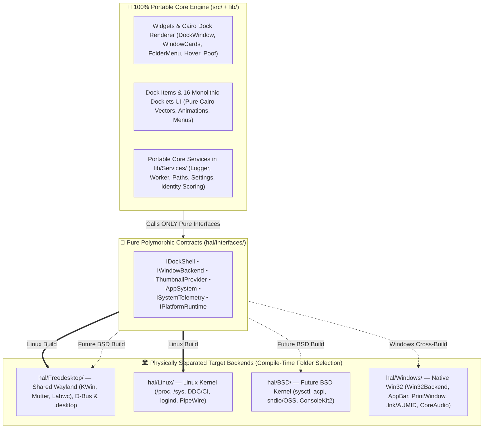
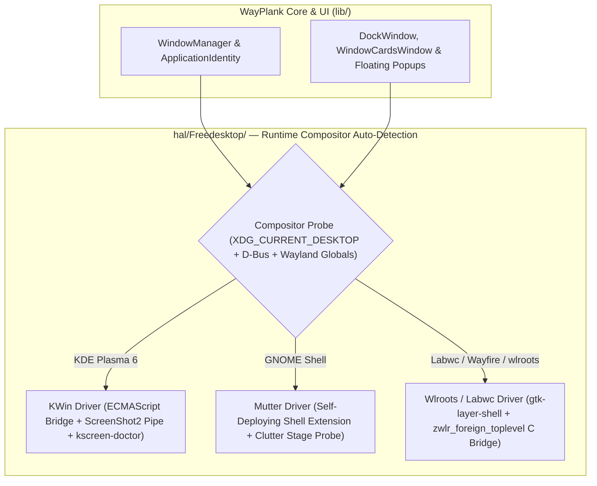

# 🏛️ WAYPLANK MASTER HARDWARE & OS ABSTRACTION LAYER (HAL) ARCHITECTURE

> **Canonical Specification for Compositor, Kernel & Multi-OS Isolation**  
> **Pedigree:** Plank (Legacy X11) ➔ WayPlank (Wayland: KWin / Mutter / Labwc) ➔ Multi-OS Horizon (Linux / BSD / Windows)  
> **Author & Maintainer:** Sergio Melas (<sergiomelas@gmail.com>)  
> **Single Source of Truth:** Master HAL reference linked by [README.md](../README.md), [DBUS_ARCHITECTURE.md](DBUS_ARCHITECTURE.md), [CONTRIBUTING.md](../CONTRIBUTING.md), [WINPLANK_PORT_BATTLE_PLAN.md](WINPLANK_PORT_BATTLE_PLAN.md), [WAYPLANK_FORK_INTEGRATION_ROADMAP.md](WAYPLANK_FORK_INTEGRATION_ROADMAP.md), [wayplank_x11_to_wayland_report_en.md](wayplank_x11_to_wayland_report_en.md), [WAYPLANK_COMPOSITORS_CHEATSHEET.md](../FAT/Test%20Files/WAYPLANK_COMPOSITORS_CHEATSHEET.md), and [WAYPLANK_LIFETIME_BUG_REGISTER.md](../FAT/WAYPLANK_LIFETIME_BUG_REGISTER.md)  
> **Architectural Status:**
> - **Active `v0.7.0` / `v0.7.1` Baseline (Public Beta 1 & 2):** Wayland 3-compositor HAL active inside `lib/Services/` (`KWin`, `Mutter`, `Labwc`).
> - **Scheduled `v0.7.2` (Public Beta 3) Consolidation Milestone:** Physical directory extraction into root-level `hal/{Interfaces,Freedesktop,Linux,BSD,Windows}/` (including the Unified D-Bus HAL in `hal/Freedesktop/Dbus/` per [DBUS_ARCHITECTURE.md](DBUS_ARCHITECTURE.md)) with compile-time OS selection and automated HAL purity firewall (enabling unified Linux, WinPlank Windows, and future BSD targets within the `v0.7.x` Public Beta series, prior to the `v0.8.x` Release Candidate feature freeze).

---

## 📌 Table of Contents

- [1. Prime Architectural Directive & Design Philosophy](#1-prime-architectural-directive--design-philosophy)
- [2. Physical Directory Topology (`Linux` / `BSD` / `Windows` + Shared `Freedesktop`)](#2-physical-directory-topology-linux--bsd--windows--shared-freedesktop)
  - [2.1 Why `Freedesktop` + `Linux` + `BSD` + `Windows` (Instead of `POSIX`)](#21-why-freedesktop--linux--bsd--windows-instead-of-posix)
  - [2.2 Target Repository Layout (Public Beta 3 — `v0.7.2+`)](#22-target-repository-layout-public-beta-3--v072)
  - [2.3 Clean Separation: Portable `lib/Services/` vs `hal/`](#23-clean-separation-portable-libservices-vs-hal)
- [3. The 6 Canonical HAL Contracts (`hal/Interfaces/`)](#3-the-6-canonical-hal-contracts-halinterfaces)
- [4. Wayland 3-Compositor Architecture (`hal/Freedesktop/`)](#4-wayland-3-compositor-architecture-halfreedesktop)
- [5. Compile-Time Target Matrix & Automated HAL Purity Firewall](#5-compile-time-target-matrix--automated-hal-purity-firewall)
- [6. 6-Step Zero-Regression Migration Roadmap (Public Beta 3 — `v0.7.2`)](#6-6-step-zero-regression-migration-roadmap-public-beta-3--v072)

---

## 1. Prime Architectural Directive & Design Philosophy

> [!IMPORTANT]
> **THE HAL PRIME DIRECTIVE:**  
> `HAL = Any part of the repository that depends on, communicates with, or negotiates with the OS kernel, desktop session, window manager, or display compositor.`

WayPlank is architected around a strict separation between **what a dock does** (pure vector rendering, icon physics, animations, layout math, grouping, preferences) and **how the host operating system or compositor exposes windows, surfaces, and hardware**:

1. **100% Portable Core (`src/` + `lib/`):**
   - Written purely against cross-platform **Vala + GLib/GObject/GIO + Gee + Json-GLib + Cairo + Pango + GdkPixbuf + GTK3**.
   - Zero `#ifdef` platform conditionals, zero compositor checks (`is_kwin()`, `is_mutter()`, `is_labwc()`), zero `/proc` or `/sys` reads, zero direct D-Bus session assumptions, and zero Win32 or Wayland protocol calls.
2. **Physically Isolated HAL (`hal/`):**
   - Encapsulates 100% of compositor bridges, surface anchoring protocols, launcher format parsers (`.desktop` vs `.lnk`/AUMID), kernel telemetry (`/proc` & `/sys` vs `sysctl` vs Win32 APIs), audio/backlight/power buses, and process signal lifecycles.
   - Selected **physically at compile time** by passing only the target platform's `hal/` subdirectories to `valac` — producing zero dead code, zero cross-OS symbol leakage, and zero runtime dispatch overhead.



---

## 2. Physical Directory Topology (`Linux` / `BSD` / `Windows` + Shared `Freedesktop`)

### 2.1 Why `Freedesktop` + `Linux` + `BSD` + `Windows` (Instead of `POSIX`)

A naive `POSIX` vs `Windows` split fails in real systems engineering for two reasons:

1. **Linux Kernel Interfaces Are Not POSIX:**
   - `/proc/<pid>/cmdline`, `/proc/stat`, `/proc/meminfo`, `/proc/diskstats`, `/proc/self/exe`, `/sys/class/backlight`, `/sys/class/power_supply`, `/dev/i2c-*`, and `systemd-logind` are **Linux-kernel-specific**. FreeBSD and OpenBSD do not mount Linux `sysfs` or `procfs` by default (they expose process arguments, CPU ticks, RAM pages, and battery state via `sysctl` and `acpi`).
2. **Zero Code Duplication Between Linux and BSD:**
   - FreeBSD and OpenBSD **do** run Wayland compositors (**KDE Plasma KWin**, **GNOME Mutter**, **Labwc / wlroots**), Freedesktop D-Bus services (`MPRIS2`, `Notifications`, `UPower`), and XDG `.desktop` launchers.
   - Placing Wayland compositors and XDG protocols inside `hal/Freedesktop/` allows **both Linux and BSD builds** to compile the exact same Wayland compositor backends with **zero duplicated lines of code**, swapping only `hal/Linux/` vs `hal/BSD/` for kernel telemetry and hardware control!

### 2.2 Target Repository Layout (Public Beta 3 — `v0.7.2+`)

```text
WayPlank/
├── src/                        # 100% Portable entry point (delegates OS init to Hal.Runtime)
├── lib/                        # 100% Portable Core Engine (ZERO OS/Compositor imports!)
│   ├── Drawing/                # Cairo surfaces, easing math, themes, HiDPI SurfaceCache
│   ├── Factories/              # Portable dock/item factories
│   ├── Items/                  # Pure UI/state models & 16 Cairo docklet frontends
│   ├── Widgets/                # Pure GTK3/Cairo windows (Dock, Cards, FolderMenu, Hover, Prefs)
│   └── Services/               # ONLY 100% OS-neutral services (Logger, Worker, Paths, Settings, Identity scoring)
├── hal/                        # 🏛️ Physically Isolated Hardware & OS Abstraction Layer
│   ├── Interfaces/             # Pure Vala interfaces & structs (compiled on ALL targets)
│   ├── Freedesktop/            # Shared Wayland & XDG stack (compiled on Linux AND BSD)
│   │   ├── KWin/               # KWinBackend, KWinBridge, KWinDbus, KWinThumbnailService, KWinTrashBridge
│   │   ├── Mutter/             # MutterBackend & embedded wayplank-bridge@wayplank.org JS extension
│   │   ├── Wlroots/            # LabwcBackend, wlr-toplevel-bridge.c & wlr-foreign-toplevel protocol
│   │   ├── Shell/              # GtkLayerShell & XDG surface coordinate implementation
│   │   └── Xdg/                # DesktopAppInfo (.desktop), RecentManager, Portal theme, MPRIS2, FDO D-Bus
│   ├── Linux/                  # Pure Linux kernel & userland drivers (compiled ONLY on Linux)
│   │   ├── ProcFs/             # /proc/<pid>/cmdline, /proc/stat, /proc/meminfo, /proc/diskstats, /proc/self/exe
│   │   ├── SysFs/              # /sys/class/power_supply, /sys/class/backlight, /sys/class/net, /dev/i2c-* DDC/CI
│   │   └── Systemd/            # systemd-logind sleep/lock/power & PipeWire/PulseAudio/ALSA helpers
│   ├── BSD/                    # Future FreeBSD / OpenBSD kernel drivers (compiled ONLY on BSD)
│   │   ├── Sysctl/             # KERN_PROC_ARGS / KERN_PROC_PATHNAME, kern.cp_time, vm.stats
│   │   └── Hardware/           # hw.acpi.battery, getifaddrs/net80211, OSS/sndio, ConsoleKit2/seatd
│   └── Windows/                # Pure Win32 native drivers (compiled ONLY by ./BuildWin.sh -> winplank.exe)
│       ├── Win32Backend.vala   # Window tracking, focus/minimize/close, PrintWindow/DWM thumbnails
│       ├── Win32Shell.vala     # SHAppBarMessage (Panel mode) + WS_EX_LAYERED + WM_NCHITTEST passthrough
│       ├── Win32AppSystem.vala # Start Menu .lnk (IShellLinkW), UWP AUMID, SHIL_JUMBO 256x256 icons
│       ├── Win32Telemetry.vala # GetSystemTimes, GlobalMemoryStatusEx, CoreAudio, DXVA2, RecycleBin
│       └── win32-bridge.c      # Out-of-context SetWinEventHook & native Win32 C ABI glue
└── vapi/
    ├── core/                   # Platform-neutral VAPIs (config.vapi, compat.vapi)
    ├── freedesktop/            # wlr-bridge.vapi, gtk-layer-shell bindings
    └── windows/                # win32-bridge.vapi
```

### 2.3 Clean Separation: Portable `lib/Services/` vs `hal/`

Not everything currently inside `lib/Services/` is hardware-dependent. During the Public Beta 3 (`v0.7.2`) extraction, portable infrastructure stays in `lib/Services/` so it is shared once across Linux, BSD, and Windows:

| Stays in `lib/Services/` (100% OS-Neutral) | Moves to `hal/` (OS / Compositor Specific) |
| :--- | :--- |
| `Logger.vala` (structured logging) | `WindowBackend.vala`, `WindowCapabilities.vala`, `WindowControl.vala`, `WindowInfo.vala` (`hal/Interfaces/`) |
| `Worker.vala` (GLib thread-pool coalescing) | `KWin*`, `MutterBackend`, `LabwcBackend`, `wlr-toplevel-bridge.c/.h` (`hal/Freedesktop/`) |
| `Paths.vala` (`GLib.Environment` user config/data paths) | `SurfaceCoordinateService.vala` & `GtkLayerShell` widget calls (`hal/Freedesktop/Shell/` vs `hal/Windows/`) |
| `Preferences.vala` & `Settings.vala` (GSettings / KeyFile models) | `ApplicationDiscovery.vala`, `System.vala`, `Matcher.vala`, `Unity.vala`, `SystemTheme.vala`, `Environment*.vala` (`hal/Freedesktop/Xdg/` vs `hal/Windows/`) |
| `ThemeManager.vala` & `Utils.vala` (archive/file helpers) | `/proc` & `/sys` & `BrightnessControl.vala` + docklet hardware probes (`hal/Linux/` vs `hal/BSD/` vs `hal/Windows/`) |
| `WindowManager.vala` & `ApplicationIdentity.vala` (pure coordinator & heuristic scoring engine fed normalized `AppDescriptor` / `ProcessSnapshot` / `WindowInfo` structs) | `Posix.signal`, `Posix.kill`, `/proc/self/exe` in `src/Main.vala` & `AbstractMain.vala` (`hal/*/Runtime`) |

---

## 3. The 6 Canonical HAL Contracts (`hal/Interfaces/`)

All communication from `src/` and `lib/` into `hal/` flows exclusively through **6 pure Vala interfaces** plus **1 capability descriptor struct** (replacing compositor-name checks in UI code):

1. **`PlatformCapabilities` (Capability-Driven Honest UI):**
   - Booleans queried by `PreferencesWindow`, `HideManager`, and `WindowCardsWindow`: `supports_live_thumbnails`, `supports_panel_struts`, `supports_dodge_active`, `supports_dodge_all`, `supports_pressure_reveal`, `supports_hardware_brightness`, `default_hide_mode`.
   - Eliminates `if (WindowControl.is_labwc())` or `if (WindowControl.is_mutter())` inside UI widgets!
2. **`IDockShell` (Surface & Input Masking Contract):**
   - `init_dock_surface (Gtk.Window)`, `init_popup_surface (Gtk.Window, PopupKind)`, `configure_dock_geometry (...)`, `update_exclusive_zone (...)`, `apply_input_region (Cairo.Region)`, `position_popup_near_rect (...)`.
   - Backed by `GtkLayerShell` on Labwc/KWin, extension IPC (`PositionDock` / `PositionHover` / struts) on Mutter, and `SHAppBarMessage` + `WS_EX_LAYERED` + `WM_NCHITTEST` (`HTTRANSPARENT`) on Windows.
3. **`IWindowBackend` (Event-Driven Window Management Contract):**
   - Signals: `windows_changed ()`, `active_window_changed ()`, `showing_desktop_changed (bool)`, `bridge_reconnected ()`.
   - Commands: `activate (id)`, `toggle_minimize (id)`, `close (id)`, `toggle_show_desktop ()`, `get_windows () -> Gee.Collection<WindowInfo>`.
4. **`IThumbnailProvider` (Live Window Frame Capture Contract):**
   - `capture_window_async (WindowInfo, target_w, target_h) -> Gdk.Pixbuf?` + cache invalidation/eviction on window close.
   - Enforces full alpha normalization (`alpha = 255` on RGB/XWayland/DIB buffers) across KWin `ScreenShot2`, Mutter `GnomeBridge`, and Win32 `PrintWindow(PW_RENDERFULLCONTENT)`.
5. **`IAppSystem` (Application Discovery, Launch & Process Inspection Contract):**
   - `discover_installed_apps ()`, `load_launcher (uri) -> AppDescriptor?`, `inspect_process (pid) -> ProcessSnapshot?`, `launch (AppDescriptor, uris)`, `launch_desktop_utility (DesktopUtilityKind)`, `get_recent_documents_for_app (...)`.
   - Abstracts `.desktop` + `/proc/<pid>/cmdline` (Linux), `.desktop` + `sysctl KERN_PROC_ARGS` (BSD), and `.lnk` (`IShellLinkW`) + UWP `AUMID` + `QueryFullProcessImageNameW` + `SHIL_JUMBO` icons (Windows).
6. **`ISystemTelemetry` & `IPlatformRuntime` (Docklet Hardware Providers & OS Lifecycle):**
   - Clean provider sub-interfaces (`ICpuMemoryProvider`, `IBatteryProvider`, `INetworkProvider`, `IAudioProvider`, `IBrightnessProvider`, `IDndProvider`, `IMediaController`, `ITrashProvider`, `ISessionPowerProvider`) keeping all 16 docklets in `lib/Items/` 100% pure Cairo + GTK.
   - `IPlatformRuntime`: single-instance detection & `--ping` IPC, graceful termination signals (`SIGINT`/`SIGTERM` vs Win32 Mutex/Window message), screen lock/unlock & suspend/resume notifications, and binary upgrade self-restart.

---

## 4. Wayland 3-Compositor Architecture (`hal/Freedesktop/`)

Because Wayland isolates clients from inspecting foreign windows or global screen coordinates, WayPlank's Freedesktop HAL auto-detects and binds the native mechanism of each compositor at startup with zero user configuration:



### Key 3-Compositor Contract Matrix & Non-Negotiable Invariants

| Subsystem | KDE Plasma 6 (`KWin`) | GNOME Shell (`Mutter`) | Labwc / `wlroots` |
| :--- | :--- | :--- | :--- |
| **Window Tracking & Actions** | Dynamic ECMAScript bridge over `org.kde.KWin /Scripting` (0 polling, auto-heals on `kwin_wayland --replace`) | Embedded `wayplank-bridge@wayplank.org` JS extension over `org.wayplank.GnomeBridge` (auto-resets `ExtensionState.ERROR`) | Native `libwayland-client` C bridge (`wlr-toplevel-bridge.c`) implementing `zwlr_foreign_toplevel_manager_v1` |
| **Dock & Popup Anchoring** | `gtk-layer-shell` (`TOP` layer + margins + exclusive zone) | Physical monitor geometry (`monGeo`) + `PositionDock` / `PositionHover` + synthetic `affectsStruts` actor (never relative to shrinking `work_area`) | `gtk-layer-shell` (`TOP` / `OVERLAY` layers + native exclusive zone) |
| **PID & CLI Resolution** | Exact per-window `pid` from KWin → `/proc/<pid>/cmdline` (Linux) or `sysctl` (BSD) | Exact `win.get_pid()` from Mutter → `/proc/<pid>/cmdline` or `sysctl` | Protocol omits PID; resolved via $O(1)$ cached process matcher disambiguated by `app_id` & title tokens |
| **Live Window Previews** | `org.kde.KWin.ScreenShot2` raw pipe capture (BGRA → RGBA with forced `alpha = 255`) | Extension Clutter actor texture capture over IPC | Clean Cairo fallback cards with high-DPI app icon & live title (`supports_live_thumbnails = false`) |
| **Critical Safety Invariants** | Autostart `.desktop` must whitelist `ScreenShot2`; ≥50ms debounce on `captionChanged` | **Zero async presentation timers** (`Pitfall #1`); **exact `===` title matching** on internal surfaces; `!win.mapped` guard before `move_frame` | Never invoke KWin/Mutter D-Bus methods; guard missing `gvfsd-metadata` via `.dockitem` fallback |

> [!WARNING]
> **Universal Anti-Message-Rush & Idempotence Law (All Platforms):**  
> Never invoke IPC/D-Bus calls, strut updates, or exclusive-zone mutations inside `draw()`, pointer-motion handlers, or geometry ticks (`update_size_and_position()`). All shell/chrome mutations must be strictly event-driven (on preference change or initial map) and guarded by a 3-way idempotence check (`enabled == last_enabled && thickness == last_thickness && position == last_position`).

---

## 5. Compile-Time Target Matrix & Automated HAL Purity Firewall

Each platform builder compiles the **exact same `src/` and `lib/` sources**, pairing them solely with that platform's `hal/` folders:

| Build Script | Output Artifact | Compiled Source Directories | Linked Platform Libraries |
| :--- | :--- | :--- | :--- |
| **`./BuildDeb.sh` / `./BuildRpm.sh`** | `wayplank` (`.deb` / `.rpm`) | `src/` + `lib/` + `hal/Interfaces/` + `hal/Freedesktop/` + `hal/Linux/` | `gtk+-3.0`, `gtk-layer-shell-0`, `gio-unix-2.0`, `wayland-client` |
| **`./BuildBsd.sh`** *(Future Horizon)* | `wayplank` (BSD pkg) | `src/` + `lib/` + `hal/Interfaces/` + `hal/Freedesktop/` + `hal/BSD/` | `gtk+-3.0`, `gtk-layer-shell-0`, `gio-unix-2.0`, `wayland-client`, `kvm` |
| **`./BuildWin.sh`** *(See [WINPLANK_PORT_BATTLE_PLAN.md](WINPLANK_PORT_BATTLE_PLAN.md))* | `winplank.exe` (Zero-DLL PE32+) | `src/` + `lib/` + `hal/Interfaces/` + `hal/Windows/` | Static GTK3/Cairo/GLib `.a` group + stock Win32 OS DLLs (`user32`, `gdi32`, `shell32`, `dwmapi`, `ole32`, `dxva2`) |

### Automated Build-Time HAL Purity Firewall (Public Beta 3 — `v0.7.2+`)
Once physical extraction completes in Public Beta 3 (`v0.7.2`), `BuildBin.sh` and `BuildWin.sh` enforce an automated pre-compile gate that **fails the build immediately** if any forbidden OS/compositor identifier ever appears inside `src/` or `lib/`:
```bash
# Enforced automatically before valac runs:
if grep -rnE "GtkLayerShell|GdkWayland|Posix\.|DesktopAppInfo|DBusConnection|Bus\.get|/proc/|/sys/|Win32" src/ lib/; then
    echo "❌ HAL FIREWALL VIOLATION: OS/Compositor dependency detected inside portable src/ or lib/!"
    exit 1
fi
```

---

## 6. 6-Step Zero-Regression Migration Roadmap (Public Beta 3 — `v0.7.2`)

To guarantee **zero regressions** against the 382-point ISA-88 FAT baseline, physical HAL extraction executes **after `v0.7.1` completes its 10-day burn-in at `0 [ko]`**, in 6 discrete compile-and-qualify steps:

1. **Step H1 — Pure Contracts (`hal/Interfaces/`):** Introduce `PlatformCapabilities`, `IDockShell`, `IWindowBackend`, `IThumbnailProvider`, `IAppSystem`, `ISystemTelemetry`, and `IPlatformRuntime` with zero behavior change.
2. **Step H2 — Purify `lib/Widgets/` & Layout Managers:** Replace all `GtkLayerShell.*` and `WindowControl.is_*()` calls in `DockWindow`, `HoverWindow`, `WindowCardsWindow`, `FolderMenuWindow`, `PoofWindow`, `PositionManager`, `HideManager`, and `PreferencesWindow` with `Hal.Shell` and `Hal.Capabilities`.
3. **Step H3 — Purify `lib/Items/` Docklets:** Extract `/proc`, `/sys`, `ddcutil`, `pactl`, `logind`, `UPower`, `NetworkManager`, and `MPRIS` backends out of `lib/Items/*DockItem.vala` into `hal/Linux/` and `hal/Freedesktop/`, leaving `lib/Items/` 100% pure Cairo + GTK.
4. **Step H4 — Purify Launchers & Process Runtime:** Abstract `DesktopAppInfo` (`.desktop`), `Posix.signal`/`kill`, and `/proc/self/exe` behind `Hal.AppSystem` and `Hal.Runtime` across `src/Main.vala`, `AbstractMain.vala`, `ItemFactory.vala`, `ApplicationDockItem.vala`, `FileDockItem.vala`, and `DragManager.vala`.
5. **Step H5 — Physical Directory Move & Firewall Activation:** Relocate `KWin*`, `Mutter*`, `Labwc*`, and `wlr-*` from `lib/Services/` into `hal/Freedesktop/`, update `BuildBin.sh` / `BuildDeb.sh` / `BuildRpm.sh` folder globs, and enable the automated **HAL Purity Firewall**.
6. **Step H6 — Multi-OS Plug-In Readiness (`v0.7.2+` / `v0.7.x`):** Plug `hal/Windows/` into `./BuildWin.sh` (per [WINPLANK_PORT_BATTLE_PLAN.md](WINPLANK_PORT_BATTLE_PLAN.md)) and expose documented `hal/BSD/` contributor entry points prior to the `v0.8.x` Release Candidate feature freeze.

