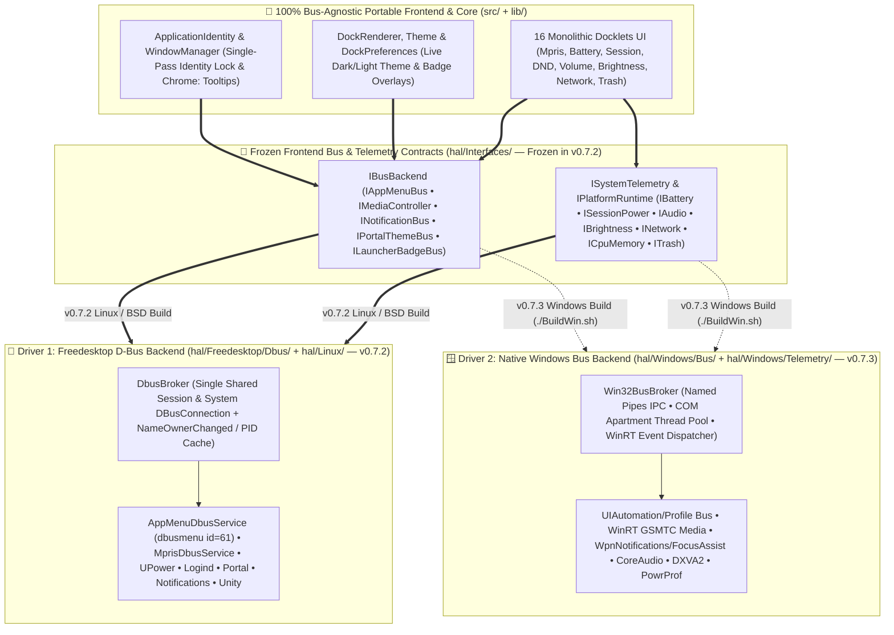
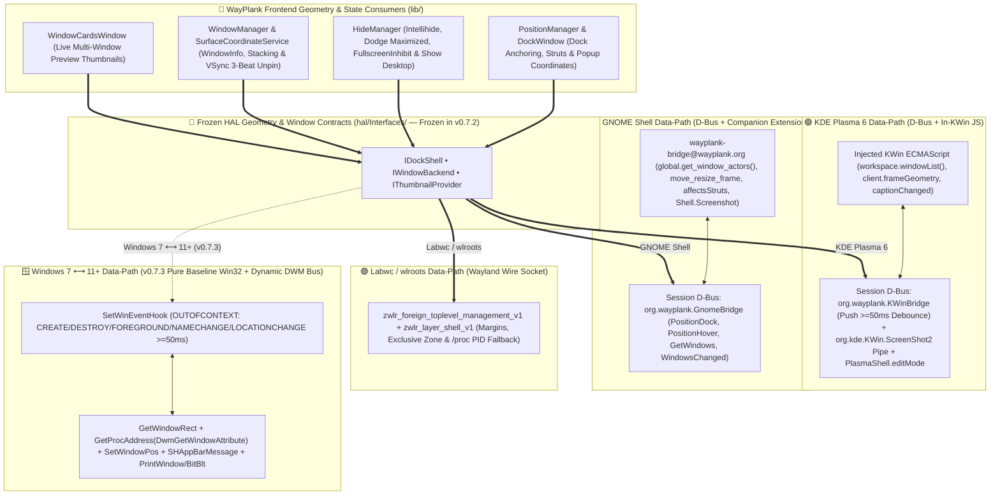
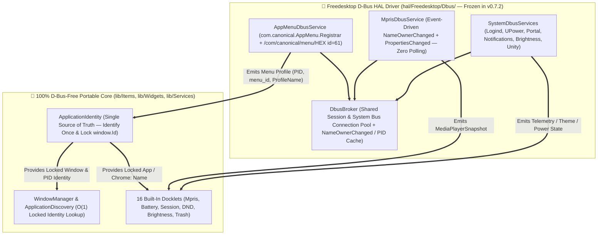
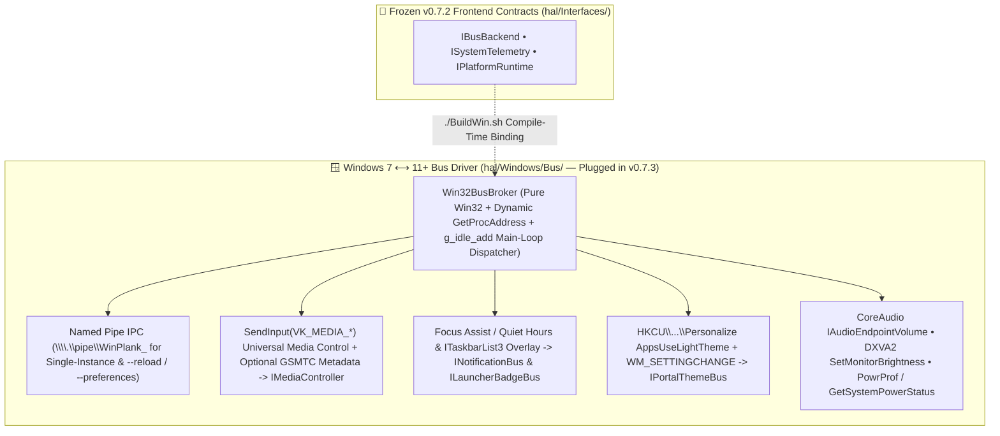

# 🚌 WAYPLANK MASTER IPC & SYSTEM BUS ABSTRACTION LAYER (`HAL_BUSES`)

> **Canonical Specification for Unified IPC, Event Bus & System Telemetry Isolation (`D-Bus` ➔ `IBusBackend` ➔ `Windows Bus`)**  
> **Pedigree:** Scattered Per-Widget `GLib.Bus.get_sync` Calls (`v0.7.0`–`v0.7.1`) ➔ Frozen `IBusBackend` + `hal/Freedesktop/Dbus/` (`v0.7.2` Public Beta 3) ➔ Native `hal/Windows/Bus/` Plug-In (`v0.7.3` Public Beta 4)  
> **Author & Maintainer:** Sergio Melas (<sergiomelas@gmail.com>) © 2026  
> **Companion Architecture Specifications:** [HAL_COMPOSITORS.md](HAL_COMPOSITORS.md) *(Compositor & Surface HAL: `KWin`, `Mutter`, `Labwc`, `Windows Compositor`)* • [APPLICATION_IDENTITY_ENGINE.md](APPLICATION_IDENTITY_ENGINE.md) *(`IAppSystem` Data Abstraction & 6-Layer Identity Engine)* • [WINPLANK_PORT_BATTLE_PLAN.md](WINPLANK_PORT_BATTLE_PLAN.md) *(Zero-DLL `winplank.exe` Cross-Build)*  
> **Single Source of Truth:** Master System & IPC Bus HAL reference linked by [README.md](../README.md), [CONTRIBUTING.md](../CONTRIBUTING.md), [HAL_COMPOSITORS.md](HAL_COMPOSITORS.md), [APPLICATION_IDENTITY_ENGINE.md](APPLICATION_IDENTITY_ENGINE.md), and [WINPLANK_PORT_BATTLE_PLAN.md](WINPLANK_PORT_BATTLE_PLAN.md)  
> **Staged Execution & Freeze Schedule (`v0.7.1` ➔ `v0.7.2` ➔ `v0.7.3`):**
> - **Active `v0.7.1` Baseline (Public Beta 2 — Released 2026-11-10, 100.0% FAT Qualified):** Core window identity is resolved and locked once per window lifecycle inside `ApplicationIdentity` (including event-driven `com.canonical.dbusmenu` submenu `id=61` + `Local State` Chrome multi-profile isolation), while raw D-Bus calls remain distributed across `lib/Services/` and `lib/Items/`.
> - **Next Beta `v0.7.2` (Public Beta 3 — 1-Week Linux HAL/Bus "Kernel" Extraction & Structural Freeze ~Nov 23–30, 2026):** Full migration of 100% of Session and System D-Bus calls out of `lib/Items/`, `lib/Widgets/`, and `lib/Services/` behind the pure `IBusBackend` / `ISystemTelemetry` contracts in `hal/Interfaces/` and into `hal/Freedesktop/Dbus/`. **The `IBusBackend` frontend contract is frozen at the end of `v0.7.2`.**
> - **Subsequent Beta `v0.7.3` (Public Beta 4 — Native `Windows Bus` Plug-In for `Win 7 ⟷ 11+` ~Dec 2026):** Implements `hal/Windows/Bus/` using **Pure Baseline Win32 C APIs + Cairo Rendering (`Windows 7 ⟷ 11+ & Future Windows` universal binary compatibility via `GetProcAddress` dynamic feature detection)**: `SetWinEventHook`, `GetWindowRect` + dynamic `DwmGetWindowAttribute`, Win32 Named Pipes, `VK_MEDIA_*` / optional GSMTC, CoreAudio / `winmm`, `DXVA2` / WMI, and `PowrProf`, hooking directly into the frozen `v0.7.2` `IBusBackend` and `ISystemTelemetry` frontend contracts.

---

## 📌 Table of Contents

- [1. Prime Architectural Directive for System & IPC Buses (`IBusBackend`)](#1-prime-architectural-directive-for-system--ipc-buses-ibusbackend)
  - [1.1 Single-Pass Window Identification & Immutable Lock in `ApplicationIdentity`](#11-single-pass-window-identification--immutable-lock-in-applicationidentity)
  - [1.2 Strict Bus Isolation Boundary (`Zero Direct Bus Calls in Frontend UI`)](#12-strict-bus-isolation-boundary-zero-direct-bus-calls-in-frontend-ui)
- [2. The Pure Frontend Bus Contracts (`hal/Interfaces/IBusBackend.vala` & `ISystemTelemetry.vala`)](#2-the-pure-frontend-bus-contracts-halinterfacesibusbackendvala--isystemtelemetryvala)
- [3. Compositor Scene-Graph, Geometry & Positioning Data-Path Buses (KWin JS, GNOME Shell Extension, Labwc Wire & Windows DWM/WinEventHook)](#3-compositor-scene-graph-geometry--positioning-data-path-buses-kwin-js-gnome-shell-extension-labwc-wire--windows-dwmwineventhook)
  - [3.1 Why WayPlank Needs a Compositor Geometry Bus (Wayland Coordinate Blindness vs Windows)](#31-why-wayplank-needs-a-compositor-geometry-bus-wayland-coordinate-blindness-vs-windows)
  - [3.2 KDE Plasma 6 Data-Path: In-Compositor KWin ECMAScript (`KWinBridge.vala` ⟷ `org.wayplank.KWinBridge`)](#32-kde-plasma-6-data-path-in-compositor-kwin-ecmascript-kwinbridgevala--orgwayplankkwinbridge)
  - [3.3 GNOME Shell Data-Path: Companion JS Extension (`wayplank-bridge@wayplank.org` ⟷ `org.wayplank.GnomeBridge`)](#33-gnome-shell-data-path-companion-js-extension-wayplank-bridgewayplankorg--orgwayplankgnomebridge)
  - [3.4 Labwc / wlroots Data-Path: Direct Wayland Wire Protocol (`zwlr_foreign_toplevel_management_v1` & `gtk-layer-shell`)](#34-labwc--wlroots-data-path-direct-wayland-wire-protocol-zwlr_foreign_toplevel_management_v1--gtk-layer-shell)
  - [3.5 Windows 7 ⟷ 11+ Data-Path (`v0.7.3`): Pure Baseline `Win32` + Dynamic `GetProcAddress(DWM)` Scene-Graph Bus (`hal/Windows/`)](#35-windows-7--11-data-path-v073-pure-baseline-win32--dynamic-getprocaddressdwm-scene-graph-bus-halwindows)
  - [3.6 4-Way Compositor Geometry & Positioning Data-Path Matrix](#36-4-way-compositor-geometry--positioning-data-path-matrix)
- [4. Driver 1: Freedesktop `D-Bus` Backend (`hal/Freedesktop/Dbus/` — Frozen in `v0.7.2`)](#4-driver-1-freedesktop-d-bus-backend-halfreedesktopdbus--frozen-in-v072)
  - [4.1 Shared Connection Pool & `NameOwnerChanged` / PID Cache (`DbusBroker`)](#41-shared-connection-pool--nameownerchanged--pid-cache-dbusbroker)
  - [4.2 Event-Driven Chrome/Chromium Multi-Profile Introspection (`com.canonical.dbusmenu` `id=61` + `Local State`)](#42-event-driven-chromechromium-multi-profile-introspection-comcanonicaldbusmenu-id61--local-state)
  - [4.3 Forensic Audit of Linux Session & System D-Bus Endpoints](#43-forensic-audit-of-linux-session--system-d-bus-endpoints)
- [5. Driver 2: Native `Windows Bus` Backend (`hal/Windows/Bus/` — Plugged in `v0.7.3`)](#5-driver-2-native-windows-bus-backend-halwindowsbus--plugged-in-v073)
- [6. 1:1 Cross-OS Equivalence & Frontend Hook-Up Matrix (`D-Bus` ⟷ `IBusBackend` ⟷ `Windows Bus`)](#6-11-cross-os-equivalence--frontend-hook-up-matrix-d-bus--ibusbackend--windows-bus)
- [7. Two-Phase Bus Consolidation Roadmap (`v0.7.2` Linux Freeze ➔ `v0.7.3` Windows Bus Plug-In)](#7-two-phase-bus-consolidation-roadmap-v072-linux-freeze--v073-windows-bus-plug-in)

---

## 1. Prime Architectural Directive for System & IPC Buses (`IBusBackend`)

> [!IMPORTANT]
> **THE SYSTEM BUS & IDENTITY PRIME DIRECTIVE:**  
> 1. **Identify Once in `ApplicationIdentity`, Broadcast Everywhere:** Every window is identified **exactly once** upon creation (`on_window_opened` / `scan_initial_windows`) inside `ApplicationIdentity`, locked immutably for the lifetime of `window.Id`, and removed strictly upon destruction (`on_window_closed`). No consumer (`WindowManager`, `ApplicationDiscovery`, `ApplicationDockItem`, `MprisDockItem`) may ever re-search or overwrite an already-identified window.
> 2. **Zero Direct OS Bus Calls in Core / Docklets (`v0.7.2` Structural Freeze):** UI widgets, core services, and docklets in `lib/Items/`, `lib/Widgets/`, and `lib/Services/` must never open raw `GLib.DBusConnection` handles, poll `org.freedesktop.DBus.ListNames`, parse raw `GLib.Variant` trees, or invoke Win32 COM/WinRT APIs directly. All bus I/O is physically isolated behind `hal/Interfaces/IBusBackend.vala` and `ISystemTelemetry.vala`, implemented by **`D-Bus`** (`hal/Freedesktop/Dbus/`) on Linux/BSD and **`Windows Bus`** (`hal/Windows/Bus/`) on Windows.

### 1.1 Single-Pass Window Identification & Immutable Lock in `ApplicationIdentity`

In `ApplicationIdentity`, window identity resolution is strictly event-driven on window creation and destruction:
- **Window Creation (`on_window_opened` / `scan_initial_windows`):** Resolves `window_browser_profiles[window.Id]`, `window_locked_launcher_uris[window.Id]`, and `window_locked_display_names[window.Id]` **once**, locking them for the entire lifetime of `window.Id`.
- **Window Destruction (`on_window_closed`):** Purges `window.Id` from all identity maps.
- **Downstream Consumers (`WindowManager`, `ApplicationDiscovery`, `ApplicationDockItem`, `MprisDockItem`):** Read the locked identity in $O(1)$ via `ApplicationIdentity.get_locked_window_launcher_uri()`, `ApplicationIdentity.get_locked_window_display_name()`, and `ApplicationIdentity.get_identity_for_pid_or_bus()`.

### 1.2 Strict Bus Isolation Boundary (`Zero Direct Bus Calls in Frontend UI`)

In **Public Beta 3 (`v0.7.2`)**, all Session and System bus communication is consolidated behind `IBusBackend` and `ISystemTelemetry` so that:
- On Linux/BSD, only **one shared Session `DBusConnection`** and **one shared System `DBusConnection`** exist per process (`DbusBroker`).
- On Windows (`v0.7.3`), only **one shared `Win32BusBroker`** (managing the STA/MTA COM apartment, WinRT event tokens, and Named Pipe IPC listener) exists per process.
- Every consumer in `lib/` interacts exclusively with typed Vala signals and structs—never raw D-Bus paths, `GLib.Variant` payloads, or Win32 `HRESULT` pointers.

---

## 2. The Pure Frontend Bus Contracts (`hal/Interfaces/IBusBackend.vala` & `ISystemTelemetry.vala`)

The frontend hooks into the bus layer through these pure, OS-independent Vala sub-contracts in `hal/Interfaces/`:

1. **`IAppMenuBus` (Browser Profile & Application Menu Introspection):**
   - Signal: `menu_profile_discovered (int pid, string window_or_menu_token, string profile_display_name)`
   - Method: `query_browser_profile_for_window (WindowInfo w) -> string?`
   - Feeds `ApplicationIdentity` so multi-profile Chrome/Chromium/Brave/Edge windows sharing a single master `PID` are locked to their exact profile (`Chrome:<ProfileName>`).
2. **`IMediaController` (Event-Driven Media Transport & Player Multiplexer):**
   - Signals: `players_changed (Gee.List<MediaPlayerSnapshot>)`, `active_player_updated (MediaPlayerSnapshot)`
   - Methods: `play_pause (string player_id)`, `next_track (string player_id)`, `previous_track (string player_id)`, `raise_player (string player_id)`
   - Consumed by `MprisDockItem` (`lib/Items/MprisDockItem.vala`) with **zero polling timers**.
3. **`INotificationBus` (Do Not Disturb & Notification Inhibition):**
   - Signal: `dnd_state_changed (bool inhibited)`
   - Methods: `set_dnd_inhibited (bool inhibit) -> bool`, `get_dnd_inhibited () -> bool`
   - Consumed by `DoNotDisturbDockItem` (`lib/Items/DoNotDisturbDockItem.vala`).
4. **`IPortalThemeBus` (Live System Dark/Light Color-Scheme & Accent Tracking):**
   - Signal: `color_scheme_changed (bool prefer_dark)`
   - Consumed by `SystemTheme` and `DockRenderer` for instantaneous Dark/Light counterpart theme swapping.
5. **`ILauncherBadgeBus` (Application Badge Counters & Progress Bars):**
   - Signals: `badge_updated (string desktop_or_aumid, int64 count, bool visible)`, `progress_updated (string desktop_or_aumid, double progress, bool visible)`
   - Consumed by `ApplicationDockItem` to render unread counts and progress overlays.
6. **`ISystemTelemetry` & `IPlatformRuntime` (Hardware & Session Providers for the 16 Docklets):**
   - `ISessionPowerProvider` (`SessionDockItem` 3×3 control center: Lock, Switch User, Log Out, Suspend, Hibernate, Hybrid Sleep, Restart, UEFI/BIOS, Shut Down + capability flags).
   - `IBatteryProvider` (`BatteryDockItem`), `IAudioProvider` (`VolumeDockItem`), `IBrightnessProvider` (`BrightnessDockItem`), `INetworkProvider` (`NetworkDockItem`), `ICpuMemoryProvider` (`CpuDockItem`), `ITrashProvider` (`TrashDockItem`), `IEjectorProvider` (`EjectorDockItem`).

---

## 3. Compositor Scene-Graph, Geometry & Positioning Data-Path Buses (KWin JS, GNOME Shell Extension, Labwc Wire & Windows DWM/WinEventHook)

### 3.1 Why WayPlank Needs a Compositor Geometry Bus (Wayland Coordinate Blindness vs Windows)

Under X11, any client could query global screen coordinates `(x, y, width, height)` of foreign windows or move its own popup windows via `XMoveResizeWindow`. Under the **Wayland security model**, a standard GTK3 client (`wayplank`) is **completely isolated from global scene-graph coordinates**:
1. **No Foreign Window Coordinates for Intellihide / Dodge (`HideManager`):** Wayland clients cannot read the `(x, y, width, height)` rectangles of other desktop windows to test whether an active, maximized, or fullscreen window overlaps `PositionManager.get_dock_window_region()`.
2. **No Global Surface Positioning on Mutter (`PositionManager` & Floating Popups):** On compositors that do not implement `zwlr_layer_shell_v1` (**GNOME Shell / Mutter**), calling `Gtk.Window.move(x, y)` from the client is ignored by the compositor—meaning the dock window itself (`DockWindow`) and all floating popups (`HoverWindow` tooltips, `FolderMenuWindow` drawers, `WindowCardsWindow` previews, `PoofWindow` unpin smoke) cannot position themselves without an in-compositor agent.
3. **No Direct Foreign Framebuffer Access (`WindowCardsWindow`):** Capturing live window thumbnails requires negotiating authenticated compositor pipes or shared-memory buffers.

Therefore, the **Bus Layer** serves as the **real-time bidirectional geometry and scene-graph data path** between the compositor's internal window tree and WayPlank's frontend (`PositionManager`, `HideManager`, `WindowManager`, `SurfaceCoordinateService`):

---

### 3.2 KDE Plasma 6 Data-Path: In-Compositor KWin ECMAScript (`KWinBridge.vala` ⟷ `org.wayplank.KWinBridge`)

On KDE Plasma 6 (Wayland), KWin supports `zwlr_layer_shell_v1` for anchoring the main dock (`DockWindow`), `HoverWindow`, `FolderMenuWindow`, and `WindowCardsWindow`, **but restricts global window coordinates `(x, y, width, height)` and foreign window actions to KWin's internal scene graph**. WayPlank bridges this via a dynamically injected **ECMAScript (JS) probe** communicating over Session D-Bus:

1. **Dynamic Script Injection (`org.kde.kwin.Scripting`):**
   - At startup, `KWinBridge.vala` writes a compact ECMAScript file and registers it with KWin via `org.kde.kwin.Scripting.loadScript` and `Script.run`, while exporting the D-Bus receiver object `org.wayplank.KWinBridge` (`/org/wayplank/KWinBridge`).
2. **Real-Time Scene-Graph & Coordinate Extraction inside KWin JS:**
   - Inside KWin's process, the JS script iterates `workspace.windowList()` and reads each window's live `client.frameGeometry` (`x, y, width, height` in logical pixels), `client.internalId` (UUID), `client.pid`, `client.resourceClass`, `client.desktopFileName`, `client.caption`, `client.minimized`, `client.fullScreen`, `client.active`, `client.demandsAttention`, and virtual desktop assignments (`client.desktops`).
   - Whenever WayPlank's dock geometry changes, WayPlank pushes the dock's screen rectangle `(dock_x, dock_y, dock_w, dock_h)` to the bridge (`UpdateDockRect`).
   - Inside KWin JS, every window geometry/focus/state signal (`frameGeometryChanged`, `activeChanged`, `minimizedChanged`, `fullScreenChanged`, `demandsAttentionChanged`, `window.captionChanged`) triggers a **$\ge 50\text{ ms}$ debounced** intersection evaluation (`rectsIntersect(client.frameGeometry, dockRect)`) and pushes the complete window table + pre-computed intersection booleans (`active_window_intersects`, `maximized_window_intersects`, `fullscreen_window_intersects`) to `org.wayplank.KWinBridge` via `callDBus` (**`0.0%` idle CPU polling**).
3. **Transient Popup Positioning (`PositionHover` & `SurfaceCoordinateService` VSync 3-Beat Unpin):**
   - When an icon is unpinned via drag-and-drop, `SurfaceCoordinateService` arms a one-shot listener inside KWin JS (`PositionHover("WayPlank Poof", x, y)`) so KWin places the floating `PoofWindow` smoke animation at the exact global release coordinate `(x, y)` before revealing Opacity `1.0`.
4. **KDE Plasma Edit Mode Coexistence (`org.kde.PlasmaShell.editMode` — Issue #27):**
   - `KWinBridge.vala` subscribes to `org.freedesktop.DBus.Properties.PropertiesChanged` on `org.kde.plasmashell` (`/PlasmaShell`, `org.kde.PlasmaShell`). When `showingDesktopChanged(true)` arrives from KWin, WayPlank checks `editMode`: if the user pressed `Super + D` (`editMode == false`), WayPlank restores dock visibility and minimizes normal windows; if KDE Plasma entered Desktop/Panel **Edit Mode** (`editMode == true`), WayPlank lets `showingDesktop` pass through and sets `fullscreen_window_intersects = true` so `HideManager` cleanly hides the dock during Edit Mode.
5. **Authenticated Raw Pipe Thumbnail Capture (`org.kde.KWin.ScreenShot2`):**
   - `KWinThumbnailService.vala` creates a UNIX `pipe()`, passes the write FD (`GLib.UnixFDList`) to `org.kde.KWin.ScreenShot2.CaptureWindow(uuid, options, pipe_fd)`, and reads raw BGRA pixels on a worker thread (enforcing `buffer[i + 3] = 255` full opacity).

---

### 3.3 GNOME Shell Data-Path: Companion JS Extension (`wayplank-bridge@wayplank.org` ⟷ `org.wayplank.GnomeBridge`)

On GNOME Shell (Mutter 45–48+), the compositor **omits both `zwlr_layer_shell_v1` and `zwlr_foreign_toplevel_management_v1`** and ignores client-side `Gtk.Window.move(x, y)` on Wayland surfaces. Consequently, the companion GNOME Shell JS extension **`wayplank-bridge@wayplank.org`** is the **mandatory bidirectional data-path bus for both reading window geometry and physically positioning WayPlank's own surfaces on screen**:

1. **Dock Surface Placement & Synthetic Strut Negotiation (`PositionDock`):**
   - When `DockWindow` realizes or `DockPreferences` (`Position`, `IconSize`, `ReserveSpace`, `Monitor`) changes, `MutterBackend.vala` invokes `org.wayplank.GnomeBridge.PositionDock(x, y, width, height, reserve_space, position, thickness, monitor_idx)`.
   - Inside `gnome-shell`, the JS extension locates WayPlank's `Meta.Window` actor (`_classifyWindow === 'dock'`), anchors its coordinates strictly to physical **`monitor_geometry`** (applying `Main.panel.height` when anchored to `TOP`, **never** using `work_area` to avoid recursive strut shrink loops), and calls `meta_window.move_resize_frame(true, x, y, width, height)`.
   - If `reserve_space == true` (Panel Mode), the extension creates/updates an invisible `St.Widget` registered via `Main.layoutManager.addChrome(strutActor, { affectsStruts: true })` guarded by a **3-way idempotence check** (`_lastReserve`, `_lastThickness`, `_lastPos`) and caches `_lastDockGeo` so the dock self-heals immediately across screen lock/unlock (`unlock-dialog`) cycles.
2. **Global Popup & Tooltip Coordinate Placement (`PositionHover`):**
   - Whenever `HoverWindow` (tooltip), `FolderMenuWindow` (drawer), `WindowCardsWindow` (preview cards), or `PoofWindow` (smoke animation) is shown, WayPlank computes the target global coordinates `(x, y)` and calls `PositionHover(window_title, x, y)` over D-Bus.
   - The extension matches the internal popup surface by **exact window title equality (`win.get_title() === title`)**, elevates it above normal windows (`make_above()`), hides it from the taskbar (`hide_from_window_list()`), and calls `win.move_frame(true, x, y)` inside `gnome-shell`.
3. **Scene-Graph Extraction & Intersection Data-Path (`GetWindows`, `CheckIntersection` & `WindowsChanged`):**
   - The extension connects to `global.display` (`window-created`, `notify::focus-window`, `window-demands-attention`, `window-marked-urgent`), `global.workspace_manager` (`active-workspace-changed`, `showing-desktop-changed`), and per-window signals (`position-changed`, `size-changed`, `notify::minimized`, `notify::fullscreen`, `notify::demands-attention`, `notify::urgent`, `notify::title`, `workspace-changed`).
   - On any change, it emits the D-Bus signal `WindowsChanged` to `MutterBackend.vala`, which fetches `GetWindows()` (returning JSON with `id`, `title`, `appId`, `wmClass`, `pid`, `x`, `y`, `width`, `height` from `win.get_frame_rect()`, `active`, `minimized`, `minimizedSequence` from monotonic `_minSeq`, `fullscreen`, `urgent`) and updates `active_window_intersects`, `maximized_window_intersects`, and `fullscreen_window_intersects` against the dock rectangle.
4. **Live Actor Texture Thumbnail Capture (`CaptureWindowPreview`):**
   - Renders the live `Meta.WindowActor` texture inside `gnome-shell` into `/dev/shm/wayplank_thumb_<id>.png` (`RAM tmpfs`), which `KWinThumbnailService` loads into a `Gdk.Pixbuf` and immediately `unlink()`s in a `finally` block.

---

### 3.4 Labwc / wlroots Data-Path: Direct Wayland Wire Protocol (`zwlr_foreign_toplevel_management_v1` & `gtk-layer-shell`)

On Labwc and wlroots-based compositors, WayPlank communicates directly over the **Wayland wire socket (`WAYLAND_DISPLAY`)** without a D-Bus compositor extension:
- **Dock & Popup Positioning (`zwlr_layer_shell_v1` via `gtk-layer-shell-0`):** Both `DockWindow` and floating popups (`HoverWindow`, `FolderMenuWindow`, `WindowCardsWindow`) are layer-shell surfaces positioned via edge anchors (`gtk_layer_shell_set_anchor`) and pixel margins (`gtk_layer_shell_set_margin`), with Panel Mode negotiated via `gtk_layer_shell_set_exclusive_zone(thickness)`.
- **Window State Stream (`zwlr_foreign_toplevel_management_v1` in `wlr-toplevel-bridge.c`):** Streams `title`, `app_id`, `activated`, `minimized`, `maximized`, and `fullscreen` events.
- **Protocol Limitations & HAL Compensation:** Because `wlr-foreign-toplevel` does **not** expose window `(x, y, width, height)` coordinates, `PID`, `urgent`, or live thumbnails, `LabwcBackend.vala` (a) resolves `PID` and `cmdline` via `/proc` matching (`resolve_toplevel_process()`), (b) evaluates Intellihide/Dodge conservatively on active-workspace (`t->active`) toplevels, and (c) sets `Capabilities.has_window_thumbnails = false` (`WindowCardsWindow` renders clean icon+title cards).

---

### 3.5 Windows 7 ⟷ 11+ Data-Path (`v0.7.3`): Pure Baseline `Win32` + Dynamic `GetProcAddress(DWM)` Scene-Graph Bus (`hal/Windows/`)

Because WayPlank renders **100% of its dock graphics, parabolic zoom, 26 visual effects, badges, tooltips, folder drawers, and preview cards in software via Cairo**, `hal/Windows/` requires **zero fragile, version-locked UI frameworks** (no WPF, no Win8 Metro, no Win10 UWP, no WinUI 3). Instead, the Windows driver is engineered on **Pure Baseline Win32 C APIs (`user32.dll`, `gdi32.dll`, `kernel32.dll`, `shell32.dll`, `psapi.dll`, `winmm.dll`)** combined with runtime **`GetProcAddress`** feature detection for optional enhancements.

> [!IMPORTANT]
> **Why One Single `winplank.exe` Binary Supports `Windows 7 ⟷ 11+` (Including Windows 12 & Beyond) Without Recompilation — And Why Only Windows XP Fails at Load Time:**
> - **Universal `Windows 7 ⟷ 11+` & Future Windows (`Windows 12+`) Compatibility:** Microsoft guarantees strict forward binary ABI compatibility for the baseline Win32 subsystem (`user32.dll`, `gdi32.dll`, `kernel32.dll`, `shell32.dll`, `dwmapi.dll`). Because all visual rendering and animations are performed internally by **Cairo** onto an ARGB32 surface (`WS_EX_LAYERED` / `UpdateLayeredWindow`) and all newer OS features (`DwmGetWindowAttribute`, `SetProcessDpiAwarenessContext`, `GetPackageFamilyName`) are resolved dynamically via `GetProcAddress` with automatic baseline fallbacks, **the exact same `winplank.exe` binary runs unmodified across Windows 7, Windows 8, Windows 8.1, Windows 10, Windows 11, and future Windows 12+ releases**.
> - **Why Windows XP (`NT 5.1`) Fails Immediately Without Recompiling Libraries:** Even though our own `win32-bridge.c` HAL code uses classic Win32 APIs compatible with Windows XP, the standard 64-bit `libglib-2.0` and `libgtk-3-0` libraries linked from modern MinGW-w64 import `NT 6.1+` (Windows 7+) kernel synchronization symbols (`AcquireSRWLockExclusive`, `SleepConditionVariableSRW`, `GetTickCount64`) in their static PE import table. Launching the standard `winplank.exe` on Windows XP without recompiling GLib/GTK triggers an immediate OS loader error before `main()` (*"The procedure entry point GetTickCount64 could not be located in KERNEL32.dll"*).

1. **Event-Driven Scene-Graph Push Bus (`SetWinEventHook` with `WINEVENT_OUTOFCONTEXT | WINEVENT_SKIPOWNPROCESS`):**
   - Available across all `Win 7 ⟷ 11+` systems in `user32.dll`. Replaces KWin's `org.wayplank.KWinBridge` and Mutter's `org.wayplank.GnomeBridge` `WindowsChanged` signals with a single OS-level out-of-context hook subscribing to:
     - `EVENT_OBJECT_CREATE` / `EVENT_OBJECT_DESTROY` / `EVENT_OBJECT_SHOW` / `EVENT_OBJECT_HIDE` (window lifecycle).
     - `EVENT_SYSTEM_FOREGROUND` (active window focus change).
     - `EVENT_OBJECT_NAMECHANGE` (live window title updates — exact Windows equivalent of KWin `window.captionChanged` and Mutter `notify::title`).
     - `EVENT_SYSTEM_MINIMIZESTART` / `EVENT_SYSTEM_MINIMIZEEND` (tracks monotonic `MinimizedSequence`).
     - `EVENT_OBJECT_LOCATIONCHANGE` (window move/resize, coalesced with the **exact same $\ge 50\text{ ms}$ debounce** as `KWinBridge.vala` so dragging a window never floods the GTK main loop).
2. **Exact Visible Window Bounds Extraction (`GetWindowRect` Baseline + Dynamic `GetProcAddress("DwmGetWindowAttribute")`):**
   - **Why Composited Windows (8/10/11+) Differ from Classic/Basic Themes:** On classic non-composited themes, `GetWindowRect(hwnd)` returns the exact visible window frame. On DWM-composited desktops (Windows 8, 10, 11+), `GetWindowRect(hwnd)` includes an **invisible $7\text{ px}$ DWM resize border/drop-shadow** on the left, right, and bottom of every standard window, which would cause false-positive Intellihide/Dodge dock hiding when a window is $1\text{–}7\text{ px}$ away from the dock.
   - **Universal `GetProcAddress` Remediation in `win32-bridge.c`:** At startup, `win32-bridge.c` resolves `DwmGetWindowAttribute` from `dwmapi.dll` via `GetProcAddress`. If available and succeeds (`S_OK`), it queries `DWMWA_EXTENDED_FRAME_BOUNDS` (`9`) to strip the invisible $7\text{ px}$ shadow; otherwise, it falls back seamlessly to `GetWindowRect(hwnd)`.
   - Inside `win32-bridge.c`, `IntersectRect(&out, &visible_rect, &dock_rect)` computes `active_window_intersects`, `IsZoomed(hwnd)` computes `maximized_window_intersects`, and monitor bounds comparison (`MonitorFromWindow` + `GetMonitorInfoW`) computes `fullscreen_window_intersects` for `HideManager`.
3. **Dock & Popup Surface Positioning + Exclusive Zone (`SetWindowPos`, `UpdateLayeredWindow` & `SHAppBarMessage`):**
   - **Cairo Layered Transparency & Input Mask (`IDockShell`):** Cairo renders the dock and its 26 animations into a 32-bit ARGB buffer displayed via `WS_EX_LAYERED | WS_EX_TOOLWINDOW | WS_EX_TOPMOST`, while `CreateRectRgn` + `SetWindowRgn` (or `WM_NCHITTEST` returning `HTTRANSPARENT` outside `background_rect`) provides zero-latency click passthrough across `Win 7 ⟷ 11+`.
   - **Dock & Strut (`IDockShell`):** Replaces Mutter's `PositionDock` / `affectsStruts` and Wayland's `gtk-layer-shell` with `SetWindowPos(dock_hwnd, HWND_TOPMOST, x, y, w, h, SWP_NOACTIVATE)` and `SHAppBarMessage(ABM_NEW / ABM_SETPOS)` (guarded by the same 3-way idempotence check `(enabled, thickness, position)` per Rule §5.10).
   - **Popup Positioning (`PositionHover` equivalent):** `HoverWindow`, `FolderMenuWindow`, `WindowCardsWindow`, and `PoofWindow` obtain their native `HWND` via `GDK_WINDOW_HWND` (`WS_EX_TOOLWINDOW | WS_EX_NOACTIVATE | WS_EX_TOPMOST`) and position directly at global screen coordinates `(x, y)` via `SetWindowPos(popup_hwnd, HWND_TOPMOST, x, y, 0, 0, SWP_NOSIZE | SWP_NOACTIVATE)`.
4. **Live Window Thumbnail Capture (`PrintWindow` with `PW_RENDERFULLCONTENT` Fallback to `0` / `BitBlt`):**
   - Calls `PrintWindow(hwnd, hdcMem, 0x00000002)` (`PW_RENDERFULLCONTENT` on Windows 8.1/10/11+); if the flag is unsupported on Windows 7/8.0, retries automatically with `PrintWindow(hwnd, hdcMem, 0)` / `BitBlt` into a `Gdk.Pixbuf` with `alpha = 255` enforcement.

---

### 3.6 4-Way Compositor Geometry & Positioning Data-Path Matrix

| Geometry / Telemetry Operation | KDE Plasma 6 (`KWinBridge` JS + D-Bus) | GNOME Shell (`wayplank-bridge` JS + D-Bus) | Labwc / wlroots (Wayland Wire Socket) | Windows `7 ⟷ 11+` (`v0.7.3` Pure Win32 + Dynamic `DWM`) |
| :--- | :--- | :--- | :--- | :--- |
| **In-Compositor / OS Agent** | Injected KWin ECMAScript (`KWinBridge.vala`) | Companion JS Extension (`wayplank-bridge@wayplank.org`) | Native Wayland compositor (`zwlr_*` protocols) | In-process `win32-bridge.c` (`user32.dll` + `GetProcAddress(dwmapi)`) |
| **Transport Bus** | Session D-Bus (`org.wayplank.KWinBridge`) | Session D-Bus (`org.wayplank.GnomeBridge`) | Wayland socket (`WAYLAND_DISPLAY`) | Out-of-context `SetWinEventHook` + `g_idle_add` |
| **Dock Surface Anchoring** | `gtk-layer-shell` (`TOP` layer + edge anchors) | Extension `PositionDock()` (`move_resize_frame` on `monitor_geometry`) | `gtk-layer-shell` (`TOP` layer + edge anchors) | `SetWindowPos(HWND_TOPMOST, x, y, w, h, SWP_NOACTIVATE)` |
| **Panel Mode (`ReserveSpace`)** | `gtk_layer_shell_set_exclusive_zone(thickness)` | Extension `Main.layoutManager.addChrome({ affectsStruts: true })` | `gtk_layer_shell_set_exclusive_zone(thickness)` | `SHAppBarMessage(ABM_NEW / ABM_SETPOS)` |
| **Popup / Tooltip Placement (`Hover`, `Cards`, `Folder`, `Poof`)** | `gtk-layer-shell` margins + `PositionHover` (`PoofWindow` VSync 3-Beat) | Extension `PositionHover(exact_title, x, y)` (`move_frame`) | `gtk-layer-shell` edge anchors + margins (`Poof` disabled) | `SetWindowPos(popup_hwnd, HWND_TOPMOST, x, y, ...)` |
| **Foreign Window Visible Rect `(x, y, w, h)`** | KWin JS `client.frameGeometry` | Extension JS `win.get_frame_rect()` | Not exposed by `wlr-foreign-toplevel` (active-output fallback) | `GetProcAddress(DwmGetWindowAttribute)` (`DWMWA_EXTENDED_FRAME_BOUNDS`) with `GetWindowRect` fallback |
| **Intellihide / Dodge Overlap Math** | Computed in KWin JS (`>=50ms` debounce) & pushed via D-Bus | Computed in Extension JS (`CheckIntersection` / `GetWindows`) | Approximated on active workspace (`t->active`) in `wlr-toplevel-bridge.c` | Computed in `win32-bridge.c` (`IntersectRect` + `>=50ms` `LOCATIONCHANGE` debounce) |
| **Show Desktop (`Super+D`) vs Desktop Edit / Overview** | `showingDesktopChanged` + `org.kde.PlasmaShell.editMode` (#27) | `showing-desktop-changed` gated on `!Main.overview.visible` | `t->active` check in `wlr-toplevel-bridge.c` | Intercepts `Shell_TrayWnd` `ToggleDesktop` / `WM_DISPLAYCHANGE` |
| **Live Window Thumbnails (`WindowCardsWindow`)** | `org.kde.KWin.ScreenShot2` UNIX pipe (`alpha = 255`) | Extension `CaptureWindowPreview` via `/dev/shm/*.png` | Disabled (`has_window_thumbnails = false` ➔ icon cards) | `PrintWindow(PW_RENDERFULLCONTENT)` with fallback to `PrintWindow(..., 0)` / `BitBlt` (`alpha = 255`) |

---

## 4. Driver 1: Freedesktop `D-Bus` Backend (`hal/Freedesktop/Dbus/` — Frozen in `v0.7.2`)

### 4.1 Shared Connection Pool & `NameOwnerChanged` / PID Cache (`DbusBroker`)
- Opens a single `BusType.SESSION` connection and a single `BusType.SYSTEM` connection for the entire `wayplank` process.
- Subscribes once to `org.freedesktop.DBus.NameOwnerChanged` and caches `unique_bus_name (`:1.xxx`) <-> unix_pid` via `org.freedesktop.DBus.GetConnectionUnixProcessID`, eliminating redundant synchronous bus round-trips.

### 4.2 Event-Driven Chrome/Chromium Multi-Profile Introspection (`com.canonical.dbusmenu` `id=61` + `Local State`)
Implemented in `v0.7.1` (`ApplicationIdentity.vala`) and extracted into `hal/Freedesktop/Dbus/AppMenuDbusService.vala` in `v0.7.2`:
1. **Menu Creation Discovery:** Listens to `com.canonical.AppMenu.Registrar` and enumerates exported `/com/canonical/menu/<HEX>` object paths on the browser's unique D-Bus connection (`list_all_chrome_menu_paths()`, sorting menu paths directly in `Gee.ArrayList<string>` by hexadecimal menu ID without nullable `uint64?` boxed-key maps).
2. **Submenu `id=61` (Profiles Menu) Introspection:** Invokes `com.canonical.dbusmenu.GetLayout(61, ...)` (or inspects the root menu tree) to read the active profile indicator and correlates open profile lock/database descriptors in `/proc/<pid>/fd` with `~/.config/google-chrome/Local State` (`profile.info_cache`).
3. **Immutable Window-to-Profile Lock & `Chrome:<Profile>` Tooltip:** Locks `window_browser_profiles[window.Id]` on creation so multiple Chrome/Chromium/Brave windows sharing the same `PID` isolate onto their respective profile dock items and display **`Chrome:<ProfileName>`** tooltips on hover.

### 4.3 Forensic Audit of Linux Session & System D-Bus Endpoints

| Active `v0.7.1` File | Bus | D-Bus Service / Interface | `v0.7.2` Frozen `hal/Freedesktop/Dbus/` Module | Frontend Contract (`hal/Interfaces/`) |
| :--- | :---: | :--- | :--- | :--- |
| `lib/Services/ApplicationIdentity.vala` | Session | `com.canonical.AppMenu.Registrar`, `com.canonical.dbusmenu` (`/com/canonical/menu/<HEX>` `id=61`), `GetConnectionUnixProcessID` | `AppMenuDbusService.vala` | `IAppMenuBus` |
| `lib/Items/MprisDockItem.vala` | Session | `org.mpris.MediaPlayer2`, `org.mpris.MediaPlayer2.Player`, `org.freedesktop.DBus.Properties` | `MprisDbusService.vala` | `IMediaController` |
| `lib/Items/DoNotDisturbDockItem.vala` | Session | `org.kde.plasmashell`, `org.freedesktop.Notifications` (+ `dunstctl`/`swaync-client` on Labwc) | `NotificationDbusService.vala` | `INotificationBus` |
| `lib/Items/SessionDockItem.vala` | System / Session | `org.freedesktop.login1.Manager` (`CanHibernate`, `CanHybridSleep`, `CanRebootToFirmwareSetup`), `org.kde.LogoutPrompt`, `org.gnome.SessionManager` | `SessionPowerDbusService.vala` | `ISessionPowerProvider` |
| `lib/Items/BatteryDockItem.vala` | System | `org.freedesktop.UPower`, `org.freedesktop.UPower.Device` | `UPowerDbusService.vala` | `IBatteryProvider` |
| `lib/Services/BrightnessControl.vala` | Session / System | `org.kde.Solid.PowerManagement.Actions.BrightnessControl`, `org.gnome.SettingsDaemon.Power.Screen`, `org.freedesktop.login1.Session` | `BrightnessDbusService.vala` | `IBrightnessProvider` |
| `lib/Services/SystemTheme.vala` | Session | `org.freedesktop.portal.Desktop` (`org.freedesktop.portal.Settings` `color-scheme`) | `PortalDbusService.vala` | `IPortalThemeBus` |
| `lib/Services/Unity.vala` | Session | `com.canonical.Unity.LauncherEntry` (`count`, `progress`, `urgent`) | `LauncherEntryDbusService.vala` | `ILauncherBadgeBus` |
| `lib/Services/KWin*.vala` & `MutterBackend.vala` | Session | `org.kde.KWin`, `org.kde.KWin.ScreenShot2`, `org.kde.PlasmaShell` (`editMode` #27), `org.wayplank.GnomeBridge` | `hal/Freedesktop/{KWin,Mutter}/` *(See [HAL_COMPOSITORS.md](HAL_COMPOSITORS.md))* | `IWindowBackend`, `IDockShell`, `IThumbnailProvider` |

---

## 5. Driver 2: Native `Windows Bus` Backend (`hal/Windows/Bus/` — Plugged in `v0.7.3`)

Across **Windows 7 ⟷ 11+ (and future Windows 12+ releases)**, there is no Freedesktop `dbus-daemon`. Instead, `hal/Windows/Bus/` implements the **exact same `IBusBackend` and `ISystemTelemetry` interfaces frozen in `v0.7.2`** using **Pure Baseline Win32 C APIs** (`Win32 Named Pipes`, `user32.dll` `VK_MEDIA_*`, `CoreAudio` / `winmm.dll`, `DXVA2` / WMI, `PowrProf`) with optional `GetProcAddress` enhancements, marshaling all asynchronous callbacks onto the GTK/GLib main thread via `g_idle_add`:

---

## 6. 1:1 Cross-OS Equivalence & Frontend Hook-Up Matrix (`D-Bus` ⟷ `IBusBackend` ⟷ `Windows Bus`)

Every single frontend widget and docklet in `lib/` hooks up to **one** contract in `hal/Interfaces/` and works identically on Linux (`D-Bus`) and Windows `7 ⟷ 11+` (`Windows Bus`):

| Frontend Consumer (`lib/`) | Frozen `hal/Interfaces/` Contract (`v0.7.2`) | Linux / BSD Driver (`hal/Freedesktop/Dbus/` & `hal/Linux/`) | Windows `7 ⟷ 11+` Driver (`hal/Windows/Bus/` & `hal/Windows/Telemetry/`) |
| :--- | :--- | :--- | :--- |
| **`AbstractMain` (Single-Instance & CLI Flags)** | `IPlatformRuntime` | `GLib.Application` D-Bus activation + `Posix.kill(SIGTERM/SIGWINCH)` | Win32 Named Mutex + Named Pipe `\\.\pipe\WinPlank_<SID>` (`--preferences`, `--reload`) |
| **`ApplicationIdentity` (Browser Multi-Profile)** | `IAppMenuBus` | `com.canonical.dbusmenu` (`/com/canonical/menu/<HEX>` `id=61`) + `~/.config/google-chrome/Local State` | `HWND` / cmdline `--profile-directory` + `%LOCALAPPDATA%\Google\Chrome\User Data\Local State` |
| **`MprisDockItem` (`docklet://mpris`)** | `IMediaController` | `org.mpris.MediaPlayer2.Player` (`NameOwnerChanged` + `PropertiesChanged`) | Universal `SendInput(VK_MEDIA_PLAY_PAUSE / NEXT / PREV)` + optional WinRT `GSMTC` metadata via `GetProcAddress` |
| **`DoNotDisturbDockItem` (`docklet://dnd`)** | `INotificationBus` | `org.freedesktop.Notifications` / KDE `plasmashell` / Labwc `dunstctl` | Windows Focus Assist (`WNF_SHEL_QUIETHOURS_ACTIVE_PROFILE_CHANGED`) / `WpnNotifications` |
| **`SystemTheme` & `DockRenderer`** | `IPortalThemeBus` | `org.freedesktop.portal.Settings` (`color-scheme`) + `kdeglobals` inotify | `WM_SETTINGCHANGE` (`ImmersiveColorSet`) + Registry `AppsUseLightTheme` |
| **`ApplicationDockItem` (Badges & Progress)** | `ILauncherBadgeBus` | `com.canonical.Unity.LauncherEntry` | `ITaskbarList3::SetOverlayIcon` / `SetProgressValue` hook & UWP Badge notifications |
| **`SessionDockItem` (`docklet://session` 3×3)** | `ISessionPowerProvider` | `org.freedesktop.login1.Manager` (`Suspend`, `Hibernate`, `HybridSleep`, `SetRebootToFirmwareSetup`) | `LockWorkStation`, `WTSDisconnectSession`, `ExitWindowsEx`, `SetSuspendState` (`powrprof.dll`), `EWX_BOOTOPTIONS` |
| **`BatteryDockItem` (`docklet://battery`)** | `IBatteryProvider` | `org.freedesktop.UPower` + `/sys/class/power_supply` | `GetSystemPowerStatus` + `WM_POWERBROADCAST` (`PBT_APMPOWERSTATUSCHANGE`) |
| **`VolumeDockItem` (`docklet://volume`)** | `IAudioProvider` | PipeWire / PulseAudio (`pactl`) / ALSA | CoreAudio MMDevice API (`IAudioEndpointVolume` + `IAudioEndpointVolumeCallback`) |
| **`BrightnessDockItem` (`docklet://brightness`)** | `IBrightnessProvider` | KWin DRM `kscreen-doctor`, GNOME Power D-Bus, `/sys/class/backlight`, `ddcutil` | `dxva2.dll` (`GetMonitorBrightness` / `SetMonitorBrightness`) + WMI `WmiMonitorBrightnessMethods` |
| **`NetworkDockItem` (`docklet://network`)** | `INetworkProvider` | `/sys/class/net`, `/proc/net/wireless`, `nmcli` | `iphlpapi.dll` (`GetAdaptersAddresses`, `NotifyIpInterfaceChange`) + `wlanapi.dll` |
| **`CpuDockItem` (`docklet://cpu`)** | `ICpuMemoryProvider` | `/proc/stat`, `/proc/meminfo`, `/proc/diskstats` | `GetSystemTimes`, `GlobalMemoryStatusEx`, `DeviceIoControl(IOCTL_DISK_PERFORMANCE)` |
| **`TrashDockItem` (`docklet://trash`)** | `ITrashProvider` | GIO `trash://` + KDE `org.kde.KIO.Trash` / GNOME `Nautilus2` D-Bus | `SHQueryRecycleBinW` + `SHEmptyRecycleBinW` + `SHChangeNotifyRegister` |
| **`EjectorDockItem` (`docklet://ejector`)** | `IEjectorProvider` | GIO `VolumeMonitor` / `UDisks2` D-Bus | `CM_Request_Device_EjectW` (`cfgmgr32.dll`) + `DeviceIoControl(IOCTL_STORAGE_EJECT_MEDIA)` |

---

## 7. Two-Phase Bus Consolidation Roadmap (`v0.7.2` Linux Freeze ➔ `v0.7.3` Windows Bus Plug-In)

### Phase 1 — `v0.7.2` (Public Beta 3): Linux-Side Bus Implementation & Contract Freeze
1. **[ ] Step B1 (`hal/Interfaces/IBusBackend.vala` & `ISystemTelemetry.vala`):** Define and freeze the pure Vala bus and telemetry interfaces (`IAppMenuBus`, `IMediaController`, `INotificationBus`, `IPortalThemeBus`, `ILauncherBadgeBus`, and the 8 docklet telemetry providers).
2. **[ ] Step B2 (`hal/Freedesktop/Dbus/DbusBroker.vala`):** Implement the shared Session & System `DBusConnection` pool with centralized `NameOwnerChanged` subscription and `sender <-> PID` cache.
3. **[ ] Step B3 (`hal/Freedesktop/Dbus/AppMenuDbusService.vala`):** Extract the `com.canonical.AppMenu.Registrar` and `/com/canonical/menu/<HEX>` (`id=61`) Chrome multi-profile listener out of `ApplicationIdentity.vala` behind `IAppMenuBus`.
4. **[ ] Step B4 (`hal/Freedesktop/Dbus/MprisDbusService.vala`):** Replace the 2-second polling timer in `MprisDockItem.vala` with event-driven `NameOwnerChanged` + `PropertiesChanged` signals behind `IMediaController`.
5. **[ ] Step B5 (Remaining Docklet D-Bus Endpoints & Build Firewall):** Extract `NotificationDbusService`, `SessionPowerDbusService`, `UPowerDbusService`, `BrightnessDbusService`, `PortalDbusService`, and `LauncherEntryDbusService`, and enable the `BuildBin.sh` firewall forbidding `GLib.Bus` or `DBusConnection` inside `src/` and `lib/`.

### Phase 2 — `v0.7.3` (Public Beta 4): Native `Windows Bus` Plug-In (`hal/Windows/Bus/`)
6. **[ ] Step B6 (`hal/Windows/Bus/Win32BusBroker.vala` & Providers):** Implement `Win32BusBroker`, Named Pipe CLI IPC, WinRT `GSMTC` media provider, Focus Assist DND provider, CoreAudio volume provider, `DXVA2`/WMI brightness provider, and `PowrProf`/`SHQueryRecycleBinW` providers against the frozen `v0.7.2` `IBusBackend` and `ISystemTelemetry` contracts (see [WINPLANK_PORT_BATTLE_PLAN.md](WINPLANK_PORT_BATTLE_PLAN.md)).
