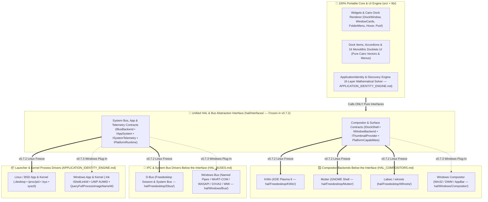
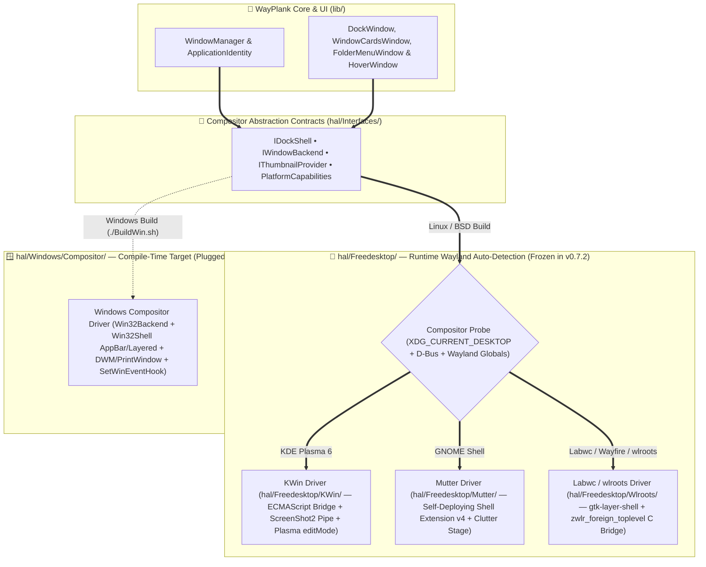
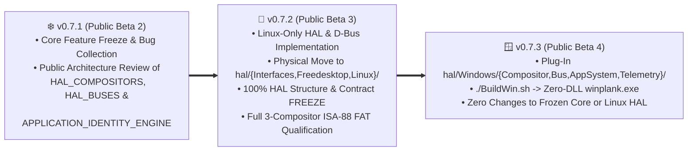

# 🏛️ WAYPLANK MASTER HARDWARE & COMPOSITOR ABSTRACTION LAYER (`HAL_COMPOSITORS`)

> **Canonical Specification for Compositor, Surface, Kernel & Multi-OS Isolation**  
> **Pedigree:** Plank (Legacy X11) ➔ WayPlank (Wayland: KWin / Mutter / Labwc) ➔ Multi-OS Horizon (Linux / BSD / Windows)  
> **Author & Maintainer:** Sergio Melas (<sergiomelas@gmail.com>) © 2026  
> **Companion Architecture Specifications:** [HAL_BUSES.md](HAL_BUSES.md) *(IPC & System Bus Abstraction: `D-Bus` vs `Windows Bus`)* • [APPLICATION_IDENTITY_ENGINE.md](APPLICATION_IDENTITY_ENGINE.md) *(`IAppSystem` Data Abstraction: `.desktop` & `/proc` vs `.lnk` & `AUMID` + 6-Layer Identity Engine)* • [WINPLANK_PORT_BATTLE_PLAN.md](WINPLANK_PORT_BATTLE_PLAN.md) *(Zero-DLL `winplank.exe` Cross-Build)*  
> **Single Source of Truth:** Master Compositor & Shell HAL reference linked by [README.md](../README.md), [CONTRIBUTING.md](../CONTRIBUTING.md), [USER_GUIDE.md](USER_GUIDE.md), [WAYPLANK_FORK_INTEGRATION_ROADMAP.md](WAYPLANK_FORK_INTEGRATION_ROADMAP.md), [WAYPLANK_COMPOSITORS_CHEATSHEET.md](../FAT/Test%20Files/WAYPLANK_COMPOSITORS_CHEATSHEET.md), and [WAYPLANK_LIFETIME_BUG_REGISTER.md](../FAT/WAYPLANK_LIFETIME_BUG_REGISTER.md)  
> **Staged Execution & Freeze Schedule (`v0.7.1` ➔ `v0.7.2` ➔ `v0.7.3`):**
> - **Active `v0.7.1` (Public Beta 2 — Released 2026-11-10, 100.0% FAT Qualified):** Wayland 3-compositor HAL active inside `lib/Services/` (`KWin`, `Mutter`, `Labwc`). Open for community burn-in, bug collection, and public architectural review of this specification.
> - **Next Beta `v0.7.2` (Public Beta 3 — 1-Week Linux HAL/Bus "Kernel" Development & Structural Freeze ~Nov 23–30, 2026):** Physical extraction of all Linux/Wayland drivers into `hal/{Interfaces,Freedesktop,Linux}/` (including `hal/Freedesktop/Dbus/` per [HAL_BUSES.md](HAL_BUSES.md) and `IAppSystem` per [APPLICATION_IDENTITY_ENGINE.md](APPLICATION_IDENTITY_ENGINE.md)) with automated build-time HAL purity firewall. **In `v0.7.2`, only the Linux side is implemented and qualified so the `hal/Interfaces/` contracts and directory structure are 100% frozen before adding Windows.**
> - **Subsequent Beta `v0.7.3` (Public Beta 4 — Native Windows Plug-In ~Dec 2026):** Plugs `hal/Windows/{Compositor,Bus,AppSystem,Telemetry}/` and `./BuildWin.sh` ([WINPLANK_PORT_BATTLE_PLAN.md](WINPLANK_PORT_BATTLE_PLAN.md)) directly into the frozen `v0.7.2` `hal/Interfaces/` contracts with zero modifications to Core or Linux backends.

---

## 📌 Table of Contents

- [1. Prime Architectural Directive & Unified HAL Topology](#1-prime-architectural-directive--unified-hal-topology)
- [2. Physical Directory Topology (`Linux` / `BSD` / `Windows` + Shared `Freedesktop`)](#2-physical-directory-topology-linux--bsd--windows--shared-freedesktop)
  - [2.1 Why `Freedesktop` + `Linux` + `BSD` + `Windows` (Instead of `POSIX`)](#21-why-freedesktop--linux--bsd--windows-instead-of-posix)
  - [2.2 Target Repository Layout (`v0.7.2` Structural Freeze & `v0.7.3` Windows Plug-In)](#22-target-repository-layout-v072-structural-freeze--v073-windows-plug-in)
  - [2.3 Clean Separation: Portable `lib/Services/` vs `hal/`](#23-clean-separation-portable-libservices-vs-hal)
- [3. The 7 Canonical HAL & Bus Contracts (`hal/Interfaces/`)](#3-the-7-canonical-hal--bus-contracts-halinterfaces)
- [4. The 4 Compositor Drivers Below the Abstraction Interface](#4-the-4-compositor-drivers-below-the-abstraction-interface)
  - [4.1 4-Compositor Contract Matrix & Non-Negotiable Safety Invariants](#41-4-compositor-contract-matrix--non-negotiable-safety-invariants)
- [5. Compile-Time Target Matrix & Automated HAL Purity Firewall](#5-compile-time-target-matrix--automated-hal-purity-firewall)
- [6. Two-Phase Beta Consolidation Roadmap (`v0.7.2` Linux Freeze ➔ `v0.7.3` Windows Plug-In)](#6-two-phase-beta-consolidation-roadmap-v072-linux-freeze--v073-windows-plug-in)

---

## 1. Prime Architectural Directive & Unified HAL Topology

> [!IMPORTANT]
> **THE HAL PRIME DIRECTIVE:**  
> `HAL = Any part of the repository that depends on, communicates with, or negotiates with the OS kernel, desktop session, IPC bus, window manager, or display compositor.`

WayPlank is architected around a strict separation between **what a dock does** (pure vector rendering, icon physics, animations, layout math, frecency accordions, preferences) and **how the host operating system, compositor, or system bus exposes windows, surfaces, events, and hardware**:

1. **100% Portable Core (`src/` + `lib/`):**
   - Written purely against cross-platform **Vala + GLib/GObject/GIO + Gee + Json-GLib + Cairo + Pango + GdkPixbuf + GTK3**.
   - Zero `#ifdef` platform conditionals, zero compositor checks (`is_kwin()`, `is_mutter()`, `is_labwc()`), zero `/proc` or `/sys` reads, zero direct D-Bus session assumptions, and zero Win32 or Wayland protocol calls.
2. **Unified Pure Abstraction Interface (`hal/Interfaces/` — Frozen in `v0.7.2`):**
   - Exposes 7 pure Vala contracts (`PlatformCapabilities`, `IDockShell`, `IWindowBackend`, `IThumbnailProvider`, `IBusBackend`, `IAppSystem`, `ISystemTelemetry` & `IPlatformRuntime`) consumed by Core & UI.
3. **Physically Isolated Drivers Below the Interface (`hal/`):**
   - **Compositor Drivers** *(Specified in this document)*:
     - **`KWin`** (`hal/Freedesktop/KWin/` — KDE Plasma 6)
     - **`Mutter`** (`hal/Freedesktop/Mutter/` — GNOME Shell + Embedded JS Bridge)
     - **`Labwc`** (`hal/Freedesktop/Wlroots/` — `wlroots` / `zwlr_foreign_toplevel_management_v1` / `gtk-layer-shell`)
     - **`Windows Compositor`** (`hal/Windows/Compositor/` — Win32 / DWM / `SHAppBarMessage`)
   - **System & IPC Bus Drivers** *(Specified in [HAL_BUSES.md](HAL_BUSES.md))*:
     - **`D-Bus`** (`hal/Freedesktop/Dbus/` — Freedesktop Session & System Bus)
     - **`Windows Bus`** (`hal/Windows/Bus/` — Win32 Named Pipes, WinRT/COM, WASAPI, DXVA2, WMI)
   - **Launcher & Process Data Drivers** *(Specified in [APPLICATION_IDENTITY_ENGINE.md](APPLICATION_IDENTITY_ENGINE.md))*:
     - **`.desktop` + `/proc/<pid>`** (`hal/Freedesktop/Xdg/` + `hal/Linux/ProcFs/`) vs **`.lnk` + `AUMID` + `Win32 Process`** (`hal/Windows/AppSystem/`)



---

## 2. Physical Directory Topology (`Linux` / `BSD` / `Windows` + Shared `Freedesktop`)

### 2.1 Why `Freedesktop` + `Linux` + `BSD` + `Windows` (Instead of `POSIX`)

A naive `POSIX` vs `Windows` split fails in real systems engineering for two reasons:

1. **Linux Kernel Interfaces Are Not POSIX:**
   - `/proc/<pid>/cmdline`, `/proc/stat`, `/proc/meminfo`, `/proc/diskstats`, `/proc/self/exe`, `/sys/class/backlight`, `/sys/class/power_supply`, `/dev/i2c-*`, and `systemd-logind` are **Linux-kernel-specific**. FreeBSD and OpenBSD do not mount Linux `sysfs` or `procfs` by default (they expose process arguments, CPU ticks, RAM pages, and battery state via `sysctl` and `acpi`).
2. **Zero Code Duplication Between Linux and BSD:**
   - FreeBSD and OpenBSD **do** run Wayland compositors (**KDE Plasma KWin**, **GNOME Mutter**, **Labwc / wlroots**), Freedesktop D-Bus services (`MPRIS2`, `Notifications`, `UPower`, `dbusmenu`), and XDG `.desktop` launchers.
   - Placing Wayland compositors, the D-Bus broker, and XDG protocols inside `hal/Freedesktop/` allows **both Linux and BSD builds** to compile the exact same Wayland compositor and D-Bus backends with **zero duplicated lines of code**, swapping only `hal/Linux/` vs `hal/BSD/` for kernel telemetry and hardware control!

### 2.2 Target Repository Layout (`v0.7.2` Structural Freeze & `v0.7.3` Windows Plug-In)

```text
WayPlank/
├── src/                            # 100% Portable entry point (delegates OS init to Hal.Runtime)
├── lib/                            # 100% Portable Core Engine (ZERO OS/Compositor/D-Bus imports!)
│   ├── Drawing/                    # Cairo surfaces, easing math, themes, HiDPI SurfaceCache
│   ├── Factories/                  # Portable dock/item factories
│   ├── Items/                      # Pure UI/state models, ›| / «| expanders & 16 Cairo docklet frontends
│   ├── Widgets/                    # Pure GTK3/Cairo windows (Dock, Cards, FolderMenu, Hover, Prefs, FirstRun)
│   └── Services/                   # ONLY 100% OS-neutral services (Logger, Worker, Paths, Settings, Identity solver)
├── hal/                            # 🏛️ Physically Isolated Hardware, Compositor & Bus Abstraction Layer
│   ├── Interfaces/                 # 🔌 Pure Vala contracts & normalized structs (Frozen in v0.7.2)
│   │   ├── PlatformCapabilities.vala
│   │   ├── IDockShell.vala
│   │   ├── IWindowBackend.vala
│   │   ├── IThumbnailProvider.vala
│   │   ├── IBusBackend.vala        # See HAL_BUSES.md
│   │   ├── IAppSystem.vala         # See APPLICATION_IDENTITY_ENGINE.md (AppDescriptor & ProcessSnapshot)
│   │   ├── ISystemTelemetry.vala
│   │   └── IPlatformRuntime.vala
│   ├── Freedesktop/                # 🐧 Shared Wayland, D-Bus & XDG stack (Implemented & Frozen in v0.7.2)
│   │   ├── KWin/                   # KWinBackend, KWinBridge, KWinDbus, KWinThumbnailService, KWinTrashBridge
│   │   ├── Mutter/                 # MutterBackend & embedded wayplank-bridge@wayplank.org JS extension (v4)
│   │   ├── Wlroots/                # LabwcBackend, wlr-toplevel-bridge.c & wlr-foreign-toplevel protocol
│   │   ├── Dbus/                   # DbusBroker, AppMenuDbusService (id=61), Mpris, UPower, Notifications, Portal (HAL_BUSES.md)
│   │   ├── Shell/                  # GtkLayerShell & XDG surface coordinate implementation
│   │   └── Xdg/                    # XdgAppSystem (.desktop -> AppDescriptor), RecentFiles, Unity badges
│   ├── Linux/                      # 🐧 Pure Linux kernel & userland drivers (Implemented & Frozen in v0.7.2)
│   │   ├── ProcFs/                 # /proc/<pid>/{cmdline,comm,environ,fd} -> ProcessSnapshot, /proc/stat, /proc/meminfo
│   │   ├── SysFs/                  # /sys/class/power_supply, /sys/class/backlight, /sys/class/net, /dev/i2c-* DDC/CI
│   │   └── Systemd/                # systemd-logind sleep/lock/power & PipeWire/PulseAudio/ALSA helpers
│   ├── BSD/                        # 😈 Future FreeBSD / OpenBSD kernel drivers (Contributor Plug-In)
│   │   ├── Sysctl/                 # KERN_PROC_ARGS / KERN_PROC_PATHNAME -> ProcessSnapshot, kern.cp_time, vm.stats
│   │   └── Hardware/               # hw.acpi.battery, getifaddrs/net80211, OSS/sndio, ConsoleKit2/seatd
│   └── Windows/                    # 🪟 Native Win32 drivers (Plugged in v0.7.3 via ./BuildWin.sh -> winplank.exe)
│       ├── Compositor/             # Windows Compositor: Win32Backend, Win32Shell (AppBar/Layered), DWM/PrintWindow, win32-bridge.c
│       ├── Bus/                    # Windows Bus: Win32BusBroker (Named Pipes, WinRT GSMTC, WpnNotifications, CoreAudio, DXVA2)
│       ├── AppSystem/              # Win32AppSystem (.lnk IShellLinkW + UWP AUMID -> AppDescriptor, QueryFullProcessImageNameW)
│       └── Telemetry/              # Win32Telemetry (GetSystemTimes, GlobalMemoryStatusEx, GetSystemPowerStatus, SHQueryRecycleBinW)
└── vapi/
    ├── core/                       # Platform-neutral VAPIs (config.vapi, compat.vapi)
    ├── freedesktop/                # wlr-bridge.vapi, gtk-layer-shell bindings
    └── windows/                    # win32-bridge.vapi
```

### 2.3 Clean Separation: Portable `lib/Services/` vs `hal/`

During the **Public Beta 3 (`v0.7.2`)** Linux-side extraction, portable infrastructure remains inside `lib/Services/` so it is compiled once across Linux, BSD, and Windows:

| Stays in `lib/Services/` (100% OS-Neutral) | Moves to `hal/` in `v0.7.2` (Linux Freeze) & `v0.7.3` (Windows Plug-In) |
| :--- | :--- |
| `Logger.vala` (structured logging) | `WindowBackend.vala`, `WindowCapabilities.vala`, `WindowControl.vala`, `WindowInfo.vala` (`hal/Interfaces/`) |
| `Worker.vala` (GLib thread-pool coalescing) | `KWin*`, `MutterBackend`, `LabwcBackend`, `wlr-toplevel-bridge.c/.h` (`hal/Freedesktop/{KWin,Mutter,Wlroots}/`) |
| `Paths.vala` (`GLib.Environment` user config/data paths) | `SurfaceCoordinateService.vala` & `GtkLayerShell` widget calls (`hal/Freedesktop/Shell/` vs `hal/Windows/Compositor/`) |
| `Preferences.vala` & `Settings.vala` (`GSettings` / `latch-state.ini` models) | All Session & System D-Bus calls (`hal/Freedesktop/Dbus/`) vs Win32 IPC/WinRT/COM (`hal/Windows/Bus/` — see [HAL_BUSES.md](HAL_BUSES.md)) |
| `ThemeManager.vala`, `AppUsageService.vala` & `Utils.vala` (archive/frecency helpers) | `.desktop` & `/proc/<pid>` readers (`hal/Freedesktop/Xdg/` + `hal/Linux/ProcFs/`) vs `.lnk` & `AUMID` (`hal/Windows/AppSystem/` — see [APPLICATION_IDENTITY_ENGINE.md](APPLICATION_IDENTITY_ENGINE.md)) |
| `WindowManager.vala`, `ApplicationDiscovery.vala` & `ApplicationIdentity.vala` (100% portable 6-layer mathematical scoring engine fed normalized `AppDescriptor` / `ProcessSnapshot` / `WindowInfo` structs) | `/sys`, `BrightnessControl.vala`, docklet hardware probes (`hal/Linux/SysFs/` vs `hal/BSD/` vs `hal/Windows/Telemetry/`), and `Posix.signal`/`kill` (`hal/*/Runtime`) |

---

## 3. The 7 Canonical HAL & Bus Contracts (`hal/Interfaces/`)

All communication from `src/` and `lib/` into `hal/` flows exclusively through **7 pure Vala interfaces** plus **1 capability descriptor struct** (frozen in `v0.7.2` prior to `v0.7.3` Windows integration):

1. **`PlatformCapabilities` (Capability-Driven Honest UI):**
   - Booleans queried by `PreferencesWindow`, `HideManager`, and `WindowCardsWindow`: `supports_live_thumbnails`, `supports_panel_struts`, `supports_primary_display`, `supports_dodge_active`, `supports_dodge_all`, `supports_pressure_reveal`, `supports_hardware_brightness`, `default_hide_mode`.
   - Eliminates `if (WindowControl.is_labwc())` or `if (WindowControl.is_mutter())` inside UI widgets.
2. **`IDockShell` (Surface, Strut & Input Masking Contract):**
   - `init_dock_surface (Gtk.Window)`, `init_popup_surface (Gtk.Window, PopupKind)`, `configure_dock_geometry (...)`, `update_exclusive_zone (...)`, `apply_input_region (Cairo.Region)`, `position_popup_near_rect (...)`.
   - Backed by `GtkLayerShell` on `KWin`/`Labwc`, extension IPC (`PositionDock` / `PositionHover` / synthetic `affectsStruts`) on `Mutter`, and `SHAppBarMessage` + `WS_EX_LAYERED` + `WM_NCHITTEST` (`HTTRANSPARENT`) on `Windows Compositor`.
3. **`IWindowBackend` (Event-Driven Window Management Contract):**
   - Signals: `windows_changed ()`, `active_window_changed ()`, `showing_desktop_changed (bool)`, `bridge_reconnected ()`.
   - Commands: `activate (id)`, `toggle_minimize (id)`, `close (id)`, `toggle_show_desktop ()`, `get_windows () -> Gee.Collection<WindowInfo>`.
4. **`IThumbnailProvider` (Live Window Frame Capture Contract):**
   - `capture_window_async (WindowInfo, target_w, target_h) -> Gdk.Pixbuf?` + cache invalidation/eviction on window close.
   - Enforces full alpha normalization (`alpha = 255` on RGB/XWayland/DIB buffers) across `KWin` `ScreenShot2`, `Mutter` `GnomeBridge`, and `Windows Compositor` `DwmRegisterThumbnail` / `PrintWindow(PW_RENDERFULLCONTENT)`.
5. **`IBusBackend` (Unified IPC, Session/System Event Bus & Multiplexer Contract — [HAL_BUSES.md](HAL_BUSES.md)):**
   - Abstracts inter-process event subscriptions, application menu introspection (`IAppMenuBus`), media transport (`IMediaController`), desktop notifications (`INotificationBus`), portal theme changes (`IPortalThemeBus`), and launcher badges (`ILauncherBadgeBus`).
   - Backed by **`D-Bus`** (`hal/Freedesktop/Dbus/`) on Linux/BSD and **`Windows Bus`** (`hal/Windows/Bus/`) on Windows `7 ⟷ 11+`.
6. **`IAppSystem` (Launcher Discovery, Process Inspection & Fallback Synthesis Contract — [APPLICATION_IDENTITY_ENGINE.md](APPLICATION_IDENTITY_ENGINE.md)):**
   - `discover_installed_apps () -> Gee.Collection<AppDescriptor>`, `load_launcher (uri) -> AppDescriptor?`, `inspect_process (pid) -> ProcessSnapshot?`, `synthesize_fallback_launcher (WindowInfo, ProcessSnapshot) -> AppDescriptor?`, `launch (AppDescriptor, uris)`, `launch_desktop_utility (DesktopUtilityKind)`, `get_recent_documents_for_app (...)`.
   - Normalizes Linux/BSD `.desktop` + `/proc/<pid>` and Windows `.lnk` (`IShellLinkW`) + UWP `AUMID` + `QueryFullProcessImageNameW` into the exact same `AppDescriptor` and `ProcessSnapshot` structs.
7. **`ISystemTelemetry` & `IPlatformRuntime` (Docklet Hardware Providers & OS Lifecycle):**
   - Clean provider sub-interfaces (`ICpuMemoryProvider`, `IBatteryProvider`, `INetworkProvider`, `IAudioProvider`, `IBrightnessProvider`, `IDndProvider`, `IMediaController`, `ITrashProvider`, `ISessionPowerProvider`) keeping all 16 docklets in `lib/Items/` 100% pure Cairo + GTK.
   - `IPlatformRuntime`: single-instance detection & `--ping` IPC, graceful termination signals (`SIGINT`/`SIGTERM` vs Win32 Mutex/Named Pipe), screen lock/unlock & suspend/resume notifications, and binary upgrade self-restart (`SIGWINCH`).

---

## 4. The 4 Compositor Drivers Below the Abstraction Interface

WayPlank's compositor abstraction layer binds the native surface and window-tracking mechanism of each desktop environment behind `IDockShell`, `IWindowBackend`, `IThumbnailProvider`, and `PlatformCapabilities`:



### 4.1 4-Compositor Contract Matrix & Non-Negotiable Safety Invariants

| Subsystem | KDE Plasma 6 (`KWin`) | GNOME Shell (`Mutter`) | Labwc / `wlroots` | `Windows Compositor` (`Win 7 ⟷ 11+` Pure Win32 + Dynamic DWM) |
| :--- | :--- | :--- | :--- | :--- |
| **Physical HAL Path** | `hal/Freedesktop/KWin/` *(`v0.7.2`)* | `hal/Freedesktop/Mutter/` *(`v0.7.2`)* | `hal/Freedesktop/Wlroots/` *(`v0.7.2`)* | `hal/Windows/Compositor/` *(`v0.7.3`)* |
| **Window Tracking & Actions** | Dynamic ECMAScript bridge over `org.kde.KWin /Scripting` (`0%` polling, auto-heals on `kwin_wayland --replace`) | Embedded `wayplank-bridge@wayplank.org` (`v4`) over `org.wayplank.GnomeBridge` (auto-resets `ExtensionState.ERROR`) | Native `libwayland-client` C bridge (`wlr-toplevel-bridge.c`) implementing `zwlr_foreign_toplevel_manager_v1` | Out-of-context `SetWinEventHook` (`EVENT_SYSTEM_FOREGROUND` .. `EVENT_OBJECT_NAMECHANGE` + `LOCATIONCHANGE` $\ge 50\text{ ms}$) + `AttachThreadInput` |
| **Dock & Popup Anchoring (`IDockShell`)** | `gtk-layer-shell` (`TOP`/`BOTTOM` layer + margins + exclusive zone) | Physical monitor geometry (`monGeo`) + `PositionDock` / `PositionHover` + synthetic `affectsStruts` actor | `gtk-layer-shell` (`TOP`/`BOTTOM`/`OVERLAY` layers + native exclusive zone) | `SHAppBarMessage` (`ABM_NEW`/`ABM_SETPOS` Panel Mode) + `WS_EX_LAYERED \| WS_EX_TOOLWINDOW` (Cairo ARGB32) + `WM_NCHITTEST` (`HTTRANSPARENT`) |
| **PID, CLI & Launcher Identity** | Exact per-window `pid` + `desktopFileName` $\rightarrow$ `/proc/<pid>` (`IAppSystem`) | Exact `win.get_pid()` + `Shell.WindowTracker` $\rightarrow$ `/proc/<pid>` (`IAppSystem`) | Heuristic $O(1)$ cached `/proc` matcher (`resolve_toplevel_process`) disambiguated by `app_id` & title | `GetWindowThreadProcessId` $\rightarrow$ `QueryFullProcessImageNameW`, PEB `CommandLine` & COM `PKEY_AppUserModel_ID` (`AUMID`) |
| **Live Window Previews (`IThumbnailProvider`)** | `org.kde.KWin.ScreenShot2` raw pipe capture (BGRA $\rightarrow$ RGBA with forced `alpha = 255`, `2.5s` TTL) | Extension Clutter actor texture capture (`/mutter/screen/preview`) over IPC | Clean Cairo fallback cards with high-DPI app icon & live title (`supports_live_thumbnails = false`) | `PrintWindow(PW_RENDERFULLCONTENT)` with automatic fallback to `PrintWindow(..., 0)` / `BitBlt` $\rightarrow$ `GdkPixbuf` (`alpha = 255`) |
| **Show Desktop & Edit Mode Coexistence** | Tracks `org.kde.PlasmaShell.editMode`: allows `showingDesktop` + `FullscreenInhibit` in Edit Mode; keeps dock visible on `Super+D` (#27) | Intercepts `showing-desktop-changed` outside `Main.overview.visible` to keep dock visible on `Super+D` | Gates intersection checks on `t->active` so `Show Desktop` never hides the dock | Shell COM `IShellDispatch4::ToggleDesktop()` + `ABN_FULLSCREENAPP` game/fullscreen auto-hide |
| **Critical Safety Invariants** | Autostart `.desktop` must whitelist `ScreenShot2`; ≥50ms debounce on `captionChanged` | **Zero async presentation timers** (`Pitfall #1`); **exact `===` title matching** on internal surfaces; `!win.mapped` guard before `move_frame` | Never invoke KWin/Mutter D-Bus methods; normalize `"Unknown"` output labels to `"Monitor"` | Resolve optional Vista/8/10/11+ APIs (`DwmGetWindowAttribute`, `SetProcessDpiAwarenessContext`) via `GetProcAddress` so one binary runs across **`Windows 7 ⟷ 11+ & Future Windows`** |

> [!WARNING]
> **Universal Anti-Message-Rush & Idempotence Law (All 4 Compositors):**  
> Never invoke IPC/D-Bus calls, strut updates, or exclusive-zone mutations inside `draw()`, pointer-motion handlers, or geometry ticks (`update_size_and_position()`). All shell/chrome mutations must be strictly event-driven (on preference change or initial map) and guarded by a 3-way idempotence check (`enabled == last_enabled && thickness == last_thickness && position == last_position`).

---

## 5. Compile-Time Target Matrix & Automated HAL Purity Firewall

Each platform builder compiles the **exact same `src/`, `lib/`, and `hal/Interfaces/` sources**, pairing them solely with that platform's physical `hal/` driver directories:

| Build Script | Target Milestone | Output Artifact | Compiled Source Directories | Linked Platform Libraries |
| :--- | :---: | :--- | :--- | :--- |
| **`./BuildDeb.sh` / `./BuildRpm.sh`** | **`v0.7.2` (Public Beta 3 — Structural Freeze)** | `wayplank` (`.deb` / `.rpm`) | `src/` + `lib/` + `hal/Interfaces/` + `hal/Freedesktop/` + `hal/Linux/` | `gtk+-3.0`, `gtk-layer-shell-0`, `gio-unix-2.0`, `wayland-client` |
| **`./BuildWin.sh`** *(See [WINPLANK_PORT_BATTLE_PLAN.md](WINPLANK_PORT_BATTLE_PLAN.md))* | **`v0.7.3` (Public Beta 4 — Windows Plug-In)** | `winplank.exe` (Zero-DLL PE32+) | `src/` + `lib/` + `hal/Interfaces/` + `hal/Windows/` | Static GTK3/Cairo/GLib `.a` group + stock Win32 OS DLLs (`user32`, `gdi32`, `shell32`, `dwmapi`, `ole32`, `dxva2`) |
| **`./BuildBsd.sh`** *(Future Horizon)* | **`v0.7.x+` (Contributor Track)** | `wayplank` (BSD pkg) | `src/` + `lib/` + `hal/Interfaces/` + `hal/Freedesktop/` + `hal/BSD/` | `gtk+-3.0`, `gtk-layer-shell-0`, `gio-unix-2.0`, `wayland-client`, `kvm` |

### Automated Build-Time HAL Purity Firewall (`v0.7.2+`)
Once the Linux-side physical extraction completes in **Public Beta 3 (`v0.7.2`)**, `BuildBin.sh` enforces an automated pre-compile gate that **fails the build immediately** if any forbidden OS, compositor, or D-Bus identifier ever appears inside `src/` or `lib/`:
```bash
# Enforced automatically in BuildBin.sh before valac runs (starting in v0.7.2):
if grep -rnE "GtkLayerShell|GdkWayland|Posix\.|DesktopAppInfo|DBusConnection|Bus\.get|/proc/|/sys/|Win32" src/ lib/; then
    echo "❌ HAL FIREWALL VIOLATION: OS/Compositor/D-Bus dependency detected inside portable src/ or lib/!"
    exit 1
fi
```

---

## 6. Two-Phase Beta Consolidation Roadmap (`v0.7.2` Linux Freeze ➔ `v0.7.3` Windows Plug-In)

To guarantee **zero regressions** against the 382-point ISA-88 FAT baseline, the HAL consolidation is strictly staged across two consecutive Public Beta releases:



### Phase 1 — `v0.7.2` (Public Beta 3): Linux-Side Implementation & HAL Structural Freeze
1. **Step H1 — Pure Contracts (`hal/Interfaces/`):** Introduce and freeze `PlatformCapabilities`, `IDockShell`, `IWindowBackend`, `IThumbnailProvider`, `IBusBackend` ([HAL_BUSES.md](HAL_BUSES.md)), `IAppSystem` ([APPLICATION_IDENTITY_ENGINE.md](APPLICATION_IDENTITY_ENGINE.md)), `ISystemTelemetry`, and `IPlatformRuntime` with zero behavior change.
2. **Step H2 — Purify `lib/Widgets/` & Layout Managers:** Replace all `GtkLayerShell.*` and `WindowControl.is_*()` calls in `DockWindow`, `HoverWindow`, `WindowCardsWindow`, `FolderMenuWindow`, `PoofWindow`, `PositionManager`, `HideManager`, and `PreferencesWindow` with `Hal.Shell` and `Hal.Capabilities`.
3. **Step H3 — Extract Unified `D-Bus` Broker & Purify `lib/Items/` Docklets:** Move all Session/System D-Bus endpoints into `hal/Freedesktop/Dbus/` (per [HAL_BUSES.md](HAL_BUSES.md)) and extract `/proc`, `/sys`, `ddcutil`, `pactl`, and `logind` probes out of `lib/Items/*DockItem.vala` into `hal/Linux/`, leaving `lib/Items/` 100% pure Cairo + GTK.
4. **Step H4 — Extract `IAppSystem` Data Layer & Process Runtime:** Abstract `DesktopAppInfo` (`.desktop`), `/proc/<pid>/{cmdline,comm,environ,fd}`, `Posix.signal`/`kill`, and `/proc/self/exe` behind `Hal.AppSystem` (`AppDescriptor` / `ProcessSnapshot`) and `Hal.Runtime`.
5. **Step H5 — Physical Directory Move, Build Firewall & Linux Freeze Sign-Off:** Relocate `KWin*`, `Mutter*`, `Labwc*`, and `wlr-*` from `lib/Services/` into `hal/Freedesktop/{KWin,Mutter,Wlroots}/`, activate the automated **HAL Purity Firewall** in `BuildBin.sh`, and qualify `v0.7.2` at **`0 [ko]`** across KWin, Mutter, and Labwc—**permanently freezing the `hal/Interfaces/` structure**.

### Phase 2 — `v0.7.3` (Public Beta 4): Native Windows Plug-In (`hal/Windows/`)
6. **Step H6 — Windows Compositor, Windows Bus & `winplank.exe` Plug-In:** Implement `hal/Windows/{Compositor,Bus,AppSystem,Telemetry}/` against the frozen `v0.7.2` `hal/Interfaces/` contracts and enable `./BuildWin.sh` (per [WINPLANK_PORT_BATTLE_PLAN.md](WINPLANK_PORT_BATTLE_PLAN.md)) without modifying a single line of portable Core or Linux HAL code.
