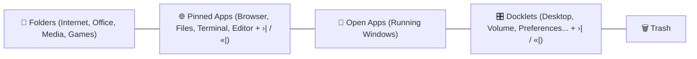
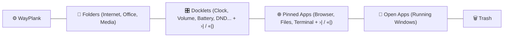
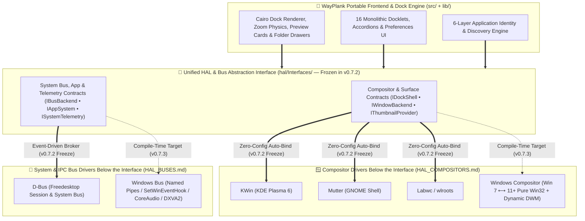

# WayPlank User Guide & Reference Manual

> **Author & Maintainer:** Sergio Melas (<sergiomelas@gmail.com>) © 2026  
> **Release Version:** `v0.7.1` (**Public Beta 2**)

Welcome to **WayPlank**, the fast, lightweight, and modern dock designed natively for modern Wayland desktop environments (**KDE Plasma**, **GNOME**, **Labwc**, and beyond).

This manual provides an in-depth reference for all features, configuration options, gestures, and advanced setups—such as folder-based application menus, docklets, accordion collapsing, multi-monitor layouts, and our modular Hardware Abstraction Layer (HAL).

---

## Table of Contents
1. [Introduction](#1-introduction)
2. [Quick Start & Interface Layout](#2-quick-start--interface-layout)
   - [Multi-Window Navigation & Cairo Preview Cards](#multi-window-navigation--cairo-preview-cards)
3. [Folder Launchers (App Drawer Menus)](#3-folder-launchers-app-drawer-menus)
   - [How Folder Launchers Work](#how-folder-launchers-work)
   - [Default First-Run Folders](#default-first-run-folders)
   - [Creating Custom Folders](#creating-custom-folders)
   - [Adding and Managing Applications](#adding-and-managing-applications)
   - [Folder Running Dots & Wheel Window Cycling](#folder-running-dots--wheel-window-cycling)
   - [Customizing Icons (Launchers, Folders & Docklets)](#customizing-icons-launchers-folders--docklets)
4. [Built-in Docklets & Accordion Mode](#4-built-in-docklets--accordion-mode)
   - [Complete List of 16 Docklets](#complete-list-of-16-docklets)
   - [Choosing Docklet Position (Left vs. Right System Tray Style)](#choosing-docklet-position-left-vs-right-system-tray-style)
   - [Accordion Mode (Space-Saving Collapsible Docklets & Smart Pinned Apps Accordion)](#accordion-mode-space-saving-collapsible-docklets--smart-pinned-apps-accordion)
   - [3×3 Session & Power Control Center](#33-session--power-control-center)
   - [Configuring the Weather Docklet](#configuring-the-weather-docklet)
5. [Categorization, Dynamic Separators & System Menu Access](#5-categorization-dynamic-separators--system-menu-access)
   - [Categorized Layout Order & Custom Category Positioning](#categorized-layout-order--custom-category-positioning)
   - [Permanent Trash Anchoring, WayPlank Far-Left Anchor & Persistent SR Latch Memory](#permanent-trash-anchoring-wayplank-far-left-anchor--persistent-sr-latch-memory)
   - [Dynamic Separators](#dynamic-separators)
   - [4-Position System Menu Access Hierarchy](#4-position-system-menu-access-hierarchy)
   - [Minimalist Dock Setup & Emergency Settings Access](#minimalist-dock-setup--emergency-settings-access)
   - [Dynamic Scale Capacity Redline Teardrop & Topology Auto-Shrink](#dynamic-scale-capacity-redline-teardrop--topology-auto-shrink)
   - [Launcher Deduplication & Item Reuse](#launcher-deduplication--item-reuse)
6. [CLI Virtual Machines & Multi-VM Independent Tracking](#6-cli-virtual-machines--multi-vm-independent-tracking-issue-14)
   - [Automatic CLI QEMU Window Detection](#automatic-cli-qemu-window-detection)
   - [Multi-Instance Isolation & Independent Dock Items](#multi-instance-isolation--independent-dock-items)
   - [Independent Pinning & Cold Relaunch](#independent-pinning--cold-relaunch)
   - [Chromium PWA & Web App Matching](#chromium-pwa--web-app-matching)
   - [Multi-Profile Browser Isolation (`Chrome:<Profile>` & `BrowserProfile`)](#multi-profile-browser-isolation-chromeprofile--browserprofile)
7. [Mouse Gestures & Shortcuts](#7-mouse-gestures--shortcuts)
   - [Click Actions](#click-actions)
   - [Scroll Gestures](#scroll-gestures)
   - [Drag & Drop Interactions](#drag--drop-interactions)
   - [Quick Settings Access & In-App Help](#quick-settings-access--in-app-help)
8. [Multi-Monitor Setup & Screen Ergonomics](#8-multi-monitor-setup--screen-ergonomics)
   - [Monitor Selection & Alignment](#monitor-selection--alignment)
   - [Intelligent Hide & Edge Pressure](#intelligent-hide--edge-pressure)
   - [Option to Reserve Screen Space (Panel Mode)](#option-to-reserve-screen-space-panel-mode---issues-9-17)
   - [Multi-Monitor Topology & DPMS Wake Stability](#multi-monitor-topology--dpms-wake-stability)
   - [Layer-Shell Input Passthrough & Transparent Window Clipping](#layer-shell-input-passthrough--transparent-window-clipping)
   - [Multi-Monitor Hardware Brightness Control (SP/PV Decoupling)](#multi-monitor-hardware-brightness-control-sppv-decoupling)
9. [Hardware Abstraction Layer (HAL) & Compositor Architecture](#9-hardware-abstraction-layer-hal--compositor-architecture)
   - [What Users Get Out of the Box (Zero Configuration)](#what-users-get-out-of-the-box-zero-configuration)
10. [Themes & Visual Customization](#10-themes--visual-customization)
   - [Built-in Themes & Classic Suite](#built-in-themes--classic-suite)
   - [True Dynamic Real-Time Light/Dark System Theming](#true-dynamic-real-time-lightdark-system-theming)
   - [Interactive Theme Manager (One-Click Archive Install & Removal)](#interactive-theme-manager-one-click-archive-install--removal)
   - [Dock Size, Zoom Level & Icons Visual Effects](#dock-size-zoom-level--icons-visual-effects)
11. [Command Line Usage, Localization & Packaging](#11-command-line-usage-localization--packaging)
   - [CLI Commands](#cli-commands)
   - [Multi-Language Translation Catalogs (Public Beta v0.7.0 / v0.7.1)](#multi-language-translation-catalogs-public-beta-v070--v071)
   - [Automated Packaging (Debian/Ubuntu & openSUSE/Fedora/RHEL)](#automated-packaging-debianubuntu--opensusefedorarhel)
   - [Configuration File Paths](#configuration-file-paths)
   - [GSettings Database Keys](#gsettings-database-keys)
12. [Troubleshooting & FAQ](#12-troubleshooting--faq)

---

## 1. Introduction

WayPlank is a native port and evolution of the classic Plank dock, rebuilt to thrive in modern Wayland display servers without X11 or XWayland workarounds.

### Key Highlights
- **Modular Multi-Compositor HAL:** Zero-configuration runtime detection and high-performance native window tracking across **KDE Plasma (KWin D-Bus Scripting Bridge)**, **GNOME (Monolithic Mutter Extension)**, and **Labwc/wlroots (`zwlr_foreign_toplevel`)** with zero X11 or XWayland dependencies.
- **Hardware-Level Brightness Control:** Atomic multi-monitor synchronization via KWin DRM `kscreen-doctor` calls, overcoming user-space PowerDevil I2C permission barriers on external HDMI/DisplayPort screens.
- **Categorized Dock Layout:** Automatic visual grouping of Folders, Docklets, Pinned Launchers, Running Windows, and the Trash can.
- **Folder Launchers:** Turn any directory into a Cairo-Dock style popup application menu with 60 FPS dynamic zoom elevation.
- **Accordion Docklets:** Keep system widgets accessible without cluttering your desktop space.
- **Fluid Animations:** Smooth zoom, bounce on launch, window attention indicators, and smoke poof animations when unpinning.
- **Sub-Second Instant Boot:** 0.74s instantaneous launch with asynchronous compositor handshake.

---

## 2. Quick Start & Interface Layout

### First-Run Onboarding (`WayPlank Classic` vs. `WayPlank Explorer`) & Legacy Plank Migration
When WayPlank starts for the very first time (when `~/.config/wayplank/dock1/launchers` is created and `~/.config/wayplank/dock1/onboarding-done` does not yet exist):
- **100% Read-Only Migration from Legacy `~/.config/plank`**: If an existing `~/.config/plank/dock1/launchers` directory is detected, WayPlank copies all compatible `.dockitem` launchers, user folders, and supported docklets into `~/.config/wayplank/dock1/launchers` and preserves your compatible GSettings preferences **without ever modifying, moving, or deleting anything inside `~/.config/plank`**, ensuring full dual-session compatibility if you also log into an X11 session running legacy Plank.
- **Interactive First-Run Choice (`FirstRunWindow`)**: A centered welcome window lets you choose how to initialize your dock (100% non-destructively—neither option ever deletes existing user launchers or folders):
  1. **🏛️ WayPlank Classic** (*"Start classical near old Plank and discover at your pace"*): Keeps your dock minimal in Free Mode (`CategorizeItems = false`, `AnchorAlwaysLeft = false`, `AccordionDocklets = false`, `PinnedAccordionMode = 0`) with your existing/migrated launchers and folders (or core pinned apps + Trash on a fresh install) without auto-adding category folders or accordion drawers.
  2. **🚀 WayPlank Explorer** (*"Start modern with all new features in the best experience spot"*): Preserves all existing items and adds the 4 Smart Application Folder Drawers (`Internet`, `Office`, `Media`, `Games/Utilities`), System Tray Docklets with Accordion, Smart Pinned Apps Accordion (`Auto-Fit Capacity`), WayPlank Always on Left, and Multi-Window Preview Cards (`CategorizeItems = true`, `AnchorAlwaysLeft = true`, `DockletsOnRight = true`, `AccordionDocklets = true`, `PinnedAccordionMode = 1`, `ShowWindowCards = true`).

When running in **WayPlank Explorer** (or Categorized Mode), the dock is arranged into clean, logical visual sections separated by dynamic dividers (**Default System Tray Layout — `Docklets on Right = ON`**):



In **Preferences $\rightarrow$ Apps & Layout**, you can also place the **Docklets** group on the left after Folders (`Docklets on Right = OFF`) or anchor the **WayPlank** icon permanently at the far left (`WayPlank Always Left`):



- **WayPlank Far-Left Anchor (Optional — `WayPlank Always Left`):** Keeps the WayPlank icon fixed at position `0` on the far left with its own vertical separator (paired via `MONLMIP Rank 1` and a persistent SR latch in `~/.config/wayplank/latch-state.ini` with `System Menu Access = Dedicated Icon`).
- **Folders (Left):** Categorized application menus for fast access to your software library.
- **Pinned Applications & Smart Pinned Accordion (`›|` / `«|`):** Direct single-click access to your pinned daily tools (with optional **Auto-Fit Capacity** or **Top Most Used** (`1..20`, default `6`) frecency collapsing onto a half-slot separator-chevron expander `›|` / `«|`) followed immediately by temporary running windows (`[Pinned Apps] ›| [Open Apps]`), keeping drag-to-pin and drag-to-unpin across their separator 100% seamless in both layouts.
- **Docklets (Default on Right — Configurable Left or Right with `›|` / `«|`):** Interactive system widgets (collapsible into a symmetric expandable accordion with its own `›|` / `«|` toggle that collapses onto the rightmost icon when on the right, and onto the leftmost icon when on the left) placed by default on the right immediately before the Trash (`Docklets on Right = ON`, System Tray style) or on the left after Folders (`Docklets on Right = OFF`).
- **Trash (Far-Right Anchor — `Show Trash`):** Anchored permanently at the far end of the dock (toggled via **Show Trash** at the bottom-center of **Preferences $\rightarrow$ Docklets**).

### Multi-Window Navigation & Cairo Preview Cards
Starting in **v0.6.2.3**, WayPlank provides modern elevated Cairo preview cards when clicking applications with multiple open windows (while hovering displays the application tooltip):
- **Live Compositor Thumbnails**:
  - Under **KDE Plasma 6 (KWin)**, live window previews are captured via `org.kde.KWin.ScreenShot2` D-Bus IPC.
  - Under **GNOME Shell (Mutter)**, live window previews are captured via the internal Mutter extension bridge (`/mutter/screen/preview`).
  - Under **Labwc / wlroots**, elegant high-contrast blank cards display the application icon, window title, and interactive action controls.
- **Card Controls**:
  - **Left-Click Card**: Activates and raises the target window to the foreground (`WindowManager.activate()`).
  - **Close Button (X)**: Top-right corner of each card lets you close that specific window instance directly (`WindowManager.close_window()`).
- **Preferences Toggle**:
  - In **Preferences $\rightarrow$ Behaviour**, you can toggle **Window Preview Cards** between visual window preview cards and classic cyclic window switching.
- **Recent Files Jump List**:
  - Right-clicking compatible applications reveals a "Recent Documents" submenu powered by FreeDesktop `Gtk.RecentManager`, allowing one-click reopening of recently accessed documents.

---

## 3. Folder Launchers (App Drawer Menus)

Folder Launchers provide a clean way to organize dozens of applications into compact menus directly on your dock.

### How Folder Launchers Work
When a dock item points to a directory (e.g., `Launcher=file:///path/to/directory`), WayPlank treats it as an application drawer. Clicking on it opens a menu displaying all `.desktop` applications found inside that folder, complete with their native icons and localized names.

### Default First-Run Folders
When WayPlank starts for the first time without an existing configuration, it automatically creates and populates four core folders under `~/.config/wayplank/folders/`:

1. **`Internet`**: Web browsers (Chrome, Firefox, Brave), email clients, messengers (Telegram, Discord), and network tools.
2. **`Office`**: Productivity suites (LibreOffice), text editors, calculators, document viewers, and IDEs.
3. **`Media`**: Media players (VLC, Totem), graphics software (GIMP, Inkscape), audio streamers (Spotify), and video recorders.
4. **`Games`**: Game launchers (Steam, Lutris, Heroic), emulators, and games (falls back to `Utilities` if no games are detected on the system).

### Creating Custom Folders
You can create as many custom folder drawers as you like:

1. Open your terminal or file manager and create a directory:
   ```bash
   mkdir -p ~/.config/wayplank/folders/"My Tools"
   ```
2. Simply **drag and drop** that folder from your file manager onto the dock background or between icons (dropping directly onto a compatible app icon such as Dolphin, Kate, or VS Code opens the folder in that application).
3. WayPlank will instantly create a corresponding `.dockitem` and anchor the folder drawer inside the `[Folders]` zone.

### Adding and Managing Applications
To add applications, subfolders, or files to a folder drawer:
- **Via Direct Drag & Drop (Onto Folder Icon or Open Popup):** Drag any `.desktop` launcher, subfolder, or file directly onto a pinned folder icon on the dock—**or directly onto its open `FolderMenuWindow` popup menu**—and WayPlank copies it into that directory and live-refreshes the menu rows, 4-item folder stack preview, and running indicator dots immediately without restarting.
- **Via File Manager:** Navigate to `/usr/share/applications/` or `~/.local/share/applications/` and copy or symlink `.desktop` files into your folder directory (`~/.config/wayplank/folders/<FolderName>/`).

### Folder Running Dots & Wheel Window Cycling
Starting in **v0.6.2.3**, Folder Drawers are fully integrated with WayPlank's native window manager:
- **Running Indicator Dots**: When one or more applications contained inside a folder drawer are currently running on your desktop, an active running indicator dot automatically appears under that folder's dock icon.
- **Mouse Wheel Window Focus Cycling**: You do not even need to open the folder drawer to switch between running documents! Scrolling your mouse wheel while hovering over the folder drawer icon dynamically cycles focus through all open window instances of applications stored inside that folder.

### Customizing Icons (Launchers, Folders & Docklets)
WayPlank provides an integrated, one-click icon personalization system directly from the dock:
1. **Right-click** on any application launcher, folder drawer, or docklet (`Preferences`, `Show Desktop`, `Session`, `Screenshot`, `Ejector`).
2. Select **Change Icon...** from the context menu.
3. The interactive **Icon Chooser** dialog will open:
   - **Live Theme Search:** Instant filtering across all 20,000+ icons in your active desktop theme.
   - **Browse File:** Select any custom image file (PNG, SVG, ICO, JPG) from your disk.
   - **Restore Default:** Reverts the item to its factory appearance.
4. Click **Apply** to update the icon immediately with zero restart needed.

> 💡 **Technical Note:** For application launchers, customizations follow the FreeDesktop standard (`~/.local/share/applications/`) without breaking Plank migration. For folders, icons are persisted using native GIO metadata (`metadata::custom-icon`), automatically recognized in Nautilus and Dolphin. For docklets, overrides are preserved in the `.dockitem` configuration.
>
> 🔄 **Theme Switching Resiliency:** When switching desktop icon themes, if an icon customized for a folder drawer does not exist in the new theme, WayPlank automatically restores the item to its default folder presentation (with 4-item card preview and folder styling), preventing missing/blank icon cards. Empty folder drawers also display a centered folder glyph so they are never rendered blank.

---

## 4. Built-in Docklets & Accordion Mode

WayPlank includes 16 built-in docklets that provide live system controls and status indicators.

### Complete List of 16 Docklets

| Docklet URI | Description |
| :--- | :--- |
| `docklet://trash` | Trash can indicator with fill status, empty action, and drag-to-delete. |
| `docklet://desktop` | Show/Hide Desktop toggle (minimizes or unminimizes all windows). |
| `docklet://preferences` | One-click access to WayPlank Preferences dialog. |
| `docklet://dnd` (or `docklet://donotdisturb`) | One-click toggle for desktop notification silencing (Do Not Disturb) with FreeDesktop portal integration and dynamic active/silenced bell icon indicators. |
| `docklet://network` | Live network connectivity monitor (Wi-Fi / Ethernet), signal strength, IP address inspection, and quick launch to network settings. |
| `docklet://volume` | Audio volume level with scroll-to-adjust and mute toggle. |
| `docklet://brightness` | Screen brightness control with scroll-to-adjust. |
| `docklet://battery` | Battery charge percentage and charging status for laptops. |
| `docklet://cpu` | Real-time CPU usage monitor meter. |
| `docklet://weather` | Real-time weather conditions and temperature. |
| `docklet://clock` | Classic analog clock showing system time. |
| `docklet://digital-clock` | Digital 12h/24h time display. |
| `docklet://mpris` | Media player controller (Play/Pause, Next, Previous track). |
| `docklet://screenshot` | Instant desktop screen capture utility. |
| `docklet://session` | 3×3 Session & Power center (Lock Screen, Switch User, Log Out, Suspend, Hibernate, Hybrid Sleep, Restart, UEFI / BIOS firmware setup, Shut Down) with automatic `systemd-logind` hardware capability detection. |
| `docklet://ejector` | Safe removal and unmounting of removable USB drives and volumes. |

### Choosing Docklet Position (Left vs. Right System Tray Style)
WayPlank lets you choose where the **Docklets** category block is positioned on the dock (**Preferences $\rightarrow$ Apps & Layout**):
- **System Tray Position (`Docklets on Right = ON`, Default)**: Moves the entire Docklets group (Clock, Volume, Battery, CPU/RAM, Brightness, Network, Weather, Do Not Disturb, etc.) to the right side of the dock immediately before the Trash (`[Folders] | [Pinned Apps] | [Running Apps] | [Docklets] | [Trash]`), mimicking a traditional desktop system tray while keeping Folders and Applications on the left. When Accordion Mode is active with `Docklets on Right = ON`, the accordion collapses symmetrically onto the **rightmost** docklet icon.
- **Left Position (`Docklets on Right = OFF`)**: Places the Docklets group on the left side immediately after Folder Drawers and before Pinned Applications (`[Folders] | [Docklets] | [Pinned Apps] | [Running Apps] | [Trash]`), collapsing the accordion onto the **leftmost** docklet icon.
- **Symmetric Left & Right Edge Anchors (`WayPlank Always Left` & `Show Trash`)**: In **Preferences $\rightarrow$ Apps & Layout**, you can toggle **WayPlank Always Left** (pinning the WayPlank icon at position `0` on the far left with its own separator, backed by `MONLMIP Rank 1` and a persistent SR latch in `~/.config/wayplank/latch-state.ini`), and at the bottom-center of **Preferences $\rightarrow$ Docklets** you can toggle **Show Trash** (anchoring the Trash bin at the far right). Even when `Docklets on Right` is enabled alongside `WayPlank Always Left`, the accordion hover/collapse zone strictly bounds only the right-hand Docklets group.

### Accordion Mode (Space-Saving Collapsible Docklets & Smart Pinned Apps Accordion)
In **Preferences $\rightarrow$ Apps & Layout**, WayPlank provides two independent, cooperative accordions that share the unified **`›|` / `«|`** half-slot separator-chevron expander, the **Click to Expand** switch, and the **Collapse Delay** slider (`0.5s` to `20.0s`, plus the **Reset App Usage Counter** button), alongside the **Icon Tooltips** switch (`tooltips-enabled` in **Preferences $\rightarrow$ Behaviour**):

1. **Docklet Accordion (`accordion-docklets = true`)**:
   - **Unified `›|` / `«|` Toggle & Hover/Click Expansion**: Collapses multiple active docklets down to the anchor docklet plus a dedicated **`›|`** (collapsed) / **`«|`** (expanded) toggle item (expanding on hover by default, or on click when **Click to Expand** is enabled).
   - **Symmetric Outer-Edge Master Anchor & Fallback**: Collapses onto the leftmost docklet when `Docklets on Right = OFF`, and onto the rightmost docklet when `Docklets on Right = ON`.
   - **Single Docklet Safety Guard**: Automatically suppressed if `<= 1` docklet is active.
2. **Smart Pinned Apps Accordion (`pinned-accordion-mode`: `Off`, `Auto-Fit Capacity`, `Top Most Used` + SpinButton `1..20`)**:
   - **Auto-Fit Capacity (`1`)**: Automatically calculates how many pinned applications fit cleanly on your monitor without overflowing or shrinking icons, collapsing the least-used overflow pinned apps behind the compact half-slot **`›|`** expander.
   - **Top Most Used (`2`)**: Keeps your top $N$ (`pinned-accordion-count`, configurable via the inline numeric SpinButton from `1` to `20`, default `6`) most frequently and recently used pinned applications visible on the dock and collapses the rest behind **`›|`**.
   - **Event-Driven Frecency Usage Engine (`AppUsageService`)**: Modelled on GNOME Shell's `shell-app-usage.c` (with read-only import of `~/.local/share/gnome-shell/application_state` on GNOME), tracking application launches ($+1.0$) and active focus sessions ($\ge 5\text{s}$ threshold ignoring `Alt+Tab` sweeps, up to $+3.0/\text{session}$, rescaled to `SCORE_MAX = 100.0`) with a 14-day lazy exponential half-life ($\tau = 14\text{ days}$) persisted in `~/.local/share/wayplank/app_usage.json` and zero background timers.
   - **Smart Visibility Exemptions**: Running applications, applications requesting urgent attention, and launchers with **Keep Always Visible** (`KeepVisible=true`) checked in their right-click context menu are **never** hidden.
   - **Half-Slot Interactive Separator-Expander (`›|` / `«|`), Fixed `1.0` Zoom & Adjacent Separator Suppression**: Both the Docklets Accordion and Pinned Apps Accordion use `PinnedExpanderDockItem` (`›|` when collapsed, `«|` when expanded) with a crisp vertical separator bar on its right edge matching standard dock separators. It occupies **half an icon slot (`0.5` width)**, maintains a **fixed `1.0` scale during icon zoom** (just like standard separators), and **automatically removes any immediately preceding or following `SeparatorDockItem` (`|`)** so there is never double spacing.
   - **Pure Manual Toggle Mode (`Click to Expand = ON`) & Independent `latch-state.ini` Memory**: When **Click to Expand** is enabled, auto-collapse timeouts are completely disabled (and the **Collapse Delay** row with its slider accessories is greyed out in `Preferences`), turning both `›|` / `«|` items into pure manual click toggles. Each accordion independently remembers whether you left it open or closed across dock restarts and PC reboots via `DockletsExpanded` and `PinnedExpanded` in `~/.config/wayplank/latch-state.ini`.
   - **Live Responsiveness During Preferences**: Both the Docklets Accordion and Pinned Apps Accordion remain 100% live and responsive while the **Preferences** window is open, updating immediately whenever you toggle settings.
   - **Popup & Drag-and-Drop Retention**: Accordion auto-collapse is held open while context menus, Folder Drawers, Window Preview Cards, Icon Chooser, Weather, Calendar, or Session popups are open, and dragging any item over an accordion anchor expands it automatically.

### 3×3 Session & Power Control Center
Clicking the **Session / Power** docklet (`docklet://session`) opens a centered **3×3 control center** (9 actions organized into 3 logical rows), also accessible via the docklet's right-click context menu:
- **Row 1 — User Session**:
  - **Lock Screen**: Immediately locks the active desktop session (`org.gnome.ScreenSaver`, `org.freedesktop.ScreenSaver`, `SwitchToGreeter`, `swaylock`/`waylock`/`hyprlock`, or `loginctl lock-sessions`).
  - **Switch User**: Transitions to the display manager greeter (`org.freedesktop.DisplayManager.Seat.SwitchToGreeter` / `dm-tool`).
  - **Log Out**: Opens an in-place confirmation view before terminating the active desktop session.
- **Row 2 — Sleep & Hibernation States**:
  - **Suspend**: Puts the system into low-power RAM sleep (`systemctl suspend`).
  - **Hibernate**: Saves the full session state to disk and powers off (`systemctl hibernate`).
  - **Hybrid Sleep**: Saves the session state to disk while entering low-power RAM sleep (`systemctl hybrid-sleep`), providing instant wake-up with zero data loss if battery power is exhausted.
- **Row 3 — System Reboot, Firmware & Power Off**:
  - **Restart**: Opens an in-place confirmation view before rebooting the operating system.
  - **UEFI / BIOS**: Opens an in-place confirmation view and reboots directly into the motherboard's UEFI / BIOS firmware setup interface (`systemctl reboot --firmware-setup` / `SetRebootToFirmwareSetup`).
  - **Shut Down**: Opens a destructive-styled confirmation view before powering off the machine.
- **Automatic Hardware & Kernel Capability Detection (`systemd-logind`)**: When the Session & Power dialog or context menu opens, WayPlank queries `org.freedesktop.login1.Manager` (`CanHibernate`, `CanHybridSleep`, `CanRebootToFirmwareSetup`). If a capability is unavailable on the host machine (for example, when swap hibernation is unconfigured, blocked by Secure Boot kernel lockdown, or running on a legacy non-UEFI system), the corresponding button is automatically disabled (`sensitive = false`) with an explanatory tooltip so an unsupported action can never be triggered accidentally.

### Configuring the Weather Docklet
The weather docklet fetches local meteorological data:
1. Edit or inspect `~/.config/wayplank/dock1/launchers/weather.dockitem`:
   ```ini
   [PlankDockItemPreferences]
   Launcher=docklet://weather

   [PlankWeatherDockItemPreferences]
   # Leave empty for automatic IP-based location, or enter your city name:
   City=Rome
   # Temperature unit: C (Celsius) or F (Fahrenheit)
   Units=C
   ```
2. Changes take effect immediately upon saving the file.

---

## 5. Categorization, Dynamic Separators & System Menu Access

WayPlank features a smart sorting engine that eliminates dock clutter.

### Categorized Layout Order & Custom Category Positioning
When **Categorize Items** is enabled (`categorize-items = true` in **Preferences $\rightarrow$ Apps & Layout**), WayPlank automatically arranges all items into clean, non-overlapping compartments while keeping **Pinned Apps** and **Running Unpinned Apps** strictly adjacent so drag-to-pin and drag-to-unpin across their divider always work effortlessly:

1. **Default System Tray Layout (`Docklets on Right = ON` / `docklets-on-right = true`)**:
   $$\text{Folders} \longrightarrow \text{Pinned Apps} \longrightarrow \text{Running Apps} \longrightarrow \text{Docklets} \longrightarrow \text{Trash}$$
   - Places all system docklets (Clock, Battery, CPU/RAM, Volume, Weather, Network, Do Not Disturb, Preferences) on the right side immediately before the Trash, mimicking a classic desktop system tray while keeping Folders and Applications up front on the left. When Accordion Mode is enabled, the group collapses symmetrically onto the **rightmost** docklet icon.

2. **Left Docklets Layout (`Docklets on Right = OFF` / `docklets-on-right = false`)**:
   $$\text{Folders} \longrightarrow \text{Docklets} \longrightarrow \text{Pinned Apps} \longrightarrow \text{Running Apps} \longrightarrow \text{Trash}$$
   - Places the Docklets group on the left after Folders, collapsing the accordion onto the **leftmost** docklet icon.

- You can freely reorder items *within* their category group.
- Items are never mixed across categories accidentally.

### Permanent Trash Anchoring, WayPlank Far-Left Anchor & Persistent SR Latch Memory
WayPlank's 4-tab Preferences dialog (**Appearance**, **Behaviour**, **Apps & Layout**, **Docklets**) is engineered via Multi-Objective Mixed-Integer Nonlinear Programming (**MONLMIP Rank 1**) for **zero cross-tab side effects ($J_{\text{cross}} = 0.0$)** and **full fault-tolerant profile & SR Flip-Flop disk persistence across reboots (`~/.config/wayplank/latch-state.ini`)**:
- **WayPlank Always Left (`anchor-always-left = true`, in `Preferences -> Apps & Layout`)**: Permanently pins the dedicated WayPlank icon at position `0` (far left of the dock) with its own dedicated vertical separator (`[WayPlank] | [Folders] | ...`). Powered by **`MONLMIP Rank 1`**, `WayPlank Always Left` remains clickable at all times: toggling it ON while in Free Mode (`Categorize Items = OFF`) automatically promotes `Categorize Items = ON` and sets `System Menu Access` to **Mode 4 (`Dedicated Icon`)**; switching `System Menu Access` away from Mode 4 saves the `WayPlank Always Left` state into `~/.config/wayplank/latch-state.ini` and automatically restores it when you return to Mode 4—even after rebooting your PC.
- **Reserve Screen Space SR Latch (`reserve-space = true`, in `Preferences -> Appearance`)**: Co-located in the **Appearance** tab alongside **Hide Dock** and **Icon Zoom**. Enabling **Reserve Screen Space** saves your current **Hide Dock** mode and **Icon Zoom** state into `~/.config/wayplank/latch-state.ini` and turns both off for Panel Mode; unchecking **Reserve Screen Space** automatically restores your previous **Hide Dock** and **Icon Zoom** settings across reboots.
- **Full Profile Persistence & Startup Validation (`~/.config/wayplank/latch-state.ini`, `FAT 7.17`)**: All **43 dock preferences (`[DockPreferences]`)** and **7 latch/accordion states (`[LatchState]`, including `DockletsExpanded` and `PinnedExpanded`)** are persisted in `~/.config/wayplank/latch-state.ini`. On startup, WayPlank probes `latch-state.ini` in an isolated child process, validates every setting against schema ranges and path/theme/monitor invariants, quarantines corrupted or path-traversal `.dockitem` files, and presents a localized `"Load environment failed"` dialog listing any settings defaulted or `.dockitem` files discarded (testable with `FAT/Test Files/Environment/Test environments.sh`).
- **Trash at Far Right (`Show Trash`, at the bottom-center of `Preferences -> Docklets`)**: The Trash docklet (`docklet://trash`) is permanently anchored to the far end of the dock and can be toggled on or off live from the bottom-center of the **Docklets** tab.

### Dynamic Separators
WayPlank automatically inserts subtle vertical separator lines between adjacent, non-empty category groups:
- If you have Folders, Docklets, and Apps active, two separators are placed: `[Folders] | [Docklets] | [Apps]`.
- When an unpinned application opens, a separator appears before it: `[Apps] | [Active App] | [Trash]`.
- When the application closes, the separator cleanly vanishes without animation stutter.

### 4-Position System Menu Access Hierarchy
Starting in **v0.6.2.3**, WayPlank introduces an ergonomic **System Menu Access** hierarchy (**Preferences $\rightarrow$ Apps & Layout**), allowing complete control over where WayPlank system options (*Preferences*, *About*, *Shortcuts & Gestures*, *Quit*) appear:
1. **Mode 1: Docklets Only**:
   - The dedicated Preferences gear icon is completely hidden from the dock.
   - Right-clicking on any docklet displays the full WayPlank system menu.
   - Right-clicking on application icons displays **strictly application-native actions** (zero WayPlank system items appended), keeping application menus clean and uncluttered.
2. **Mode 2: Docklets Only (with fallback)** *(Recommended Default for Minimalist Docks)*:
   - The dedicated Preferences gear icon is hidden from the dock.
   - Right-clicking on docklets opens the full system menu.
   - If no docklets are active on the dock, right-clicking on any application icon automatically serves as a fallback to ensure settings access is never lost.
3. **Mode 3: All Icons (integrated)**:
   - The dedicated Preferences gear icon is hidden.
   - Right-clicking on **any** icon (application, folder drawer, or docklet) integrates the full WayPlank system menu at the bottom of the context menu.
4. **Mode 4: Dedicated Icon (on dock)**:
   - The classic dedicated Preferences gear icon is anchored directly to the dock surface.

### Minimalist Dock Setup & Emergency Settings Access
- **One-Click Preferences Removal**: In Mode 4, simply right-click the Preferences gear icon and select **Remove from Dock**. The icon is removed immediately with a cartoon poof animation, and WayPlank automatically transitions to **Mode 2** (or **Mode 3** in Free Mode) so you are never locked out of settings.
- **Universal Emergency Access**: If you ever hide all docklets or need immediate access to settings, **`Ctrl + Right Click`** on **any** icon or dock surface unconditionally opens the complete WayPlank system menu at all times.
- **Free Mode (Uncategorized) Protection & Align by Type**: When **Categorize Items** is toggled off (Free Mode), docklet-only options are dynamically hidden from Preferences, and WayPlank automatically migrates to **Mode 3 (All Icons)**. In Free Mode, an **Align by Type** button becomes available in **Preferences $\rightarrow$ Apps & Layout** to perform a one-shot sort following your last chosen category layout (`[Folders] -> [Docklets] -> [Apps] -> [Trash]` or `[Folders] -> [Apps] -> [Docklets] -> [Trash]` when `Docklets on Right` was enabled) while retaining free manual drag reordering.

### Dynamic Scale Capacity Redline Teardrop & Topology Auto-Shrink
When pinning a high number of applications or operating on compact displays, dock items may approach or exceed the monitor's physical boundary:
- **Dynamic CSS Redline Gradient**: In the Preferences dialog (**Appearance $\rightarrow$ Icon Size**), if the selected icon size exceeds the screen's maximum physical capacity, the slider track dynamically illuminates with a warning CSS redline gradient for all values beyond safe capacity.
- **Vector Teardrop Badge & Dual-Color Split**: Dragging the slider into the exceeded zone displays a red warning teardrop indicator badge and splits the track highlight (blue in the safe zone, red in the exceeded zone) with a clear notification: `"⚠️ Limited to XXpx by screen space (auto-shrunk)"`.
- **Display Topology Real-Time Auto-Shrink**: When switching between displays or reconfiguring monitor layouts, WayPlank recalculates physical screen limits in real time and automatically scales down icon sizes to guarantee that the dock always fits within the active screen geometry without clipping.
- **Boundary Clamping & Smooth Mouse Wheel Panning**: WayPlank automatically clamps its background rendering strictly to the monitor's visible dimensions (`int.min(monitor_geo.width, background_width)`). With **Scroll on Overflow** enabled (**Preferences $\rightarrow$ Behaviour**), rotating your mouse wheel over the dock surface shifts items smoothly with interpolated motion (`scroll_offset += (target_scroll_offset - scroll_offset) * 0.35`). Scrolling specifically over the Volume docklet continues to adjust audio volume without triggering overflow dock pan.

### Launcher Deduplication & Item Reuse
To maintain a clean and reliable configuration:
- **Canonical Deduplication on Load & Drop**: When initializing launchers or receiving drag-and-drop items, WayPlank resolves canonical file paths (`Posix.realpath`), percent-encoded URIs (`GLib.File.equal`), and desktop IDs. If an item already exists in the dock, WayPlank reuses and repositions its existing `.dockitem` file instead of spawning redundant incremented filenames (such as `app-1.dockitem` or `app-2.dockitem`).
- **KISS Drag-Off Removal & Poof Animation**: Dragging an unpinned application off the dock inspects actual running windows (`window_count_for_app > 0`). If the app has zero open windows, it is instantly deleted from disk with a clean Cairo `PoofWindow` cloud particle animation, eliminating transient icon ghosting or hopping into the unpinned section. If active windows remain, it cleanly transitions to an unpinned running item until its windows are closed.
- **Auxiliary Bridge Window Shielding**: Internal background windows—such as `xwaylandvideobridge` surfaces used by Discord, Slack, and OBS for Wayland screen-sharing—are automatically detected and filtered out, preventing phantom 1×1 ghost launcher icons from cluttering your running apps list.

---

## 6. CLI Virtual Machines & Multi-VM Independent Tracking (Issue #14)

Starting in **v0.6.2.3**, WayPlank provides full first-class support for command-line spawned virtual machines (e.g. QEMU `qemu-system-x86_64`), complex terminal applications, and Chromium Progressive Web Apps (PWAs).

### Automatic CLI QEMU Window Detection
CLI-launched virtual machines typically lack desktop launcher entries (`.desktop` files) or specify `NoDisplay=true` with no `Exec=` key (such as `/usr/share/applications/qemu.desktop`). Previously, this caused CLI-spawned VM windows to appear without an icon or fail to spawn a dock item.
- **NoDisplay Desktop Indexing**: WayPlank indexes all installed application entries—including those with `NoDisplay=true`—allowing it to match running window processes to canonical application metadata, icons, and display titles.
- **Dedicated Synthetic Launcher Synthesis (Issues #14 & #16)**: When a CLI-launched GUI application, virtual machine, or standalone AppImage (`/proc/<pid>/environ` `APPIMAGE=` FUSE path) opens without an installed desktop launcher, WayPlank synthesizes an executable `.desktop` launcher under `~/.local/share/applications/` (bound stably by window class across dynamic title changes and automatically cleaned up on close if unpinned), while masking transient CLI helper dialogs (`WindowInfo.IsDialog` and `NoDisplay=true` utility entries such as `zenity` or `kdialog`).

### Multi-Instance Isolation & Independent Dock Items
When running multiple distinct virtual machines simultaneously (for example, `VM-Alpha` and `VM-Beta`):
- **Independent Dock Items**: Each VM window is tracked as its own independent dock item with its dedicated title (`QEMU (VM-Alpha)`, `QEMU (VM-Beta)`), active running dot, and window controls.
- **Hypervisor Argument Stopword Filtering**: WayPlank's argument parser automatically filters out generic runtime flags (`-accel kvm`, `-m 512M`, `-enable-kvm`), preventing common hypervisor options from causing distinct VM instances to collapse onto a single dock icon.
- **Instance Isolation Guard**: Synthetic launchers are strictly matched against the window's sanitized instance name, ensuring `VM-Beta` can never be hijacked by `VM-Alpha`'s dock item.

### Independent Pinning & Cold Relaunch
- **Keep in Dock**: Right-click any running VM dock item and select **"Keep in Dock"**.
- **Cold Relaunch**: When the VM is shut down, its pinned dock item remains in place. Clicking the pinned icon cold-relaunches that exact VM with all its original command-line parameters (kernel image, memory allocation, drive images, and network flags) exactly as originally invoked!

### Chromium PWA & Web App Matching
WayPlank accurately discriminates between standalone Progressive Web Apps (PWAs) launched via Chromium, Chrome, Brave, or Edge (using `--app=...` or `--app-id=...`) and regular browser windows:
- **Strict Identity Scoping**: PWAs are assigned their dedicated dock icons and never collapse into the main browser window item.
- **Word-Boundary Token Matching**: Application titles are parsed using strict word-boundary matching rather than substring searches, preventing unrelated applications from being misidentified.

### Multi-Profile Browser Isolation (`Chrome:<Profile>` & `BrowserProfile`)
Even when multiple Google Chrome, Chromium, or Brave windows run inside a **single shared browser process (`PID`)** under Wayland (where the compositor reports the same `google-chrome` `app_id` and main process command line for every window), WayPlank isolates each browser profile onto its own dock icon:
- **Event-Driven Multi-Profile Introspection (`com.canonical.dbusmenu` + `/proc/<pid>/fd` + `Local State`)**: Whenever a browser window opens or updates its menu layout, WayPlank introspects its live D-Bus menu tree (`/com/canonical/menu/<HEX>`) and open profile lock/database descriptors in `/proc/<pid>/fd`, maps internal profile directory IDs (`Default`, `Profile 1`, `Profile 2`, ...) to human-readable profile names via `~/.config/google-chrome/Local State`, and locks each window to its exact profile.
- **`Chrome:<Profile>` Dock Tooltips**: Hovering over a profile-specific Chrome dock icon displays a concise **`Chrome:<ProfileName>`** tooltip (for example, `Chrome:Work` or `Chrome:Personal`) so you can immediately distinguish multiple pinned or running browser profiles.
- **Pinning & Customizing Profile Launchers**: You can isolate browser profiles via `.desktop` / `.sh` flags (`--profile-directory="Profile 1"`, `--user-data-dir=...`, `firefox -P <profile>`) or by setting `BrowserProfile=<Profile Directory or Display Name>` directly under `[PlankDockItemPreferences]` in any `~/.config/wayplank/dock1/launchers/*.dockitem` file.

---

## 7. Mouse Gestures & Shortcuts

WayPlank offers an extensive set of mouse gestures and keyboard shortcuts designed for maximum productivity:

### Click Actions
- **Left Click**: Launch an application, or bring its existing window(s) to the foreground (or open floating Cairo Window Preview Cards when 2+ windows are open).
- **Middle Click** (or **Ctrl + Left Click**): Force launch a **NEW** instance of the application.
- **Middle Click on Window Preview Card**: Directly close that specific window instance.
- **Middle Click on MPRIS Docklet**: Directly toggle media playback (Play / Pause).
- **Right Click**: Open the application's context menu (displaying Desktop Actions / Quicklists, Recent Documents, and "Keep in Dock").
- **Ctrl + Right Click (Any Icon or Dock Surface)**: Unconditionally opens the full WayPlank System Menu at all times, guaranteeing instant access to *Preferences*, *Shortcuts & Gestures*, *About*, and *Quit*.
- **Shift + Left Click**: Cycle focus to the next open window of that specific application.

### Scroll Gestures
- **Mouse Scroll on App Icon**: Smoothly cycle through all open windows of that application.
- **Mouse Scroll on Folder Drawer**: Smoothly cycle focus through all open windows of applications stored inside that folder.
- **Mouse Scroll on Dock Surface (Overflow Mode)**: When dock items exceed available display boundaries and overflow scrolling is active, smoothly pan the dock items left/right or up/down.
- **Mouse Scroll on Volume Docklet**: Directly raise or lower the master system volume.
- **Mouse Scroll on Screen Brightness Docklet**: Adjust backlight intensity up or down in discrete 5% steps.
- **Mouse Scroll on MPRIS Docklet**: Skip directly to the next or previous media track.
- **Ctrl + Mouse Scroll Up**: Dynamically increase dock icon size in real time.
- **Ctrl + Mouse Scroll Down**: Dynamically decrease dock icon size in real time.

### Drag & Drop Interactions
- **Drag icon off the dock**: Unpin and remove a launcher with a classic cartoon smoke ("poof") animation (zero-ghosting KISS cleanup).
- **Drag icon along the dock**: Reorder launchers within their category.
- **Drop file onto an application icon**: Directly opens the dropped file in the target application (supports 0-byte files, multi-file payloads, full FreeDesktop `%U`/`%F` parameters, icon bounce feedback, and automatic window activation).
- **Strict FreeDesktop MIME Type Validation**: Dropped files are strictly validated against target applications' declared `.desktop` `MimeType=` entries. Incompatible files (e.g. dropping a PDF file onto Kate, Gedit, or Dolphin) are cleanly bounced and rejected, preventing unexpected app crashes or accidental pinning.
- **Hover-To-Raise Target Window**: Pausing hover over a running application dock item for >500ms during an active drag operation triggers an automated focus request (`WindowManager.activate()`), bringing that application's window to the foreground so you can drop files or text directly into the application's workspace without manual task switching.
- **Drop web URL onto dock background**: Dropping links or URLs dragged from web browsers (Firefox, Chrome, Edge, Brave) directly onto empty dock space opens the target URL in the system default web browser.
- **Drop web URL onto web browser dock icon**: Dropping a URL onto a specific web browser launcher opens the link in a new tab within that browser.
- **Internet Desktop Link Shortcuts**: Dragging and dropping `.desktop` files of `Type=Link` (supporting standard `URL=` and KDE expanded `URL[$e]=` keys) or `.url` files will either pin the shortcut or open the destination URL directly. Pinning always takes strict precedence when dropping `.desktop` files onto the dock.
- **Drop folder onto a folder or directory-aware application**: Drops into a folder drawer to copy files, or onto a code editor/file manager (like Kate, Dolphin, VSCode) to open the project folder.
- **Drop onto empty dock space**: Pins files or folders as new dock items, or adds new application launchers from `.desktop` files.

### Quick Settings Access & In-App Help
- **Right Click (Docklets, Empty Dock Space, or All Icons in Mode 3)**: Access to **Shortcuts & Gestures...**, **Preferences...**, **About**, and **Quit** according to your configured **System Menu Access** mode.
- **Ctrl + Right Click (Anywhere)**: Unconditionally opens the full WayPlank System Menu (**Preferences...**, **Shortcuts & Gestures...**, **About**, and **Quit**), even when clicking over an active application icon in Mode 1 or Mode 2.
- **Shortcuts & Gestures Dialog**: Visual reference dialog (`HelpWindow`) with categorized tabs explaining dock operations, gestures, and keyboard combinations.
- **Terminal CLI Cheatsheet**: Run `wayplank --help` in the terminal for a full, colorized quick-reference guide.
- **Right Click on empty dock space**: Opens the dock context menu.
- **Ctrl + Alt + Shift + Right Click (Developer Tools)**: Opens the **Developer Tools** submenu on any dock item (`Print info to stdout`, `Open dockitem file`, `Open launcher file` in your system text editor, and `Print usage score`, plus global theme/config debug actions).
- **🥚 Hidden Easter Egg Treasure Hunt**: Try combining that same 3-modifier developer chord (`Ctrl + Alt + Shift`) with a **Left Click** on a very special WayPlank emblem inside one of the dialogs... *(For the exact treasure-hunt procedure, inspect the `V0.7.1: Added Fun and Structure` commit message in the [GitHub Commit History](https://github.com/sergiomelas/WayPlank/commits/main))!*

---

## 8. Multi-Monitor Setup & Screen Ergonomics

WayPlank is architected from the ground up for modern multi-monitor Wayland workstations, whether utilizing homogeneous 4K displays or heterogeneous multi-output setups with mixed fractional scaling.

### Monitor Selection & Alignment
- **Position**: Place the dock on the `Bottom`, `Top`, `Left`, or `Right` edge of your screen.
- **Alignment**: Align the dock to `Center`, `Start` (Left/Top), or `End` (Right/Bottom).
- **On Primary Display & Monitor Pinning**: In the Preferences dialog (**Preferences $\rightarrow$ Appearance**):
  - **GNOME Shell (Mutter) & KDE Plasma 6 (KWin)**: The **On Primary Display** switch is enabled and dynamically tracks your desktop's designated Primary Display (and primary desktop panel) in real time via the compositor HAL bridge. Turning the switch OFF unlocks the output monitor dropdown so you can pin WayPlank to any specific monitor (e.g., `eDP-1`, `DP-1`, `HDMI-A-1`).
  - **Labwc (wlroots)**: Because the pure Wayland / wlroots protocol has no native concept of a "Primary Display" (unlike Mutter and KWin), WayPlank's **Honest UI** disables the **On Primary Display** switch on Labwc with the universal tooltip `"Not supported by this compositor"` and leaves the output monitor dropdown immediately active so you can directly select whichever physical screen you want the dock anchored to. Because `wlroots-0.20` omits legacy `wl_output` `make`/`model` strings (`"Unknown"`), WayPlank automatically normalizes fallback monitor labels to `Monitor [WxH @ X,Y]` (or `Monitor (1)`, `Monitor (2)`, `Monitor (3)` across multiple displays).

### Intelligent Hide & Edge Pressure
- **Hide Modes**:
  - `None`: Dock stays permanently on screen and does not dodge or hide (panel mode can be enabled via Reserve Screen Space).
  - `Intelligent`: Dock automatically slides out of view only when an active window overlaps its territory.
  - `Autohide`: Dock hides whenever the mouse leaves its boundary.
  - `Dodge Active Window`: Dock hides only when the focused window overlaps it.
- **Pressure Reveal**: Requires touching the physical screen edge (1px barrier) before the dock reveals itself, preventing accidental triggers when moving the mouse across monitor boundaries or working near the border. When disabled, the dock unhides smoothly 10px before reaching the edge for fluid everyday access.
- **Direct Fullscreen Auto-Hide & 0px Edge Click Passthrough (Issue #10)**: Whenever an active window enters fullscreen on the dock's monitor—including applications transitioning directly from a normal unmaximized state into fullscreen (such as Remmina remote desktop, MPV, QEMU, or web browser `F11`)—WayPlank activates **`FullscreenInhibit`**:
  - The dock hides immediately across **all** Hide Modes (including `None` / Always Visible).
  - The Cairo input mask (`get_cursor_region()`) shrinks to `{ 0, 0, 0, 0 }`, disabling the `10px`/`1px` edge reveal zone so moving the mouse to the screen edge never unhides the dock during fullscreen sessions and 100% of `0px` screen-edge clicks pass directly through to the fullscreen application.

### Option to Reserve Screen Space (Panel Mode - Issues #9, #17)
WayPlank supports a configurable **Reserve Screen Space** mode (**Preferences $\rightarrow$ Behaviour $\rightarrow$ Reserve Screen Space** or GSettings key `reserve-space`), converting the dock into a stationary system panel:
- **Maximized Window Tiling**: When enabled, the dock negotiates an exclusive screen boundary matching its exact calculated visual thickness. Maximized and tiled windows (browsers, terminals, IDEs) stop flush against the edge of the dock without overlapping or obscuring any icons.
- **Clickable Edge-Triggered SR Flip-Flop**: Panel mode requires a permanent dock without icon clipping, while keeping **Reserve Screen Space**, **Hide Dock**, and **Icon Zoom** 100% clickable at all times (never grayed out): enabling **Reserve Screen Space** automatically switches off **Hide Dock** and **Icon Zoom**, and enabling **Hide Dock** or **Icon Zoom** automatically switches off **Reserve Screen Space**—working identically in the Preferences dialog and via CLI `gsettings set`.
- **Cross-Compositor Architecture**:
  - **KDE Plasma 6 (KWin) & Labwc (wlroots)**: Uses `gtk-layer-shell` to dynamically assign `GtkLayerShell.set_exclusive_zone` matching `VisibleDockHeight` / `VisibleDockWidth`, placing the window surface on `Layer.BOTTOM`.
  - **GNOME Shell (Mutter)**: Deploys a synthetic strut actor (`affectsStruts: true`) via the WayPlank GNOME Bridge extension. Window coordinates anchor strictly to physical monitor geometry (`monGeo`) with top panel offset, utilizing unconstrained `user_op = true` placement to eliminate Mutter's `constrain_fully_onscreen` feedback loop.

### Multi-Monitor Topology & DPMS Wake Stability
In complex multi-monitor environments, dynamic display changes—such as hotplugging an external screen, changing physical layout topology, or waking from system suspend / DPMS sleep—frequently cause race conditions in Wayland clients:
- **50ms Debounced Topology Sync**: WayPlank intercepts Gdk/Wayland display configuration events through a non-blocking 50ms debouncer, preventing display flicker or multiple surface rebuilds while displays renegotiate modes.
- **Persistent Output Mapping**: Monitor connector identifiers are tracked across sleep and resume cycles, ensuring the dock never jumps unexpectedly between displays when external docks or monitors re-enumerate.
- **Heterogeneous DPI & Fractional Scaling**: Layer-shell geometry and Cairo surface buffers automatically adjust scaling factors when moved across displays with differing device pixel ratios (HiDPI / LoDPI).

### Layer-Shell Input Passthrough & Transparent Window Clipping
On Wayland compositors supporting `gtk-layer-shell` (KDE Plasma, Labwc) and GNOME Shell (Mutter):
- **Zero Desktop Panel Displacement**: When Reserve Screen Space is disabled (default), WayPlank maintains `exclusive_zone` at 0 even when Hide Mode is `None`. This guarantees the dock never collides with or displaces system panels (such as KDE Plasma top/bottom panels or Labwc bars). When Reserve Screen Space is enabled, it claims exclusive desktop boundaries without disturbing existing system bars.
- **Cairo Input Shape Pass-Through**: WayPlank dynamically clips its Cairo input region (`window.input_shape_combine_region`) strictly to the visible dock pill during realization and mapping. Transparent areas outside the dock items pass mouse clicks directly through to underlying desktop windows and icons via `wl_surface.set_input_region`, eliminating the classic Wayland issue where transparent layer-shell window margins block clicks.
- **Dynamic Hysteresis Flip-Flop & Anticipate Icon Zoom (Issue #12)**: In classic Plank tradition, an anticipatory runway begins expanding icon magnification as the cursor approaches the dock. In Wayland environments, this invisible runway could intercept pointer events intended for overlapping windows placed behind or immediately above the dock (such as text editor scrollbars, terminal buffers, or Kate line selections). WayPlank implements a two-stage hysteresis flip-flop and an **Anticipate Icon Zoom** toggle in **Preferences $\rightarrow$ Behaviour**:
  - **Enabled (`true`, Default)**: Preserves 100% of classic Plank's smooth anticipatory approach feel out of the box.
  - **Disabled (`false`)**: Strictly clamps the layer-shell input region to the 60px visual dock pill when the mouse is at rest, dynamically expanding the input mask upward only while an icon is actively hovered and collapsing it immediately upon pointer leave. This provides 100% transparent click passthrough (I-beam selection, button clicks, status bar interaction) to underlying windows.

### Multi-Monitor Hardware Brightness Control (SP/PV Decoupling)
WayPlank's integrated Screen Brightness docklet features per-monitor hardware backlight and DDC/CI level synchronization:
- **KWin DRM Integration**: On KDE Plasma, WayPlank synchronizes brightness levels through KWin's DRM `kscreen-doctor` bridge and kernel interfaces, allowing fluid backlight adjustments across all connected displays without requiring root permissions or external background daemons.
- **Dedicated Background Worker with Target Coalescing**: On GNOME/Mutter and Labwc/wlroots, slow synchronous DDC/CI hardware I2C bus calls (`ddcutil`, `brightnessctl`) can introduce latency. WayPlank serializes hardware communication across a dedicated background worker thread with rapid target coalescing, keeping the dock completely fluid at 60 FPS even during heavy multi-monitor I2C transactions.
- **Set Point (SP) vs Process Variable (PV) Decoupling**: In industrial process control, an operator's commanded Set Point must never be clobbered by delayed sensor feedback. WayPlank implements an authoritative SP architecture: once you dial a brightness value, background polling cannot overwrite your target.
- **8-Second Settling Window & ±3% Deadband**: External D-Bus property updates originating from self-echoes or intermediate hardware steps are filtered through an 8-second settling window and a ±3% deadband, preventing badge bounce, slider flicker, and hardware oscillation across external HDMI/DP monitors and internal laptop panels.

---

## 9. Hardware Abstraction Layer (HAL) & Compositor Architecture

Unlike legacy X11—where any client could inspect global window lists and coordinates—the **Wayland security model** isolates applications from one another. To deliver running indicators, window activation, live preview cards, Dodge/Intellihide overlap tracking, and multi-monitor brightness sync with **zero user configuration**, WayPlank routes all OS, compositor, and system bus communication through a unified **Hardware & Bus Abstraction Layer (`hal/Interfaces/`)**.

For complete developer specifications, see the official architectural blueprints in the repository `Documentation/` folder:
- 🏛️ **Master Compositor & Shell HAL Specification:** `Documentation/HAL_COMPOSITORS.md`
- 🚌 **Master IPC & System Bus HAL Specification:** `Documentation/HAL_BUSES.md`
- 🎯 **Application Identity Engine & `IAppSystem` Data Abstraction:** `Documentation/APPLICATION_IDENTITY_ENGINE.md`
- 🪟 **WinPlank Zero-DLL Native Windows (`7 ⟷ 11+`) Port Blueprint:** `Documentation/WINPLANK_PORT_BATTLE_PLAN.md`



### What Users Get Out of the Box (Zero Configuration)
- **Automatic Session Detection**: At startup, WayPlank detects your active session automatically—no CLI flags, config edits, or manual plugin setup needed.
- **KDE Plasma 6 (`KWin`)**: Event-driven window tracking with 0% idle polling, live `ScreenShot2` window preview thumbnails, floating panel awareness, auto-healing across `kwin_wayland --replace`, and hardware DRM backlight sync.
- **GNOME Shell (`Mutter`)**: Sub-second (`0.74s`) startup via a self-deploying, auto-recovering companion extension delivering live window thumbnails, Intellihide, Panel Mode struts, and multi-monitor stage edge reveal.
- **Labwc & `wlroots` (`LXQt` / `XFCE` Wayland)**: Native `gtk-layer-shell` surface anchoring and `zwlr_foreign_toplevel` C protocol tracking with Cairo icon/title preview cards and Honest UI capability adaptation.

---

## 10. Themes & Visual Customization

### Built-in Themes & Classic Suite
WayPlank ships with 6 built-in themes and an adaptive dynamic GTK theme engine:
1. **Default**: Modern adaptive GTK engine with translucent glass styling and desktop accent color wiring.
2. **Arian Theme Dark**: Modern dark translucent glass with subtle border illumination.
3. **Arian Theme Light**: Clean frosted glass designed for light desktop environments.
4. **IFtiger Theme Dark**: Sleek high-contrast dark theme with reverse fillet skirt contributed by downstream collaborator 史有虎 (IFtiger-hu).
5. **IFtiger Theme Light**: Crisp, clean light theme with subtle frosted edges.
6. **Transparent**: Ultra-minimalist borderless design showing only floating icons.

### True Dynamic Real-Time Light/Dark System Theming
Starting in **v0.6.2.3**, WayPlank features multi-bus and filesystem convergence for instantaneous system theme tracking:
- **FreeDesktop Settings Portal**: Intercepts `color-scheme` key changes over D-Bus (`org.freedesktop.portal.Settings`).
- **GNOME Shell GSettings**: Directly tracks `org.gnome.desktop.interface.color-scheme`.
- **KDE Plasma Inotify Monitoring**: Monitors `~/.config/kdeglobals` for immediate color changes under KDE Plasma 6.
- **Dynamic Counterpart Swapping**: When the desktop toggles between Dark and Light mode, WayPlank automatically switches between any paired counterpart themes ending in `" Light"` and `" Dark"` (*Arian Theme Light* $\longleftrightarrow$ *Arian Theme Dark*, *IFtiger Theme Light* $\longleftrightarrow$ *IFtiger Theme Dark*) and dynamically updates the adaptive `Default` theme with zero dock restarts required.

### Interactive Theme Manager (One-Click Archive Install & Removal)
Starting in **v0.6.2.2**, WayPlank includes an integrated Theme Manager directly within the Preferences dialog (**Preferences $\rightarrow$ Appearance**):
- **Install Theme (`+` Button)**: Opens a native file chooser dialog (`Gtk.FileChooserNative`). Select any theme archive (`.zip`, `.tar.gz`, `.tar.xz`, `.tar.bz2`) or standalone `.theme` file. WayPlank automatically unpacks, verifies the `dock.theme` structure, presents an interactive multi-theme selection checklist if multiple themes are packaged together, installs it into `~/.local/share/wayplank/themes/`, and applies it instantaneously!
- **Delete Theme (Trash Button)**: Select any user-installed theme from the dropdown menu and click the trash button to permanently delete it. Built-in system themes are protected against accidental deletion.
- **Manual Installation (100% Plank Compatibility)**: You can also manually drop folders containing `dock.theme` into:
```bash
~/.local/share/wayplank/themes/<ThemeName>/dock.theme
~/.local/share/plank/themes/<ThemeName>/dock.theme
~/.themes/<ThemeName>/dock.theme
/usr/share/wayplank/themes/<ThemeName>/dock.theme
/usr/share/plank/themes/<ThemeName>/dock.theme
```
They will instantly appear in the **Preferences $\rightarrow$ Theme** dropdown menu.

### Dock Size, Zoom Level & Icons Visual Effects
- **Icon Size**: Adjustable from 24px up to 128px in Preferences $\rightarrow$ Appearance.
- **Icon Zoom (Magnification)**: When enabled, icons smoothly magnify up to 200% under the mouse cursor, with physics-based smooth interpolation.
- **Anticipate Icon Zoom Toggle**: Located in **Preferences $\rightarrow$ Behaviour**. Controls whether the zoom engine claims an anticipatory approach runway above the dock (`true`, classic Plank behavior) or operates via an on-demand hysteresis flip-flop (`false`, maximum click passthrough for overlapping windows behind the dock).
- **Icons Visual Effects & Effect Duration**: At the bottom of **Preferences $\rightarrow$ Behaviour**, configure **26 independent visual effect styles** across three choosers plus a unified speed slider:
  - **Launch Effect** (`launch-animation`): `Bounce` *(default)*, `Elastic`, `Pulse`, `Spring`, `Ripple`, `Flip`, `Swing`, `Flash`, or `None`.
  - **Focused App** (`active-highlight`): `Classic Box` *(default)*, `Icon Glow`, `Spotlight`, `Rounded Card`, `Accent Bar`, `Rim Halo`, `Floor Reflection`, or `None`.
  - **Unpin Effect** (`unpin-animation`): `Poof Cloud` *(default)*, `Shrink & Fade`, `Implode Spin`, `Shatter Burst`, `Vaporize`, `3D Tumble`, `Shockwave`, `Pixel Dissolve`, or `None`.
  - **Effect Duration** (`effect-duration`): Continuous `300 ms` – `1500 ms` slider (default `600 ms`, automatically hidden when all three effects are set to `None`).

---

## 11. Command Line Usage, Localization & Packaging

### CLI Commands
```bash
# Start WayPlank
wayplank

# Reload / replace a running WayPlank instance cleanly
wayplank -r
# or: wayplank --reload / wayplank --replace

# Open the Preferences dialog directly
wayplank -p
# or: wayplank --preferences

# Open the Shortcuts & Gestures reference dialog directly
wayplank -s
# or: wayplank --shortcuts

# Run in debug or verbose logging mode
wayplank -d
wayplank -V

# Start or target a specific named dock instance (defaults to dock1)
wayplank -n dock1

# Show current version and build information
wayplank -v
# or: wayplank --version
```

### Multi-Language Translation Catalogs (Public Beta v0.7.0 / v0.7.1)
WayPlank ships with complete multi-language translation catalogs and an automated translation framework via `po/generate_translations.py`:
- **Complete String Catalogs Ready**: All **522** user-facing strings, tooltips, onboarding cards, settings labels, and docklet strings have been fully translated across **7 community languages** (plus native English `en`):
  1. **Simplified Chinese (`zh_CN`)** — Community contribution by 史有虎 (IFtiger-hu).
  2. **Italian (`it`)**
  3. **Spanish (`es`)**
  4. **French (`fr`)**
  5. **Catalan (`ca`)**
  6. **German (`de`)** — Community contribution by Renate Schwiedernoch.
  7. **Ukrainian (`uk`)** — Community contribution by Michailo Buchko.
- **Monolithic Embedded Localization Architecture**: All 7 language catalogs (`522/522` strings — 100%) are designed for monolithic in-memory `GResource` resolution with **Zero Host Pollution** (`0` external files installed in `/usr/share/locale/`), dynamically rendering the dock UI in the user's desktop language based on `LANG` / `LC_MESSAGES`.
- **Automatic Browser Translation of the User Guide (`wayplank_user_guide.html`, `FAT 2.6`)**: Opening the User Guide from **Shortcuts & Gestures $\rightarrow$ Open Complete User Guide (Browser)** extracts `wayplank_user_guide.html` and automatically translates the manual into your active WayPlank locale (`LANGUAGE` / `LC_ALL` / `LC_MESSAGES` / `LANG`, 100% compatible with `"FAT/Test Files/Localization/switch_lang.sh"` without changing the OS language), complete with a floating top-right language selector (`#wp-lang-select`), mainland China fallback (`res.zvo.cn/translate/translate.js`), and `notranslate` protection for code blocks and Mermaid diagrams.
- **Balanced 600×520 Preferences Geometry**: The Preferences window layout is engineered with compact 600×520 constraints to guarantee that all localized strings fit cleanly with zero horizontal label truncation.
- **Call for Translators**: Contributors can easily add new languages or refine existing strings directly in `po/generate_translations.py`.

### Automated Packaging (Debian/Ubuntu & openSUSE/Fedora/RHEL)
WayPlank provides native, standalone packaging scripts requiring zero manual Makefile manipulation:

- **Debian, Ubuntu & Derivatives (`.deb`)**:
  ```bash
  chmod +x BuildDeb.sh
  ./BuildDeb.sh
  sudo apt install ./build/wayplank_0.7.1_amd64.deb
  ```
  *(Installing or upgrading the `.deb` package automatically signals any running WayPlank process via `SIGWINCH` to re-exec cleanly into the newly installed binary with zero downtime.)*

- **openSUSE, Fedora & RHEL (`.rpm`)**:
  ```bash
  chmod +x BuildRpm.sh
  ./BuildRpm.sh
  # On openSUSE:
  sudo zypper install ./build/wayplank-0.7.1-1.x86_64.rpm
  # On Fedora / RHEL:
  sudo dnf install ./build/wayplank-0.7.1-1.x86_64.rpm
  ```

> 💡 **Headless / CI Automation**: All build scripts support non-interactive execution via `WAYPLANK_NO_PROMPT=1` (e.g., `WAYPLANK_NO_PROMPT=1 ./BuildDeb.sh`).

### Configuration File Paths
- **Launchers Directory**: `~/.config/wayplank/dock1/launchers/`
- **First-Run Onboarding Marker**: `~/.config/wayplank/dock1/onboarding-done`
- **Persistent Full Profile & SR Latch Memory**: `~/.config/wayplank/latch-state.ini`
- **Smart LRU App Usage Database**: `~/.local/share/wayplank/app_usage.json`
- **Folder Drawers**: `~/.config/wayplank/folders/`
- **Custom Themes**: `~/.local/share/wayplank/themes/` (and legacy `~/.local/share/plank/themes/`)
- **Cache & Temporary Files**: `~/.cache/wayplank/`

### GSettings Database Keys
All settings are stored in the GSettings schema `net.launchpad.plank.dock.settings:/net/launchpad/plank/docks/dock1/`:
```bash
# Read all current dock settings
gsettings list-recursively net.launchpad.plank.dock.settings:/net/launchpad/plank/docks/dock1/

# Toggle categorized items, docklets on right (System Tray mode, default true), and WayPlank far-left anchor
gsettings set net.launchpad.plank.dock.settings:/net/launchpad/plank/docks/dock1/ categorize-items true
gsettings set net.launchpad.plank.dock.settings:/net/launchpad/plank/docks/dock1/ docklets-on-right true
gsettings set net.launchpad.plank.dock.settings:/net/launchpad/plank/docks/dock1/ anchor-always-left false

# Toggle accordion docklets, smart pinned apps accordion (0 = Off, 1 = Auto-Fit Capacity, 2 = Top Most Used), and click-to-expand mode
gsettings set net.launchpad.plank.dock.settings:/net/launchpad/plank/docks/dock1/ accordion-docklets true
gsettings set net.launchpad.plank.dock.settings:/net/launchpad/plank/docks/dock1/ pinned-accordion-mode 1
gsettings set net.launchpad.plank.dock.settings:/net/launchpad/plank/docks/dock1/ pinned-accordion-count 6
gsettings set net.launchpad.plank.dock.settings:/net/launchpad/plank/docks/dock1/ accordion-click-to-expand false

# Toggle dock overflow smooth scrolling
gsettings set net.launchpad.plank.dock.settings:/net/launchpad/plank/docks/dock1/ scroll-overflow true

# Toggle floating Cairo window preview cards on multi-window click
gsettings set net.launchpad.plank.dock.settings:/net/launchpad/plank/docks/dock1/ show-window-cards true

# Set window click behavior (0 = Smart, 1 = Focus, 2 = Cycle)
gsettings set net.launchpad.plank.dock.settings:/net/launchpad/plank/docks/dock1/ window-click-behavior 0

# Toggle 1px edge pressure reveal barrier
gsettings set net.launchpad.plank.dock.settings:/net/launchpad/plank/docks/dock1/ pressure-reveal false

# Change dock theme
gsettings set net.launchpad.plank.dock.settings:/net/launchpad/plank/docks/dock1/ theme 'Arian Theme Light'

# Set system menu access mode (1 = Docklets Only, 2 = Docklets Fallback, 3 = All Icons, 4 = Dedicated Icon)
gsettings set net.launchpad.plank.dock.settings:/net/launchpad/plank/docks/dock1/ system-menu-access 2

# Toggle anticipatory icon zoom runway (false = strict click passthrough for overlapping windows)
gsettings set net.launchpad.plank.dock.settings:/net/launchpad/plank/docks/dock1/ anticipate-zoom true

# Toggle screen space reservation / panel mode (SR flip-flop automatically disables Hide Dock & Icon Zoom)
gsettings set net.launchpad.plank.dock.settings:/net/launchpad/plank/docks/dock1/ reserve-space true

# Configure Icons Visual Effects & Effect Duration (300–1500 ms)
gsettings set net.launchpad.plank.dock.settings:/net/launchpad/plank/docks/dock1/ launch-animation 0
gsettings set net.launchpad.plank.dock.settings:/net/launchpad/plank/docks/dock1/ active-highlight 0
gsettings set net.launchpad.plank.dock.settings:/net/launchpad/plank/docks/dock1/ unpin-animation 0
gsettings set net.launchpad.plank.dock.settings:/net/launchpad/plank/docks/dock1/ effect-duration 600
```

#### Complete 43-Key GSettings Reference (`net.launchpad.plank.dock.settings`)

| GSettings Key | Type | Default | Description |
| :--- | :---: | :---: | :--- |
| `theme` | `s` | `'Default'` | Active dock theme (`Default`, `Arian Theme Dark/Light`, `IFtiger Theme Dark/Light`, `Transparent`, or custom). |
| `position` | `enum` | `'bottom'` | Screen edge placement (`bottom`, `top`, `left`, `right`). |
| `primary-display` | `b` | `true` | Automatically follow the desktop's designated Primary Display (KWin / Mutter). |
| `monitor` | `s` | `''` | Connector name of the pinned monitor when `primary-display` is `false` (`''` = active/primary). |
| `alignment` | `enum` | `'center'` | Dock placement along the screen edge (`fill`, `start`, `end`, `center`). |
| `items-alignment` | `enum` | `'center'` | Icon alignment inside `fill` panel mode (`start`, `end`, `center`). |
| `icon-size` | `i` | `48` | Base icon size in pixels (`24`–`128`). |
| `offset` | `i` | `0` | Dock offset along the screen edge (`-100` to `100` percent). |
| `zoom-enabled` | `b` | `false` | Enable smooth cursor hover icon magnification. |
| `zoom-percent` | `i` | `150` | Icon magnification percentage when `zoom-enabled` is `true` (`100`–`200`). |
| `anticipate-zoom` | `b` | `true` | Claim anticipatory hover runway (`false` = strict 60px input mask passthrough until hover). |
| `hide-mode` | `enum` | `'intelligent'` | Auto-hide behavior (`none`, `intelligent`, `auto`, `dodge-maximized`, `window-dodge`, `dodge-active`). |
| `hide-delay` | `i` | `0` | Delay in milliseconds before hiding the dock (`0`–`5000`). |
| `unhide-delay` | `i` | `0` | Delay in milliseconds before revealing the dock (`0`–`5000`). |
| `pressure-reveal` | `b` | `false` | Require 1px physical screen-edge contact to reveal the hidden dock. |
| `reserve-space` | `b` | `false` | Reserve exclusive screen strut space (Panel Mode; SR latch with `hide-mode` and `zoom-enabled`). |
| `scroll-overflow` | `b` | `false` | Enable smooth mouse-wheel panning when icons exceed monitor width/height. |
| `tooltips-enabled` | `b` | `true` | Show text tooltips (`HoverWindow`) when hovering dock icons. |
| `lock-items` | `b` | `false` | Lock dock icons against drag-off unpinning or drag reordering. |
| `auto-pinning` | `b` | `true` | Automatically pin newly dropped launchers. |
| `launch-animation` | `i` | `0` | Icon launch animation (`0` Bounce, `1` Elastic, `2` Pulse, `3` Spring, `4` Ripple, `5` Flip, `6` Swing, `7` Flash, `8` None). |
| `active-highlight` | `i` | `0` | Focused app indicator (`0` Classic Box, `1` Icon Glow, `2` Spotlight, `3` Rounded Card, `4` Accent Bar, `5` Rim Halo, `6` Floor Reflection, `7` None). |
| `unpin-animation` | `i` | `0` | Unpin removal effect (`0` Poof Cloud, `1` Shrink & Fade, `2` Implode Spin, `3` Shatter Burst, `4` Vaporize, `5` 3D Tumble, `6` Shockwave, `7` Pixel Dissolve, `8` None). |
| `effect-duration` | `i` | `600` | Visual effect duration in milliseconds (`300`–`1500`). |
| `window-click-behavior` | `i` | `0` | Click action on running apps (`0` Smart Focus/Minimize, `1` Focus Only, `2` Cycle Windows). |
| `show-window-cards` | `b` | `true` | Open floating Cairo `WindowCardsWindow` when clicking multi-window apps. |
| `restore-minimized-windows` | `b` | `true` | Unminimize windows when activating an application. |
| `pinned-only` | `b` | `false` | Show only pinned launchers (`false` = show unpinned running apps). |
| `current-workspace-only` | `b` | `false` | Track and display only windows on the active virtual workspace. |
| `show-running-indicators` | `b` | `true` | Render illuminated dots beneath running applications and folders. |
| `show-attention-indicators` | `b` | `true` | Animate and highlight applications requesting urgent attention. |
| `categorize-items` | `b` | `true` | Automatically group items into `[Folders] | [Pinned Apps] | [Running Apps] | [Docklets] | [Trash]`. |
| `docklets-on-right` | `b` | `true` | Place Docklets before Trash in System Tray style (`false` = place Docklets after Folders). |
| `anchor-always-left` | `b` | `false` | Pin the dedicated WayPlank icon at index `0` on the far left (`MONLMIP Rank 1`). |
| `system-menu-access` | `i` | `2` | System Menu access (`1` Docklets Only, `2` Docklets with Fallback, `3` All Icons, `4` Dedicated Icon). |
| `show-dock-item` | `b` | `false` | Legacy Plank alias synchronized with `system-menu-access = 4`. |
| `show-trash` | `b` | `true` | Anchor the Trash docklet (`docklet://trash`) at the far right of the dock. |
| `accordion-docklets` | `b` | `true` | Collapse active docklets into an expandable accordion drawer. |
| `pinned-accordion-mode` | `i` | `0` | Smart Pinned Apps Accordion (`0` Off, `1` Auto-Fit Capacity, `2` Top Most Used). |
| `pinned-accordion-count` | `i` | `6` | Number of most-used pinned apps kept visible in `Top Most Used` mode (`1`–`20`). |
| `accordion-click-to-expand` | `b` | `false` | Expand accordions on click instead of pointer hover. |
| `accordion-delay` | `u` | `1000` | Auto-collapse delay in milliseconds (`500`–`20000`). |
| `dock-items` / `free-dock-items` / `categorized-dock-items` | `as` | `[]` | Ordered `.dockitem` filename arrays for active, free, and categorized item order. |

#### Per-Item `.dockitem` Keys (`~/.config/wayplank/dock1/launchers/*.dockitem`)
- `Launcher`: Target URI (`file:///.../*.desktop`, directory `file:///...`, or `docklet://<name>`).
- `KeepVisible`: When `true`, exempts this pinned launcher from being collapsed by the Smart Pinned Apps Accordion (**Keep Always Visible** in the right-click menu).
- `BrowserProfile`: Optional browser profile directory (`Default`, `Profile 1`, ...) or display name binding this launcher to a specific Chrome/Chromium/Brave profile.
- `Locked`: Per-item lock flag.
- `DockletIcon`: Optional custom icon override for docklets (`Change Icon...`).

---

## 12. Troubleshooting & FAQ

#### Q: How do I open Preferences if the preferences icon is missing?
**A:** Press **`Ctrl + Right-Click`** on **any** application icon, folder drawer, docklet, or empty dock surface to open the WayPlank System Menu unconditionally. You can also run `wayplank --preferences` in a terminal.

#### Q: Why do my virtual machines (QEMU) get distinct dock icons?
**A:** WayPlank features an advanced hypervisor instance isolation engine (Issue #14). When running multiple VMs (e.g. `VM-Alpha` and `VM-Beta`), WayPlank analyzes `/proc/<pid>/cmdline`, ignores generic flags (`-accel kvm`, `-m 512M`), and synthesizes dedicated launchers for each VM. You can pin each VM separately, and clicking a pinned VM icon cold-relaunches that specific machine with its original disk image and flags.

#### Q: Do I need to reboot or log out of GNOME Shell after an update or extension crash?
**A:** **No.** WayPlank's MutterBackend incorporates self-healing logic that executes `gnome-extensions reset` prior to reloading the bridge. This automatically clears GNOME Shell's internal `ExtensionState.ERROR` flag from memory, reloading the extension dynamically without needing a session restart or reboot.

#### Q: How do I add an application that is not in the default folders?
**A:** Open your Application Menu (KDE Kickoff, GNOME Dash, Labwc menu) or your file manager (Dolphin, Nautilus, Thunar) at `/usr/share/applications/`, and simply drag the `.desktop` file onto WayPlank.

#### Q: Can I reset WayPlank to its initial default state?
**A:** Yes. You can click **Reset to Default** directly inside the **Preferences** window, select option **`7) EmptyProfile`** in `"FAT/Test Files/Environment/Test environments.sh"`, or close WayPlank and remove the configuration files manually:
```bash
killall wayplank
rm -rf ~/.config/wayplank/dock1/ ~/.config/wayplank/latch-state.ini
wayplank &
```
WayPlank will automatically regenerate the clean defaults and present the First-Run Onboarding choice (`WayPlank Classic` vs. `WayPlank Explorer`).

---

*WayPlank is free software licensed under the GNU General Public License v3.*  
*Copyright © 2011–2015 Plank Developers | Copyright © 2026 Sergio Melas & WayPlank Contributors.*

