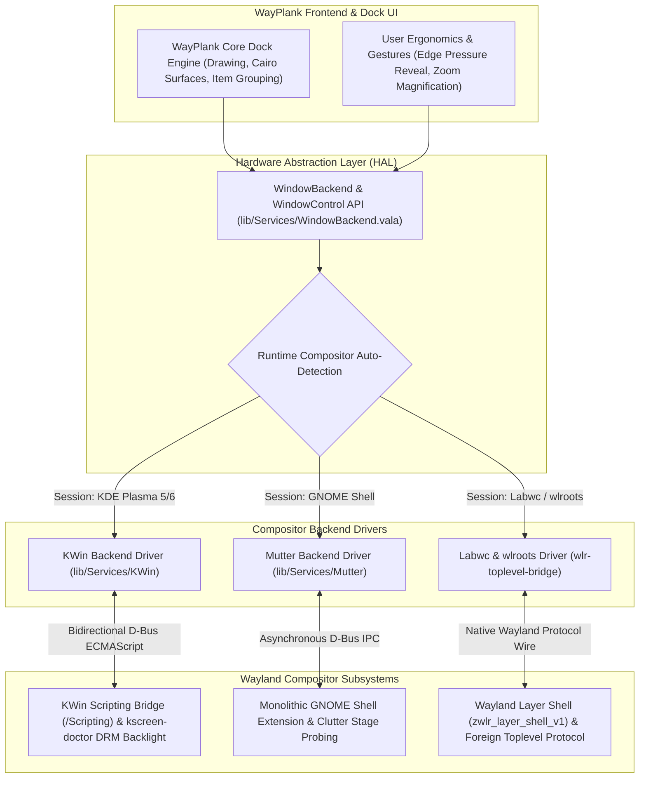

# WayPlank User Guide & Reference Manual

Welcome to **WayPlank**, the fast, lightweight, and modern dock designed natively for modern Wayland desktop environments (**KDE Plasma**, **GNOME**, **Labwc**, and beyond).

This manual provides an in-depth reference for all features, configuration options, gestures, and advanced setups—such as folder-based application menus, docklets, accordion collapsing, multi-monitor layouts, and our modular Hardware Abstraction Layer (HAL).

---

## Table of Contents
1. [Introduction](#1-introduction)
2. [Quick Start & Interface Layout](#2-quick-start--interface-layout)
   - [Multi-Window Navigation & Cairo Preview Cards](#multi-window-navigation--cairo-preview-cards)
3. [Folder Launchers (App Drawer Menus)](#3-folder-launchers-app-drawer-menus)
   - [How Folder Launchers Work](#how-folder-launchers-work)
   - [Default First-Run Folders](#default-first-run-folders)
   - [Creating Custom Folders](#creating-custom-folders)
   - [Adding and Managing Applications](#adding-and-managing-applications)
   - [Folder Running Dots & Wheel Window Cycling](#folder-running-dots--wheel-window-cycling)
   - [Customizing Icons (Launchers, Folders & Docklets)](#customizing-icons-launchers-folders--docklets)
4. [Built-in Docklets & Accordion Mode](#4-built-in-docklets--accordion-mode)
   - [Complete List of 16 Docklets](#complete-list-of-16-docklets)
   - [Accordion Mode (Space-Saving Collapsible Docklets)](#accordion-mode-space-saving-collapsible-docklets)
   - [Configuring the Weather Docklet](#configuring-the-weather-docklet)
5. [Categorization, Dynamic Separators & System Menu Access](#5-categorization-dynamic-separators--system-menu-access)
   - [Categorized Layout Order](#categorized-layout-order)
   - [Permanent Trash Anchoring](#permanent-trash-anchoring)
   - [Dynamic Separators](#dynamic-separators)
   - [4-Position System Menu Access Hierarchy](#4-position-system-menu-access-hierarchy)
   - [Minimalist Dock Setup & Emergency Settings Access](#minimalist-dock-setup--emergency-settings-access)
   - [Dynamic Scale Capacity Redline Teardrop & Topology Auto-Shrink](#dynamic-scale-capacity-redline-teardrop--topology-auto-shrink)
   - [Launcher Deduplication & Item Reuse](#launcher-deduplication--item-reuse)
6. [CLI Virtual Machines & Multi-VM Independent Tracking](#6-cli-virtual-machines--multi-vm-independent-tracking-issue-14)
   - [Automatic CLI QEMU Window Detection](#automatic-cli-qemu-window-detection)
   - [Multi-Instance Isolation & Independent Dock Items](#multi-instance-isolation--independent-dock-items)
   - [Independent Pinning & Cold Relaunch](#independent-pinning--cold-relaunch)
   - [Chromium PWA & Web App Matching](#chromium-pwa--web-app-matching)
7. [Mouse Gestures & Shortcuts](#7-mouse-gestures--shortcuts)
   - [Click Actions](#click-actions)
   - [Scroll Gestures](#scroll-gestures)
   - [Drag & Drop Interactions](#drag--drop-interactions)
   - [Quick Settings Access & In-App Help](#quick-settings-access--in-app-help)
8. [Multi-Monitor Setup & Screen Ergonomics](#8-multi-monitor-setup--screen-ergonomics)
   - [Monitor Selection & Alignment](#monitor-selection--alignment)
   - [Intelligent Hide & Edge Pressure](#intelligent-hide--edge-pressure)
   - [Multi-Monitor Topology & DPMS Wake Stability](#multi-monitor-topology--dpms-wake-stability)
   - [Layer-Shell Input Passthrough & Transparent Window Clipping](#layer-shell-input-passthrough--transparent-window-clipping)
   - [Multi-Monitor Hardware Brightness Control (SP/PV Decoupling)](#multi-monitor-hardware-brightness-control-sppv-decoupling)
9. [Hardware Abstraction Layer (HAL) & Compositor Architecture](#9-hardware-abstraction-layer-hal--compositor-architecture)
   - [The Wayland Security Model & Why WayPlank Needs an HAL](#the-wayland-security-model--why-wayplank-needs-an-hal)
   - [KDE Plasma: KWin D-Bus Scripting Bridge](#kde-plasma-kwin-d-bus-scripting-bridge)
   - [GNOME Shell: Monolithic Mutter Extension](#gnome-shell-monolithic-mutter-extension)
   - [Labwc & wlroots: Native Protocol Architecture](#labwc--wlroots-native-protocol-architecture)
   - [Runtime Auto-Detection Engine](#runtime-auto-detection-engine)
10. [Themes & Visual Customization](#10-themes--visual-customization)
   - [Built-in Themes & Classic Suite](#built-in-themes--classic-suite)
   - [True Dynamic Real-Time Light/Dark System Theming](#true-dynamic-real-time-lightdark-system-theming)
   - [Interactive Theme Manager (One-Click Archive Install & Removal)](#interactive-theme-manager-one-click-archive-install--removal)
   - [Dock Size & Zoom Level](#dock-size--zoom-level)
11. [Command Line Usage, Localization & Packaging](#11-command-line-usage-localization--packaging)
   - [CLI Commands](#cli-commands)
   - [Multi-Language Translation Catalogs (Public Beta v0.7.0 Preparation)](#multi-language-translation-catalogs-public-beta-v070-preparation)
   - [Automated Packaging (Debian/Ubuntu & openSUSE/Fedora/RHEL)](#automated-packaging-debianubuntu--opensusefedorarhel)
   - [Configuration File Paths](#configuration-file-paths)
   - [GSettings Database Keys](#gsettings-database-keys)
12. [Troubleshooting & FAQ](#12-troubleshooting--faq)

---

## 1. Introduction

WayPlank is a native port and evolution of the classic Plank dock, rebuilt to thrive in modern Wayland display servers without X11 or XWayland workarounds.

### Key Highlights
- **Modular Multi-Compositor HAL:** Zero-configuration runtime detection and high-performance native window tracking across **KDE Plasma (KWin D-Bus Scripting Bridge)**, **GNOME (Monolithic Mutter Extension)**, and **Labwc/wlroots (`zwlr_foreign_toplevel`)** with zero X11 or XWayland dependencies.
- **Hardware-Level Brightness Control:** Atomic multi-monitor synchronization via KWin DRM `kscreen-doctor` calls, overcoming user-space PowerDevil I2C permission barriers on external HDMI/DisplayPort screens.
- **Categorized Dock Layout:** Automatic visual grouping of Folders, Docklets, Pinned Launchers, Running Windows, and the Trash can.
- **Folder Launchers:** Turn any directory into a Cairo-Dock style popup application menu with 60 FPS dynamic zoom elevation.
- **Accordion Docklets:** Keep system widgets accessible without cluttering your desktop space.
- **Fluid Animations:** Smooth zoom, bounce on launch, window attention indicators, and smoke poof animations when unpinning.
- **Sub-Second Instant Boot:** 0.74s instantaneous launch with asynchronous compositor handshake.

---

## 2. Quick Start & Interface Layout

When WayPlank starts with default settings, the dock is arranged into clean, logical visual sections separated by dynamic dividers:

```
[ Folders ]   |   [ Docklets ]   |   [ Pinned Apps ]   |   [ Open Apps ]   |   [ Trash ]
 📁 Internet        🎛️ Accordion       🌐 Web Browser       📝 Kate             🗑️ Trash
 💼 Office          (Preferences,      📁 File Manager      ...
 🎬 Media            Desktop,          💻 Terminal
 🎮 Games            Volume...)        ⚙️ Editor
```

- **Folders (Left):** Categorized application menus for fast access to your software library.
- **Docklets (Center-Left):** Interactive system widgets collapsed into an expandable accordion.
- **Pinned Applications (Center):** Direct single-click access to your essential daily tools.
- **Running Applications (Center-Right):** Temporary icons for active, unpinned windows.
- **Trash (Right):** Anchored permanently at the end of the dock for quick file disposal and ejection.

### Multi-Window Navigation & Cairo Preview Cards
Starting in **v0.6.2.3**, WayPlank provides modern elevated Cairo preview cards when hovering or clicking applications with multiple open windows:
- **Live Compositor Thumbnails**:
  - Under **KDE Plasma 6 (KWin)**, live window previews are captured via `org.kde.KWin.ScreenShot2` D-Bus IPC.
  - Under **GNOME Shell (Mutter)**, live window previews are captured via the internal Mutter extension bridge (`/mutter/screen/preview`).
  - Under **Labwc / wlroots**, elegant high-contrast blank cards display the application icon, window title, and interactive action controls.
- **Card Controls**:
  - **Left-Click Card**: Activates and raises the target window to the foreground (`WindowManager.activate()`).
  - **Close Button (X)**: Top-right corner of each card lets you close that specific window instance directly (`WindowManager.close_window()`).
- **Preferences Toggle**:
  - In **Preferences $\rightarrow$ Behaviour**, you can toggle between visual window preview cards and classic cyclic window switching.
- **Recent Files Jump List**:
  - Right-clicking compatible applications reveals a "Recent Documents" submenu powered by FreeDesktop `Gtk.RecentManager`, allowing one-click reopening of recently accessed documents.

---

## 3. Folder Launchers (App Drawer Menus)

Folder Launchers provide a clean way to organize dozens of applications into compact menus directly on your dock.

### How Folder Launchers Work
When a dock item points to a directory (e.g., `Launcher=file:///path/to/directory`), WayPlank treats it as an application drawer. Clicking on it opens a menu displaying all `.desktop` applications found inside that folder, complete with their native icons and localized names.

### Default First-Run Folders
When WayPlank starts for the first time without an existing configuration, it automatically creates and populates four core folders under `~/.config/wayplank/folders/`:

1. **`Internet`**: Web browsers (Chrome, Firefox, Brave), email clients, messengers (Telegram, Discord), and network tools.
2. **`Office`**: Productivity suites (LibreOffice), text editors, calculators, document viewers, and IDEs.
3. **`Media`**: Media players (VLC, Totem), graphics software (GIMP, Inkscape), audio streamers (Spotify), and video recorders.
4. **`Games`**: Game launchers (Steam, Lutris, Heroic), emulators, and games (falls back to `Utilities` if no games are detected on the system).

### Creating Custom Folders
You can create as many custom folder drawers as you like:

1. Open your terminal or file manager and create a directory:
   ```bash
   mkdir -p ~/.config/wayplank/folders/"My Tools"
   ```
2. Simply **drag and drop** that folder from your file manager directly onto WayPlank.
3. WayPlank will instantly create a corresponding `.dockitem` and anchor the folder drawer to the dock.

### Adding and Managing Applications
To add applications to your folder drawer:
- **Via File Manager:** Navigate to `/usr/share/applications/` or `~/.local/share/applications/`, copy the `.desktop` files you want, and paste them (or symlink them) into your folder directory (`~/.config/wayplank/folders/<FolderName>/`).
- **Via Drag & Drop:** Drag an application `.desktop` file into the folder directory.

### Folder Running Dots & Wheel Window Cycling
Starting in **v0.6.2.3**, Folder Drawers are fully integrated with WayPlank's native window manager:
- **Running Indicator Dots**: When one or more applications contained inside a folder drawer are currently running on your desktop, an active running indicator dot automatically appears under that folder's dock icon.
- **Mouse Wheel Window Focus Cycling**: You do not even need to open the folder drawer to switch between running documents! Scrolling your mouse wheel while hovering over the folder drawer icon dynamically cycles focus through all open window instances of applications stored inside that folder.

### Customizing Icons (Launchers, Folders & Docklets)
WayPlank provides an integrated, one-click icon personalization system directly from the dock:
1. **Right-click** on any application launcher, folder drawer, or docklet (`Preferences`, `Show Desktop`, `Session`, `Screenshot`, `Ejector`).
2. Select **Change Icon...** from the context menu.
3. The interactive **Icon Chooser** dialog will open:
   - **Live Theme Search:** Instant filtering across all 20,000+ icons in your active desktop theme.
   - **Browse File:** Select any custom image file (PNG, SVG, ICO, JPG) from your disk.
   - **Restore Default:** Reverts the item to its factory appearance.
4. Click **Apply** to update the icon immediately with zero restart needed.

> 💡 **Technical Note:** For application launchers, customizations follow the FreeDesktop standard (`~/.local/share/applications/`) without breaking Plank migration. For folders, icons are persisted using native GIO metadata (`metadata::custom-icon`), automatically recognized in Nautilus and Dolphin. For docklets, overrides are preserved in the `.dockitem` configuration.
>
> 🔄 **Theme Switching Resiliency:** When switching desktop icon themes, if an icon customized for a folder drawer does not exist in the new theme, WayPlank automatically restores the item to its default folder presentation (with 4-item card preview and folder styling), preventing missing/blank icon cards. Empty folder drawers also display a centered folder glyph so they are never rendered blank.

---

## 4. Built-in Docklets & Accordion Mode

WayPlank includes 16 built-in docklets that provide live system controls and status indicators.

### Complete List of 16 Docklets

| Docklet URI | Description |
| :--- | :--- |
| `docklet://trash` | Trash can indicator with fill status, empty action, and drag-to-delete. |
| `docklet://desktop` | Show/Hide Desktop toggle (minimizes or unminimizes all windows). |
| `docklet://preferences` | One-click access to WayPlank Preferences dialog. |
| `docklet://donotdisturb` | One-click toggle for desktop notification silencing (Do Not Disturb) with FreeDesktop portal integration and dynamic active/silenced bell icon indicators. |
| `docklet://network` | Live network connectivity monitor (Wi-Fi / Ethernet), signal strength, IP address inspection, and quick launch to network settings. |
| `docklet://volume` | Audio volume level with scroll-to-adjust and mute toggle. |
| `docklet://brightness` | Screen brightness control with scroll-to-adjust. |
| `docklet://battery` | Battery charge percentage and charging status for laptops. |
| `docklet://cpu` | Real-time CPU usage monitor meter. |
| `docklet://weather` | Real-time weather conditions and temperature. |
| `docklet://clock` | Classic analog clock showing system time. |
| `docklet://digital-clock` | Digital 12h/24h time display. |
| `docklet://mpris` | Media player controller (Play/Pause, Next, Previous track). |
| `docklet://screenshot` | Instant desktop screen capture utility. |
| `docklet://session` | Session controls (Lock screen, Log out, Suspend, Restart, Shut down). |
| `docklet://ejector` | Safe removal and unmounting of removable USB drives and volumes. |

### Accordion Mode (Space-Saving Collapsible Docklets)
When **Accordion Mode** is enabled (`accordion-docklets = true`), multiple docklets are collapsed into a single compact master slot on the dock.
- **Hover Expansion**: In standard mode, hovering over or dragging across the docklet section smoothly expands all active docklets. Moving the pointer away collapses them back into a single icon after the configured delay.
- **Click to Expand Mode**: In Preferences -> Appearance, enable **Click to Expand**. In this mode, hovering does not expand the docklets; instead, a single click on the master anchor toggles expansion, and a second click opens its action.
- **Dynamic Master Anchor Fallback**: When the Preferences gear icon is hidden from the dock (via System Menu Access modes), the first available docklet automatically assumes the role of the Master Accordion Anchor with zero disruption to expansion behavior.
- **Single Docklet Safety Guard**: If only a single docklet is active on the dock, accordion collapsing is automatically suppressed, preventing redundant expand/collapse cycles for a single item.
- **Drag-and-Drop Auto-Expansion**: Hovering any dragged item (e.g. a file, URL, or application launcher) over the accordion anchor automatically expands all collapsed docklets on hover—even if 'Click to Expand' is enabled—allowing effortless drag-to-docklet operations (such as dropping files directly onto the Trash or media docklet).
- **Configurable Collapse Delay**: Adjust the collapse countdown timer (0.5s to 20.0s) using the slider in Preferences -> Appearance.
- **Directional Indicators**: The anchor tooltip dynamically shows directional arrows (`▸` / `◂`) indicating whether the accordion is collapsed or expanded.
- **Intelligent Retention**: If the dock autohides or dodges while the accordion is expanded, returning within the delay window preserves the expanded state.
- **Modal Interaction Invalidation**: The accordion collapse timer is automatically paused while any dialog (Preferences, Shortcuts & Gestures, Icon Chooser, Weather) or popup menu is active.

To toggle Accordion Mode:
- Open **Preferences** (`Ctrl + Right-Click` on the dock $\rightarrow$ *Preferences*).
- Under the **Appearance / Items** tab, toggle **Accordion Docklets**.

### Configuring the Weather Docklet
The weather docklet fetches local meteorological data:
1. Edit or inspect `~/.config/wayplank/dock1/launchers/weather.dockitem`:
   ```ini
   [PlankDockItemPreferences]
   Launcher=docklet://weather

   [PlankWeatherDockItemPreferences]
   # Leave empty for automatic IP-based location, or enter your city name:
   City=Rome
   # Temperature unit: C (Celsius) or F (Fahrenheit)
   Units=C
   ```
2. Changes take effect immediately upon saving the file.

---

## 5. Categorization & Dynamic Separators

WayPlank features a smart sorting engine that eliminates dock clutter.

### Categorized Layout Order
When **Categorize Items** is enabled (`categorize-items = true`), WayPlank automatically arranges all items in a strictly defined sequence:

$$\text{Folders} \longrightarrow \text{Docklets} \longrightarrow \text{Pinned Apps} \longrightarrow \text{Running Apps} \longrightarrow \text{Trash}$$

- You can freely reorder items *within* their category group.
- Items are never mixed across categories accidentally.

### Permanent Trash Anchoring
The Trash docklet (`docklet://trash`) is permanently anchored to the far end of the dock (the right side on horizontal docks, or the bottom on vertical docks). Even if you drag or open new applications, Trash stays fixed at the edge, exactly where muscle memory expects it.

### Dynamic Separators
WayPlank automatically inserts subtle vertical separator lines between adjacent, non-empty category groups:
- If you have Folders, Docklets, and Apps active, two separators are placed: `[Folders] | [Docklets] | [Apps]`.
- When an unpinned application opens, a separator appears before it: `[Apps] | [Active App] | [Trash]`.
- When the application closes, the separator cleanly vanishes without animation stutter.

### 4-Position System Menu Access Hierarchy
Starting in **v0.6.2.3**, WayPlank introduces an ergonomic **System Menu Access** hierarchy (**Preferences $\rightarrow$ Behaviour**), allowing complete control over where WayPlank system options (*Preferences*, *About*, *Shortcuts & Gestures*, *Quit*) appear:
1. **Mode 1: Docklets Only**:
   - The dedicated Preferences gear icon is completely hidden from the dock.
   - Right-clicking on any docklet displays the full WayPlank system menu.
   - Right-clicking on application icons displays **strictly application-native actions** (zero WayPlank system items appended), keeping application menus clean and uncluttered.
2. **Mode 2: Docklets Only (with fallback)** *(Recommended Default for Minimalist Docks)*:
   - The dedicated Preferences gear icon is hidden from the dock.
   - Right-clicking on docklets opens the full system menu.
   - If no docklets are active on the dock, right-clicking on any application icon automatically serves as a fallback to ensure settings access is never lost.
3. **Mode 3: All Icons (integrated)**:
   - The dedicated Preferences gear icon is hidden.
   - Right-clicking on **any** icon (application, folder drawer, or docklet) integrates the full WayPlank system menu at the bottom of the context menu.
4. **Mode 4: Dedicated Icon (on dock)**:
   - The classic dedicated Preferences gear icon is anchored directly to the dock surface.

### Minimalist Dock Setup & Emergency Settings Access
- **One-Click Preferences Removal**: In Mode 4, simply right-click the Preferences gear icon and select **Remove from Dock**. The icon is removed immediately with a cartoon poof animation, and WayPlank automatically transitions to **Mode 2** (or **Mode 3** in Free Mode) so you are never locked out of settings.
- **Universal Emergency Access**: If you ever hide all docklets or need immediate access to settings, **`Ctrl + Right Click`** on **any** icon or dock surface unconditionally opens the complete WayPlank system menu at all times.
- **Free Mode (Uncategorized) Protection**: When **Categorize Items** is toggled off (Free Mode), docklet-only options are dynamically hidden from Preferences, and WayPlank automatically migrates to **Mode 3 (All Icons)**.

### Dynamic Scale Capacity Redline Teardrop & Topology Auto-Shrink
When pinning a high number of applications or operating on compact displays, dock items may approach or exceed the monitor's physical boundary:
- **Dynamic CSS Redline Gradient**: In the Preferences dialog (**Appearance $\rightarrow$ Icon Size**), if the selected icon size exceeds the screen's maximum physical capacity, the slider track dynamically illuminates with a warning CSS redline gradient for all values beyond safe capacity.
- **Vector Teardrop Badge & Dual-Color Split**: Dragging the slider into the exceeded zone displays a red warning teardrop indicator badge and splits the track highlight (blue in the safe zone, red in the exceeded zone) with a clear notification: `"⚠️ Limited to XXpx by screen space (auto-shrunk)"`.
- **Display Topology Real-Time Auto-Shrink**: When switching between displays or reconfiguring monitor layouts, WayPlank recalculates physical screen limits in real time and automatically scales down icon sizes to guarantee that the dock always fits within the active screen geometry without clipping.
- **Boundary Clamping & Smooth Mouse Wheel Panning**: WayPlank automatically clamps its background rendering strictly to the monitor's visible dimensions (`int.min(monitor_geo.width, background_width)`). With **Scroll on Overflow** enabled (**Preferences $\rightarrow$ Behaviour**), rotating your mouse wheel over the dock surface shifts items smoothly with interpolated motion (`scroll_offset += (target_scroll_offset - scroll_offset) * 0.35`). Scrolling specifically over the Volume docklet continues to adjust audio volume without triggering overflow dock pan.

### Launcher Deduplication & Item Reuse
To maintain a clean and reliable configuration:
- **Canonical Deduplication on Load & Drop**: When initializing launchers or receiving drag-and-drop items, WayPlank resolves canonical file paths (`Posix.realpath`), percent-encoded URIs (`GLib.File.equal`), and desktop IDs. If an item already exists in the dock, WayPlank reuses and repositions its existing `.dockitem` file instead of spawning redundant incremented filenames (such as `app-1.dockitem` or `app-2.dockitem`).
- **KISS Drag-Off Removal & Poof Animation**: Dragging an unpinned application off the dock inspects actual running windows (`window_count_for_app > 0`). If the app has zero open windows, it is instantly deleted from disk with a clean Cairo `PoofWindow` cloud particle animation, eliminating transient icon ghosting or hopping into the unpinned section. If active windows remain, it cleanly transitions to an unpinned running item until its windows are closed.
- **Auxiliary Bridge Window Shielding**: Internal background windows—such as `xwaylandvideobridge` surfaces used by Discord, Slack, and OBS for Wayland screen-sharing—are automatically detected and filtered out, preventing phantom 1×1 ghost launcher icons from cluttering your running apps list.

---

## 6. CLI Virtual Machines & Multi-VM Independent Tracking (Issue #14)

Starting in **v0.6.2.3**, WayPlank provides full first-class support for command-line spawned virtual machines (e.g. QEMU `qemu-system-x86_64`), complex terminal applications, and Chromium Progressive Web Apps (PWAs).

### Automatic CLI QEMU Window Detection
CLI-launched virtual machines typically lack desktop launcher entries (`.desktop` files) or specify `NoDisplay=true` with no `Exec=` key (such as `/usr/share/applications/qemu.desktop`). Previously, this caused CLI-spawned VM windows to appear without an icon or fail to spawn a dock item.
- **NoDisplay Desktop Indexing**: WayPlank indexes all installed application entries—including those with `NoDisplay=true`—allowing it to match running window processes to canonical application metadata, icons, and display titles.
- **Dedicated Synthetic Launcher Synthesis**: When a CLI application window opens, WayPlank extracts the exact process command line from `/proc/<pid>/cmdline` and automatically synthesizes a dedicated, executable `.desktop` launcher under `~/.local/share/applications/` (e.g. `wayplank-app-qemu-vm-alpha.desktop`).

### Multi-Instance Isolation & Independent Dock Items
When running multiple distinct virtual machines simultaneously (for example, `VM-Alpha` and `VM-Beta`):
- **Independent Dock Items**: Each VM window is tracked as its own independent dock item with its dedicated title (`QEMU (VM-Alpha)`, `QEMU (VM-Beta)`), active running dot, and window controls.
- **Hypervisor Argument Stopword Filtering**: WayPlank's argument parser automatically filters out generic runtime flags (`-accel kvm`, `-m 512M`, `-enable-kvm`), preventing common hypervisor options from causing distinct VM instances to collapse onto a single dock icon.
- **Instance Isolation Guard**: Synthetic launchers are strictly matched against the window's sanitized instance name, ensuring `VM-Beta` can never be hijacked by `VM-Alpha`'s dock item.

### Independent Pinning & Cold Relaunch
- **Keep in Dock**: Right-click any running VM dock item and select **"Keep in Dock"**.
- **Cold Relaunch**: When the VM is shut down, its pinned dock item remains in place. Clicking the pinned icon cold-relaunches that exact VM with all its original command-line parameters (kernel image, memory allocation, drive images, and network flags) exactly as originally invoked!

### Chromium PWA & Web App Matching
WayPlank accurately discriminates between standalone Progressive Web Apps (PWAs) launched via Chromium, Chrome, Brave, or Edge (using `--app=...` or `--app-id=...`) and regular browser windows:
- **Strict Identity Scoping**: PWAs are assigned their dedicated dock icons and never collapse into the main browser window item.
- **Word-Boundary Token Matching**: Application titles are parsed using strict word-boundary matching rather than substring searches, preventing unrelated applications from being misidentified.

---

## 7. Mouse Gestures & Shortcuts

WayPlank offers an extensive set of mouse gestures and keyboard shortcuts designed for maximum productivity:

### Click Actions
- **Left Click**: Launch an application, or bring its existing window(s) to the foreground.
- **Middle Click** (or **Ctrl + Left Click**): Force launch a **NEW** instance of the application.
- **Middle Click on Window Preview Card**: Directly close that specific window instance.
- **Right Click**: Open the application's context menu (displaying Desktop Actions / Quicklists, Recent Documents, and "Keep in Dock").
- **Ctrl + Right Click (Any Icon or Dock Surface)**: Unconditionally opens the full WayPlank System Menu at all times, guaranteeing instant access to *Preferences*, *Shortcuts & Gestures*, *About*, and *Quit*.
- **Shift + Left Click**: Cycle focus to the next open window of that specific application.

### Scroll Gestures
- **Mouse Scroll on App Icon**: Smoothly cycle through all open windows of that application.
- **Mouse Scroll on Folder Drawer**: Smoothly cycle focus through all open windows of applications stored inside that folder.
- **Mouse Scroll on Dock Surface (Overflow Mode)**: When dock items exceed available display boundaries and overflow scrolling is active, smoothly pan the dock items left/right or up/down.
- **Mouse Scroll on Volume Docklet**: Directly raise or lower the master system volume.
- **Mouse Scroll on Screen Brightness Docklet**: Adjust backlight intensity up or down in discrete 5% steps.
- **Ctrl + Mouse Scroll Up**: Dynamically increase dock icon size in real time.
- **Ctrl + Mouse Scroll Down**: Dynamically decrease dock icon size in real time.

### Drag & Drop Interactions
- **Drag icon off the dock**: Unpin and remove a launcher with a classic cartoon smoke ("poof") animation (zero-ghosting KISS cleanup).
- **Drag icon along the dock**: Reorder launchers within their category.
- **Drop file onto an application icon**: Directly opens the dropped file in the target application (supports 0-byte files, multi-file payloads, full FreeDesktop `%U`/`%F` parameters, icon bounce feedback, and automatic window activation).
- **Strict FreeDesktop MIME Type Validation**: Dropped files are strictly validated against target applications' declared `.desktop` `MimeType=` entries. Incompatible files (e.g. dropping a PDF file onto Kate, Gedit, or Dolphin) are cleanly bounced and rejected, preventing unexpected app crashes or accidental pinning.
- **Hover-To-Raise Target Window**: Pausing hover over a running application dock item for >500ms during an active drag operation triggers an automated focus request (`WindowManager.activate()`), bringing that application's window to the foreground so you can drop files or text directly into the application's workspace without manual task switching.
- **Drop web URL onto dock background**: Dropping links or URLs dragged from web browsers (Firefox, Chrome, Edge, Brave) directly onto empty dock space opens the target URL in the system default web browser.
- **Drop web URL onto web browser dock icon**: Dropping a URL onto a specific web browser launcher opens the link in a new tab within that browser.
- **Internet Desktop Link Shortcuts**: Dragging and dropping `.desktop` files of `Type=Link` (supporting standard `URL=` and KDE expanded `URL[$e]=` keys) or `.url` files will either pin the shortcut or open the destination URL directly. Pinning always takes strict precedence when dropping `.desktop` files onto the dock.
- **Drop folder onto a folder or directory-aware application**: Drops into a folder drawer to copy files, or onto a code editor/file manager (like Kate, Dolphin, VSCode) to open the project folder.
- **Drop onto empty dock space**: Pins files or folders as new dock items, or adds new application launchers from `.desktop` files.

### Quick Settings Access & In-App Help
- **Right Click (Any Item or Background)**: Instant access to **Shortcuts & Gestures...**, **Preferences...**, and **Quit**.
- **Ctrl + Right Click (Anywhere)**: Opens the WayPlank Preferences dialog directly, even when clicking over an active launcher icon.
- **Shortcuts & Gestures Dialog**: Visual reference dialog (`HelpWindow`) with categorized tabs explaining dock operations, gestures, and keyboard combinations.
- **Terminal CLI Cheatsheet**: Run `wayplank --help` in the terminal for a full, colorized quick-reference guide.
- **Right Click on empty dock space**: Opens the dock context menu.
- **Ctrl + Alt + Shift + Right Click**: Opens Developer Inspection Tools (launcher URI inspector, reload theme, inspect configuration).

---

## 8. Multi-Monitor Setup & Screen Ergonomics

WayPlank is architected from the ground up for modern multi-monitor Wayland workstations, whether utilizing homogeneous 4K displays or heterogeneous multi-output setups with mixed fractional scaling.

### Monitor Selection & Alignment
- **Position**: Place the dock on the `Bottom`, `Top`, `Left`, or `Right` edge of your screen.
- **Alignment**: Align the dock to `Center`, `Start` (Left/Top), or `End` (Right/Bottom).
- **Monitor Pinning**: In the Preferences dialog (**Preferences $\rightarrow$ Appearance $\rightarrow$ Monitor**), select the exact physical output where WayPlank should appear (e.g., `eDP-1`, `DP-1`, `HDMI-A-1`). When set to primary or specific outputs, WayPlank binds its layer-shell surface exclusively to that display geometry.

### Intelligent Hide & Edge Pressure
- **Hide Modes**:
  - `None`: Dock stays permanently on screen and reserves desktop strut space.
  - `Intelligent`: Dock automatically slides out of view only when an active window overlaps its territory.
  - `Autohide`: Dock hides whenever the mouse leaves its boundary.
  - `Dodge Active Window`: Dock hides only when the focused window overlaps it.
- **Pressure Reveal**: Requires touching the physical screen edge (1px barrier) before the dock reveals itself, preventing accidental triggers when moving the mouse across monitor boundaries or working near the border. When disabled, the dock unhides smoothly 10px before reaching the edge for fluid everyday access.

### Multi-Monitor Topology & DPMS Wake Stability
In complex multi-monitor environments, dynamic display changes—such as hotplugging an external screen, changing physical layout topology, or waking from system suspend / DPMS sleep—frequently cause race conditions in Wayland clients:
- **50ms Debounced Topology Sync**: WayPlank intercepts Gdk/Wayland display configuration events through a non-blocking 50ms debouncer, preventing display flicker or multiple surface rebuilds while displays renegotiate modes.
- **Persistent Output Mapping**: Monitor connector identifiers are tracked across sleep and resume cycles, ensuring the dock never jumps unexpectedly between displays when external docks or monitors re-enumerate.
- **Heterogeneous DPI & Fractional Scaling**: Layer-shell geometry and Cairo surface buffers automatically adjust scaling factors when moved across displays with differing device pixel ratios (HiDPI / LoDPI).

### Layer-Shell Input Passthrough & Transparent Window Clipping
On Wayland compositors supporting `gtk-layer-shell` (KDE Plasma, Labwc) and GNOME Shell (Mutter):
- **Zero Desktop Panel Displacement**: When Hide Mode is set to `None` (dock permanently visible), WayPlank maintains `exclusive_zone` at 0. This guarantees the dock never collides with or displaces system panels (such as KDE Plasma top/bottom panels or Labwc bars).
- **Cairo Input Shape Pass-Through**: WayPlank dynamically clips its Cairo input region (`window.input_shape_combine_region`) strictly to the visible dock pill during realization and mapping. Transparent areas outside the dock items pass mouse clicks directly through to underlying desktop windows and icons via `wl_surface.set_input_region`, eliminating the classic Wayland issue where transparent layer-shell window margins block clicks.
- **Dynamic Hysteresis Flip-Flop & Anticipate Icon Zoom (Issue #12)**: In classic Plank tradition, an anticipatory runway begins expanding icon magnification as the cursor approaches the dock. In Wayland environments, this invisible runway could intercept pointer events intended for overlapping windows placed behind or immediately above the dock (such as text editor scrollbars, terminal buffers, or Kate line selections). WayPlank implements a two-stage hysteresis flip-flop and an **Anticipate Icon Zoom** toggle in **Preferences $\rightarrow$ Behaviour**:
  - **Enabled (`true`, Default)**: Preserves 100% of classic Plank's smooth anticipatory approach feel out of the box.
  - **Disabled (`false`)**: Strictly clamps the layer-shell input region to the 60px visual dock pill when the mouse is at rest, dynamically expanding the input mask upward only while an icon is actively hovered and collapsing it immediately upon pointer leave. This provides 100% transparent click passthrough (I-beam selection, button clicks, status bar interaction) to underlying windows.

### Multi-Monitor Hardware Brightness Control (SP/PV Decoupling)
WayPlank's integrated Screen Brightness docklet features per-monitor hardware backlight and DDC/CI level synchronization:
- **KWin DRM Integration**: On KDE Plasma, WayPlank synchronizes brightness levels through KWin's DRM `kscreen-doctor` bridge and kernel interfaces, allowing fluid backlight adjustments across all connected displays without requiring root permissions or external background daemons.
- **Dedicated Background Worker with Target Coalescing**: On GNOME/Mutter and Labwc/wlroots, slow synchronous DDC/CI hardware I2C bus calls (`ddcutil`, `brightnessctl`) can introduce latency. WayPlank serializes hardware communication across a dedicated background worker thread with rapid target coalescing, keeping the dock completely fluid at 60 FPS even during heavy multi-monitor I2C transactions.
- **Set Point (SP) vs Process Variable (PV) Decoupling**: In industrial process control, an operator's commanded Set Point must never be clobbered by delayed sensor feedback. WayPlank implements an authoritative SP architecture: once you dial a brightness value, background polling cannot overwrite your target.
- **8-Second Settling Window & ±3% Deadband**: External D-Bus property updates originating from self-echoes or intermediate hardware steps are filtered through an 8-second settling window and a ±3% deadband, preventing badge bounce, slider flicker, and hardware oscillation across external HDMI/DP monitors and internal laptop panels.

---

## 9. Hardware Abstraction Layer (HAL) & Compositor Architecture

Unlike legacy X11—where any unprivileged client could globally poll window hierarchies, coordinates, and input focus via the root window—the **Wayland security model** intentionally isolates applications from one another. By design, a pure Wayland client cannot query other applications' windows or control desktop focus without explicit compositor cooperation.

To deliver full dock functionality—including running application indicators, window activation, minimize/restore toggling, dynamic Dodge/Intellihide window overlap tracking, and multi-monitor coordination—WayPlank incorporates a modular, zero-configuration **Hardware Abstraction Layer (HAL)** (`lib/Services/WindowBackend.vala` and `lib/Services/WindowControl.vala`).

### The Wayland Security Model & Why WayPlank Needs an HAL
In Wayland, the compositor acts as the display server, window manager, and compositor all in one. Standard Wayland protocols (`wl_compositor`, `wl_surface`) deliberately omit APIs for inspecting foreign toplevel windows to prevent keylogging and screen snooping.



### KDE Plasma: KWin D-Bus Scripting Bridge
On KDE Plasma (Plasma 5 & Plasma 6), WayPlank communicates with KWin via its native D-Bus scripting interface (`org.kde.KWin /Scripting`):
- **Dynamic ECMAScript Bridge**: WayPlank registers a high-performance helper script inside KWin's JavaScript runtime, providing bi-directional, event-driven notifications for window creation, destruction, focus shifts, minimization, and geometry changes.
- **Zero Polling Overhead**: Window geometry and state changes are delivered via D-Bus signal emissions, eliminating CPU-intensive polling loops.
- **Dynamic Top Floating Panel Tracking**: Starting in **v0.6.2.3**, WayPlank actively synchronizes with KDE Plasma 6 floating top panels, adjusting dock dodge offsets and seamlessly tracking when windows maximize to 0-gap edge struts.
- **Auto-Healing Service Watcher**: If KWin crashes or is manually replaced (`kwin_wayland --replace`), WayPlank's D-Bus service watcher automatically detects the compositor restoration, re-registers the bridge script, and re-engages live tracking with zero manual intervention.
- **Hardware-Level Display Sync**: Leverages `kscreen-doctor` for atomic multi-monitor brightness and output state synchronization.
- **Validated 100% FAT Stability**: Fully compliant with the WayPlank Factory Acceptance Test (FAT) matrix on KDE Plasma 6.

### GNOME Shell: Monolithic Mutter Extension
Because GNOME Shell (Mutter) does not implement the `zwlr_foreign_toplevel_manager_v1` protocol and restricts foreign window inspection, WayPlank features a self-deploying GNOME Shell extension:
- **Instantaneous 0.74s Startup**: Asynchronous initialization with zero synchronous evaluation freezes, achieving sub-second cold starts.
- **Extension Error-Latch Auto-Recovery**: Starting in **v0.6.2.3**, MutterBackend automatically executes `gnome-extensions reset` prior to reloading the bridge. This clears GNOME Shell's internal `ExtensionState.ERROR` flag from memory, enabling seamless instant bridge updates and hot-reloads **without requiring desktop session logout or reboot**.
- **Unpositioned Dock Concealment Guard**: Suppresses window visibility on GNOME Wayland until backend D-Bus positioning coordinates are negotiated, eliminating flashes of unanchored dock windows in the center of the display.
- **Recursive Position Loop Filtering**: Restricts window signal broadcasts (`position-changed`, `size-changed`, `notify::title`) strictly to external client windows, completely preventing recursive D-Bus repositioning loops and maintaining dock idle CPU usage at $\le 0.1\%$.
- **Clutter Stage Probing**: Multi-monitor boundaries and dock reveal triggers are probed directly through Clutter stage coordinates, guaranteeing responsive mouse unhide even on secondary screens located at bottom or lateral coordinates.
- **Window Geometry & Intellihide**: Provides real-time window boundary data over session D-Bus (`/org/gnome/Shell/Extensions/WayPlank`), powering intelligent dodge and hide calculations on GNOME Wayland sessions.
- **Non-Intrusive Desktop Integration**: Dialogs are centered automatically, and desktop notifications are delivered cleanly without intrusive banner overlays.

### Labwc & wlroots: Native Protocol Architecture
For modular Wayland environments such as Labwc, Wayfire, and generic wlroots-based compositors:
- **`gtk-layer-shell` Surface Management**: WayPlank anchors itself directly to the desktop using standard Wayland layer-shell protocol semantics (`zwlr_layer_shell_v1`), managing exclusive zones and autohide margins natively.
- **Foreign Toplevel Management**: Communicates via `zwlr_foreign_toplevel_manager_v1` using an optimized, native C bridge (`lib/Services/wlr-toplevel-bridge.c`), enabling window tracking, activation, minimization, and closing without intermediate desktop daemons.
- **State-Based Dodge & Honest UI**: Employs an intelligent window state filter (`DODGE_MAXIMIZED` and focused window tracking), validated across lightweight Wayland environments including LXQt 2.x and XFCE 4.20 on Labwc.

### Runtime Auto-Detection Engine
WayPlank requires zero user configuration or environment toggles to select the correct compositor backend:
- During startup, the HAL detection engine inspects session environment variables (`XDG_CURRENT_DESKTOP`, `XDG_SESSION_TYPE`, `WAYLAND_DISPLAY`), tests compositor D-Bus interfaces, and probes supported Wayland protocol globals.
- It dynamically binds the optimal driver at runtime with graceful fallback, ensuring a seamless, out-of-the-box user experience regardless of distribution or desktop environment.

---

## 10. Themes & Visual Customization

### Built-in Themes & Classic Suite
WayPlank ships with a curated selection of built-in themes and an adaptive dynamic GTK theme engine:
1. **Default**: Modern adaptive GTK engine with translucent glass styling and desktop accent color wiring.
2. **Arian Theme Dark**: Modern dark translucent glass with subtle border illumination.
3. **Arian Theme Light**: Clean frosted glass designed for light desktop environments.
4. **IFtiger Theme Dark**: Sleek high-contrast dark theme contributed by downstream collaborator 史有虎 (IFtiger-hu).
5. **IFtiger Theme Light**: Crisp, clean light theme with subtle frosted edges.
6. **Dark**: Classic monochrome dark theme with rounded styling.
7. **Light**: Classic monochrome light theme.
8. **Transparent**: Ultra-minimalist borderless design showing only floating icons.

### True Dynamic Real-Time Light/Dark System Theming
Starting in **v0.6.2.3**, WayPlank features multi-bus and filesystem convergence for instantaneous system theme tracking:
- **FreeDesktop Settings Portal**: Intercepts `color-scheme` key changes over D-Bus (`org.freedesktop.portal.Settings`).
- **GNOME Shell GSettings**: Directly tracks `org.gnome.desktop.interface.color-scheme`.
- **KDE Plasma Inotify Monitoring**: Monitors `~/.config/kdeglobals` for immediate color changes under KDE Plasma 6.
- **Dynamic Counterpart Swapping**: When the desktop toggles between Dark and Light mode, WayPlank automatically switches between paired counterpart themes (*Arian Theme Light* $\longleftrightarrow$ *Arian Theme Dark*, *IFtiger Theme Light* $\longleftrightarrow$ *IFtiger Theme Dark*, *Light* $\longleftrightarrow$ *Dark*) and dynamically updates the adaptive `Default` theme with zero dock restarts required.

### Interactive Theme Manager (One-Click Archive Install & Removal)
Starting in **v0.6.2.2**, WayPlank includes an integrated Theme Manager directly within the Preferences dialog (**Preferences $\rightarrow$ Appearance**):
- **Install Theme (`+` Button)**: Opens a native file chooser dialog (`Gtk.FileChooserNative`). Select any theme archive (`.zip`, `.tar.gz`, `.tar.xz`, `.tar.bz2`) or standalone `.theme` file. WayPlank automatically unpacks, verifies the `dock.theme` structure, presents an interactive multi-theme selection checklist if multiple themes are packaged together, installs it into `~/.local/share/wayplank/themes/`, and applies it instantaneously!
- **Delete Theme (Trash Button)**: Select any user-installed theme from the dropdown menu and click the trash button to permanently delete it. Built-in system themes are protected against accidental deletion.
- **Manual Installation (100% Plank Compatibility)**: You can also manually drop folders containing `dock.theme` into:
```bash
~/.local/share/wayplank/themes/<ThemeName>/dock.theme
~/.local/share/plank/themes/<ThemeName>/dock.theme
~/.themes/<ThemeName>/dock.theme
/usr/share/wayplank/themes/<ThemeName>/dock.theme
/usr/share/plank/themes/<ThemeName>/dock.theme
```
They will instantly appear in the **Preferences $\rightarrow$ Theme** dropdown menu.

### Dock Size & Zoom Level
- **Icon Size**: Adjustable from 24px up to 128px in Preferences $\rightarrow$ Appearance.
- **Icon Zoom (Magnification)**: When enabled, icons smoothly magnify up to 200% under the mouse cursor, with physics-based smooth interpolation.
- **Anticipate Icon Zoom Toggle**: Located in **Preferences $\rightarrow$ Behaviour** (Row 6). Controls whether the zoom engine claims an anticipatory approach runway above the dock (`true`, classic Plank behavior) or operates via an on-demand hysteresis flip-flop (`false`, maximum click passthrough for overlapping windows behind the dock).

---

## 11. Command Line Usage, Localization & Packaging

### CLI Commands
```bash
# Start WayPlank
wayplank

# Open the Preferences dialog directly
wayplank --preferences

# Run in debug mode with verbose logging
wayplank -d

# Show current version and build information
wayplank --version
```

### Multi-Language Translation Catalogs (Public Beta v0.7.0 Preparation)
In preparation for the upcoming **Public Beta (v0.7.0)**, WayPlank has introduced complete multi-language translation catalogs and an automated translation framework via `po/generate_translations.py`:
- **Complete String Catalogs Ready**: All 322 user-facing strings, tooltips, settings labels, and docklet strings have been fully translated across **7 community languages**:
  1. **Simplified Chinese (`zh_CN`)** — Community contribution by 史有虎 (IFtiger-hu).
  2. **Italian (`it`)**
  3. **Spanish (`es`)**
  4. **French (`fr`)**
  5. **Catalan (`ca`)**
  6. **German (`de`)**
  7. **Ukrainian (`uk`)**
- **Public Beta Runtime Engine Roadmap**: While the translation catalogs and PO infrastructure are established and maintained in the repository, the monolithic in-memory embedded localization engine (compiled into the binary via GResource / gettext) is scheduled for activation in the **Public Beta v0.7.0** release (Week 45 — Nov 2026), which will dynamically render the dock UI in the user's desktop language based on `LANG` / `LC_MESSAGES`.
- **Balanced 560×480 Preferences Geometry**: Ahead of runtime engine activation, the Preferences window layout has already been engineered with compact 560×480 constraints to guarantee that all localized strings fit cleanly with zero horizontal label truncation.
- **Call for Translators**: Contributors can easily add new languages or refine existing strings directly in `po/generate_translations.py`.

### Automated Packaging (Debian/Ubuntu & openSUSE/Fedora/RHEL)
WayPlank provides native, standalone packaging scripts requiring zero manual Makefile manipulation:

- **Debian, Ubuntu & Derivatives (`.deb`)**:
  ```bash
  chmod +x BuildDeb.sh
  ./BuildDeb.sh
  sudo apt install ./build/wayplank_0.6.2.3_amd64.deb
  ```

- **openSUSE, Fedora & RHEL (`.rpm`)**:
  ```bash
  chmod +x BuildRpm.sh
  ./BuildRpm.sh
  # On openSUSE:
  sudo zypper install ./build/wayplank-0.6.2.3-1.x86_64.rpm
  # On Fedora / RHEL:
  sudo dnf install ./build/wayplank-0.6.2.3-1.x86_64.rpm
  ```

> 💡 **Headless / CI Automation**: All build scripts support non-interactive execution via `WAYPLANK_NO_PROMPT=1` (e.g., `WAYPLANK_NO_PROMPT=1 ./BuildDeb.sh`).

### Configuration File Paths
- **Launchers Directory**: `~/.config/wayplank/dock1/launchers/`
- **Folder Drawers**: `~/.config/wayplank/folders/`
- **Custom Themes**: `~/.local/share/plank/themes/`
- **Cache & Temporary Files**: `~/.cache/wayplank/`

### GSettings Database Keys
All settings are stored in the GSettings schema `net.launchpad.plank.dock.settings:/net/launchpad/plank/docks/dock1/`:
```bash
# Read all current dock settings
gsettings list-recursively net.launchpad.plank.dock.settings:/net/launchpad/plank/docks/dock1/

# Toggle categorized items
gsettings set net.launchpad.plank.dock.settings:/net/launchpad/plank/docks/dock1/ categorize-items true

# Toggle accordion docklets
gsettings set net.launchpad.plank.dock.settings:/net/launchpad/plank/docks/dock1/ accordion-docklets true

# Toggle dock overflow smooth scrolling
gsettings set net.launchpad.plank.dock.settings:/net/launchpad/plank/docks/dock1/ scroll-overflow true

# Change dock theme
gsettings set net.launchpad.plank.dock.settings:/net/launchpad/plank/docks/dock1/ theme 'Arian Theme Light'

# Set system menu access mode (1 = Docklets Only, 2 = Docklets Fallback, 3 = All Icons, 4 = Dedicated Icon)
gsettings set net.launchpad.plank.dock.settings:/net/launchpad/plank/docks/dock1/ system-menu-access 2

# Toggle anticipatory icon zoom runway (false = strict click passthrough for overlapping windows)
gsettings set net.launchpad.plank.dock.settings:/net/launchpad/plank/docks/dock1/ anticipate-zoom true
```

---

## 12. Troubleshooting & FAQ

#### Q: How do I open Preferences if the preferences icon is missing?
**A:** Press **`Ctrl + Right-Click`** on **any** application icon, folder drawer, docklet, or empty dock surface to open the WayPlank System Menu unconditionally. You can also run `wayplank --preferences` in a terminal.

#### Q: Why do my virtual machines (QEMU) get distinct dock icons?
**A:** WayPlank features an advanced hypervisor instance isolation engine (Issue #14). When running multiple VMs (e.g. `VM-Alpha` and `VM-Beta`), WayPlank analyzes `/proc/<pid>/cmdline`, ignores generic flags (`-accel kvm`, `-m 512M`), and synthesizes dedicated launchers for each VM. You can pin each VM separately, and clicking a pinned VM icon cold-relaunches that specific machine with its original disk image and flags.

#### Q: Do I need to reboot or log out of GNOME Shell after an update or extension crash?
**A:** **No.** WayPlank's MutterBackend incorporates self-healing logic that executes `gnome-extensions reset` prior to reloading the bridge. This automatically clears GNOME Shell's internal `ExtensionState.ERROR` flag from memory, reloading the extension dynamically without needing a session restart or reboot.

#### Q: How do I add an application that is not in the default folders?
**A:** Open your Application Menu (KDE Kickoff, GNOME Dash, Labwc menu) or your file manager (Dolphin, Nautilus, Thunar) at `/usr/share/applications/`, and simply drag the `.desktop` file onto WayPlank.

#### Q: Can I reset WayPlank to its initial default state?
**A:** Yes. Close WayPlank, remove the configuration folder, and start WayPlank again:
```bash
killall wayplank
rm -rf ~/.config/wayplank/dock1/
wayplank &
```
WayPlank will automatically regenerate the clean modern defaults with folders, docklets, and pinned applications.

---

*WayPlank is free software licensed under the GNU General Public License v3.*  
*Copyright © 2011–2015 Plank Developers | Copyright © 2026 Sergio Melas & WayPlank Contributors.*

