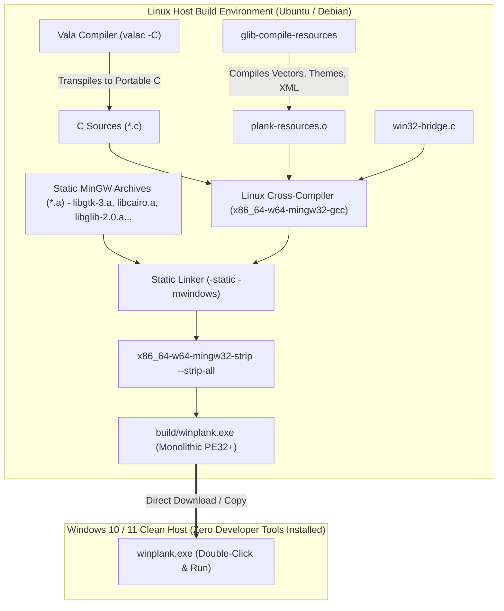
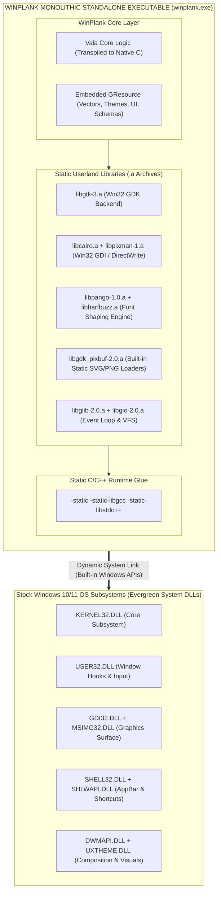
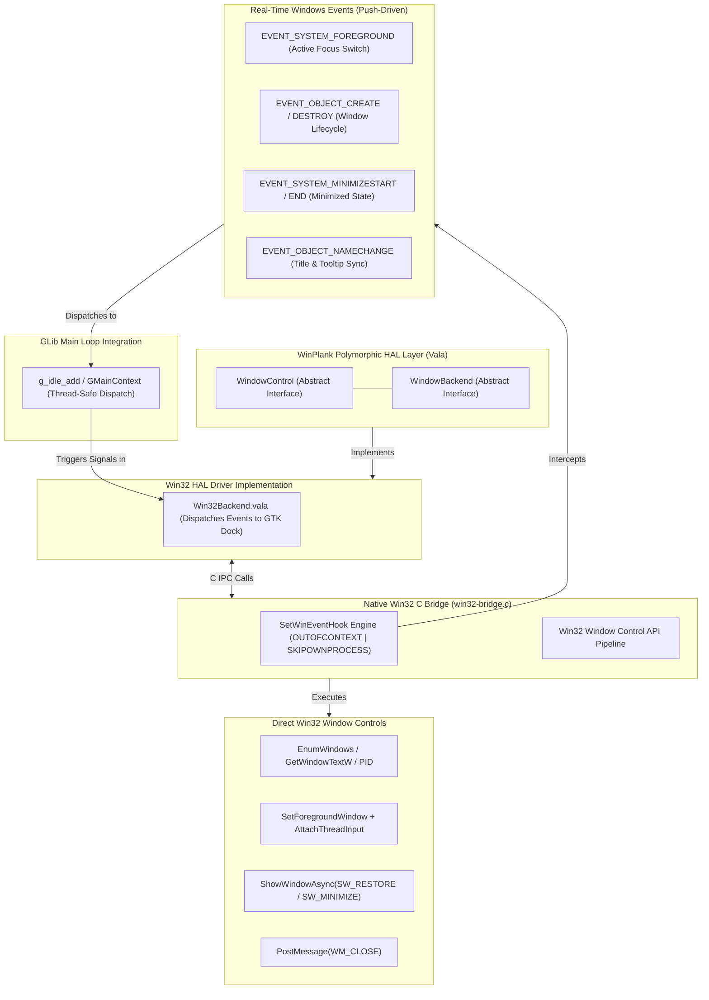
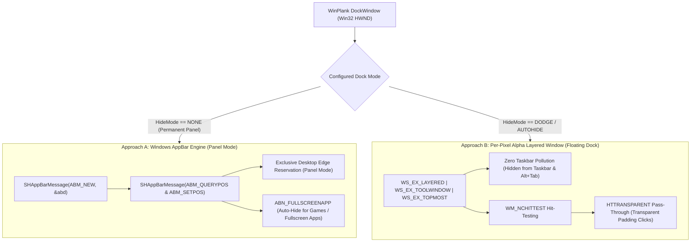
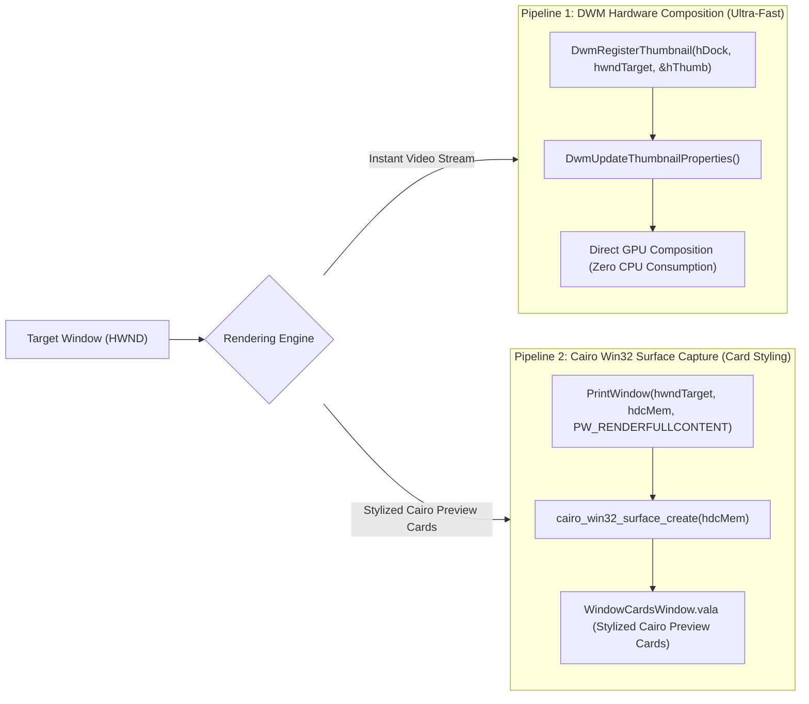
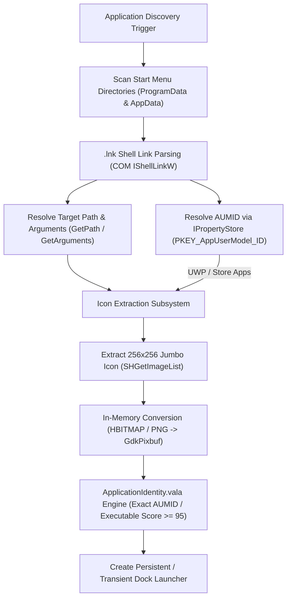
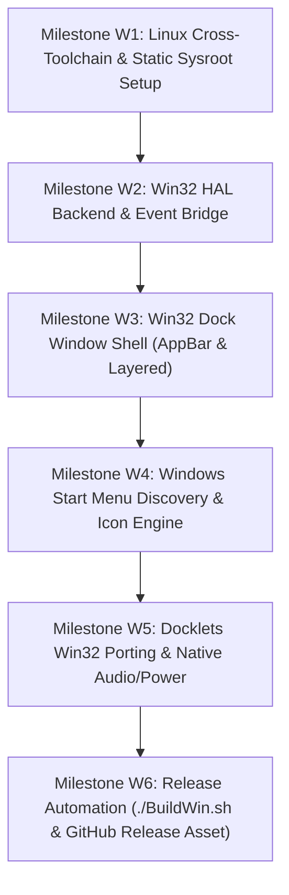

# 🪟 WINPLANK: MONOLITHIC ZERO-DLL PORT BATTLE PLAN
> **Architectural Specification & Linux Cross-Compilation Blueprint for Native Windows (10/11)**  
> **Pedigree:** Plank (X11) ➔ WayPlank (Wayland) ➔ WinPlank (Windows)  
> **Mandate:** Compiled 100% on Linux — Zero Compilers or Runtimes Needed on Windows  
> **Target Asset:** Single Monolithic Standalone Executable (`build/winplank.exe`) with **ZERO External DLLs**  
> **Author:** Sergio Melas (<sergiomelas@gmail.com>)  
> **Status:** Multi-Platform Expansion Horizon (v0.8.x) Architectural Blueprint — STRICTLY INACTIVE (Pending v0.7.0 Public Beta)  

---

> [!CAUTION]
> # 🛑 MULTI-PLATFORM EXPANSION HORIZON (v0.8.x) — NO TIME FOR THIS NOW!
> ## THIS INITIATIVE IS STRICTLY SCHEDULED FOR THE v0.8.x MULTI-PLATFORM MILESTONE (PRIOR TO THE v0.9.x FINAL STABILIZATION CYCLE).
> ## THERE IS CURRENTLY ZERO TIME FOR THIS: ACTIVE COMMITMENT IS 100% COMMITTED TO THE WAYPLANK PUBLIC BETA (v0.7.0) ON LINUX WAYLAND.
> ### ZERO TOLERANCE POLICY: THERE IS NO WINDOWS VERSION TODAY. DO NOT ATTEMPT TO COMPILE, RUN, OR OPEN GITHUB ISSUES OR DISCUSSIONS ASKING FOR WINDOWS SUPPORT OR ETAS. ANY SUCH REQUESTS WILL BE IMMEDIATELY CLOSED WITHOUT DISCUSSION.

---

## 🎯 Executive Summary & Architectural Objective

WayPlank was engineered from day one around a strict **Hardware Abstraction Layer (HAL)**:
* **Core & Presentation Layer (90% of codebase):** Cairo rendering engine, icon layout, item models, docklets, animations, drag-and-drop, theme manager, and folder menus are **100% agnostic** of the underlying windowing system.
* **Compositor / Windowing HAL (10% of codebase):** All window tracking, desktop coordination, thumbnail capture, and window management reside strictly inside [`lib/Services/`](../lib/Services/) behind the polymorphic `WindowBackend` and `WindowControl` interfaces.

### The Objective — WinPlank:
Create **WinPlank**: a lightweight, ultra-smooth, GPU-accelerated dock running natively on **Windows 10 and Windows 11**, compiled into a single, fully self-contained monolithic executable (`winplank.exe`):
1. **Compile Exclusively on Linux (`./BuildWin.sh`):** No compiler, build toolchain, or POSIX layer (Cygwin/MSYS2) is ever installed or run on the target Windows machine. Everything is cross-compiled directly on Linux using the standard MinGW-w64 cross-toolchain (`x86_64-w64-mingw32-gcc`), producing `build/winplank.exe`.
2. **Official Repository Asset:** `build/winplank.exe` is generated alongside `wayplank` (Linux native), `.deb` (Debian/Ubuntu), and `.rpm` (Fedora/openSUSE), distributed directly via GitHub Releases.
3. **Zero External DLL Dependencies:** Runs immediately on any stock, unconfigured Windows 10 or Windows 11 machine upon double-click. No GTK runtimes, no Visual C++ redistributables, no bundled DLL folder.
4. **Native Win32 HAL Integration:** Replaces Wayland compositors (KWin/Mutter/Labwc) with an event-driven Win32 backend (`Win32Backend` + `win32-bridge.c`).
5. **Hardware-Accelerated Cairo Rendering:** Preserves the crisp Plank/WayPlank visual aesthetics, real-time zoom, running dots, and live thumbnail preview cards.

---

## 🏗️ 1. Linux Cross-Compilation Pipeline & Zero-DLL Strategy

### 1.1 The Cross-Compilation Pipeline (`./BuildWin.sh`)
On the Linux development machine (Ubuntu/Debian), WayPlank's build suite is extended with `./BuildWin.sh`. The entire compilation happens on Linux:



### 1.2 Binary Architecture of `winplank.exe`
All userland libraries are baked permanently into the `.text` segment of the executable. Only the evergreen Windows kernel APIs are dynamically linked:



> [!NOTE]
> Linking against stock Windows DLLs (`user32.dll`, `gdi32.dll`, `shell32.dll`, `dwmapi.dll`) is completely standard for native Windows software. These DLLs are integral components of the Windows operating system kernel/subsystems and are guaranteed to exist on 100% of Windows installations. **Zero third-party DLLs are distributed alongside the executable.**

---

## 🏛️ 2. The Windows HAL Architecture (`Win32Backend`)

In WinPlank, all window tracking and compositor controls are abstracted. On Windows, we implement `Win32Backend.vala` backed by a high-performance C bridge (`win32-bridge.c`).



### 2.1 Real-Time Window Event Tracking (Zero Polling)
Instead of inefficient polling loops, `win32-bridge.c` installs a native Win32 Event Hook via `SetWinEventHook`:

```c
HWINEVENTHOOK hook = SetWinEventHook(
    EVENT_SYSTEM_FOREGROUND,      // Range start
    EVENT_OBJECT_NAMECHANGE,      // Range end
    NULL,
    WinEventProcCallback,
    0, 0,
    WINEVENT_OUTOFCONTEXT | WINEVENT_SKIPOWNPROCESS
);
```

The hook intercepts:
* `EVENT_SYSTEM_FOREGROUND`: Instantly updates active window focus on the dock.
* `EVENT_OBJECT_CREATE` / `EVENT_OBJECT_DESTROY`: Adds or removes running dock items.
* `EVENT_SYSTEM_MINIMIZESTART` / `EVENT_SYSTEM_MINIMIZEEND`: Updates minimized state.
* `EVENT_OBJECT_NAMECHANGE`: Updates window titles and tooltips with zero lag.

These Win32 events are dispatched directly into the GLib `GMainContext` main loop using `g_idle_add`, maintaining 100% thread safety with GTK.

### 2.2 Window Identification & Application Matching
On Windows, every top-level application window has:
1. **Window Handle (`HWND`)**: Unique identifier.
2. **Process ID (`PID`)**: Resolved via `GetWindowThreadProcessId(hwnd, &pid)`.
3. **Executable Path**: Resolved via `QueryFullProcessImageNameW(hProcess, 0, path, &size)`.
4. **AppUserModelID (AUMID)**: Crucial for **UWP and Windows Store Apps** (e.g. WhatsApp, Spotify, Settings, Calculator). Retrieved via COM `IPropertyStore` (`PKEY_AppUserModel_ID`).
5. **Window Class & Title**: Resolved via `GetClassNameW` and `GetWindowTextW`.

This data feeds directly into WayPlank's [`ApplicationIdentity.vala`](../lib/Services/ApplicationIdentity.vala) matching engine, which already supports exact primary token scoring!

### 2.3 Window Control Actions
* **Activate / Focus:** 
  Windows restricts background focus-stealing. WinPlank bypasses this cleanly using the standard Win32 foreground lock bypass:
  ```c
  DWORD currentThread = GetCurrentThreadId();
  DWORD targetThread = GetWindowThreadProcessId(hwnd, NULL);
  AttachThreadInput(currentThread, targetThread, TRUE);
  SetForegroundWindow(hwnd);
  BringWindowToTop(hwnd);
  AttachThreadInput(currentThread, targetThread, FALSE);
  ```
* **Toggle Minimize / Restore:**
  ```c
  if (IsIconic(hwnd))
      ShowWindowAsync(hwnd, SW_RESTORE);
  else
      ShowWindowAsync(hwnd, SW_MINIMIZE);
  ```
* **Close Window:**
  `PostMessage(hwnd, WM_CLOSE, 0, 0);`

---

## 🪟 3. Desktop Dock Shell & Window Integration on Windows

On Linux Wayland, WayPlank uses `gtk-layer-shell`. On Windows, WinPlank integrates natively with the desktop window manager using two complementary approaches:



### 3.1 Approach A: The Windows Application Desktop Toolbar (AppBar)
Windows provides a dedicated subsystem for screen-edge panels: the **AppBar API** (`SHAppBarMessage`).

```c
APPBARDATA abd = { sizeof(APPBARDATA) };
abd.hWnd = dock_hwnd;
abd.uCallbackMessage = WM_APPBAR_NOTIFY;
abd.uEdge = ABE_BOTTOM; // or ABE_TOP, ABE_LEFT, ABE_RIGHT

// Register as an official AppBar
SHAppBarMessage(ABM_NEW, &abd);

// Reserve desktop space (Panel Mode / Exclusive Zone)
SHAppBarMessage(ABM_QUERYPOS, &abd);
abd.rc = target_rect;
SHAppBarMessage(ABM_SETPOS, &abd);
```

#### Key Advantages of AppBar:
* **True Panel Mode (Exclusive Zone):** Maximized Windows (File Explorer, Chrome, Word) automatically tile *above* the dock without overlapping it, exactly like the Windows Taskbar!
* **Native Auto-Hide:** Supports `ABM_SETAUTOHIDEBAR` for system-managed sliding.
* **Fullscreen Game Detection:** The OS automatically sends `ABN_FULLSCREENAPP` notifications when games (e.g. DirectX/Vulkan) or full-screen apps take over the monitor, allowing WinPlank to hide gracefully.

### 3.2 Approach B: Per-Pixel Alpha Layered Window (`WS_EX_LAYERED`)
For a floating, modern transparent dock (with blurred or rounded Cairo backgrounds):
* The GTK window is styled with `WS_EX_LAYERED | WS_EX_TOOLWINDOW | WS_EX_TOPMOST`.
* `WS_EX_TOOLWINDOW` ensures the dock **never shows up as a button on the Windows Taskbar** and never appears in Alt+Tab.
* Click-through pass-through on transparent padding: Handled via `WM_NCHITTEST` returning `HTTRANSPARENT` for areas where the Cairo alpha channel is 0, allowing clicks on the wallpaper behind the dock to pass directly to the desktop!

---

## 🖼️ 4. Universal Live Window Previews on Windows

On Linux, WayPlank features Cairo live thumbnail preview cards (via KWin ScreenShot2 and Mutter extension IPC). On Windows, WinPlank implements **two ultra-fast rendering pipelines**:



### Pipeline 1: Native DWM Thumbnail (Zero CPU overhead)
Windows DWM provides `DwmRegisterThumbnail` and `DwmUpdateThumbnailProperties`:
* Renders a live, real-time video preview of any window directly into a destination rectangle.
* Executed 100% on the GPU with 0% CPU consumption.

### Pipeline 2: PrintWindow Capture to Cairo Surface
For custom card styling, rounded borders, shadows, and smooth scaling:
```c
HDC hdcMem = CreateCompatibleDC(hdcScreen);
HBITMAP hbm = CreateCompatibleBitmap(hdcScreen, width, height);
SelectObject(hdcMem, hbm);

// Render complete window including hardware-accelerated content
PrintWindow(hwndTarget, hdcMem, PW_RENDERFULLCONTENT);

// Wrap directly into a Cairo surface without copying
cairo_surface_t *cairo_surface = cairo_win32_surface_create(hdcMem);
```
The resulting Cairo surface is seamlessly passed to [`WindowCardsWindow.vala`](../lib/Widgets/WindowCardsWindow.vala) to render the preview card!

---

## 🔍 5. Windows Shortcut & Application Discovery

On Linux, applications are defined by `.desktop` files. On Windows, WinPlank implements **Windows Application Discovery**:



### 5.1 Scanning Start Menu Shortcuts (`.lnk`)
WinPlank scans the standard Windows shortcut directories:
1. **System-wide:** `C:\ProgramData\Microsoft\Windows\Start Menu\Programs\`
2. **User-specific:** `C:\Users\<User>\AppData\Roaming\Microsoft\Windows\Start Menu\Programs\`

Using native COM interfaces (`IShellLinkW` and `IPersistFile`):
```c
IShellLinkW* psl;
CoCreateInstance(&CLSID_ShellLink, NULL, CLSCTX_INPROC_SERVER, &IID_IShellLinkW, (void**)&psl);
IPersistFile* ppf;
psl->QueryInterface(&IID_IPersistFile, (void**)&ppf);

ppf->Load(lnk_path, STGM_READ);
psl->GetPath(target_path, MAX_PATH, &wfd, SLGP_UNCPRIORITY);
psl->GetArguments(args, MAX_PATH);
psl->GetIconLocation(icon_path, MAX_PATH, &icon_index);
```

### 5.2 Extracting Jumbo High-Resolution Vector/Bitmap Icons
Windows executables and DLLs contain embedded icons up to **256×256 pixels** (PNG-compressed Vista+ format).
* We extract the highest resolution icon using `SHGetImageList(SHIL_JUMBO, ...)` or `PrivateExtractIconsW`.
* The extracted icon is converted directly in memory into a `GdkPixbuf`, ensuring icons in the dock are pin-sharp on 4K HiDPI displays.

---

## 🧩 6. Monolithic Docklets Portability Matrix

WinPlank inherits all 14 built-in docklets. Here is how each docklet maps to native Win32 APIs:

| Docklet | Linux (WayPlank) | Windows 10/11 (WinPlank) |
|---|---|---|
| **Trash** (`docklet://trash`) | GIO `trash://` + KDE/GNOME D-Bus | `SHQueryRecycleBinW` (item count & size) + `SHEmptyRecycleBinW` |
| **Analog & Digital Clocks** | GLib `DateTime` + Cairo vectors | 100% Portable (GLib / Cairo identical) |
| **Battery Monitor** | UPower D-Bus / sysfs | `GetSystemPowerStatus` (`ACLineStatus`, `BatteryLifePercent`) |
| **System Pressure (CPU/RAM)**| `/proc/stat` & `/proc/meminfo` | `GetSystemTimes` (CPU idle/kernel/user) + `GlobalMemoryStatusEx` (RAM) |
| **Volume Control** | ALSA / PulseAudio / WirePlumber | Windows Core Audio API (`IAudioEndpointVolume` via COM) |
| **Brightness Control** | DDC/CI & `brightnessctl` | High-level Monitor Configuration API (`SetMonitorBrightness` in `dxva2.dll`) |
| **Do Not Disturb (DND)** | `org.freedesktop.Notifications` | Windows Focus Assist / Quiet Hours Registry or `WpnNotifications` API |
| **Screenshot Tool** | `grim` / KWin ScreenShot2 | Win32 GDI `BitBlt` capture or Windows Snipping Tool invocation |
| **Show Desktop** | HAL `toggle_show_desktop()` | Shell COM `IShellDispatch4::ToggleDesktop()` |
| **Session & Power** | systemd logind D-Bus | `ExitWindowsEx`, `LockWorkStation`, `SetSuspendState` |
| **Media Player (MPRIS)** | MPRIS2 D-Bus (`org.mpris.MediaPlayer2`) | Windows `GlobalSystemMediaTransportControlsSessionManager` (WinRT) |
| **Removable Drive Ejector** | UDisks2 D-Bus | `DeviceIoControl` with `IOCTL_STORAGE_EJECT_MEDIA` |
| **Weather Forecast** | Open-Meteo REST API (libsoup) | 100% Portable (GLib / libsoup static or WinHTTP) |
| **Preferences** | GtkDialog + GSettings | 100% Portable (GTK3 Cairo monolithic) |

---

## 🛠️ 7. Linux Cross-Build Pipeline Architecture (Planned `./BuildWin.sh`)

> [!CAUTION]
> **ARCHITECTURAL BLUEPRINT ONLY — NOT ACTIVE**  
> This build pipeline is currently a design specification for future development. No `./BuildWin.sh` script or Win32 backend drivers are committed to the active tree. **Do not attempt to execute or cross-compile for Windows at this stage.**

### Planned Cross-Build Execution Stages:
1. **Vala Transpilation:** Host `valac -C` transpiles generic Vala sources into intermediate ANSI C files in `build/win_c/`.
2. **GResource Compilation:** Host `glib-compile-resources` generates `plank-resources.c` with all SVG icons, schemas, and UI definitions embedded into `.rodata`.
3. **Cross-Compilation:** Linux `x86_64-w64-mingw32-gcc` compiles C sources, intermediate resources, and `win32-bridge.c` against the static MinGW sysroot.
4. **Monolithic Static Linking:** Links userland static archives (`libgtk-3.a`, `libcairo.a`, `libglib-2.0.a`, etc.) with `-static -static-libgcc -static-libstdc++`, linking dynamically only against built-in Windows kernel libraries (`kernel32`, `user32`, `gdi32`, `shell32`, `dwmapi`).
5. **Symbol Stripping & Optimization:** Linux `x86_64-w64-mingw32-strip` strips all debug symbols, yielding the standalone `build/winplank.exe`.

---

## 🗺️ 8. Step-by-Step Implementation Roadmap



### Milestone W1: Linux Cross-Toolchain & Static Sysroot Setup
- [ ] Configure `x86_64-w64-mingw32-gcc` cross-compilation pipeline on Linux.
- [ ] Assemble static MinGW sysroot: static `libgtk-3.a`, `libcairo.a`, `libpixman-1.a`, `libglib-2.0.a`.
- [ ] Embed built-in static GdkPixbuf loaders (PNG, SVG).
- [ ] Verify clean compilation of a minimal static GTK3 window on Linux into an `.exe`.

### Milestone W2: Win32 HAL Backend & Event Bridge
- [ ] Create `lib/Services/Win32Backend.vala` implementing `WindowBackend` and `WindowControl`.
- [ ] Implement `win32-bridge.c` with `SetWinEventHook` for real-time window tracking.
- [ ] Implement window focus, minimize, restore, and close actions.
- [ ] Implement `PrintWindow` and `DwmRegisterThumbnail` Cairo card previews.

### Milestone W3: Win32 Dock Window Shell
- [ ] Integrate Win32 `HWND` initialization into `DockWindow.vala`.
- [ ] Implement AppBar registration (`SHAppBarMessage`) for screen-edge reservation.
- [ ] Implement per-pixel alpha transparency and `HTTRANSPARENT` input pass-through.
- [ ] Support multi-monitor positioning via `EnumDisplayMonitors` and `GetMonitorInfoW`.

### Milestone W4: Windows Start Menu Discovery & Icon Engine
- [ ] Implement `.lnk` shortcut parsing via COM `IShellLinkW`.
- [ ] Implement UWP/Store App detection via AUMID (`PKEY_AppUserModel_ID`).
- [ ] Implement Jumbo (256×256) icon extraction directly to `GdkPixbuf`.
- [ ] Wire discovery into `ApplicationDiscovery.vala` and `ApplicationIdentity.vala`.

### Milestone W5: Docklets Win32 Porting
- [ ] Port Trash docklet to `SHQueryRecycleBinW` / `SHEmptyRecycleBinW`.
- [ ] Port Battery docklet to `GetSystemPowerStatus`.
- [ ] Port CPU/RAM docklet to `GetSystemTimes` and `GlobalMemoryStatusEx`.
- [ ] Port Volume docklet to Windows Core Audio (`IAudioEndpointVolume`).
- [ ] Port Brightness docklet to High-Level Monitor API (`dxva2.dll`).

### Milestone W6: Release Automation (`./BuildWin.sh`)
- [ ] Finalize `./BuildWin.sh` for single-command automated generation of `build/winplank.exe` on Linux.
- [ ] Verify that `objdump -p build/winplank.exe` on Linux lists **zero third-party DLLs** (only Windows OS DLLs).
- [ ] Package `winplank.exe` as a release asset in the repository and GitHub Releases.

---

## 🏆 Conclusion & Expected Outcome

By treating Windows as simply another HAL backend and building entirely from Linux:
* **The Windows user experience is zero-friction:** No installers, no runtimes, no dependencies. Just download `winplank.exe` and launch it.
* **The Linux developer experience is unified:** You compile for Debian (`./BuildDeb.sh`), openSUSE/Fedora (`./BuildRpm.sh`), and Windows (`./BuildWin.sh`) **from the very same terminal on your Linux machine**.

