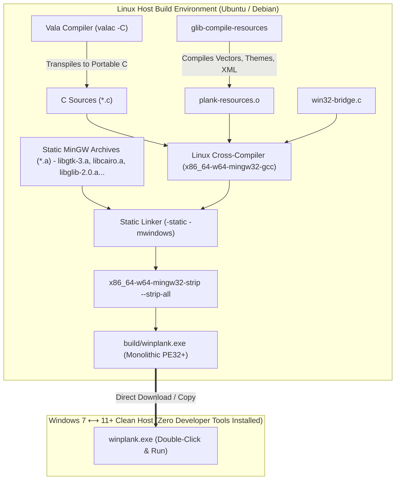
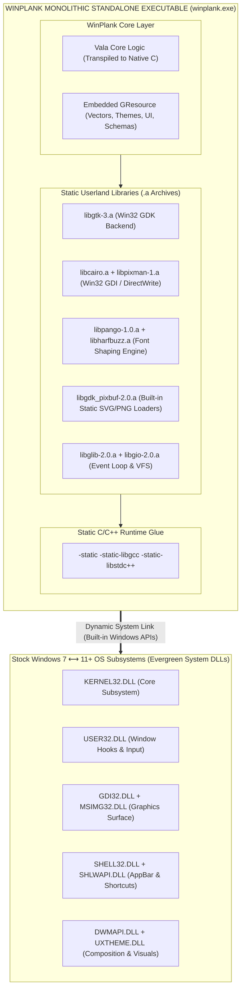
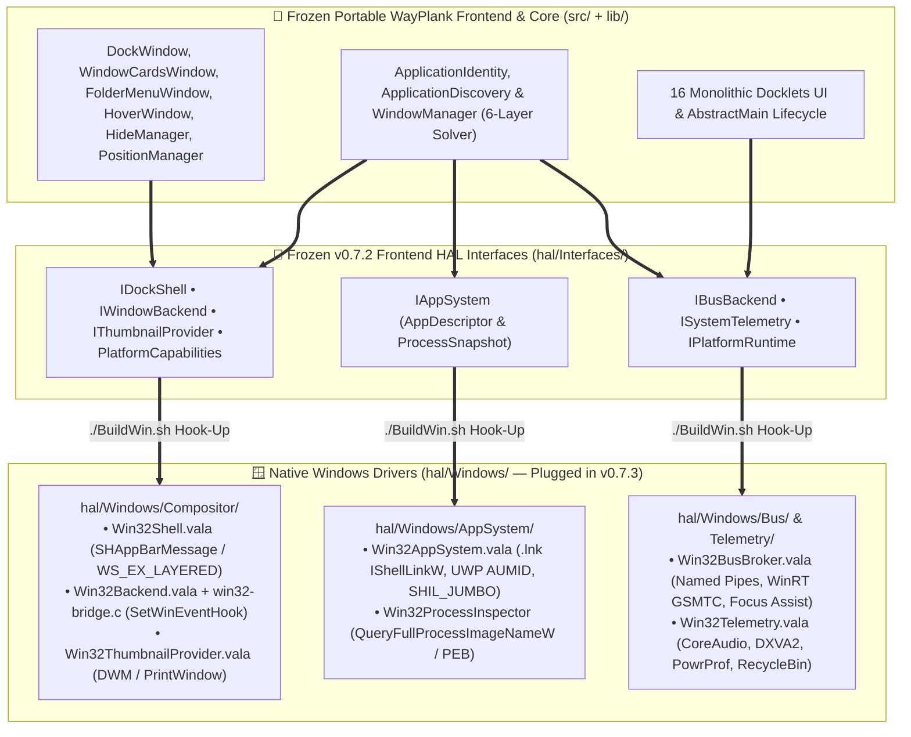
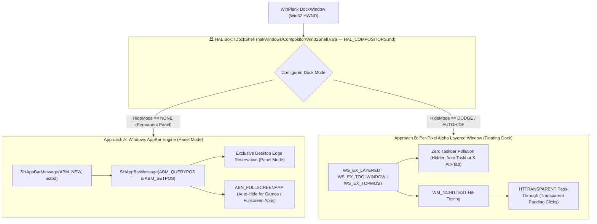
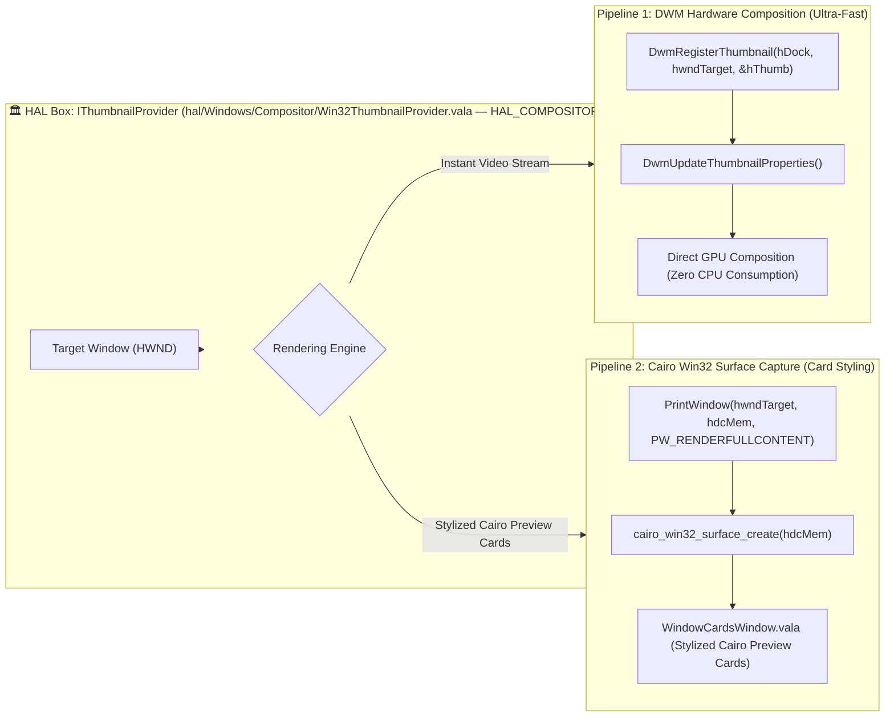
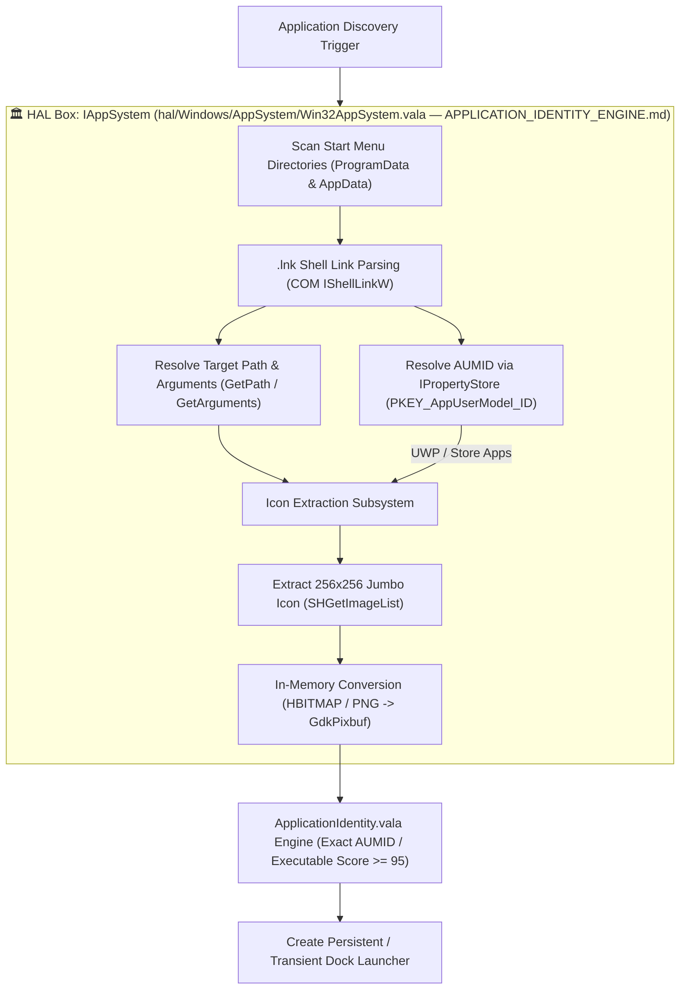
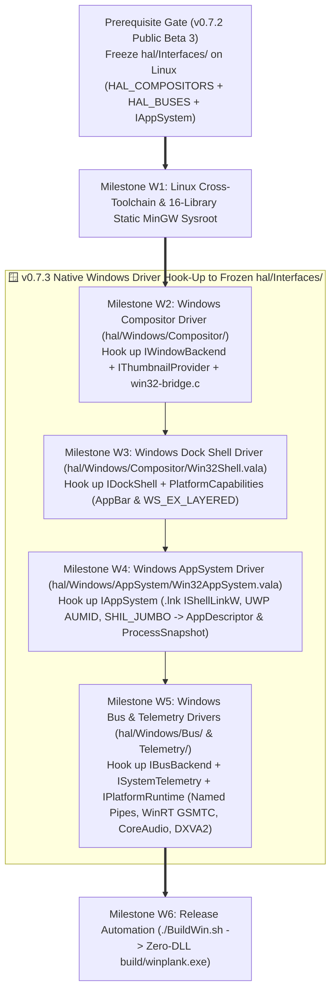

# 🪟 WINPLANK: MONOLITHIC ZERO-DLL PORT BATTLE PLAN
> **Architectural Specification & Linux Cross-Compilation Blueprint for Native Windows (`Win 7 ⟷ 11+ & Future Windows`)**  
> **Pedigree:** Plank (X11) ➔ WayPlank (Wayland) ➔ WinPlank (Windows `7 ⟷ 11+`)  
> **Mandate:** Compiled 100% on Linux — Zero Compilers or Runtimes Needed on Windows  
> **Target Asset:** Single Monolithic Standalone Executable (`build/winplank.exe`) with **ZERO External DLLs**  
> **Author:** Sergio Melas (<sergiomelas@gmail.com>) © 2026  
> **Companion Master Specifications:** [README.md](../README.md) • [CONTRIBUTING.md](../CONTRIBUTING.md) • [HAL_COMPOSITORS.md](HAL_COMPOSITORS.md) *(Compositor & Shell HAL)* • [HAL_BUSES.md](HAL_BUSES.md) *(IPC & System Bus HAL)* • [APPLICATION_IDENTITY_ENGINE.md](APPLICATION_IDENTITY_ENGINE.md) *(`IAppSystem` Data Abstraction & 6-Layer Identity Engine)* • [USER_GUIDE.md](USER_GUIDE.md)  
> **Status:** Staged Two-Beta Execution Plan — **`v0.7.2` (Public Beta 3): Linux-Side HAL Implementation & Structural Freeze** $\longrightarrow$ **`v0.7.3` (Public Beta 4): Native `hal/Windows/` Driver Plug-In & `winplank.exe`** (Active Public Linux Baseline: `v0.7.1` Public Beta 2)  

---

> [!CAUTION]
> # 🛑 PUBLIC REPOSITORY NOTICE — TWO-STAGE BETA GATE (`v0.7.2` LINUX FREEZE ➔ `v0.7.3` WINDOWS PLUG-IN)
> ## IN `v0.7.2` (PUBLIC BETA 3), WAYPLANK IMPLEMENTS AND FREEZES THE `hal/Interfaces/` FRONTEND CONTRACTS ON LINUX ONLY ([HAL_COMPOSITORS.md](HAL_COMPOSITORS.md) & [HAL_BUSES.md](HAL_BUSES.md)). PUBLIC `winplank.exe` INTEGRATION IS SCHEDULED FOR `v0.7.3` (PUBLIC BETA 4), PLUGGING `hal/Windows/` DIRECTLY INTO THE FROZEN `v0.7.2` HAL INTERFACES.
> ### ISSUE TRACKER POLICY: UNTIL `./BuildWin.sh` AND `winplank.exe` ARE PUBLISHED AS OFFICIAL `v0.7.3+` GITHUB RELEASE ASSETS, DO NOT OPEN GITHUB ISSUES OR DISCUSSIONS ASKING FOR WINDOWS SUPPORT OR ETAS. ANY PREMATURE REQUESTS WILL BE CLOSED WITHOUT DISCUSSION.

---

## 🎯 Executive Summary & Architectural Objective

WayPlank was engineered from day one around a strict **Hardware, Compositor & Bus Abstraction Layer (HAL)** specified across three companion documents ([HAL_COMPOSITORS.md](HAL_COMPOSITORS.md), [HAL_BUSES.md](HAL_BUSES.md), and [APPLICATION_IDENTITY_ENGINE.md](APPLICATION_IDENTITY_ENGINE.md)):
* **Core & Presentation Layer (90% of codebase — `src/` + `lib/`):** Cairo rendering engine, icon layout, item models, docklets UI, animations, drag-and-drop, theme manager, and folder menus are **100% agnostic** of the underlying operating system, compositor, and IPC bus.
* **Physically Isolated OS, Compositor & Bus HAL (10% of codebase — `hal/`):** All window tracking, surface anchoring, thumbnail capture, IPC bus events, launcher discovery, and hardware telemetry reside strictly behind the polymorphic contracts in **`hal/Interfaces/`** (frozen on Linux in `v0.7.2`), with native Windows drivers isolated inside **`hal/Windows/{Compositor,Bus,AppSystem,Telemetry}/`** (plugged in `v0.7.3`).

### The Objective — WinPlank (`Windows 7 ⟷ 11+ & Future Windows`):
Create **WinPlank**: a lightweight, ultra-smooth, Cairo-rendered dock running natively across **Windows 7, Windows 8, Windows 8.1, Windows 10, Windows 11, and future Windows 12+ releases**, compiled into a single, fully self-contained monolithic executable (`winplank.exe`):
1. **Compile Exclusively on Linux (`./BuildWin.sh`):** No compiler, build toolchain, or POSIX layer (Cygwin/MSYS2) is ever installed or run on the target Windows machine. Everything is cross-compiled directly on Linux using the standard MinGW-w64 cross-toolchain (`x86_64-w64-mingw32-gcc`), producing `build/winplank.exe`.
2. **Official Repository Asset:** `build/winplank.exe` is generated alongside `wayplank` (Linux native), `.deb` (Debian/Ubuntu), and `.rpm` (Fedora/openSUSE), distributed directly via GitHub Releases.
3. **Zero External DLL Dependencies (`Win 7 ⟷ 11+` Universal Binary):** Runs immediately on any stock, unconfigured **Windows 7, 8, 8.1, 10, 11, or 12+** machine upon double-click. No GTK runtimes, no Visual C++ redistributables, no bundled DLL folder.
4. **Pure Baseline Win32 HAL + Dynamic `GetProcAddress`:** Replaces Wayland compositors (KWin/Mutter/Labwc) with an event-driven baseline Win32 backend (`Win32Backend` + `win32-bridge.c` using `user32.dll`, `gdi32.dll`, `kernel32.dll`, `shell32.dll` + dynamic `GetProcAddress` for `dwmapi.dll`/HiDPI enhancements) that never breaks across Windows generations. *(Note: only Windows XP `NT 5.1` fails at OS load time without recompiling libraries because modern 64-bit `libglib-2.0` statically imports `NT 6.1+` `AcquireSRWLockExclusive` / `GetTickCount64` from `KERNEL32.dll`).*
5. **100% Internal Cairo Rendering & Animations:** All 26 icon animations, parabolic zoom, badges, tooltips, folder drawers, and preview cards are rendered by WayPlank's internal **Cairo** engine onto a 32-bit per-pixel ARGB layered surface (`WS_EX_LAYERED`), guaranteeing pixel-identical visuals across every Windows version.

---

## 🏗️ 1. Linux Cross-Compilation Pipeline & Zero-DLL Strategy

### 1.1 The Cross-Compilation Pipeline (`./BuildWin.sh`)
On the Linux development machine (Ubuntu/Debian), WayPlank's build suite is extended with `./BuildWin.sh`. The entire compilation happens on Linux:



### 1.2 Binary Architecture of `winplank.exe`
All userland libraries are baked permanently into the `.text` segment of the executable. Only the evergreen Windows kernel APIs are dynamically linked:



> [!NOTE]
> Linking against stock Windows DLLs (`user32.dll`, `gdi32.dll`, `shell32.dll`, `dwmapi.dll`) is completely standard for native Windows software. These DLLs are integral components of the Windows operating system kernel/subsystems and are guaranteed to exist on 100% of Windows installations. **Zero third-party DLLs are distributed alongside the executable.**

---

## 🏛️ 2. Hooking Up `hal/Windows/` to the Frozen `v0.7.2` Frontend HAL State

Rather than modifying portable Core or UI classes, WinPlank (`v0.7.3`) hooks its four driver sub-packages (`hal/Windows/{Compositor,Bus,AppSystem,Telemetry}/`) directly into the **7 pure Vala frontend interfaces frozen on Linux in `v0.7.2`** ([HAL_COMPOSITORS.md](HAL_COMPOSITORS.md), [HAL_BUSES.md](HAL_BUSES.md), [APPLICATION_IDENTITY_ENGINE.md](APPLICATION_IDENTITY_ENGINE.md)):



### 2.0 Frontend HAL State Hook-Up & Windows OS Limitation Guards

Every Windows driver translates Win32/UWP/WinRT semantics into the **exact cross-level compatible message structs** expected by the frontend (`WindowInfo`, `AppDescriptor`, `ProcessSnapshot`, `PlatformCapabilities`):

| Frozen Frontend State / Consumer (`lib/`) | `hal/Interfaces/` Contract (`v0.7.2`) | Windows Driver File (`hal/Windows/`) | Win32 / UWP Limitation & Cross-Level Message Compatibility Guard |
| :--- | :--- | :--- | :--- |
| **`DockWindow`, `HideManager`, `PositionManager`** | `IDockShell` & `PlatformCapabilities` | `Compositor/Win32Shell.vala` | Windows lacks `wlr-layer-shell`. Maps `ReserveSpace=true` to `SHAppBarMessage(ABM_SETPOS)` (guarded by 3-way idempotence check) and floating mode to `WS_EX_LAYERED \| WS_EX_TOOLWINDOW` with `WM_NCHITTEST -> HTTRANSPARENT` outside `Cairo.Region`. |
| **`WindowManager` (Active / Minimized / Geometry)** | `IWindowBackend` (`WindowInfo`) | `Compositor/Win32Backend.vala` + `win32-bridge.c` | `HWND` is 64-bit; formatted as opaque string `Id = "hwnd:0x%016llx"`. Out-of-context `SetWinEventHook` callbacks are marshaled into the GTK thread via `g_idle_add`. Filters out cloaked UWP background windows (`DWMWA_CLOAKED != 0`). |
| **`WindowCardsWindow` (Live Previews)** | `IThumbnailProvider` | `Compositor/Win32ThumbnailProvider.vala` | GDI `PrintWindow(PW_RENDERFULLCONTENT)` leaves `alpha = 0` on standard Win32 GDI controls; driver enforces `buffer[i + 3] = 255` (matching KWin `ScreenShot2` Pitfall #3) before returning `Gdk.Pixbuf`. |
| **`ApplicationIdentity` & `ApplicationDiscovery`** | `IAppSystem` (`AppDescriptor` & `ProcessSnapshot`) | `AppSystem/Win32AppSystem.vala` | **1) UWP Host Limitation:** UWP apps run inside `ApplicationFrameHost.exe`; driver enumerates child `Windows.UI.Core.CoreWindow` to extract the real child `PID` and queries `SHGetPropertyStoreForWindow(PKEY_AppUserModel_ID)` into `ApplicationId`.<br>**2) Elevated Admin Process Limitation:** `OpenProcess(PROCESS_VM_READ)` fails with `ERROR_ACCESS_DENIED` on elevated processes; driver opens with `PROCESS_QUERY_LIMITED_INFORMATION` (`QueryFullProcessImageNameW` always succeeds!) and sets `full_cmdline = ""` gracefully. |
| **`ApplicationIdentity` (Chrome Multi-Profile)** | `IAppMenuBus` (`IBusBackend`) | `Bus/Win32AppMenuBus.vala` | Windows has no `com.canonical.dbusmenu`. Inspects `UIAutomation` / Chrome `HWND` profile property and `%LOCALAPPDATA%\Google\Chrome\User Data\Local State` (`info_cache`), emitting the same `Chrome:<ProfileName>` lock. |
| **16 Monolithic Docklets & `SystemTheme`** | `IBusBackend` & `ISystemTelemetry` | `Bus/Win32BusBroker.vala` & `Telemetry/Win32Telemetry.vala` | Marshals WinRT `GlobalSystemMediaTransportControls`, `IAudioEndpointVolumeCallback`, `WM_POWERBROADCAST`, and `WM_SETTINGCHANGE` (`AppsUseLightTheme`) onto the GLib main loop with zero polling. |

### 2.1 Real-Time Window Event Tracking (Zero Polling)
Instead of inefficient polling loops, `win32-bridge.c` installs a native Win32 Event Hook via `SetWinEventHook`:

```c
HWINEVENTHOOK hook = SetWinEventHook(
    EVENT_SYSTEM_FOREGROUND,      // Range start
    EVENT_OBJECT_NAMECHANGE,      // Range end
    NULL,
    WinEventProcCallback,
    0, 0,
    WINEVENT_OUTOFCONTEXT | WINEVENT_SKIPOWNPROCESS
);
```

The hook intercepts:
* `EVENT_SYSTEM_FOREGROUND`: Instantly updates active window focus on the dock.
* `EVENT_OBJECT_CREATE` / `EVENT_OBJECT_DESTROY`: Adds or removes running dock items.
* `EVENT_SYSTEM_MINIMIZESTART` / `EVENT_SYSTEM_MINIMIZEEND`: Updates minimized state.
* `EVENT_OBJECT_NAMECHANGE`: Updates window titles and tooltips with zero lag.

These Win32 events are dispatched directly into the GLib `GMainContext` main loop using `g_idle_add`, maintaining 100% thread safety with GTK.

### 2.2 Window Identification & Application Matching
On Windows, every top-level application window has:
1. **Window Handle (`HWND`)**: Unique identifier.
2. **Process ID (`PID`)**: Resolved via `GetWindowThreadProcessId(hwnd, &pid)`.
3. **Executable Path**: Resolved via `QueryFullProcessImageNameW(hProcess, 0, path, &size)`.
4. **AppUserModelID (AUMID)**: Crucial for **UWP and Windows Store Apps** (e.g. WhatsApp, Spotify, Settings, Calculator). Retrieved via COM `IPropertyStore` (`PKEY_AppUserModel_ID`).
5. **Window Class & Title**: Resolved via `GetClassNameW` and `GetWindowTextW`.

This data feeds directly into WayPlank's [`ApplicationIdentity.vala`](../lib/Services/ApplicationIdentity.vala) matching engine, which already supports exact primary token scoring!

### 2.3 Window Control Actions
* **Activate / Focus:** 
  Windows restricts background focus-stealing. WinPlank bypasses this cleanly using the standard Win32 foreground lock bypass:
  ```c
  DWORD currentThread = GetCurrentThreadId();
  DWORD targetThread = GetWindowThreadProcessId(hwnd, NULL);
  AttachThreadInput(currentThread, targetThread, TRUE);
  SetForegroundWindow(hwnd);
  BringWindowToTop(hwnd);
  AttachThreadInput(currentThread, targetThread, FALSE);
  ```
* **Toggle Minimize / Restore:**
  ```c
  if (IsIconic(hwnd))
      ShowWindowAsync(hwnd, SW_RESTORE);
  else
      ShowWindowAsync(hwnd, SW_MINIMIZE);
  ```
* **Close Window:**
  `PostMessage(hwnd, WM_CLOSE, 0, 0);`

---

## 🪟 3. Desktop Dock Shell & Window Integration on Windows

On Linux Wayland, WayPlank uses `gtk-layer-shell`. On Windows, WinPlank integrates natively with the desktop window manager using two complementary approaches:



### 3.1 Approach A: The Windows Application Desktop Toolbar (AppBar)
Windows provides a dedicated subsystem for screen-edge panels: the **AppBar API** (`SHAppBarMessage`).

```c
APPBARDATA abd = { sizeof(APPBARDATA) };
abd.hWnd = dock_hwnd;
abd.uCallbackMessage = WM_APPBAR_NOTIFY;
abd.uEdge = ABE_BOTTOM; // or ABE_TOP, ABE_LEFT, ABE_RIGHT

// Register as an official AppBar
SHAppBarMessage(ABM_NEW, &abd);

// Reserve desktop space (Panel Mode / Exclusive Zone)
SHAppBarMessage(ABM_QUERYPOS, &abd);
abd.rc = target_rect;
SHAppBarMessage(ABM_SETPOS, &abd);
```

#### Key Advantages of AppBar:
* **True Panel Mode (Exclusive Zone):** Maximized Windows (File Explorer, Chrome, Word) automatically tile *above* the dock without overlapping it, exactly like the Windows Taskbar!
* **Native Auto-Hide:** Supports `ABM_SETAUTOHIDEBAR` for system-managed sliding.
* **Fullscreen Game Detection:** The OS automatically sends `ABN_FULLSCREENAPP` notifications when games (e.g. DirectX/Vulkan) or full-screen apps take over the monitor, allowing WinPlank to hide gracefully.

### 3.2 Approach B: Per-Pixel Alpha Layered Window (`WS_EX_LAYERED`)
For a floating, modern transparent dock (with blurred or rounded Cairo backgrounds):
* The GTK window is styled with `WS_EX_LAYERED | WS_EX_TOOLWINDOW | WS_EX_TOPMOST`.
* `WS_EX_TOOLWINDOW` ensures the dock **never shows up as a button on the Windows Taskbar** and never appears in Alt+Tab.
* Click-through pass-through on transparent padding: Handled via `WM_NCHITTEST` returning `HTTRANSPARENT` for areas where the Cairo alpha channel is 0, allowing clicks on the wallpaper behind the dock to pass directly to the desktop!

---

## 🖼️ 4. Universal Live Window Previews on Windows

On Linux, WayPlank features Cairo live thumbnail preview cards (via KWin ScreenShot2 and Mutter extension IPC). On Windows, WinPlank implements **two ultra-fast rendering pipelines**:



### Pipeline 1: Native DWM Thumbnail (Zero CPU overhead)
Windows DWM provides `DwmRegisterThumbnail` and `DwmUpdateThumbnailProperties`:
* Renders a live, real-time video preview of any window directly into a destination rectangle.
* Executed 100% on the GPU with 0% CPU consumption.

### Pipeline 2: PrintWindow Capture to Cairo Surface
For custom card styling, rounded borders, shadows, and smooth scaling:
```c
HDC hdcMem = CreateCompatibleDC(hdcScreen);
HBITMAP hbm = CreateCompatibleBitmap(hdcScreen, width, height);
SelectObject(hdcMem, hbm);

// Render complete window including hardware-accelerated content
PrintWindow(hwndTarget, hdcMem, PW_RENDERFULLCONTENT);

// Wrap directly into a Cairo surface without copying
cairo_surface_t *cairo_surface = cairo_win32_surface_create(hdcMem);
```
The resulting Cairo surface is seamlessly passed to [`WindowCardsWindow.vala`](../lib/Widgets/WindowCardsWindow.vala) to render the preview card!

---

## 🔍 5. Windows Shortcut & Application Discovery

On Linux, applications are defined by `.desktop` files. On Windows, WinPlank implements **Windows Application Discovery**:



### 5.1 Scanning Start Menu Shortcuts (`.lnk`)
WinPlank scans the standard Windows shortcut directories:
1. **System-wide:** `C:\ProgramData\Microsoft\Windows\Start Menu\Programs\`
2. **User-specific:** `C:\Users\<User>\AppData\Roaming\Microsoft\Windows\Start Menu\Programs\`

Using native COM interfaces (`IShellLinkW` and `IPersistFile`):
```c
IShellLinkW* psl;
CoCreateInstance(&CLSID_ShellLink, NULL, CLSCTX_INPROC_SERVER, &IID_IShellLinkW, (void**)&psl);
IPersistFile* ppf;
psl->QueryInterface(&IID_IPersistFile, (void**)&ppf);

ppf->Load(lnk_path, STGM_READ);
psl->GetPath(target_path, MAX_PATH, &wfd, SLGP_UNCPRIORITY);
psl->GetArguments(args, MAX_PATH);
psl->GetIconLocation(icon_path, MAX_PATH, &icon_index);
```

### 5.2 Extracting Jumbo High-Resolution Vector/Bitmap Icons
Windows executables and DLLs contain embedded icons up to **256×256 pixels** (PNG-compressed Vista+ format).
* We extract the highest resolution icon using `SHGetImageList(SHIL_JUMBO, ...)` or `PrivateExtractIconsW`.
* The extracted icon is converted directly in memory into a `GdkPixbuf`, ensuring icons in the dock are pin-sharp on 4K HiDPI displays.

---

## 🧩 6. Monolithic Docklets Portability Matrix

WinPlank inherits all 16 built-in docklets. Here is how each docklet maps to native Win32 APIs:

| Docklet | Linux (WayPlank) | Windows `7 ⟷ 11+` (WinPlank) |
|---|---|---|
| **Trash** (`docklet://trash`) | GIO `trash://` + KDE/GNOME D-Bus | `SHQueryRecycleBinW` (item count & size) + `SHEmptyRecycleBinW` |
| **Analog & Digital Clocks (2)** (`docklet://clock`, `docklet://digital-clock`) | GLib `DateTime` + Cairo vectors | 100% Portable (GLib / Cairo identical) |
| **Battery Monitor** | UPower D-Bus / sysfs | `GetSystemPowerStatus` (`ACLineStatus`, `BatteryLifePercent`) |
| **System Pressure (CPU/RAM)**| `/proc/stat` & `/proc/meminfo` | `GetSystemTimes` (CPU idle/kernel/user) + `GlobalMemoryStatusEx` (RAM) |
| **Network Monitor** (`docklet://network`) | `/sys/class/net` & `/proc/net/wireless` | `GetAdaptersAddresses` / `NotifyIpInterfaceChange` (`iphlpapi.dll`) + Native Wifi API |
| **Volume Control** | ALSA / PulseAudio / WirePlumber | Windows Core Audio API (`IAudioEndpointVolume` via COM) |
| **Brightness Control** | DDC/CI & `brightnessctl` | High-level Monitor Configuration API (`SetMonitorBrightness` in `dxva2.dll`) |
| **Do Not Disturb (DND)** | `org.freedesktop.Notifications` | Windows Focus Assist / Quiet Hours Registry or `WpnNotifications` API |
| **Screenshot Tool** | `grim` / KWin ScreenShot2 | Win32 GDI `BitBlt` capture or Windows Snipping Tool invocation |
| **Show Desktop** | HAL `toggle_show_desktop()` | Shell COM `IShellDispatch4::ToggleDesktop()` |
| **Session & Power** | systemd logind D-Bus | `ExitWindowsEx`, `LockWorkStation`, `SetSuspendState` |
| **Media Player (MPRIS)** | MPRIS2 D-Bus (`org.mpris.MediaPlayer2`) | Windows `GlobalSystemMediaTransportControlsSessionManager` (WinRT) |
| **Removable Drive Ejector** | UDisks2 D-Bus | `DeviceIoControl` with `IOCTL_STORAGE_EJECT_MEDIA` |
| **Weather Forecast** | Open-Meteo REST API (libsoup) | 100% Portable (GLib / libsoup static or WinHTTP) |
| **Preferences** | GtkDialog + GSettings | 100% Portable (GTK3 Cairo monolithic) |

---

## 🛠️ 7. Linux Cross-Build Pipeline Architecture (Planned `./BuildWin.sh`)

> [!CAUTION]
> **PUBLIC `main` BRANCH STATUS (`v0.7.1` BASELINE)**  
> This cross-build pipeline plugs into the `v0.7.2` frozen `hal/Interfaces/` contracts defined in [HAL_COMPOSITORS.md](HAL_COMPOSITORS.md), [HAL_BUSES.md](HAL_BUSES.md), and [APPLICATION_IDENTITY_ENGINE.md](APPLICATION_IDENTITY_ENGINE.md) during **`v0.7.3` (Public Beta 4)**. `./BuildWin.sh` and `hal/Windows/` are not yet merged into the public `v0.7.1` `main` branch.

### 7.1 4-Tier Source-Code Static Cross-Compilation DAG (`./deps/win32/sysroot`)
To guarantee a 100% self-contained `winplank.exe` without relying on pre-compiled binary blobs or incompatible MSVC `.lib` objects, `./BuildWin.sh` cross-compiles all **16 upstream cross-platform C/Vala libraries** from source tarballs on the Linux host using `x86_64-w64-mingw32-gcc` in strict topological order:

1. **Tier 1 — Foundational Primitives (Autotools / CMake):**
   - `zlib` (`libz.a`), `libffi` (`libffi.a`), `libiconv` (`libiconv.a`), `gettext-runtime` (`libintl.a`), `pcre2` (`libpcre2-8.a` with `--enable-unicode`).
2. **Tier 2 — GLib Ecosystem & Vala Models (Meson Cross-File `--default-library=static`):**
   - `glib-2.0` (`libglib-2.0.a`, `libgobject-2.0.a`, `libgmodule-2.0.a`, `libgio-2.0.a` with built-in `giowin32` & `GRegistrySettingsBackend`, `libgthread-2.0.a`).
   - `libgee-0.8` (`libgee-0.8.a` for `--pkg gee-0.8` collections).
   - `json-glib-1.0` (`libjson-glib-1.0.a` for `--pkg json-glib-1.0` parsers).
3. **Tier 3 — 2D Vector Graphics, Shaping & Static Loaders:**
   - `libpng` (`libpng16.a`), `pixman` (`libpixman-1.a`), `freetype2` (`libfreetype.a`), `fribidi` (`libfribidi.a`), `harfbuzz` (`libharfbuzz.a`).
   - `cairo` (`libcairo.a`, `libcairo-gobject.a` with `-Dwin32=enabled -Dpng=enabled`).
   - `pango` (`libpango-1.0.a`, `libpangowin32-1.0.a`, `libpangocairo-1.0.a`).
   - `gdk-pixbuf-2.0` (`libgdk_pixbuf-2.0.a` with `-Dbuiltin_loaders=png,bmp,ico,jpeg -Dgio_sniffing=false` so zero external `loaders/*.dll` are ever queried).
   - **Static Pure-C SVG Rasterizer:** `librsvg-2.40.21` (pure C) or embedded `nanosvg`/`lunasvg` Cairo loader to rasterize all bundled SVG icons in `plank.gresource.xml` without requiring a Rust cross-toolchain.
4. **Tier 4 — Widget Toolkit:**
   - `libepoxy` (`libepoxy.a`), `atk` (`libatk-1.0.a`), `gtk+-3.0` (`libgtk-3.a`, `libgdk-3.a` with `-Dwin32_backend=true -Dx11_backend=false -Dwayland_backend=false --default-library=static`).

### 7.2 Planned Cross-Build Execution Stages:
1. **Vala Transpilation & `hal/Windows/` Compile-Time Selection:** Host `valac -C -d build/win_c` transpiles the portable `src/` + `lib/` + `hal/Interfaces/` + `hal/Windows/` Vala sources into portable ANSI C (with `IDockShell` in `hal/Windows/Win32Shell.vala` replacing `GtkLayerShell`, or a 20-line no-op `gtk_layer_shell_*` C stub if compiled prior to `Step H2` widget purification).
2. **GResource & Zero-DLL `GSettings` Bootstrap:** Host `glib-compile-schemas` compiles `gschemas.compiled`, which is embedded into `plank.gresource.xml` alongside all SVG icons and UI files. At startup on Windows, `main()` extracts `gschemas.compiled` to `%LOCALAPPDATA%\WinPlank\glib-2.0\schemas\` and sets `G_SETTINGS_SCHEMA_DIR` before initializing `DockPreferences`, preventing GLib schema abort on a virgin Windows PC.
3. **Cross-Compilation:** Linux `x86_64-w64-mingw32-gcc` compiles `build/win_c/*.c`, `hal/Windows/win32-bridge.c`, `hal/Windows/win32-compat.c`, `resources.c`, and `winplank-res.o` (HiDPI Per-Monitor V2 manifest + icon).
4. **Monolithic Static Linking (`-Wl,--start-group ... -Wl,--end-group`):** Encloses all 16 static `.a` userland archives inside a linker group to resolve circular GTK/GDK/Pango/Cairo/GLib references, linking dynamically solely against stock Windows OS DLLs (`-lkernel32 -luser32 -lgdi32 -lmsimg32 -lshell32 -lshlwapi -lcomctl32 -lcomdlg32 -lole32 -loleaut32 -luuid -ladvapi32 -ldwmapi -luxtheme -limm32 -lwinmm -lws2_32 -liphlpapi -ldnsapi -lsetupapi -lhid -lwtsapi32 -ldxva2 -lpowrprof`).
5. **Symbol Stripping & IAT Verification:** Linux `x86_64-w64-mingw32-strip --strip-all` strips debug tables, and `x86_64-w64-mingw32-objdump -p` verifies zero third-party DLL imports.

---

## 🗺️ 8. Step-by-Step Implementation Roadmap (`v0.7.2` Linux Freeze ➔ `v0.7.3` Windows Plug-In)



### Prerequisite Gate (`v0.7.2` Public Beta 3 — Linux-Only Structural Freeze):
- [ ] Complete and qualify the Linux-side extraction into `hal/{Interfaces,Freedesktop,Linux}/` ([HAL_COMPOSITORS.md](HAL_COMPOSITORS.md) & [HAL_BUSES.md](HAL_BUSES.md)) so all 7 frontend HAL interfaces are 100% frozen before Milestone W1 begins.

### Milestone W1: Linux Cross-Toolchain & Static Sysroot Setup
- [ ] Configure `x86_64-w64-mingw32-gcc` cross-compilation pipeline on Linux (`./deps/win32/sysroot`).
- [ ] Assemble 4-tier static MinGW sysroot (`libgtk-3.a`, `libcairo.a`, `libpixman-1.a`, `libglib-2.0.a`, `libgee-0.8.a`, `libjson-glib-1.0.a`).
- [ ] Embed built-in static `GdkPixbuf` loaders (PNG, BMP, ICO, JPEG, SVG) and `gschemas.compiled` bootstrap.
- [ ] Verify clean compilation of a minimal static GTK3 window on Linux into a zero-DLL `.exe`.

### Milestone W2: Windows Compositor Driver (`hal/Windows/Compositor/` $\longrightarrow$ `IWindowBackend` & `IThumbnailProvider`)
- [ ] Implement `hal/Windows/Compositor/Win32Backend.vala` and `win32-bridge.c` hooking into the frozen `IWindowBackend` interface ([HAL_COMPOSITORS.md](HAL_COMPOSITORS.md)).
- [ ] Install out-of-context `SetWinEventHook` (`EVENT_SYSTEM_FOREGROUND` .. `EVENT_OBJECT_NAMECHANGE`) dispatching normalized `WindowInfo` messages (`Id = "hwnd:0x..."`) via `g_idle_add` and filtering `DWMWA_CLOAKED` background windows.
- [ ] Implement `AttachThreadInput` + `SetForegroundWindow`, `ShowWindowAsync(SW_RESTORE/SW_MINIMIZE)`, `PostMessage(WM_CLOSE)`, and `IShellDispatch4::ToggleDesktop()`.
- [ ] Implement `hal/Windows/Compositor/Win32ThumbnailProvider.vala` (`DwmRegisterThumbnail` & `PrintWindow(PW_RENDERFULLCONTENT)` with `alpha = 255` normalization) hooking into `WindowCardsWindow`.

### Milestone W3: Windows Dock Shell Driver (`hal/Windows/Compositor/Win32Shell.vala` $\longrightarrow$ `IDockShell` & `PlatformCapabilities`)
- [ ] Implement `IDockShell` and `PlatformCapabilities` for Win32 `HWND` surfaces without touching `lib/Widgets/DockWindow.vala`, `HoverWindow.vala`, `FolderMenuWindow.vala`, or `WindowCardsWindow.vala`.
- [ ] Hook `update_exclusive_zone()` to `SHAppBarMessage(ABM_NEW / ABM_QUERYPOS / ABM_SETPOS)` with 3-way idempotence guard and `ABN_FULLSCREENAPP` game auto-hide.
- [ ] Hook `apply_input_region(Cairo.Region)` to `WS_EX_LAYERED | WS_EX_TOOLWINDOW | WS_EX_TOPMOST` and `WM_NCHITTEST` (`HTTRANSPARENT` click passthrough on transparent padding).
- [ ] Hook multi-monitor geometry and `PrimaryDisplay` tracking to `EnumDisplayMonitors` and `GetMonitorInfoW`.

### Milestone W4: Windows AppSystem Driver (`hal/Windows/AppSystem/Win32AppSystem.vala` $\longrightarrow$ `IAppSystem`)
- [ ] Implement `IAppSystem` ([APPLICATION_IDENTITY_ENGINE.md](APPLICATION_IDENTITY_ENGINE.md)) producing normalized `AppDescriptor` and `ProcessSnapshot` structs for `ApplicationDiscovery` and `ApplicationIdentity`.
- [ ] Scan Start Menu (`%PROGRAMDATA%` & `%APPDATA%`) and Desktop `.lnk` files via COM `IShellLinkW` and `.url` shortcuts.
- [ ] Unwrap `ApplicationFrameHost.exe` child `CoreWindow` processes and resolve UWP/Store App `PKEY_AppUserModel_ID` (`AUMID`).
- [ ] Inspect live processes via `OpenProcess(PROCESS_QUERY_LIMITED_INFORMATION)` + `QueryFullProcessImageNameW` (with graceful `full_cmdline = ""` degradation on elevated Admin processes) and synthesize `winplank-app-*.lnk` fallback launchers for unmatched CLI tools.
- [ ] Extract `256×256` `SHIL_JUMBO` icons directly to `GdkPixbuf`.

### Milestone W5: Windows Bus & Telemetry Drivers (`hal/Windows/Bus/` & `Telemetry/` $\longrightarrow$ `IBusBackend`, `ISystemTelemetry`, `IPlatformRuntime`)
- [ ] Implement `hal/Windows/Bus/Win32BusBroker.vala` hooking into the frozen `IBusBackend` and `IPlatformRuntime` contracts ([HAL_BUSES.md](HAL_BUSES.md)).
- [ ] Implement Named Pipe single-instance & CLI flag forwarding (`\\.\pipe\WinPlank_<SID>`).
- [ ] Hook `IAppMenuBus` to `UIAutomation` / `HWND` Chrome profile properties + `%LOCALAPPDATA%\Google\Chrome\User Data\Local State` for `Chrome:<ProfileName>` isolation.
- [ ] Hook `IMediaController` (`MprisDockItem`) to WinRT `GlobalSystemMediaTransportControlsSessionManager`.
- [ ] Hook `INotificationBus` (`DoNotDisturbDockItem`) to Windows Focus Assist (`WpnNotifications`), `IPortalThemeBus` (`SystemTheme`) to `AppsUseLightTheme` / `WM_SETTINGCHANGE`, and `ILauncherBadgeBus` to `ITaskbarList3`.
- [ ] Hook `ISystemTelemetry` providers in `hal/Windows/Telemetry/Win32Telemetry.vala` to `SHQueryRecycleBinW` (Trash), `GetSystemPowerStatus` / `PowrProf` (Battery & Session 3×3), `GetSystemTimes` / `GlobalMemoryStatusEx` (CPU/RAM), `iphlpapi` / `wlanapi` (Network), CoreAudio `IAudioEndpointVolume` (Volume), `dxva2.dll` / WMI (Brightness), and `CM_Request_Device_EjectW` (Ejector).

### Milestone W6: Release Automation (`./BuildWin.sh`)
- [ ] Finalize `./BuildWin.sh` for single-command automated generation of `build/winplank.exe` on Linux.
- [ ] Verify that `x86_64-w64-mingw32-objdump -p build/winplank.exe` lists **zero third-party DLLs** (only stock Windows OS DLLs).
- [ ] Qualify `winplank.exe` across Windows `7 ⟷ 11+` and publish as an official `v0.7.3+` GitHub Release asset.

---

## 🏆 Conclusion & Expected Outcome

By treating Windows as simply another HAL backend and building entirely from Linux:
* **The Windows user experience is zero-friction:** No installers, no runtimes, no dependencies. Just download `winplank.exe` and launch it.
* **The Linux developer experience is unified:** You compile for Debian (`./BuildDeb.sh`), openSUSE/Fedora (`./BuildRpm.sh`), and Windows (`./BuildWin.sh`) **from the very same terminal on your Linux machine**.

