# 🛡️ WayPlank Lifetime Master Bug & Defect Register

> **Project:** WayPlank (Lightweight native Wayland dock based on Plank architecture)  
> **Author & Maintainer:** Sergio Melas (<sergiomelas@gmail.com>) © 2026  
> **Scope:** Complete Lifetime Audit — From Inception (`v0.1.0`) to Present (`v0.7.2` Public Beta 3 `100.0%` 3-Compositor Linux Qualified `397/397` • `v0.7.3` / `v0.7.3.2` Public Beta 4 + Hotfix `100.0%` 4-Platform Qualified `529/529` • **`v0.7.4` Final Public Beta 5 `100.0%` 7-Platform Qualified `942/942`** — CONCLUDED & FROZEN in [`FAT/2026-11-25 FAT 0.7.4.txt`](2026-11-25%20FAT%200.7.4.txt): `958` Tests Defined / `942` Applicable across 7 Platforms [3 FreeBSD + 1 Windows + 3 Linux]: `881 [ok]` + `61 [ko->ok]` numbered tests + `2 [ko->ok]` on `0. Crashes` [`63` verifications across `14` unique IDs], `16 [NA]`, `0 [ko]`)  
> **Period:** 2026-09-19 to 2026-11-25  
> **Standard:** ISA-88 Qualification Standard  
> **Master HAL Specifications:** [Documentation/Architecture/README.md](../Documentation/Architecture/README.md), [HAL_COMPOSITORS.md](../Documentation/Architecture/HAL_COMPOSITORS.md), [HAL_BUSES.md](../Documentation/Architecture/HAL_BUSES.md), [APPLICATION_IDENTITY_ENGINE.md](../Documentation/Architecture/APPLICATION_IDENTITY_ENGINE.md), [HAL_LINUX_BACKEND.md](../Documentation/Architecture/HAL_LINUX_BACKEND.md), [HAL_WINDOWS_BACKEND.md](../Documentation/Architecture/HAL_WINDOWS_BACKEND.md) & [HAL_BSD_BACKEND.md](../Documentation/Architecture/HAL_BSD_BACKEND.md)

---

## 📊 Lifetime Executive Scoreboard

* **ERA 1 (Pre-FAT Foundation & X11 Purge: `v0.1.0` – `v0.4.2`)**:
  - **Milestones**: 6 (`v0.1.0`, `v0.2.0`, `v0.3.0`, `v0.4.0`, `v0.4.1`, `v0.4.2`)
  - **Architectural Bugs & Blockers Resolved**: **34** `[ko->ok]`
* **ERA 2 (Multi-Compositor & Multi-OS Qualification — Public Beta Series: `v0.4.3` – `v0.7.4`)**:
  - **Milestones**: 14 (`v0.4.3`, `v0.5.0`, `v0.5.1`, `v0.5.2`, `v0.6.0`, `v0.6.1`, `v0.6.2.1`, `v0.6.2.2`, `v0.6.2.3`, `v0.7.0`, `v0.7.1.2`, `v0.7.2`, `v0.7.3.2`, **`v0.7.4`**)
  - **Formal Tests Executed**: **4,690** Total Test Definitions across Platforms & Compositors (**`958`** in `v0.7.4` across **7 platforms**: 3 FreeBSD + 1 Windows + 3 Linux)
  - **Unique Functional Bugs Squashed**: **168** `[ko->ok]` (`100` through `v0.7.1.2` + `24` in `v0.7.2` + `30` in `v0.7.3.2` + **`14` in `v0.7.4`**)
  - **Total Multi-Compositor / Multi-OS Verifications**: **380** `[ko->ok]` in ERA 2 (`192` through `v0.7.1.2` + `59` in `v0.7.2` + `66` in `v0.7.3.2` + **`63` in `v0.7.4`** [`61` numbered + `2` on `0. Crashes`] across 7 platforms)
  - **Open FAT Regressions Remaining (`2026-11-25` — `v0.7.4` Final Public Beta 5 CONCLUDED & FROZEN at `100.0%` 7-Platform Qualified)**: **0 Open `[ko]` Defects** (**`881 [ok]` + `61 [ko->ok]` + `2 [ko->ok]` on `0. Crashes` [`63` verifications across `14` unique IDs] + `0 [ko->test]` + `0 [  ]` + `16 [NA]` + `0 [ko]` = `942/942` Applicable `100.0% PASS`** across all **7 platforms** in [`FAT/2026-11-25 FAT 0.7.4.txt`](2026-11-25%20FAT%200.7.4.txt): **FreeBSD GNOME `138/138`**, **FreeBSD KDE Plasma 6 `138/138`**, **FreeBSD Labwc `133/133`**, **Windows 11 `137/137`**, **Linux GNOME `134/134`**, **Linux KDE Plasma 6 `134/134`**, **Linux Labwc `128/128`**)
* **GRAND TOTAL ACROSS LIFETIME**:
  - **Total Milestones**: **20 Qualified Releases** (`6` ERA 1 Pre-FAT + `14` ERA 2 Formal FAT, culminating in **`v0.7.4` Final Public Beta 5 `100.0%` 7-Platform Qualified `942/942`**)
  - **Total Unique Functional & Architectural Bugs Squashed**: **202** `[ko->ok]` (`34` ERA 1 + `168` ERA 2: `188` through `v0.7.3.2` + **`14` unique `[ko->ok]` IDs** `0. Crashes`, `1.9`, `1.10`, `2.6`, `3.3`, `3.4`, `5.3`, `6.5`, `6.13`, `7.2`, `7.8`, `7.17`, `15.3`, `15.6` verified live across 7 platforms in `v0.7.4`)
  - **Total Multi-Compositor / Multi-OS Verification Instances**: **414** `[ko->ok]` (`34` ERA 1 + `380` ERA 2: `351` through `v0.7.3.2` + **`63` `[ko->ok]` verifications** across 7 platforms in `v0.7.4`)

---

## 🧭 ISA-88 Qualification SOP, Management of Change (MOC) & FAT State Machine (Contributor Guide)

To guarantee zero silent regressions across Wayland compositors and operating-system backends, all code contributions, bug remediations, and architectural refactorings in WayPlank are governed by a formal **ISA-88 Factory Acceptance Test (FAT)** and **Management of Change (MOC)** protocol.

### 1. Seven-Step Engineering & Contribution SOP

Every non-trivial bugfix, feature, or refactoring follows seven sequential gates:

1. **Forensic Audit & Anti-Regression Cross-Check:** Inspect call graphs, IPC buses, and compositor interactions *before* modifying code. Cross-check [`CONTRIBUTING.md`](../CONTRIBUTING.md), [`Changelogs/`](../Changelogs/), and this Lifetime Bug Register to guarantee every historic fix invariant remains intact.
2. **Three-Tier HAL Change Classification & Plan:** Classify every change honestly under [`Documentation/Architecture/README.md`](../Documentation/Architecture/README.md):
   - **Tier 1 — Pure Core / UI (`Zone 1`, HAL-Neutral):** Themes, rendering math, localization, animations, and pure Vala models with zero compositor or OS dependency.
   - **Tier 2 — Core HAL-Consumer (`Zone 1` consuming `Zone 2`):** Portable logic consuming existing `Hal.*` contracts (`hal/Interfaces/`) with **zero driver edits**; verify contract data availability and graceful degradation across **KDE Plasma 6 (`KWin`)**, **GNOME Shell (`Mutter`)**, and **`Labwc` (`wlroots`)**.
   - **Tier 3 — True HAL / Bus / OS Driver Modification (`Zone 2` Contracts or `Zone 3` Drivers):** Touches `hal/Interfaces/*`, `hal/Freedesktop/*`, `hal/Linux/*`, `hal/BSD/*`, or `hal/Windows/*`; requires an explicit **Multi-Compositor / Multi-OS Contract Matrix** (`KWin` + `Mutter` + `Labwc` + `Windows` / `FreeBSD`) before implementation.
3. **Maintainer Approval Gate:** Present the file-level change plan, HAL tier classification, and affected `FAT` test IDs before landing structural changes.
4. **Layered Implementation & Zone Purity:** Implement in strict discrete layers (`Zone 3` Drivers $\rightarrow$ `Zone 2` Boundary Translators $\rightarrow$ `Zone 1` Agnostic Core/UI). Never leak compositor conditionals, raw D-Bus proxies, POSIX headers, or OS paths (`/proc`, `/sys`, `.desktop`) into `Zone 1` (`src/`, `lib/`, `vapi/core/`).
5. **Atomic Packaging & Firewall Build Gate (`Gate 1`):** Build exclusively via the non-interactive full-package builders under `builders/{linux,bsd,windows}/` (never raw partial binary builds):
   ```bash
   WAYPLANK_NO_PROMPT=1 ./builders/linux/BuildDeb.sh
   ```
   Every build must pass the automated **8-Gate Dual-Zone HAL Purity Firewall** (`0` leaks across `Zone 1` & `Zone 2`), compile with **zero warnings and zero errors**, embed all GResource/schema/localization assets atomically, and preserve community-contributed translations in `po/generate_translations.py`.
6. **Live Multi-Compositor Human Test Gate (`Gate 2`):** Live interactive verification across target platforms (**FreeBSD GNOME/KDE/Labwc**, **Windows**, **Linux GNOME/KDE/Labwc**). Automated unit tests or matrix oracles qualify code to *enter* the Test Gate (`[  ]` or `[ko->test]`), **never** to bypass human sign-off.
7. **4-Way Atomic Documentation Synchronization:** Synchronize the active `FAT/YYYY-MM-DD FAT X.X.X.txt`, [`FAT/Template/FAT Template.txt`](Template/FAT%20Template.txt), this `WAYPLANK_LIFETIME_BUG_REGISTER.md`, and [`README.md`](../README.md) in the same atomic closeout step.

---

### 2. Management of Change (MOC) Governance for Structural Refactorings

Large architectural migrations (such as `MOC-0.7.2-HAL-001` extracting the 3-Zone Dichotomic HAL) execute under a formal **MOC Control Number** split into sequential **Moves / Sub-Gates** (`Move 1` $\rightarrow$ `Move 2` $\rightarrow$ `Move 3` $\rightarrow$ `Move 4`):

- **Per-Move Checkpoints & Parity Oracles:** Each Move requires an clean `.deb` build, automated boundary verification (e.g. Dual-Zone HAL Purity Firewall + 65,025-case Identity Engine SHA-256 Regression Matrix), live 3-compositor smoke verification, and an immutable Git checkpoint tag (`backup/X.Y.Z-move-N`) before the next Move begins.
- **Mandatory MOC Test Invalidation Rule:** Whenever an MOC Move or contributor PR modifies code, contracts, or shared dependencies backing a previously qualified test point:
  - Any **`[ok]`** test point touching the modified subsystem **MUST immediately reset to `[  ]`** (`[ok] -> [  ]`).
  - Any **`[ko->ok]`** or **`[ko->imp]`** test point within the active milestone whose code is modified again **MUST immediately transition to `[ko->test]`** (`{[ko->ok], [ko->imp]} -> [ko->test]`), mandating a fresh human re-test while preserving the milestone's indelible `ko->` defect trail.

---

### 3. The Dual-Phase ISA-88 FAT Finite State Machine (7 Canonical States)

Every test item in `FAT/*.txt` occupies exactly one of **7 canonical states**, governed by two strict gates (**Gate 1: Engineering Build Gate** vs. **Gate 2: Human Live Compositor Test Gate**):

| Token | State Name | Gate Owner | Meaning & Governance Rule |
| :---: | :--- | :---: | :--- |
| **`[  ]`** | **Pending Test Gate** | Enters via Gate 1 | Open / unverified test point (new milestone feature, or prior `[ok]` baseline invalidated by code / MOC modification). |
| **`[ok]`** | **Qualified Clean** | **Human Only (Gate 2)** | Passed live human compositor testing cleanly (`[  ] -> [ok]`), or consolidated untouched from the prior release (`Phase B.1`). |
| **`[ko]`** | **Non-Conformance (Open)** | **Human / Audit** | Defect detected (`[  ] -> [ko]`, live regression `[ok] -> [ko]`, or rejected remediation `[ko->test] -> [ko]`). |
| **`[ko->test]`** | **Pending Re-Test Gate** | Enters via Gate 1 | Remediation built & packaged (`builders/*/Build*.sh`), awaiting live human re-test (`Gate 2`). Never skipped. |
| **`[ko->ok]`** | **Defect Squashed** | **Human Only (Gate 2)** | Remediation verified live on re-test (`[ko->test] -> [ko->ok]`). **Indelible for the entire milestone** (never overwritten as `[ok]`). |
| **`[ko->imp]`** | **Verified (Minor Polish)** | **Human Only (Gate 2)** | Core defect resolved on re-test (`[ko->test] -> [ko->imp]`), minor non-blocking UX/code polish noted; follow-up code re-enters `[ko->test]`. |
| **`[NA]`** | **Protocol Limitation** | **Maintainer** | Structural compositor/OS protocol ceiling (e.g. `zwlr_foreign_toplevel` urgency on `Labwc`) or formally deferred scope. |

#### Phase A — Intra-Milestone & Active MOC State Diagram

```mermaid
stateDiagram-v2
    direction LR
    state "[  ] Pending Test Gate" as PENDING
    state "[ok] Qualified Clean" as OK
    state "[ko] Defect Open" as KO
    state "[ko->test] Pending Re-Test Gate" as KOTEST
    state "[ko->ok] Defect Squashed" as KOOK
    state "[ko->imp] Verified (Minor Polish)" as KOIMP
    state "[NA] Protocol Limitation" as NA

    [*] --> PENDING : New Feature or Phase B.2 MOC Reset
    [*] --> OK : Phase B.1 Untouched Baseline
    [*] --> NA : Compositor Protocol Ceiling

    PENDING --> OK : Gate 2 Human Test PASS
    PENDING --> KO : Gate 2 Human Test FAIL

    OK --> PENDING : Gate 1 Code or MOC Modification
    OK --> KO : Live Regression Detected

    KO --> KOTEST : Gate 1 Fix Built (builders/*/Build*.sh)

    KOTEST --> KOOK : Gate 2 Human Re-Test PASS
    KOTEST --> KOIMP : Gate 2 Re-Test PASS (Polish Queued)
    KOTEST --> KO : Gate 2 Human Re-Test FAIL

    KOOK --> KOTEST : Gate 1 Subsequent Code/MOC Touch
    KOIMP --> KOTEST : Gate 1 Polish Fix Built (builders/*/Build*.sh)

    NA --> PENDING : Compositor Protocol Support Added
```



#### Phase B — Inter-Milestone Release Transition Matrix (`Release N` $\longrightarrow$ `Release N+1`)

When cutting the formal FAT protocol for a new milestone, every prior test point transitions by strict deterministic rules:

1. **Phase B.1 — Untouched Baseline Consolidation (`Zero Code/Contract Touch`):**
   $$\{\text{[ok]}, \text{[ko->ok]}\}_{\text{previous}} \xrightarrow{\text{Zero Code / HAL / Bus Touch}} \mathbf{\text{[ok]}}_{\text{new}}$$
2. **Phase B.2 — MOC / Regression Risk Reset Guard (`Code Touched or Any Doubt`):**
   $$\{\text{[ok]}, \text{[ko->ok]}\}_{\text{previous}} \xrightarrow{\text{Code / HAL / Bus Touched or Doubt}} \mathbf{\text{[  ]}}_{\text{new}}$$
3. **Phase B.3 — Unresolved, Polish & Protocol-Limitation Carry-Over:**
   - $\text{[ko]}_{\text{previous}} \longrightarrow \mathbf{\text{[ko]}}_{\text{new}}$ *(or $\mathbf{\text{[ko->test]}}_{\text{new}}$ once remediated — never silently reset to `[  ]`)*
   - $\{\text{[ko->test]}, \text{[ko->imp]}\}_{\text{previous}} \longrightarrow \mathbf{\text{[ko->test]}}_{\text{new}}$ *(must clear live human Re-Test Gate)*
   - $\text{[NA]}_{\text{previous}} \longrightarrow \mathbf{\text{[NA]}}_{\text{new}}$ *(unless protocol support was added $\longrightarrow \mathbf{\text{[  ]}}_{\text{new}}$)*

#### Phase C — Exclusive Maintainer Sign-Off & Release Closeout Invariant

- **Exclusive Human Sign-Off:** Contributors and automated tools may prepare code and enter Gate 1 states (`[  ]`, `[ko->test]`), but **only the human maintainer** executes Gate 2 live compositor qualification and certifies `[ok]`, `[ko->ok]`, or `[ko->imp]`.
- **Release Closeout Gate:** No milestone release can be frozen while any test point remains unverified:
  $$\text{Count}(\text{[  ]}) = 0 \;\land\; \text{Count}(\text{[ko->test]}) = 0$$

---

## 🗓️ Historical Milestone Qualification Matrix

| Milestone | Date | Scope & Focus | FAT Points | Squashed | Open |
| :--- | :--- | :--- | :---: | :---: | :---: |
| **`v0.1.0`** | 2026-09-19 | Autotools & Namespace | Pre-FAT | 4 | 0 |
| **`v0.2.0`** | 2026-09-22 | Layer Shell & `/proc` | Pre-FAT | 5 | 0 |
| **`v0.3.0`** | 2026-09-23 | Early KWin D-Bus & Zoom | Pre-FAT | 5 | 0 |
| **`v0.4.0`** | 2026-09-24 | Modular & Intellihide | Pre-FAT | 6 | 0 |
| **`v0.4.1`** | 2026-09-25 | Multi-Mon & Tooltips | Pre-FAT | 4 | 0 |
| **`v0.4.2`** | 2026-10-02 | Monolithic Docklets | Pre-FAT | 10 | 0 |
| **ERA 1 SUB** | **Foundation** | **6 Early Engine Milestones** | **Pre-FAT** | **34** | **0** |
| **`v0.4.3`** | 2026-10-06 | 3-Compositor Baseline | 117 | 9 | 0 |
| **`v0.5.0`** | 2026-10-07 | Cross-Compositor Check | 120 | 0 | 7 `ko`* |
| **`v0.5.1`** | 2026-10-08 | 100% Pass (all rem.) | 162 | 15 | 0 |
| **`v0.5.2`** | 2026-10-09 | Session & Brightness | 203 | 4 | 0 |
| **`v0.6.0`** | 2026-10-11 | Shortcuts & Debounce | 231 | 1 | 0 |
| **`v0.6.1`** | 2026-10-13 | 0-byte MIME & Badges | 246 | 7 | 0 |
| **`v0.6.2.1`** | 2026-10-17 | Fork & Gold Standard | 282 | 16 | 0 |
| **`v0.6.2.2`** | 2026-10-20 | Round 2 & DND Docklet | 306 | 5 | 0 |
| **`v0.6.2.3`** | 2026-11-01 | Previews, Stacks, Comm. | 370 | 27 | 0 |
| **`v0.7.0`** | 2026-11-06 | Public Beta 1 (Concluded) | 379 | 15 | 4 `ko`** |
| **`v0.7.1.2`** | 2026-11-14 | Public Beta 2 + Hotfix (100% Pass) | 377 | `12 [ko->ok] (39 inst.)` | 0 |
| **`v0.7.2`** | 2026-11-18 | Public Beta 3 — 3-Zone HAL & Multi-Dock (100% Pass) | 402 | `24 [ko->ok] (59 inst.)` | 0 |
| **`v0.7.3.2`** | 2026-11-22 | Public Beta 4 + Hotfix — Unified Linux & Native Windows (4 Platforms, 100% Pass) | 537 | `30 [ko->ok] (66 inst.)` | 0 |
| **`v0.7.4`** | 2026-11-25 | Final Public Beta 5 — Native FreeBSD, Windows & Linux (7 Platforms, 100% Pass) | 958 | `14 [ko->ok] (63 inst.)` | 0 |
| **ERA 2 SUB** | **Formal FAT** | **14 Concluded Milestones** | **4,690** | **168** | **0** |
| **TOTAL** | **All Eras** | **20 Qualified Milestones** | **4,690** | **202** | **0** |

*\*Note on `v0.5.0`: The 7 `[ko]` defects logged were remediated and qualified in `v0.5.1`.*  
*\*\*Note on `v0.7.0` $\longrightarrow$ `v0.7.1.2`: `FAT/2026-11-05 FAT 0.7.0.txt` concluded at `359/377` (`95.2%`); all 18 transferred `[ko]` instances plus all `v0.7.1` / `v0.7.1.2` burn-in hotfixes achieved `100.0%` qualification (`375/375` applicable: `336 [ok]` + `39 [ko->ok]` + `2 [NA]` + `0 [ko]`) in `FAT/2026-11-13 FAT 0.7.1.txt`.*

---

## 🖥️ 7-Platform Qualification Breakdown (`v0.7.4` — CONCLUDED & FROZEN `100.0%`)

| # | Platform / OS & Compositor Backend | `0. Crashes` | Qualified `[ok]` | Squashed `[ko->ok]` | `[NA]` | Open `[ko]` | Final Result |
| :-: | :--- | :---: | :---: | :---: | :---: | :---: | :---: |
| 1 | **FreeBSD — GNOME Shell (`Mutter` Backend)** | **`[ko->ok]`** | **127** | **11** | 1 | 0 | **`138 / 138` (`100.0%`)** |
| 2 | **FreeBSD — KDE Plasma 6 (`KWin` Backend)** | `[ok]` | **129** | **9** | 1 | 0 | **`138 / 138` (`100.0%`)** |
| 3 | **FreeBSD — Labwc (`wlroots` Backend)** | `[ok]` | **126** | **7** | 6 | 0 | **`133 / 133` (`100.0%`)** |
| 4 | **Windows (`Win32 / DWM`, `7 ⟷ 11+`)** | **`[ko->ok]`** | **127** | **10** | 3 | 0 | **`137 / 137` (`100.0%`)** |
| 5 | **Linux — GNOME Shell (`Mutter` Backend)** | `[ok]` | **124** | **10** | 0 | 0 | **`134 / 134` (`100.0%`)** |
| 6 | **Linux — KDE Plasma 6 (`KWin` Backend)** | `[ok]` | **126** | **8** | 0 | 0 | **`134 / 134` (`100.0%`)** |
| 7 | **Linux — Labwc (`wlroots` Backend)** | `[ok]` | **122** | **6** | 5 | 0 | **`128 / 128` (`100.0%`)** |
| — | **TOTAL (`958` Defined / `942` Applicable — 7 Platforms)** | **2 `[ko->ok]`** | **`881`** | **`61` (+2 on `0.` = `63` / `14` unique)** | **16** | **0** | **`942 / 942` (`100.0%`)** |

---

## 🟢 Remediated & Qualified Defects (`[ko->ok]`) in `v0.7.4` Final Public Beta 5 (`2026-11-25` — `100.0%` 7-Platform Qualified `942/942`, `0` Open `[ko]`)

All **14 unique defects** (`63` multi-OS verification instances: `61` numbered tests + `2` crash-gate remediations on `0. Crashes`) passed Gate 1 across all 3 operating-system toolchains (`0` compiler warnings/errors, `8/8` Linux & FreeBSD HAL Purity Firewall `GREEN`, `0` Pitfall #14 UAFs on Linux ELF, FreeBSD ELF & Windows PE32+, Zero-DLL Gate `GREEN` at 25 stock Windows OS DLLs) and were live-certified by the human maintainer at Gate 2 across all **7 platforms** (**FreeBSD GNOME/KDE/Labwc**, **Windows 11**, **Linux GNOME/KDE/Labwc**, including live dual-monitor `FAT 7.6` verification on all 7 platforms) in [`FAT/2026-11-25 FAT 0.7.4.txt`](2026-11-25%20FAT%200.7.4.txt):

1. **Live Crash Remediations (`FAT 0. Crashes during test` — `[ko->ok]` ×2 on FreeBSD GNOME & Windows 11):**
   - **FreeBSD GNOME (`Mutter 47.10` `SIGSEGV`):** `gnome-shell` crashed systematically inside `meta_window_set_transient_for()` ➔ `meta_stack_update_transient()` (`W8 [untitled]`, `warn_on_incorrectly_unmanaged_window`) whenever WayPlank opened a GTK3 `Gtk.Menu` / `Gtk.ComboBox` (`xdg_popup`). Fixed in `hal/Freedesktop/Mutter/MutterBackend.vala` (`v074_bridge_7`) by returning `'unknown'` in `_classifyWindow()` for untitled/role-less, `override_redirect`, and popup/menu/tooltip/combo window types (`0` crashes on re-test).
   - **Windows 11 (`IconChooserDialog` Browse File Crash):** Clicking *Browse File...* aborted `wayplank.exe` with `GLib-GIO ERROR: No GSettings schemas are installed on the system (0x40000015)` due to a single-character env-var typo (`G_SETTINGS_SCHEMA_DIR` ➔ `GSETTINGS_SCHEMA_DIR`) in `hal/Windows/WindowsHalBootstrap.vala` (`0` crashes on re-test).
2. **Explorer Smart Folders Category Substring Bug & Empty Folders (`FAT 1.9` — `[ko->ok]` ×7 across all 7 platforms; discovered on FreeBSD):**
   - Replaced substring `categories.contains(tag)` with exact `;`-delimited token matching in `hal/Freedesktop/Xdg/XdgAppSystem.vala` and deferred folder creation until `matched_paths.size > 0` (`lib/Factories/ItemFactory.vala`), preventing unrelated terminals/apps from appearing inside Explorer *Games* and avoiding empty smart folders.
3. **Universal Folder `Change Icon...` Parity (`FAT 1.10` — `[ko->ok]` ×7 across all 7 platforms):**
   - Added Zone 1 `lib/Services/CustomIconService.vala`, `IconChooserDialog.show_for_launcher_uri()`, and backwards-compatible migration so right-click *Change Icon...* works cleanly on folders and launchers inside folders across Linux, FreeBSD, and Windows.
4. **GNOME Mutter Native `xdg_popup` Context-Menu Guard (`FAT 2.6` — `[ko->ok]` ×2 on FreeBSD GNOME & Linux GNOME):**
   - Eliminated `MetaStack` Use-After-Free `SIGSEGV` on GTK3 context menus (`MutterBackend.vala` `v074_bridge_7`).
5. **Cross-OS Intellihide & Dodge Active Popup/Dialog Parent-Focus Retention (`FAT 3.3` `[ko->ok]` ×5 & `FAT 3.4` `[ko->ok]` ×5 on FreeBSD GNOME, FreeBSD KDE, Windows 11, Linux GNOME & Linux KDE; `[NA]` on Linux & FreeBSD Labwc):**
   - Propagated active state to the root owner / transient parent when a popup, toolwindow, or dialog (e.g. Notepad++ *Find/Search*, *Save As*, *Preferences*) holds focus across all three geometric drivers: `GetAncestor(fg_hwnd, GA_ROOTOWNER)` in `hal/Windows/Compositor/win32-bridge.c`, `workspace.activeWindow.transientFor` walk (`guard < 8`) in `hal/Freedesktop/KWin/KWinBridge.vala`, and `focusWin.get_transient_for()` walk (`v074_bridge_8`) in `hal/Freedesktop/Mutter/MutterBackend.vala`, paired with Zone 1 `HideManager.active_family_intersects()` (`lib/HideManager.vala`, zero Zone 2 edits).
6. **Zoom-Consistent Master `SurfaceCache` Folder Hover Fix (`FAT 5.3` — `[ko->ok]` ×7 across all 7 platforms; discovered on FreeBSD):**
   - Pre-rendered icons once at `ZoomIconSize` in Zone 1 `lib/DockRenderer.vala`, evicted lower-res downscale entries in `lib/Drawing/SurfaceCache.vala`, and enforced `Cairo.Filter.BEST` in `lib/Drawing/Surface.vala`, eliminating the square fallback icon glitch when hovering zoomed folder items.
7. **Non-Systemd Session & Power `ConsoleKit2` / `acpiconf` / `shutdown` Fallback (`FAT 6.5` — `[ko->ok]` ×3 on FreeBSD GNOME, FreeBSD KDE & FreeBSD Labwc):**
   - Guarded `systemctl`/`loginctl` existence checks and wired `org.freedesktop.ConsoleKit.Manager`, `acpiconf -s 3`, and `shutdown -r/-p now` in `hal/Freedesktop/Dbus/FreedesktopSessionPower.vala`.
8. **Multi-OS Priority Network Docklet, 4-Arc Wi-Fi SVGs & Copy-All IPs (`FAT 6.13` — `[ko->ok]` ×7 across all 7 platforms):**
   - Fixed single-interface / virtual-adapter masking (e.g. VMware NIC hiding real Wi-Fi/Wired links) and single-IP clipboard copy in Zone 1 `lib/Items/NetworkDockItem.vala` + `lib/Drawing/DrawingService.vala` (`107` SVGs) and Zone 3 drivers (`NetworkManagerDbusService`, `LinuxNetworkTelemetry`, `bsd-kernel-bridge.c`, `Win32Telemetry`), adding priority ordering (`Wi-Fi ➔ Wired ➔ Virtual`), live 1 s RX/TX telemetry, per-interface submenus, and labeled *Copy All IPs*.
9. **GNOME Mutter Atomic Monitor/Edge Move-Resize (`FAT 7.2` — `[ko->ok]` ×2 on FreeBSD GNOME & Linux GNOME):**
   - Replaced non-atomic two-step `move_frame` + `move_resize_frame` in `_applyDockPosition` / `_applyPoofPosition` with a single atomic `win.move_resize_frame(true, targetX, targetY, width, height)` (`MutterBackend.vala` `v074_bridge_6`).
10. **HiDPI Preferences Docklets Selector Icons (`FAT 7.8` — `[ko->ok]` ×7 across all 7 platforms):**
    - Replaced unscaled `35×35` fallback icons in Zone 1 `lib/Widgets/PreferencesWindow.vala` (`ensure_docklet_icon()`) with HiDPI `DrawingService.load_icon(spec, 36 * scale, 36 * scale)` + `Gdk.cairo_surface_create_from_pixbuf`.
11. **One-Click `OK` Cleanup of Stale Internal `.dockitem` Files (`FAT 7.17` — `[ko->ok]` ×7 across all 7 platforms):**
    - Fixed startup infinite warning loop on orphaned/corrupted internal `.dockitem`s in Zone 1 `lib/DockPreferences.vala` (`purge_discarded_dockitems()`) + `lib/Factories/AbstractMain.vala` (`ResponseType.OK`), while preserving 100% non-destructive disk immunity until explicit user `OK`.
12. **Windows Embedded GSchemas `GSETTINGS_SCHEMA_DIR` Fix & UWP/Metro Launcher + Stock Icon Parity (`FAT 15.3` `[ko->ok]` ×1 & `FAT 15.6` `[ko->ok]` ×1 on Windows 11):**
    - Fixed `G_SETTINGS_SCHEMA_DIR` ➔ `GSETTINGS_SCHEMA_DIR` (`hal/Windows/WindowsHalBootstrap.vala`), fixed UWP/Metro app launching (e.g. Microsoft Teams via `aumid://`) & synthetic icon fallback (`Win32AppSystem.vala` / `win32-app-bridge.c`), and removed broken `SIID_SETTINGS` (`106`) mapping so context menus render crisp `settings-gear.svg`.
13. **New `v0.7.4` Multi-OS Capabilities Certified `[ok]` Across All 7 Platforms (`0` regressions):**
    - Native FreeBSD 14.x / 15.x & GhostBSD kernel backend (`hal/BSD/` + `bsd-kernel-bridge.c`: `libprocstat`/`sysctl`, OpenZFS ARC-aware RAM, `libdevstat`, ACPI battery, PipeWire/PulseAudio + OSS `/dev/mixer*`, `<sys/backlight.h>` + `hw.acpi.video.*`, `getifaddrs`/`SIOCGIFMEDIA`/`IEEE80211_IOC_SSID`/`PF_ROUTE`, `builders/bsd/BuildPkg.sh` ➔ `build/bsd/wayplank-0.7.4.pkg`), capability-driven multi-OS **`Workspace Only`** filtering (`FAT 7.13`), and live dual-monitor positioning (`FAT 7.6`) across all 7 platforms. *(Note: VM-environment issues on FreeBSD — `qt6-base 6.11.2` `kwin_wayland` startup, missing `kactivitymanagerd`/`plasma-integration-qt6` packages, nested `plasma-shutdown`, and VMware `svga.numDisplays` — were external guest-OS issues, not WayPlank defects.)*

---

## 🖥️ Historical 4-Platform Qualification Breakdown (`v0.7.3.2` — CONCLUDED & FROZEN `100.0%`)

| Platform / Compositor Backend | Qualified `[ok]` | Squashed `[ko->ok]` | `[NA]` | Open `[ko]` | Pending | Final Result |
| :--- | :---: | :---: | :---: | :---: | :---: | :---: |
| **Windows (`Win32 / DWM`, `7 ⟷ 11+`)** | **106** | **30** | 3 | 0 | 0 | **`136 / 136` (`100.0%`)** |
| **GNOME Shell (`Mutter` Backend)** | **121** | **12** | 0 | 0 | 0 | **`133 / 133` (`100.0%`)** |
| **KDE Plasma 6 (`KWin` Backend)** | **121** | **12** | 0 | 0 | 0 | **`133 / 133` (`100.0%`)** |
| **Labwc (`wlroots` Backend)** | **115** | **12** | 5 | 0 | 0 | **`127 / 127` (`100.0%`)** |
| **TOTAL (`537` Defined / `529` Applicable)** | **`463`** | **`66` (`30` unique)** | **8** | **0** | **0** | **`529 / 529` (`100.0%`)** |

---

## 🟢 Remediated & Qualified Defects (`[ko->ok]`) in `v0.7.3.2` Public Beta 4 Hotfix (`2026-11-22` — `100.0%` 4-Platform Qualified `529/529`, `0` Open `[ko]`)

All remediations below passed Gate 1 (`0` compiler warnings/errors, `8/8` HAL Purity Firewall `GREEN`, `0` Pitfall #14 UAFs on ELF & PE32+, Zero-DLL Gate `GREEN` at 25 stock Windows OS DLLs) and were live-certified by the human maintainer at Gate 2 across Windows 11, GNOME `Mutter`, KDE Plasma 6 `KWin`, and `Labwc` in [`FAT/2026-11-22 FAT 0.7.3.txt`](2026-11-22%20FAT%200.7.3.txt):

1. **Icons, Drag & Drop, Folder Drawers & Universal `Rename Shortcut...`** (`1.7`, `1.8`, `1.10`, `1.11`, `1.12` `[ko->ok]` ×4; `1.3`, `1.13` `[ok]` ×4; Windows `1.4` `[ok]`):
   - `1.8`, `1.11`, `1.12` `[ko->ok]` ×4: Live Light/Dark theme sync on `FolderMenuWindow`, running-app drag & *Move to Folder* (without obsolete 1-frame `TransientDockItem` flicker), and cross-dock folder-pinned suppression of duplicate unpinned running icons.
   - `1.10` `[ko->ok]` ×4: Async chunked `IconChooserDialog`, cached read-only Windows Explorer icon stores (`imageres`/`ddores`/`shell32`), 2-pass `DrawingService` icon precedence, duplicate `search_debounce_id` teardown cleanup, and **Linux live-FAT fix eliminating the 6-second folder `Change Icon...` freeze** via Zone 3 `Hal.Apps.is_folder_metadata_file()` (`.directory*`/`desktop.ini*`/`thumbs.db`), `120 ms` debounced `FileDockItem.handle_dir_changed()` (`GLib.WeakRef`) + `ApplicationDiscovery.schedule_refresh()`, and non-destructive `XdgAppSystem.invalidate_cache()` pruning.
   - `1.13` `[ok]` ×4 *(New Feature)*: Universal non-destructive **`Rename Shortcut...`** (`CustomNameService.vala` → `launcher-names.ini`, CSD dialog preserving explicit overrides to default app names such as `Edge:Profile 1` → `Microsoft Edge`, `Reset Default`, live folder-menu refresh on `name_changed`, `Move to Folder <-> Move to Dock` persistence).
   - `1.3` `[ok]` ×4, `1.7` `[ko->ok]` ×4 & Windows `1.4` `[ok]`: `DragManager` `GLib.Timeout.add` timer migration, categorized drag bounding, and immediate eviction of deleted local `.lnk` entries on fixed drives in `Win32AppSystem.load_lnk_descriptor()`.
2. **Window Management, Browser Profile Identity & Context Menus** (Windows `2.3`, `2.6`, `2.14`, `12.2`, `14.5` `[ko->ok]`; Linux `2.6`, `2.14`, `14.5` `[ok]`):
   - `2.3` `[ko->ok]` Windows: 1st-click minimize of active foreign windows via `g_last_foreign_fg_hwnd`.
   - `2.6` (`[ko->ok]` Win / `[ok]` Linux) & `12.2` `[ko->ok]` Windows: Right-click menu focus-loss auto-dismiss (`on_app_deactivated`), unified `VERSION` GResource metadata (`ReleaseMetadata.vala`), auto-translated User Guide (`572/572` strings), and **Windows live-FAT fix adding official COM `IApplicationDocumentLists`** (`win32_app_enum_jump_list_recent()` in `win32-app-bridge.c`, `ADLT_RECENT`/`ADLT_FREQUENT` for both UWP and Win32 apps, restricting `%APPDATA%\Microsoft\Windows\Recent\*.lnk` fallback strictly to default handlers `match_level >= 2`).
   - `2.14` (`[ko->ok]` Win / `[ok]` Linux) & `14.5` (`[ko->ok]` Win / `[ok]` Linux): Per-family Chromium `Local State` profile formatting (`Edge:`, `Brave:`, `Vivaldi:`, `Chromium:`, `Opera:`, `Chrome:`) and persistent `.lnk` index cache (`lnk-index-cache.ini`).
3. **Hide/Dodge, Icon Zoom, Tooltips & Multi-Window Preview Cards** (`5.1`, `12.3` `[ko->ok]` ×4; `5.3` `[ko->ok]` Win / `[ok]` Linux; `3.2`, `3.3` [NA Labwc], `5.2` `[ok]`):
   - `3.2`, `3.3` (NA Labwc), `5.3`: Full migration of remaining non-`_full` `Gdk.threads_add_{timeout,idle}` timers in `HideManager`, `DockRenderer`, and `DockController` to `GLib.Timeout.add` / `GLib.Idle.add` (`0` Pitfall #14 UAFs).
   - `5.1` `[ko->ok]` ×4, `5.2` `[ok]` ×4, `12.3` `[ko->ok]` ×4: Live Light/Dark theme sync on `HoverWindow` & `WindowCardsWindow`, plus `Win32ShellState.taskbar_hidden` guard eliminating per-show COM `CoCreateInstance` stutter on Windows popups.
4. **Themes, Persistence, Multi-Dock & Docklets** (`6.8`, `6.16`, `7.17`, `12.1`, `14.6` `[ko->ok]` ×4; Windows `6.9`, `6.10a/b`, `6.12` `[ko->ok]`, `6.2` `[ok]`):
   - `6.8`, `6.16`, `7.17`, `12.1`, `14.6` `[ko->ok]` ×4: `battery-low*.svg` 50% fill calibration + `104`-SVG audit, cross-dock folder-pinned suppression, and unified `latch-state.ini` persistence.
   - Windows `6.2` `[ok]`, `6.9`, `6.10a`, `6.10b`, `6.12` `[ko->ok]`: Deferred Trash init, USB Ejector empty-slot guard & 3 s polling, async WMI + `dxva2.dll` brightness (`hw-caps-cache.ini`), and docklet right-click menu auto-dismiss.
5. **Windows Native HAL & Zero-DLL Monolith Gates** (`14.2`, `14.3`, `14.4`, `15.1`, `15.2`, `15.5`, `15.6` `[ko->ok]` Windows):
   - `< 0.5 s` startup (`lnk-index-cache.ini`, non-blocking `SLGP_RAWPATH`, `DRIVE_FIXED` guard, early `Win32Backend.start()`, $O(N)$ process snapshot), Windows Taskbar suppression (`ITaskbarList::DeleteTab` + `WS_EX_TOOLWINDOW`), WinRT `GSMTC` Media Player (`win32-media-bridge.c`) with balanced COM/RoUninit, direct `%LOCALAPPDATA%\WayPlank\glib-2.0\schemas` extraction, and Zero-DLL Gate (`25` evergreen stock Windows OS DLLs).

---

## 🟢 Remediated & Qualified Defects (`[ko->ok]`) in `v0.7.3` (`2026-11-19` — `100.0%` 4-Platform Qualified `525/525`)

1. **Windows 11 Drag-Off Removal (`FAT 1.5` `[ko->ok]`):** Added `Gdk.DragAction.MOVE | Gdk.DragAction.PRIVATE` and outside-dock `drag_failed` guard in `DragManager.vala`.
2. **Windows `notepad++` vs `notepad` Identity Collision (`FAT 2.14` `[ko->ok]`):** Normalized `"++"` → `"plusplus"` during token extraction (`Win32Backend` / `ApplicationIdentity`).
3. **Windows 60 FPS Hover & Zoom Pacing (`FAT 5.3` `[ko->ok]`):** Moved `PrintWindow(PW_RENDERFULLCONTENT)` captures off the GTK main thread (`GLib.Thread` + `GdiFlush()`) and eliminated per-frame `SWP_FRAMECHANGED` HWND re-styling in `Win32Shell`.

---

## 🟢 Remediated & Qualified Defects (`[ko->ok]`) in `v0.7.2` (`MOC-0.7.2-HAL-001` — `100.0%` Qualified across KWin, Mutter & Labwc)

1. **Multi-Dock CLI `GVariantDict` Heap Safety, `SurfaceCache` Static `WeakRef` & `Matcher` Shutdown Ownership (`FAT 0.1, 0.2, 9.6` `[ko->ok]` ×3)**: Changed `AbstractMain` `--name` lookup from borrowed `"&s"` to owned `"s"` (`FAT 0.1`), replaced raw dangling pointer capture in `SurfaceCache` 300s maintenance with `GLib.WeakRef` plus `LauncherEntryDbusService` `int32`/`int64` `Variant` compatibility (`FAT 0.2`), and transferred `Matcher` singleton ownership prior to `cleanup()` (`var inst = (owned) matcher;`) eliminating `!object_already_finalized` double-`unref` on `SIGINT` teardown (`FAT 9.6`).
2. **Zero-Timer `inotify` Chrome Profile Attribution, Bidirectional `--app=URL` ↔ `--app-id=` Symmetry, Deduplicate-to-Last-Pinned & Dichotomic Portable Bundle Icon Persistence (`FAT 1.11, 2.14, 11.1, 11.7` `[ko->ok]` ×3; `FAT 2.15` `[ko->ok]` Mutter — `MOC Rev 2.1` & `Rev 2.2`)**: Replaced browser FD polling timers with `0ms` launch-intent attribution + kernel `GFileMonitor` (`inotify`) session watching (`FAT 1.11`), made Class B2 (`--app-id=`) ↔ Class B3 (`--app=URL`) web-app co-matching symmetric (`>= 118` before `pwa_app_id` zero-score guard, `FAT 2.14`), replaced equivalent pinned siblings in place on dock drop (`launchers_share_runtime_identity`, `FAT 11.7`), excluded `Type=Link`/`.url` shortcuts from `is_launcher_uri()` while unwrapping `.sh` / `%U`-less wrappers in `XdgAppSystem.launch_app()` for remote URL drops (`FAT 11.1`), and added OS-blind `clean_executable_stem()` lookup in Zone 1 plus southbound `/tmp/.mount_*` `.DirIcon` extraction/persistence & GC in `XdgAppSystem.vala` + atomic `DockItem` rename reload (`FAT 2.15`).
3. **3-Zone HAL UI, Docklet, Theme & Persistence Remediations (`FAT 6.9, 6.12, 6.14, 7.2, 7.5, 7.6, 7.17, 14.1, 14.2` `[ko->ok]` ×3; `FAT 0.3, 9.9` `[ko->ok]` Mutter)**: Fixed `GVariantBuilder` `"as"` toast crash on `EjectorDockItem` (`FAT 6.9`), multi-choice persistent `_Docklets` submenu batching (`FAT 6.12`), stable `Top-N` frecency ranking in `PinnedAccordion` (`FAT 6.14`), `PreferencesWindow` focus retention across edge/monitor switches (`FAT 7.2, 7.6`), portable `Cairo.ImageSurface` + `TopRoundness` notification (`FAT 7.5`), debounced `IconSize` scale disk flush (`FAT 7.17`), frame-0 `is_compositor_managed` accordion divisor integrity (`FAT 14.1`), unified `44px` tooltip clearance + Mutter `v072_bridge_2` `BEFORE_REDRAW` hotplug safety (`FAT 0.3, 9.9, 14.2`).
4. **Labwc Move-5 Closure — Per-PID `ProcessSnapshot` Cache, Per-Output Dodge & `[NA]` Protocol Ceiling (`FAT 1.11, 2.12, 2.14, 2.15, 14.5` MOC retest ×3; `FAT 3.5`, `3.10` Labwc)**: Implemented the `pid_snapshot_cache` mandated by `APPLICATION_IDENTITY_ENGINE.md §2.3` in `LinuxProcessInspector.inspect_process()` (eliminating per-refresh `/proc/<pid>/{cmdline,environ,stat}` re-reads in `LabwcBackend` that caused up to `6%` idle CPU), tracked `zwlr_foreign_toplevel` `output_enter`/`output_leave` in `wlr-toplevel-bridge.c` so Dodge Maximized / Fullscreen only react to windows on the dock's own `wl_output` (`HAL_BUSES.md §3.6`), and dispositioned Labwc `3.3`, `3.4`, `3.6` as `[NA]` (no window geometry in `wlr-foreign-toplevel`; only Autohide & Dodge Maximized supported). `3.10` Reserve Screen Space on Labwc qualified `[ok]` with an intermittent exclusive-zone miss tracked via community feedback.

---

## 🟢 Remediated & Qualified Defects (`[ko->ok]`) in `v0.7.1` / `v0.7.1.2`

1. **[Issue #20](https://github.com/sergiomelas/WayPlank/issues/20)** (`FAT 1.11` `[ko->ok]` — All 3 Compositors): Enforced strict `AND` matching on all differentiating browser wrapper flags (`--user-agent`, `--incognito`, `--user-data-dir`, `--profile-directory`) and `.dockitem` `BrowserProfile` metadata persistence so normal Chrome windows never match specialized `.sh` wrappers.
2. **[Issue #21](https://github.com/sergiomelas/WayPlank/issues/21)** (`FAT 7.11, 10.4, 12.4` `[ko->ok]` — All 3 Compositors): Restored `Shift+Left Click` reverse window cycling, preview card `Middle-Click` close in `WindowCardsWindow`, `item_captures_scroll()` overflow scroll exemption for multi-window apps (`window_count > 1`) and `MPRIS`, 2-phase Accordion slot/vertical expand-collapse animation (`PositionManager.get_effective_item_slot()` + `DockRenderer` `allow_animation` on `RemoveTime > 0`, `StructuralPosition`, rightmost anchor when `DockletsOnRight` is active, unified `›|`/`«|` expander, and `'Click to Expand/Compress:'` label), and `About WayPlank` 2-Tab Credits with top homogeneous card buttons, hidden logo/title in Credits/License mode, `vhomogeneous=false`, and Cairo `@theme_bg_color` fill eliminating the X11/Xfce black border.
3. **[Issue #22](https://github.com/sergiomelas/WayPlank/issues/22)** (`FAT 2.7` GNOME, `2.9 & 12.6` KDE `[ko->ok]`): Wired Mutter background urgency `WindowsChanged` & `MinimizedSequence`, KWin `captionChanged` dynamic title sync, and `KWinThumbnailService` 2.5s refresh TTL, close eviction, debug logging, and `WindowControl.is_kwin()` guard.
4. **[Issue #23](https://github.com/sergiomelas/WayPlank/issues/23)** (`FAT 6.12` GNOME/Labwc, `6.18` Labwc `[ko->ok]`): Guarded GNOME `gsettings` branch in `DoNotDisturbDockItem` so Labwc reaches `dunstctl`/`swaync-client`, and centralized `XDG_CURRENT_DESKTOP`-aware utility priority in `System.launch_desktop_utility()`.
5. **`v0.7.1` Feature Set & `FAT 7.17` Profile Validation (`FAT 7.17` `[ko->ok]`; `FAT 1.9, 2.6, 3.10, 6.14, 7.8, 7.9` `[ok]`/`[ko->ok]` — All 3 Compositors)**: Full 43-preference + 7-key (`5` SR Flip-Flops + `DockletsExpanded` & `PinnedExpanded`) disk persistence in `~/.config/wayplank/latch-state.ini` with subprocess syntax probe, `.dockitem` corruption quarantine, `"Load environment failed"` startup dialog, and 8-scenario `FAT/Test Files/Environment/` suite (`FAT 7.17` `[ko->ok]`), First-Run Onboarding Popup (`WayPlank Classic` vs `WayPlank Explorer`) with 100% read-only `~/.config/plank` migration (`FirstRunWindow.vala`, `ItemFactory.vala`), Pinned Apps Usage-Adaptive Accordion (`Off`, `Auto-Fit Capacity`, `Top 1..20 Most Used` + unified `›|`/`«|` `PinnedExpanderDockItem` with 2-phase slot/vertical animation & `'Click to Expand/Compress:'`, Issue [#26](https://github.com/sergiomelas/WayPlank/issues/26)), live accordions while `Preferences` is open, `MONLMIP Rank 1` on `WayPlank Always Left` + `~/.config/wayplank/latch-state.ini` persistence across reboots, centered `Show Trash` in `Preferences -> Docklets`, and browser auto-translated User Guide compatible with `switch_lang.sh`.
6. **`v0.7.1.2` Burn-In Hotfix Set (Issues [#30](https://github.com/sergiomelas/WayPlank/issues/30), [#32](https://github.com/sergiomelas/WayPlank/issues/32), [#33](https://github.com/sergiomelas/WayPlank/issues/33), [#34](https://github.com/sergiomelas/WayPlank/issues/34), [#35](https://github.com/sergiomelas/WayPlank/issues/35))**: Browser-family profile isolation (`get_window_browser_family` / `is_google_chrome_window` / `shares_browser_family_with`), Beta/Nightly & Flatpak browser IDs, Wayland base browser `app_id` caption guard & `is_terminal_app` terminal child guard (`FAT 2.14` `[ko->ok]` ×3); `/usr/local/share/glib-2.0/schemas` + `effect-duration` schema validation & Arch `dconf`/`plank` docs (`FAT 7.17` `[ko->ok]` ×3); `_Docklets` checkbox chooser submenu on all docklets in mode `4` (`FAT 6.12` `[ko->ok]` ×3); `AnticipateZoom` input-mask clamping to `ZoomIconSize - IconSize` (`FAT 5.4` `[ko->ok]` ×3); and GNOME Mutter physical `monGeo` single-monitor strut isolation, `PositionDock` / `monitors-changed` primary-display hotplug synchronization, persistent `trackFullscreen: false` `_strutActor` updates, and 1-shot `workareas-changed` self-healing (`BRIDGE_GEN = "v0712_bridge_2"`, extension `version: 5`, `FAT 3.10` GNOME `[ko->ok]`).

---

## 🧩 Defect Classification by Subsystem

### 1. Window Management, Focus & Virtual Desktops (20 Bugs)
- KWin FIFO command queue for rapid multi-window close (`v0.4.3` / `2.8`)
- `getAllWindows()` & `switchToDesktopIfNeeded()` window list focus (`v0.4.3` / `2.9`)
- Sticky dock surface across virtual desktops on KWin (`v0.4.3` & `v0.5.1` / `4.1`)
- GNOME Shell workspace changed signal tracking (`v0.5.1` & `v0.6.2.3` / `4.1`, Issue #11)
- Labwc `t->active` workspace intersection filtering (`v0.6.2.3` / `4.1`, Issue #11)
- Attention bounce easing underflow & `LastUrgent` timestamp (`v0.5.1` / `v0.6.2.1`)
- Smooth mouse-wheel window focus cycling (`v0.4.2` / `6.10`)
- Anti-bounce on application window closure (`v0.4.2` / `6.8`)
- Show Desktop bi-directional stateful restore toggle (`v0.4.2` / `6.2`)
- Ghost window shielding for screen-sharing helpers (`v0.6.2.1` / `10.11`)
- Urgent window auto-scrolling on dock overflow (`v0.6.2.1` / `10.6`)
- Running indicator dots for folder items & drawer rows (`v0.6.2.3` / `1.11`)
- Folder drawer application contract parity & wheel cycling (`v0.6.2.3` / `1.12`)
- Cross-compositor dock persistence on "Show Desktop" (`Super + D`) via KWin D-Bus signal bridge, GNOME Mutter `hide_from_window_list()` + `showing-desktop-changed`, and Labwc `t->active` (`v0.6.2.3` / `6.1`, Issue #13)
- GNOME Mutter exact surface title classification (`===`) & `show_in_window_list()` self-healing (`v0.6.2.3` / `0.4`)
- KDE Plasma 6 `org.kde.PlasmaShell.editMode` D-Bus tracking & `fullscreen_window_intersects()` auto-hide during Desktop/Panel Edit Mode while preserving `Super + D` dock visibility across KWin, Mutter & Labwc (`v0.7.1` / `6.1`, Issue #27)

### 2. Multi-Monitor, Display Geometry & Tooltips (24 Bugs)
- Layer-shell secondary monitor display persistence (`v0.4.1` & `v0.5.1` / `7.2`)
- Tooltip coordinate translation on secondary screens (`v0.4.1` / `5.2`)
- Primary display toggle off restoration failure (`v0.5.1` / `7.2`)
- Fractional scaling & HiDPI label identity matching + cold-start `notify["scale-factor"]` listener (`v0.5.1` & `v0.6.2.3` / `7.7`, Issue #5)
- Folder menu centering bug on GNOME Mutter (`v0.5.2` & `v0.6.2.1` / `1.8`)
- Shortcuts & Gestures dialog centering on Mutter (`v0.6.0` / `7.12`)
- Multi-monitor DDC/CI & back-end brightness decoupling (`v0.6.2.1` / `6.10`)
- Rapid display reconfiguration & DPI storm hardening (`v0.5.1` / `9.6`)
- About dialog screen centering via independent toplevel & role binding (`v0.6.2.3` / `7.1`)
- Cross-compositor peer dialog stacking & sub-popup decoupling (`v0.6.2.3` / `7.15`)
- AboutDialog native CSD HeaderBar & close action on Mutter (`v0.6.2.3` / `7.16`)
- KDE Plasma 6 dynamic top floating panel offset & maximized de-float synchronization (`v0.6.2.3` / `7.2`)
- Dynamic scale capacity redline SVG teardrop pointer, topology auto-shrink & dual-color highlight split (`v0.6.2.3` / `10.8`)
- HAL Prime Directive extraction & Multi-monitor external auto-sync (`v0.6.2.3` / `6.10b`)
- GNOME Mutter vertical dock resize-commit race & `size-changed` re-anchoring (`v0.6.2.3` / `7.2`)
- KDE Plasma 6 multi-monitor per-screen floating panel check & layer-shell `GtkWindow` resize synchronization (`v0.6.2.3` / `7.6`)
- `HoverWindow` `popup-menu` role standardization & 25ms post-show coordinate re-assertion (`v0.6.2.3` / `5.1`)
- KDE Plasma 6 primary panel monitor tracking (`__wayplank_primary_panel__` in-RAM KWin bridge & `plasmashell` panel observer) and Labwc Honest UI disable for `On Primary Display` (`WindowCapabilities.primary_display_supported()`) (`v0.7.0` / `7.6`)
- GNOME Mutter live `On Primary Display` tracking via `org.gnome.Mutter.DisplayConfig::MonitorsChanged` + post-`layoutManager` sync & `PreferencesWindow` `primary_monitor_changed` (`v0.7.1` / `7.6`)
- `ReverseRoundness` 40px concave theme skirt padding in `PositionManager.get_max_screen_fit_icon_size()` redline capacity math (`v0.7.1` / `10.8`, Issue #24)
- Right-side Accordion directional tooltip arrow (`DockletsOnRight`) & exact single- vs 3-modifier (`Ctrl+Alt+Shift+Right Click`) `Developer Tools` inspector routing (`v0.7.1` / `5.6` & `7.11`, Issue #21)

### 3. Docklets & Special Items (20 Bugs)
- Trash docklet bi-directional D-Bus sync with Dolphin/KIO (`v0.4.2` / `6.1`)
- Screenshot docklet multi-compositor fallback (`v0.5.1` & `v0.5.2` / `6.5`)
- Session & Power docklet lock-screen SDDM fallback (`v0.5.2` / `6.5`)
- Screen brightness 3s debounce & GPU override loop fix (`v0.5.2` / `6.10`)
- Weather forecast docklet vector SVG icon fallback (`v0.6.2.1` / `6.11`)
- Docklet badge unit strings (`°C`, `°F`, `%`) & proportional scaling (`v0.6.1` / `6.17`)
- Volume over-amplification guard and step scrolling (`v0.4.2` & `v0.6.2.1`)
- Battery sysfs introspection on modern Wayland systems (`v0.4.2` / `6.4`)
- CPU/RAM differential calculation in circular gauges (`v0.4.2` / `6.5`)
- Session & Power dialog centering on GNOME Mutter (`v0.6.2.3` / `6.5`)
- Weather location settings dialog crash on GNOME Mutter (`v0.6.2.3` / `0.1`)
- Asynchronous timer elimination & Mutter assertion crash prevention (`v0.6.2.3` / `0.2`)
- Strict Minimalist Dock Mode (Mode 1: `Docklets Only` — zero app intrusion fallback) (`v0.6.2.3` / `13.6`)
- `MPRIS` Play/Pause state-icon polarity fix, single-register rising-edge `Playing` latch, radio multi-player context-menu selector, Middle-Click `PlayPause` & scroll-wheel track skipping (`v0.7.1` / `6.16` & `7.11`, Issue #21)

### 4. Hide, Dodge, Hover & Pressure Reveal (15 Bugs)
- Mouse hover zoom stuck on layer-shell surfaces (`v0.3.0` / `3.2`)
- Intellihide geometric intersection calculation (`v0.4.0` / `4.2`)
- Fullscreen exclusive zone toggle to 0 (`v0.4.0` / `4.3`)
- Pressure reveal timer leak & mouse unhide race (`v0.6.1` / `3.7`)
- Inverted pressure reveal semantics: 10px default vs 1px pressure (`v0.6.1`)
- Layer-shell tooltip margin clamping against negative coordinates (`v0.4.2`)
- Layer-shell input passthrough clipping for permanent non-hiding dock (`v0.6.2.3` / `3.1`)
- Two-stage hysteresis flip-flop & `AnticipateZoom` runway pointer click stealing on overlapping windows (`v0.6.2.3` / `5.4`, Issue #12)
- Direct unmaximized-to-fullscreen auto-hide & `0px` edge click passthrough (`v0.6.2.3` / `3.9`, Issue #10)
- `ReserveSpace` Panel Mode exclusive zone / synthetic strut & mutual exclusivity guard (`v0.6.2.3` / `3.10`, Issue #9)
- Edge-triggered SR Flip-Flop for clickable `Reserve Screen Space`, `Hide Dock` & `Icon Zoom` across GUI and CLI `gsettings` (`v0.7.0` / `3.10`, Issue #17)
- Unified `350 ms` `DockTheme.DEFAULT_HIDE_TIME` (`FadeTime`/`HideTime`) across all built-in themes & immediate `set_input_mask()` contraction on `HideDelay` timeout (`v0.7.1` / `12.1`)

### 5. Application Matching, Sandboxes & Pinning (22 Bugs)
- Asynchronous `/proc` process scanner for Wayland (`v0.2.0` / `2.3`)
- Multi-tier `.desktop` application discovery & `app_id` matching (`v0.4.0` / `4.4`)
- 0-byte file drop with `application/x-zerosize` MIME guessing (`v0.6.1` / `1.6`)
- Strict `.desktop` pinning precedence over app drop handlers (`v0.6.2.1` / `1.6`)
- Sandbox / wrapper unwrapping (Flatpak, Snap, Firejail) (`v0.6.2.1` / `2.12`)
- Universal Change Icon & theme change fallback (`v0.6.1` & `v0.6.2.1` / `1.10`)
- Show Unpinned dynamic layout refresh without window focus (`v0.6.1` / `7.14`)
- Canonical launcher deduplication via `Posix.realpath` & `equal` (`v0.6.2.2` / `11.7`)
- Strict FreeDesktop MIME rejection on application drops (`v0.6.2.2` / `11.6`)
- KISS Drag-Off immediate removal & poof animation (`v0.6.2.2` / `11.8`)
- Desktop link shortcut (`Type=Link` & `URL[$e]`) parsing and launch (`v0.6.2.2` / `11.1`)
- Application identity, Chromium PWA (`pwa_id` & `ResourceName` multi-PWA profile isolation) & word-boundary matching (`v0.6.2.3` & `v0.7.0` / `2.14`)
- CLI virtual machines, Exec-less `NoDisplay=true` template matching & `gc_synthetic_launchers()` garbage collection (`v0.6.2.3` / `2.15`, Issue #14)
- Multi-VM instance isolation & generic argument stopwords (`v0.6.2.3` / `2.15`, Issue #14)
- `LabwcBackend.resolve_toplevel_process()` $O(1)$ `/proc` PID/cmdline resolver & synthetic `.desktop` self-healing for Labwc VM cold relaunch (`v0.6.2.3` / `2.15`, Issue #14)
- URI-keyed folder/web-app isolation, `NoDisplay=true` PWA ↔ `--app=URL` & sibling `WMClass` parity, and open-popup folder DnD (`v0.7.0` / `1.11` — `.sh` profile wrapper isolation reopened as `#20` for `v0.7.1`)
- CLI-launched GUI & AppImage (`/proc/<pid>/environ` `APPIMAGE=`) discovery, dynamic-title binding stability & zero-hardcoding dialog masking (`v0.7.0` / `2.15`, Issue #16)
- HAL `SurfaceCoordinateService` overlay positioning, timer-free VSync 3-Beat unpin pipeline & `PendingRemovalLauncher` deduplication (`v0.7.0` / `11.8`)
- Canonical `file://` URI preservation & `.dockitem` `CustomIcon` fallback persistence for custom image icons on Folder Drawers (`v0.7.1` / `1.10`, Issue #25)
- `RecentFilesService` (`Gtk.RecentManager`) *"Recent Files"* jump-list submenu restoration on dock and Folder Drawer items (`v0.7.1` / `12.2`, Issue #19)
- Cross-dock drag/pinning (`dockA <-> dockB` for Folders, Pinned/Unpinned Apps, Docklets & Folder-Drawer apps), cross-dock pinned-suppresses-unpinned deduplication, `dock1`-only WayPlank icon & `dock1`-only unpinned running apps (`TransientDockItem`), automatic secondary-dock deletion when emptied (`0` items = `Delete This Dock`), Preferences `<Dock> - Screen X - <Position>` selector dropdown, 2D `(EffectiveScreen, Edge)` collision gray-out across `Position`, `Screen` & `On Primary Display`, deterministic Mutter `1..4` dock slot reuse (`v072_bridge_5`) & `PoofWindow` secondary-dock slot/index parity, global $O(\log N)$ dichotomic `AppUsageService` ranking vector, and strict `(Same Payload Type) ∧ (Corresponding Target Zone)` accordion auto-unfold (`v0.7.2` / `6.14`, `11.8`, `14.6` — Qualified `100.0%` in `FAT/2026-11-18 FAT 0.7.2.txt`)

### 6. Process Lifecycle, IPC Bridges & Architectural Purge (23 Bugs)
- Purge of 112,000+ lines of obsolete X11 Autotools & VAPIs (`v0.1.0` – `v0.3.0`)
- Purge of dynamic shared-library docklet plugins (`v0.4.0` / `4.5`)
- CLI `--replace` / `-r` flag registration & clean `killall` (`v0.4.2` & `v0.5.1`)
- KWin resume event storm prevention via 50ms `QTimer` debouncer (`v0.5.1` / `9.6`)
- KWin duplicate script prevention on system sleep/resume (`v0.5.1` / `9.4`)
- Labwc `wlr-toplevel` RFC 8259 JSON escaper for UTF-8 bytes (`v0.5.1` / `2.13`)
- Labwc toplevel callback 50ms single-shot debouncer (`v0.5.1` / `9.7`)
- Native RPM packaging for openSUSE and Fedora (`v0.6.2.1` / Round 1)
- FreeDesktop color-scheme Settings portal D-Bus sync (`v0.6.2.2` / `11.3`)
- ThemeManager archive scanner & native portal file chooser (`v0.6.2.2` / `11.5`)
- KWin `ScreenShot2` D-Bus pipe capture & binary authorization (`v0.6.2.3` / `12.1`)
- Dynamic counterpart theme swapping & buffer reset (`v0.6.2.3` / `11.4`)
- `WindowCardsWindow` dynamic positioning without stale caching (`v0.6.2.3` / `12.2`)
- GNOME Shell crash safety mode unblock & extension self-healing bootstrap (`v0.6.2.3` / `9.9`)
- KWin D-Bus service watcher & bridge script self-healing (`v0.6.2.3` / `0.1`)
- KWin preview cards first-hover zero-alpha & autostart `ScreenShot2` authorization (`v0.6.2.3` / `12.6`)
- GNOME Shell extension error-latch recovery, floating dock concealment & unaccelerated `/proc` throttle (`v0.6.2.3` / `0.3`)
- GNOME Mutter D-Bus window position recursive loop elimination (`v0.6.2.3` / `2.15` & `0.3`)
- Cross-compositor instantaneous startup (`GTK_USE_PORTAL=0` / `NameHasOwner` portal decoupling, background `kscreen-doctor` probing, KWin single-load owner guard, Labwc native `autostart` sync), `SIGTERM` clean shutdown handshake & `LC_ALL=C` audio volume locale fix (`v0.7.0` / `0.1` & `0.3`)
- Screen lock/unlock, idle & DPMS sleep/wake dock self-healing (`_lastDockGeo` Mutter deadlock break, `bridge_reconnected`, `login1.Session.Unlock`, `dock_unmapped` recovery) & `SIGWINCH` live `.deb` upgrade reload (`v0.7.0` / `9.9` & `9.10`, Issue #18)
- Cross-compositor internal popup window-event filtering, multi-size `SurfaceCache` & 50ms VSync motion hold for 60 FPS hover at `0.1%` idle CPU (`v0.7.0` / `0.1` & `0.3`)
- Monolithic in-RAM `GResource` embedding for all 5 stock `.theme` files (`Preferences.init_from_resource()`) and purge of `/usr/share/wayplank/themes/` from `.deb`/`.rpm` packaging (`v0.7.1` / `12.1`)
- Single-Source-of-Truth `EffectDuration` (`1500 ms` `PoofWindow` fix) / `VERSION` constants, `ShowRunningIndicators` live Folder/Dock redraw, CLI `-V` verbose flag routing & dead `doc/report.md` `GResource` purge (`v0.7.1` / `13.8`, Issue #24)
- Unified `[MultiDock]` single-process (`dock1`–`dock4`) `latch-state.ini` registry with `v0.7.1` migration, non-destructive RAM-only fault defaulting (preserving faulty `latch-state.ini` and `.dockitem` files untouched on disk across 9 `Test environments.sh` profiles), Vala `.bss` static array initialization guard, `NULL`-terminated `GStrv` (`list_to_strv()`) heap safety, Multi-Seat `Screen 1..4` lowest-index hotplug arbitration, `IAppSystem.is_folder_metadata_file()` Zone 1 purification, and Labwc zero-stall portal/AppMenu/reverse-DNS PID resolution hardening (`AppMenuDbusService` registrar guard, `LinuxProcessInspector` reverse-DNS tail matching, persistent `GTK_USE_PORTAL=0` with clean child `AppLaunchContext`, and non-wiping `PositionManager.get_draw_value_for_item()` fallback) (`v0.7.2` / `1.11`, `7.17`, `9.5`, `14.5`, `14.6` — Qualified `100.0%` in `FAT/2026-11-18 FAT 0.7.2.txt`)

---

## 📁 Directory of Corresponding FAT Documents

1. [`FAT/2026-10-02 PRE-FAT  (v0.1.0 - v0.4.2).txt`](2026-10-02%20PRE-FAT%20%20%28v0.1.0%20-%20v0.4.2%29.txt) — Covers `v0.1.0` to `v0.4.2` (34 bugs squashed)
2. [`FAT/2026-10-06 FAT 0.4.3.txt`](2026-10-06%20FAT%200.4.3.txt) — Covers `v0.4.3` (117 tests, 9 bugs squashed)
3. [`FAT/2026-10-07 FAT 0.5.0.txt`](2026-10-07%20FAT%200.5.0.txt) — Covers `v0.5.0` (120 tests, 7 open defects logged)
4. [`FAT/2026-10-08 FAT 0.5.1.txt`](2026-10-08%20FAT%200.5.1.txt) — Covers `v0.5.1` (162 tests, 15 bugs squashed, 100% compliant)
5. [`FAT/2026-10-09 FAT 0.5.2.txt`](2026-10-09%20FAT%200.5.2.txt) — Covers `v0.5.2` (203 tests, 4 bugs squashed, 100% compliant)
6. [`FAT/2026-10-11 FAT 0.6.0.txt`](2026-10-11%20FAT%200.6.0.txt) — Covers `v0.6.0` (231 tests, 1 bug squashed, 100% compliant)
7. [`FAT/2026-10-13 FAT 0.6.1.txt`](2026-10-13%20FAT%200.6.1.txt) — Covers `v0.6.1` (246 tests, 7 bugs squashed, 100% compliant on KWin)
8. [`FAT/2026-10-17 FAT 0.6.2.1.txt`](2026-10-17%20FAT%200.6.2.1.txt) — Covers `v0.6.2.1` (282 tests, 16 bugs squashed, 100% compliant Gold Standard)
9. [`FAT/2026-10-20 FAT 0.6.2.2.txt`](2026-10-20%20FAT%200.6.2.2.txt) — Covers `v0.6.2.2` (306 tests, Round 2 completed, 100% compliant, 0 pending, Gold Standard)
10. [`FAT/2026-11-01 FAT 0.6.2.3.txt`](2026-11-01%20FAT%200.6.2.3.txt) — Covers `v0.6.2.3` (370 tests, Round 3: Window Cards, Dynamic System Theming, Recent Files, Stock Themes, Folder Running Dots, Drawer UX Parity, Native Peer Stacking, 4-Position System Menu Access, Do Not Disturb Docklet, 7×2 Balanced Preferences Grid, KDE Plasma 6 Multi-Monitor Floating Panel Tracking, Layer-Shell Input Passthrough, Fullscreen Auto-Hide & `0px` Edge Passthrough [Issue #10], Reserve Screen Space / Panel Mode [Issue #9], Show Desktop Persistence [Issue #13], Workspace Switch Visibility [Issue #11], Cold-Start Fractional Scaling [Issue #5], & Multi-VM Instance Tracking with Garbage Collection [Issue #14] on GNOME, KDE Plasma, Labwc)
11. [`FAT/2026-11-05 FAT 0.7.0.txt`](2026-11-05%20FAT%200.7.0.txt) — Covers `v0.7.0` (Public Beta 1 — Concluded & Frozen: 379 tests defined, 359/377 applicable passed — `95.2% PASS`: 317 `[ok]` baseline + 42 `[ko->ok]` squashed across GNOME Shell, KDE Plasma 6, and Labwc, 2 `[NA]`, 18 `[ko]` open defect instances formally transferred to `v0.7.1`)
12. [`FAT/2026-11-13 FAT 0.7.1.txt`](2026-11-13%20FAT%200.7.1.txt) — Covers `v0.7.1` / `v0.7.1.2` (Public Beta 2 + Hotfix — 100.0% Multi-Compositor Qualification: 377 tests defined, 375/375 applicable passed — `100.0% PASS`: 336 `[ok]` consolidated baseline + 39 `[ko->ok]` squashed across GNOME Shell, KDE Plasma 6, and Labwc, 2 `[NA]`, 0 `[ko]` open defects)
13. [`FAT/2026-11-18 FAT 0.7.2.txt`](2026-11-18%20FAT%200.7.2.txt) — Covers `v0.7.2` (Public Beta 3 — 3-Zone Linux HAL & Bus Structural Freeze + Single-Process Multi-Dock Engine `dock1`–`dock4`, Multi-Seat `Screen 1..4` arbitration, 2D `(Screen, Edge)` collision gray-out, non-destructive 9-profile fault armor, `dock1`-only WayPlank icon & unpinned running apps, automatic secondary-dock deletion when emptied, cross-dock drag/pinning/suppression, global $O(\log N)$ dichotomic `AppUsageService` vector, strict `(Same Type) ∧ (Target Zone)` accordion unfold, and Labwc zero-stall portal/AppMenu/reverse-DNS PID hardening — **100.0% Multi-Compositor Qualified: `402` tests defined / `397/397` Applicable Passed [`338 [ok]` + `59 [ko->ok]` across `24` unique IDs], `5 [NA]`, `0 [ko]`**: GNOME `Mutter` `135/135`, KDE Plasma 6 `KWin` `134/134`, `Labwc` `128/128`)
14. [`FAT/2026-11-22 FAT 0.7.3.txt`](2026-11-22%20FAT%200.7.3.txt) — Covers `v0.7.3` / `v0.7.3.2` (Public Beta 4 + Hotfix — First Unified Linux Wayland & Native Windows Zero-DLL Monolith `build/wayplank.exe` + 64-Bit NSIS Installer `build/WayPlank-0.7.3.2-Setup.exe` — **CONCLUDED & FROZEN at `100.0%` 4-Platform FAT Qualified: `537` tests defined / `529/529` Applicable Passed [`463 [ok]` + `66 [ko->ok]` across `30` unique IDs], `8 [NA]`, `0 [ko]`**: Windows 11 `136/136`, GNOME `Mutter` `133/133`, KDE Plasma 6 `KWin` `133/133`, `Labwc` `127/127`)
15. [`FAT/2026-11-25 FAT 0.7.4.txt`](2026-11-25%20FAT%200.7.4.txt) — Covers `v0.7.4` (Final Public Beta 5 — Native FreeBSD Kernel Backend `hal/BSD/`, Multi-OS Priority Network & Live 1s RX/TX Menu, Capability-Driven `Workspace Only`, Folder `Change Icon...`, HiDPI Docklets Icons, Mutter `v074_bridge_8` Atomic Positioning, Native `xdg_popup` SIGSEGV Protection & Transient Parent Focus, Cross-OS Intellihide / Dodge Active Popup & Dialog Parent-Focus Retention, Zoom-Consistent Master `SurfaceCache`, Exact XDG Category Tokens, Windows `GSETTINGS_SCHEMA_DIR`, UWP/Metro & 4-Tier Brightness Hardening [Issue #38, `6.10a`/`6.10b`], Free Mode Smart Accordion + Damped-$L^2$ Folder Norm + Per-Dock Mode/Count [Issue #31, `6.19`, `7.9`, `7.17`, `14.6`], One-Click `OK` Cleanup of Stale `.dockitem`s, and Unified 3-OS `builders/{linux,bsd,windows}/` ➔ `build/{linux,bsd,windows}/` Delivery — **CONCLUDED & FROZEN at `100.0%` 7-Platform FAT Qualified: `958` tests defined / `942/942` Applicable Passed [`881 [ok]` + `61 [ko->ok]` + `2 [ko->ok]` on `0. Crashes` = `63` verifications across `14` unique IDs: `0.`, `1.9`, `1.10`, `2.6`, `3.3`, `3.4`, `5.3`, `6.5`, `6.13`, `7.2`, `7.8`, `7.17`, `15.3`, `15.6`], `16 [NA]`, `0 [ko]`**: FreeBSD GNOME `138/138`, FreeBSD KDE Plasma 6 `138/138`, FreeBSD Labwc `133/133`, Windows 11 `137/137`, Linux GNOME `134/134`, Linux KDE Plasma 6 `134/134`, Linux Labwc `128/128`)
