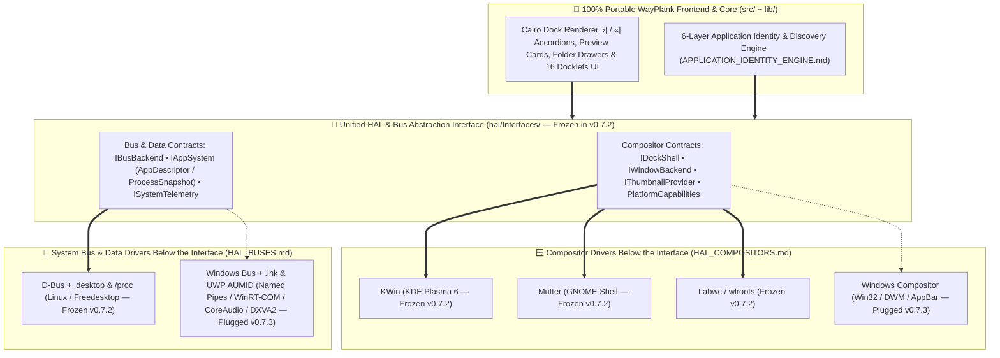
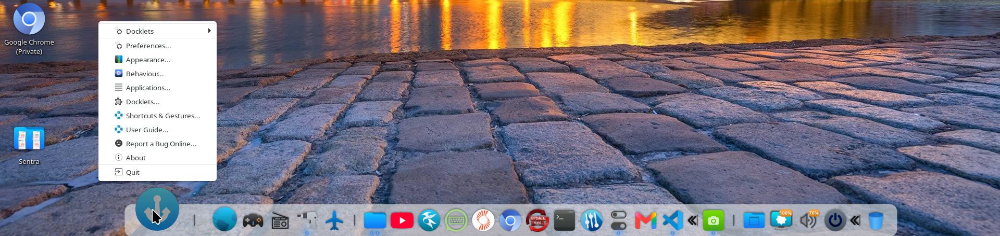
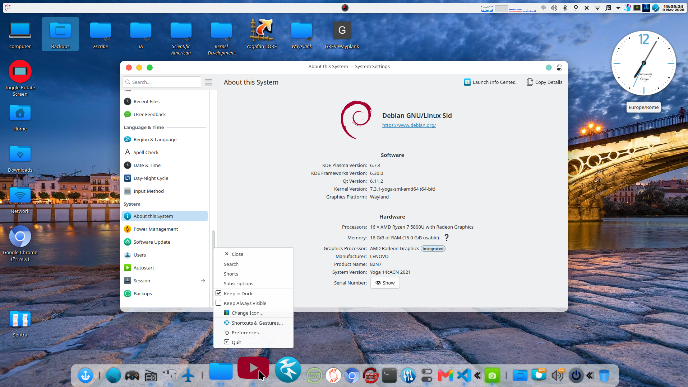
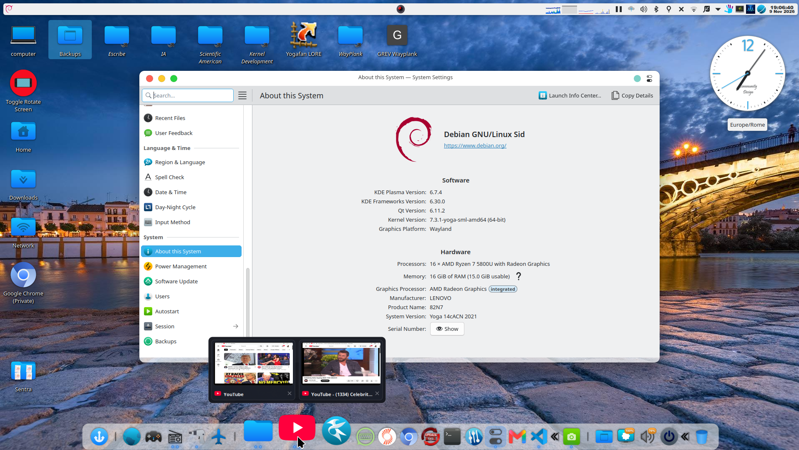
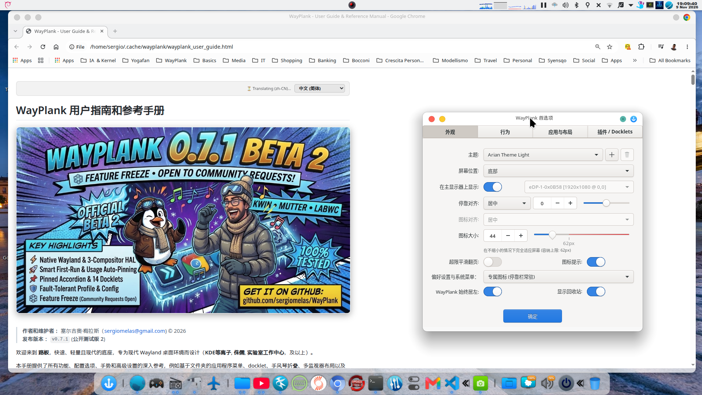

# WAYPLANK: THE ROAD TO WAYLAND DOCK

> A lightweight native Wayland dock, forked and modernized from Plank.
>
> Maintained by Sergio Melas (sergiomelas@gmail.com) © 2026
>
> [](LICENSE)
> [](Changelogs/CHANGELOG_v0.7.1.md)
> [](Documentation/HAL_COMPOSITORS.md)
> [](FAT/2026-11-10%20FAT%200.7.1.txt)
> [](po/README.md)
> [](README.md)


> *📌 **Public Beta 2 (`v0.7.1`) Release & Burn-In Schedule (`2026-11-10`):** [`FAT/2026-11-05 FAT 0.7.0.txt`](FAT/2026-11-05%20FAT%200.7.0.txt) (Public Beta 1) is formally concluded and frozen at **`359/377` (`95.2% PASS`)**, and **Public Beta 2 (`v0.7.1`, [`FAT/2026-11-10 FAT 0.7.1.txt`](FAT/2026-11-10%20FAT%200.7.1.txt))** has achieved **100.0% Multi-Compositor Qualification (`375/375` Applicable Passed: `344 [ok]` Consolidated Baseline + `31 [ko->ok]` Squashed + `0 [ko->test]` + `0 [  ]` + `2 [NA]` + `0 [ko]` Open Defects)** across KDE Plasma 6 (KWin), GNOME Shell (Mutter), and Labwc (wlroots). **Public Beta 2 (`v0.7.1`)** enters **1 week of Community Burn-In & Architecture Review (~November 16–23, 2026)** followed by **1 week of Linux HAL/Bus "Kernel" Implementation & Structural Freeze in `v0.7.2` (~November 23–30, 2026)**!*

> [!TIP]
> ## 🎉 WAYPLANK `v0.7.1` — PUBLIC BETA 2 (FEATURE FREEZE — OPEN TO COMMUNITY REQUESTS!)
> **The Alpha & Pre-Beta Engineering Era (`v0.1.0` $\longrightarrow$ `v0.6.2.3`) and Public Beta 1 (`v0.7.0` — `95.2%` FAT Concluded) are complete, and Public Beta 2 (`v0.7.1`) is 100.0% FAT Qualified (`375/375`)!**
>
> Across **17 consecutive milestone releases**, over **112,000 lines of legacy X11/Autotools code** have been purged, **131 unique functional & architectural bugs** have been squashed across **2,793 formal ISA-88 test definitions**, and **`FAT/2026-11-10 FAT 0.7.1.txt` (`377` defined: `344 [ok]` consolidated baseline + `31 [ko->ok]` squashed + `2 [NA]` + `0 [ko]` open defects = `100.0% PASS`)** is qualified across **KDE Plasma 6 (KWin)**, **GNOME Shell (Mutter)**, and **Labwc (wlroots)**:
> - 🧭 **First-Run Onboarding (`WayPlank Classic` vs `WayPlank Explorer`) & 100% Read-Only `~/.config/plank` Migration**: Automatically copies compatible launchers and folders from `~/.config/plank/` in **100% read-only mode** (leaving X11 Plank configurations untouched) and lets you choose between **WayPlank Classic** and **WayPlank Explorer** without ever deleting existing user items or folders.
> - 📊 **Smart Usage-Adaptive Accordion for Pinned Apps & Unified `›|` / `«|` Toggle ([#26](https://github.com/sergiomelas/WayPlank/issues/26))**: Powered by GNOME Shell's `shell-app-usage.c` frecency algorithm (`Off`, `Auto-Fit Capacity`, `Top Most Used` `1..20`) with a unified half-slot **`›|` / `«|`** separator-expander shared by both Docklets and Pinned Apps, pure manual toggle mode (`Click to Expand` with independent open/closed memory in `latch-state.ini`), per-icon `KeepVisible` override, and **live accordions while `Preferences` is open**.
> - 🌐 **Event-Driven Multi-Profile Chrome / Chromium Isolation (`com.canonical.dbusmenu`) & `Chrome:<Profile>` Tooltips**: Disambiguates multiple Chrome, Chromium, Brave, and Edge profiles (`--profile-directory`) sharing a single master process `PID` on Wayland via event-driven Session D-Bus introspection (`/com/canonical/menu/<N>` submenu `id=61` + `Local State` `info_cache`), isolating each active profile into its own dock icon with a dedicated **`Chrome:<Profile>`** tooltip and `~/Desktop` launcher indexing (`UserDirectory.DESKTOP`)—with **zero HAL changes and zero polling**.
> - 🛡️ **Fault-Tolerant Profile Persistence (`~/.config/wayplank/latch-state.ini`) & Startup Validation (`FAT 7.17` `[ko->ok]`)**: Persists all **43 dock preferences** and **7 SR Flip-Flop & accordion latch states** in a single unified `~/.config/wayplank/latch-state.ini`, protected by a fork-isolated syntax probe, per-key schema range validation, automatic `.dockitem` corruption quarantine with diagnostic startup dialog, and an 8-scenario interactive test suite ([`FAT/Test Files/Environment/Test environments.sh`](FAT/Test%20Files/Environment/Test%20environments.sh)).
> - 🌍 **100% Automatic Monolithic In-Memory Localization Engine (`GResource`) & Browser Auto-Translated User Guide**: **8 languages** compiled directly into the executable's RAM (**Simplified Chinese `zh_CN`**, **Italian `it`**, **Spanish `es`**, **French `fr`**, **Catalan `ca`**, **German `de`**, **Ukrainian `uk`**, and native **English `en`** — **`522 / 522` strings each**) with **zero files in `/usr/share/locale/`**, plus automatic browser translation of the offline HTML [User Guide](Documentation/USER_GUIDE.md) (`switch_lang.sh` compatible + China-safe fallback).
> - 🎛️ **Configurable Category & Docklet Layout Engine (`Apps & Layout`) + `MONLMIP Rank 1` & `latch-state.ini`**: Place the **Docklets** group on the right (`Docklets on Right`, default) or on the left, pair **WayPlank Always Left** (`MONLMIP Rank 1` promotion of `Categorize Items`) with **Show Trash** (centered in `Preferences -> Docklets`), and persist all 43 dock settings + latch states across reboots in `~/.config/wayplank/latch-state.ini`.
> - 🏛️ **Pure Single-Binary Monolithic Architecture**: **16 built-in docklets**, **6 dock themes**, **52 vector icons**, the **self-deploying GNOME Shell companion bridge (`version: 4`)**, the **KWin D-Bus ECMAScript bridge**, and **all 8 language catalogs** reside inside a single standalone `wayplank` binary.
> - 🥚 **Hidden Easter Egg Treasure Hunt & 2-Tab Credits (`🚀 WayPlank` | `🏛️ Plank Historic` in `V0.7.1: Added Fun and Structure`)**: `About WayPlank -> Credits` now features a dedicated 2-tab switcher separating **🚀 WayPlank (2026)** contributors from **🏛️ Plank (Historic)** creators, and we hid a celebratory interactive dock show inside `v0.7.1` (with full Pango CJK Hall of Fame marquee)! **Clue:** you already know the 3-modifier developer chord (`Ctrl + Alt + Shift`) used for `Developer Tools`... try pairing that chord with a **Click** on the **WayPlank emblem inside the `About WayPlank` dialog**! *(Want the complete step-by-step unlocking procedure? Hunt down the commit message of **`V0.7.1: Added Fun and Structure`** in [`git log` / GitHub Commits](https://github.com/sergiomelas/WayPlank/commits/main)!)*
> - ❄️ **Core Feature Freeze & Bug Collection — Open Exclusively to Community Requests (`v0.7.x` Through Up to Dec 31, 2026)**: With `v0.7.1`, WayPlank's internal Linux feature roadmap enters **Core Feature Freeze & Bug Collection**: no further self-initiated core features will be added by the maintainer, **with the explicit exception of Community Feature Requests, Bug Reports, Architecture Reviews, Translations, and Pull Requests** via [GitHub Issues](https://github.com/sergiomelas/WayPlank/issues) and [Discussions](https://github.com/sergiomelas/WayPlank/discussions) until the community says we are ready for the `v0.8.x` RC freeze (hard cap: **December 31, 2026**)!

---

> [!IMPORTANT]
> ### 📅 Master Release Roadmap & Milestone Schedule
> - 🚀 **v0.7.0 (Public Beta 1 — Concluded & Frozen on GitHub)**: [`FAT/2026-11-05 FAT 0.7.0.txt`](FAT/2026-11-05%20FAT%200.7.0.txt) concluded at **`359/377` (`95.2% PASS`)**, introducing the Monolithic Embedded Localization Engine, Category & Docklet Layout Engine, Icons Visual Effects suite, and GNOME Shell Bridge `version: 4`.
> - 🚀 **v0.7.1 (Public Beta 2 — 100.0% FAT Qualified `2026-11-10` $\longrightarrow$ 1-Week Community Burn-In, Bug Collection & Architecture Review ~Nov 16–23, 2026)**: [`FAT/2026-11-10 FAT 0.7.1.txt`](FAT/2026-11-10%20FAT%200.7.1.txt) (`377` defined: `344 [ok]` baseline + `31 [ko->ok]` squashed + `2 [NA]` + `0 [ko]` = `100.0% PASS`), featuring the **First-Run Onboarding Popup (`Classic` vs `Explorer`) + 100% Read-Only `~/.config/plank` Migration**, **Smart Usage-Adaptive Accordion & Unified `›|` / `«|` Expander** ([#26](https://github.com/sergiomelas/WayPlank/issues/26)), **Event-Driven Chrome Multi-Profile D-Bus Isolation (`Chrome:<Profile>` Tooltips & `~/Desktop` Indexing)**, **Browser Auto-Translated [User Guide](Documentation/USER_GUIDE.md)**, **`MONLMIP Rank 1` & Full `latch-state.ini` Profile Persistence (`FAT 7.17` `[ko->ok]`)**, **2-Tab Credits & Pango CJK Easter Egg**, **`522/522` In-RAM Strings**, and complete remediation of all `v0.7.0` audit issues ([#19](https://github.com/sergiomelas/WayPlank/issues/19)–[#25](https://github.com/sergiomelas/WayPlank/issues/25), [#27](https://github.com/sergiomelas/WayPlank/issues/27))!
> - 🐧 **v0.7.2 (Public Beta 3 — 1-Week Linux HAL/Bus "Kernel" Development & Structural Freeze ~Nov 23–30, 2026)**: Following the 1-week `v0.7.1` community burn-in, dedicated 1-week physical extraction of all Linux compositor, D-Bus, and launcher/process drivers behind a single **Pure Abstraction Interface (`hal/Interfaces/`)** into `hal/{Interfaces,Freedesktop,Linux}/` per [**`HAL_COMPOSITORS.md`**](Documentation/HAL_COMPOSITORS.md), [**`HAL_BUSES.md`**](Documentation/HAL_BUSES.md), and [**`APPLICATION_IDENTITY_ENGINE.md`**](Documentation/APPLICATION_IDENTITY_ENGINE.md). **In `v0.7.2`, only the Linux side (`KWin`, `Mutter`, `Labwc`, `D-Bus`, `.desktop` & `/proc`) is implemented and qualified at `0 [ko]` so that the `hal/Interfaces/` frontend contract structure is 100% frozen before adding Windows.**
> - 🪟 **v0.7.3 (Public Beta 4 — Subsequent Beta ~Dec 2026: Native Windows Driver Plug-In & `winplank.exe`)**: Plugs **`Windows Compositor`** (`hal/Windows/Compositor/`), **`Windows Bus`** (`hal/Windows/Bus/`), and **`Win32AppSystem`** (`.lnk` / UWP `AUMID` in `hal/Windows/AppSystem/`) directly into the frozen `v0.7.2` `hal/Interfaces/` contracts via `./BuildWin.sh` ([**`WINPLANK_PORT_BATTLE_PLAN.md`**](Documentation/WINPLANK_PORT_BATTLE_PLAN.md)), alongside ongoing community feature requests and translations (open through up to **December 31, 2026**).
> - **v0.8.x (Release Candidate — RC Series)**: Following the completion of the `v0.7.x` Public Beta cycle, strict feature freeze, memory leak profiling, and distribution packaging hardening (.deb, .rpm, AUR).
> - **v0.9.x (Long-Term Production Stabilization)**: The official battle-tested production milestone for daily driving across all Linux distros and Windows `7 ⟷ 11+`.
> - **v1.0.0 (The Grand Milestone — ~2-Year Horizon)**: The long-term landmark celebrating proven stability and next-gen Wayland protocol standards.

---

> [!WARNING]
> ### 🏛️ Call for Architecture Review — Multi-OS HAL, Bus & Identity Specifications (`v0.7.2` Structural Freeze Gate)!
> During the **`v0.7.1` (Public Beta 2)** burn-in and bug-collection window, we invite systems engineers, Wayland/Windows developers, and community contributors to review our four master architectural specifications before we freeze the `hal/Interfaces/` contracts in **`v0.7.2` (Public Beta 3)**:
> 1. 🪟 [**`Documentation/HAL_COMPOSITORS.md`**](Documentation/HAL_COMPOSITORS.md) — **Compositor & Surface HAL (`IDockShell`, `IWindowBackend`, `IThumbnailProvider`, `PlatformCapabilities`)** abstracting **`KWin`**, **`Mutter`**, **`Labwc`**, and **`Windows Compositor` (`Win32 / DWM / AppBar`)**.
> 2. 🚌 [**`Documentation/HAL_BUSES.md`**](Documentation/HAL_BUSES.md) — **IPC & System Bus HAL (`IBusBackend`, `ISystemTelemetry`, `IPlatformRuntime`)** abstracting **`D-Bus` (Linux/BSD Session & System Bus)** and **`Windows Bus` (Win32 Named Pipes, WinRT GSMTC, Focus Assist, CoreAudio, DXVA2, PowrProf)**.
> 3. 🎯 [**`Documentation/APPLICATION_IDENTITY_ENGINE.md`**](Documentation/APPLICATION_IDENTITY_ENGINE.md) — **Launcher & Process Data HAL (`IAppSystem`: `.desktop` & `/proc/<pid>` $\longleftrightarrow$ `.lnk`, UWP `AUMID` & `Win32 Process`)** feeding the 100% OS-neutral 6-Layer Mathematical Identity Engine.
> 4. 🛠️ [**`Documentation/WINPLANK_PORT_BATTLE_PLAN.md`**](Documentation/WINPLANK_PORT_BATTLE_PLAN.md) — **Zero-DLL `winplank.exe` Linux Cross-Compilation Pipeline & Frontend HAL Hook-Up Matrix**.
>
> **Why your review matters now:** In **Public Beta 3 (`v0.7.2`)**, we will implement and qualify **only the Linux side** of this architecture so that the `hal/Interfaces/` contracts and cross-level message schemas are **100% frozen** before plugging in the native Windows drivers in **Public Beta 4 (`v0.7.3`)**. Please share any architectural feedback in [GitHub Discussions](https://github.com/sergiomelas/WayPlank/discussions) or [Issues](https://github.com/sergiomelas/WayPlank/issues)!

---

> [!NOTE]
> ### 📢 Maintainer Announcement: `v0.7.1` Core Feature Freeze — Open Exclusively to Community Requests!
> Starting with **Public Beta 2 (`v0.7.1`)**, WayPlank's planned internal feature roadmap for the Linux dock core is **100% complete and enters Core Feature Freeze**:
> 
> - ❄️ **Core Feature Freeze (Zero Unsolicited Feature Creep):** To guarantee rock-solid stability on the road to `v0.8.x` (RC), no new maintainer-invented core features will be added.
> - 🗣️ **100% Open to Community Feature Requests & Feedback:** The **only** new features and workflow enhancements that will be implemented during the remainder of the `v0.7.x` Public Beta cycle (open through up to **December 31, 2026**) are those **explicitly requested by the community** via [GitHub Issues](https://github.com/sergiomelas/WayPlank/issues), [Discussions](https://github.com/sergiomelas/WayPlank/discussions), or Pull Requests!
> - 🧪 **Reproducible Community Environment Test Suite (`FAT 7.17` `[ko->ok]`):** Anyone can stress-test WayPlank's fault-tolerant configuration and `.dockitem` loader against corrupted profiles, missing keys, out-of-range settings, path traversal, broken `.dockitem` files, custom profiles, and clean cold-starts using [`FAT/Test Files/Environment/Test environments.sh`](FAT/Test%20Files/Environment/Test%20environments.sh) (complete with automatic safety backup in `~/.config/wayplank_fat_backup/` and 1-click or manual restore).
> - 🤝 **Door Wide Open for Community Contributors & Translators:** Community developers and translators are **warmly encouraged to step in**, propose enhancements, and submit Pull Requests or translation updates at any time (following our HAL & FAT qualification guidelines in [`CONTRIBUTING.md`](CONTRIBUTING.md))!

---

> [!TIP]
> ### 🌍 Call for Translators — Help Localize WayPlank (`v0.7.x` Public Beta Series)!
> All WayPlank translations are maintained in a clean, self-contained Python generator script: [`po/generate_translations.py`](po/generate_translations.py).
> Complete 100% string coverage (`522/522` strings) is shipped in **Public Beta 2 (`v0.7.1`)** for **Simplified Chinese (`zh_CN`)**, **Italian (`it`)**, **Spanish (`es`)**, **French (`fr`)**, **Catalan (`ca`)**, **German (`de`)**, and **Ukrainian (`uk`)** (plus native **English (`en`)**).
>
> **Want to add your language (e.g. Portuguese, Polish, Japanese, etc.) or contribute?**
> 1. Open [`po/generate_translations.py`](po/generate_translations.py), where all 522 strings are stored in a simple, structured Python dictionary.
> 2. Add or update your language entries directly in the dictionary (much cleaner and easier to manage than raw `.po` files!).
> 3. Submit your updated `generate_translations.py` by opening a [GitHub Issue](https://github.com/sergiomelas/WayPlank/issues) or Pull Request for inclusion in upcoming `v0.7.x` / `v0.8.x` releases!

---

## 📢 Current Status

Plank was completely unmaintained and broken on Wayland. Wayplank brings it back to life with a native Wayland architecture using `gtk-layer-shell`, modular bridges for different compositors, while preserving the fast and clean Cairo rendering engine we all loved.

I get why it might look like slop at first glance, but this is done with professional rigor. Before dumping code, every single change and architecture shift goes through strict Factory Acceptance Testing—you can literally check the logs in the FAT/ folder to see how every version is systematically tested and verified.

AI is fantastic for rapid prototyping and bringing boilerplate up fast, but this isn't just 'vibe coding'; it's heavily human-reviewed, debugged, and architected for real stability across KWin, Labwc, and Mutter. It’s a robust, hobbyist-driven, native Wayland solution. All compositor features, window previews, and theming integrations are verified with total engineering transparency. Take it or leave it, enjoy the code!

With **Public Beta 2 (`v0.7.1`)**, WayPlank ships a mature, battle-tested Hardware Abstraction Layer (HAL) working out of the box on **KDE Plasma 6 (KWin)**, **GNOME Shell (Mutter)**, and **Labwc (wlroots)**—auto-detecting your compositor at startup with zero messy configuration, complete with First-Run Onboarding (`WayPlank Classic` vs `WayPlank Explorer`) and 100% read-only `~/.config/plank` migration, Smart Usage-Adaptive Pinned Apps Accordion, event-driven Chrome/Chromium multi-profile D-Bus isolation (`Chrome:<Profile>` tooltips & `~/Desktop` launcher indexing), fault-tolerant `~/.config/wayplank/latch-state.ini` profile persistence, live Cairo window preview cards, smart multi-zone app drawers, configurable docklet positioning (left or right System Tray style via `Docklets on Right` and `WayPlank Always Left` in `Apps & Layout`), 16 monolithic docklets, 8-language in-RAM localization (`522/522` strings) + browser auto-translated User Guide, real-time dark/light theme switching, fullscreen inhibit, and panel mode. 

## 🤝 Acknowledgments & Contributors

WayPlank is proudly developed with and for the Linux Wayland community. A huge thank you to our 400+ users, issue reporters, and translators whose real-world feedback has helped squash 124 bugs across 377 validation points (`359/377` = `95.2%` FAT pass rate in frozen `v0.7.0`, with all remaining issues remediated and ready for final FAT & 1-week community burn-in in `v0.7.1`)!

* **史有虎 (IFtiger-hu)** ([@IFtiger-hu-hub](https://github.com/IFtiger-hu-hub)): Author of the WayPlank community fork, contributor of native openSUSE/Fedora/RHEL RPM packaging (`BuildRpm.sh`), dock overflow smooth scrolling architecture, and launcher deduplication engine.

### 🤝 How to Contribute & Community Roll of Honor

All community feature ideas, issue reporters, and translation authors are actively tracked and credited in our community roll of honor:
👉 Please see [**CONTRIBUTING.md**](CONTRIBUTING.md) for full contribution guidelines, active tracks, and the comprehensive issues & discussions matrix.


## 📖 Documentation

* 📚 [User Guide & Complete Reference Manual (`v0.7.1`)](Documentation/USER_GUIDE.md)
* 🏛️ [Master Compositor & Shell HAL Architecture (`HAL_COMPOSITORS.md`)](Documentation/HAL_COMPOSITORS.md)
* 🚌 [Master IPC & System Bus HAL Architecture (`HAL_BUSES.md`)](Documentation/HAL_BUSES.md)
* 🎯 [6-Layer Application Identity Engine & `IAppSystem` Data Abstraction (`APPLICATION_IDENTITY_ENGINE.md`)](Documentation/APPLICATION_IDENTITY_ENGINE.md)
* 🪟 [WinPlank Zero-DLL Native Windows Port Blueprint (`WINPLANK_PORT_BATTLE_PLAN.md`)](Documentation/WINPLANK_PORT_BATTLE_PLAN.md)
* 🤝 [Contributing Guidelines & Community Tracks](CONTRIBUTING.md)
* 🌍 [Monolithic Localization & i18n Guide](po/README.md)
* 🖥️ [Compositors & Nested Desktops Cheatsheet](FAT/Test%20Files/WAYPLANK_COMPOSITORS_CHEATSHEET.md)
* 🗺️ [Permanent Community Fork Integration & Cherry-Pick Roadmap](Documentation/WAYPLANK_FORK_INTEGRATION_ROADMAP.md)
* 📖 [X11-to-Wayland Technical Migration Report *(Archived Reference)*](Documentation/wayplank_x11_to_wayland_report_en.md)
* 🛡️ [Lifetime Master Bug & Defect Register](FAT/WAYPLANK_LIFETIME_BUG_REGISTER.md)
* 🧪 [Compositor test matrix & protocols](FAT/)
* 📦 [Full technical changelogs](Changelogs/)

### 🎯 Compositor Support, Native HAL Architecture & `v0.7.2` ➔ `v0.7.3` Consolidation Roadmap

WayPlank features a modular Hardware & Bus Abstraction Layer (`hal/Interfaces/`) with zero-configuration runtime auto-detection on Wayland and compile-time driver selection across operating systems:



| Compositor / Subsystem | Integration Engine | Key Capabilities | Status |
| :--- | :--- | :--- | :---: |
| **KDE Plasma 6 (`KWin`)** | D-Bus ECMAScript Bridge (`hal/Freedesktop/KWin/`) | Live Cairo window preview cards (`ScreenShot2` D-Bus IPC), `Bus.watch_name` bridge self-healing, bidirectional event tracking, atomic DRM `kscreen-doctor` brightness sync, KDE Plasma Edit Mode & `Super+D` coexistence (#27), 95.2% `v0.7.0` FAT pass (`0 [ko]` in `v0.7.1`) | **Tier 1 (`0 [ko]` in `v0.7.1`)** |
| **GNOME Shell (`Mutter`)** | Monolithic Mutter Extension `v4` (`hal/Freedesktop/Mutter/`) | Live Cairo window preview cards (`org.wayplank.GnomeBridge` IPC), 0.74s instant cold start, deterministic map activation (zero async timer crashes), native CSD HeaderBar dialogs, window Dodge/Intellihide, 95.3% `v0.7.0` FAT pass (`0 [ko]` in `v0.7.1`) | **Tier 1 (`0 [ko]` in `v0.7.1`)** |
| **Labwc / `wlroots`** | `gtk-layer-shell` + `zwlr_foreign_toplevel` (`hal/Freedesktop/Wlroots/`) | Native C protocol bridge, Cairo fallback preview cards with app icons & titles, Honest UI matrix, tested on LXQt 2.x & XFCE 4.20 Wayland, 95.1% `v0.7.0` FAT pass (`0 [ko]` in `v0.7.1`) | **Tier 1 (`0 [ko]` in `v0.7.1`)** |
| **Freedesktop `D-Bus`** | Shared Event-Driven Broker (`hal/Freedesktop/Dbus/`) | `com.canonical.dbusmenu` (`id=61`) Chrome multi-profile isolation, `MPRIS2`, `UPower`, `systemd-logind` 3×3 power center, `Portal` dark/light sync, `Notifications` DND | **Active (`v0.7.2` Extraction & Freeze)** |
| **`Windows Compositor` & `Windows Bus`** | Win32 `SetWinEventHook` + `SHAppBarMessage` + WinRT/COM (`hal/Windows/`) | Native AppBar & `WS_EX_LAYERED` dock shell, `DwmRegisterThumbnail`/`PrintWindow` previews, `.lnk` & UWP `AUMID` discovery, Named Pipes, WinRT GSMTC media, CoreAudio & DXVA2 | **Scheduled (`v0.7.3` Plug-In)** |
| **Sway & Hyprland** | `wlroots` protocol extensions | Native layer-shell docking & workspace tracking | *In Roadmap* |

*For in-depth architectural details, cross-level compatible message schemas, and the two-stage `v0.7.2` (Linux HAL Freeze) $\longrightarrow$ `v0.7.3` (Windows Plug-In) roadmap, see [**`HAL_COMPOSITORS.md`**](Documentation/HAL_COMPOSITORS.md), [**`HAL_BUSES.md`**](Documentation/HAL_BUSES.md), [**`APPLICATION_IDENTITY_ENGINE.md`**](Documentation/APPLICATION_IDENTITY_ENGINE.md), [**`WINPLANK_PORT_BATTLE_PLAN.md`**](Documentation/WINPLANK_PORT_BATTLE_PLAN.md), and the [**User Guide**](Documentation/USER_GUIDE.md).*

Feel free to star the repo or follow releases if you want to track progress!

---

> 🌟 **Compositor Qualification Status:** On KDE Plasma 6 (KWin), GNOME Shell (Mutter), and Labwc (wlroots), Public Beta 1 (`v0.7.0`, [`FAT/2026-11-05 FAT 0.7.0.txt`](FAT/2026-11-05%20FAT%200.7.0.txt)) concluded at **`359/377` (`95.2% PASS`)**, and Public Beta 2 (`v0.7.1`, [`FAT/2026-11-10 FAT 0.7.1.txt`](FAT/2026-11-10%20FAT%200.7.1.txt)) is **100.0% Qualified (`375/375` Applicable Passed: `344 [ok]` consolidated baseline + `31 [ko->ok]` squashed + `2 [NA]` + `0 [ko]` open defects)** under the formal ISA-88 qualification protocol. Every validation point and remediation is documented with total engineering transparency in [`FAT/`](FAT/), [`Changelogs/`](Changelogs/), and [`CONTRIBUTING.md`](CONTRIBUTING.md).

---

## 📸 Screenshots



<details>
<summary><b>🔍 Click to view full desktop integration (1920x1080), detail 1</b></summary>

<br>



</details>

<details>
<summary><b>🔍 Click to view full desktop integration (1920x1080), detail 2</b></summary>

<br>



</details>

<details>
<summary><b>🌍 Click to view native multi-language localization showcase (Simplified Chinese — zh_CN)</b></summary>

<br>



</details>

---

# Universal Build & Installation Guide (Any Linux Distribution)

## 1. CORE DEPENDENCIES

To compile Wayplank from source and enable all docklets, ensure your distribution provides the required development libraries and runtime tools:

### Build Dependencies (Compiler & Headers):
- Vala compiler (`valac >= 0.40`)
- GTK+ 3.0 development headers (`gtk3` / `libgtk-3-dev`)
- GTK Layer Shell (`gtk-layer-shell` / `libgtk-layer-shell-dev`)
- Wayland Client library (`wayland` / `libwayland-client0` / `libwayland-dev`)
- JSON-GLib 1.0 (`json-glib` / `libjson-glib-dev`)
- LibGee 0.8 (`libgee` / `libgee-0.8-dev`)
- GLib 2.0 (`glib2` / `libglib2.0-dev`, includes `glib-compile-resources`)
- `pkg-config` / `base-devel` / `build-essential`

### Runtime Dependencies & Docklet Tools:
- **Screenshot Docklet (Labwc / wlroots / XFCE on Labwc):** `grim`, `slurp`
- **Screenshot Docklet (KDE Plasma):** `kde-spectacle`
- **Screenshot Docklet (XFCE / Generic X11):** `xfce4-screenshooter` or `flameshot`
- **Screen Brightness Docklet (Hardware control fallback):** `brightnessctl` (optional)

**Quick Install Commands:**
- **Debian / Ubuntu:**
  ```bash
  sudo apt install build-essential valac libgtk-3-dev libgtk-layer-shell-dev libwayland-dev libjson-glib-dev libgee-0.8-dev libglib2.0-dev grim slurp
  ```
- **Arch Linux:**
  ```bash
  sudo pacman -S --needed base-devel vala gtk3 gtk-layer-shell wayland json-glib libgee glib2 grim slurp
  ```
- **Fedora / RHEL:**
  ```bash
  sudo dnf install gcc vala gtk3-devel gtk-layer-shell-devel wayland-devel json-glib-devel libgee-devel glib2-devel grim slurp rpm-build
  ```
- **openSUSE (Tumbleweed / Leap):**
  ```bash
  sudo zypper install gcc vala gtk3-devel gtk-layer-shell-devel wayland-devel json-glib-devel libgee-devel glib2-devel grim slurp rpm-build
  ```

---

## 2. COMPILATION

### Option A: Universal Automated Build Script (Recommended for Any Distro)

Wayplank includes an automated standalone build script that compiles all Vala sources, C bridges, and GLib resources directly without distribution-specific dependencies:

```bash
chmod +x BuildBin.sh
./BuildBin.sh
```

The resulting standalone binary is generated in `build/wayplank`.

---

### Option B: Manual Step-by-Step Compilation

If you prefer building manually in your terminal (mirroring every step of `./BuildBin.sh`, including in-RAM `.mo` localization catalogs, embedded stock themes, and `VERSION` metadata):

```bash
# Step 1: Generate and compile embedded localization catalogs (.mo) into GResource XML
python3 po/generate_translations.py
rm -rf data/locale
EMBEDDED_LANGS=""
LOCALE_XML_ENTRIES=""
for po in po/*.po; do
    lang="$(basename "$po" .po)"
    mkdir -p "data/locale/${lang}"
    msgfmt "$po" -o "data/locale/${lang}/wayplank.mo"
    EMBEDDED_LANGS="${EMBEDDED_LANGS:+${EMBEDDED_LANGS}:}${lang}"
    LOCALE_XML_ENTRIES="${LOCALE_XML_ENTRIES}		<file compressed=\"true\">locale/${lang}/wayplank.mo</file>\n"
done
awk -v entries="$LOCALE_XML_ENTRIES" '/<\/gresource>/ { printf "%s", entries } { print }' \
    data/plank.gresource.xml > data/.plank.build.gresource.xml

# Step 2: Compile GLib schemas and embedded GResource C source (themes, icons, UI, and .mo catalogs)
glib-compile-schemas data/glib-2.0/schemas
glib-compile-resources --sourcedir=data --target=lib/resources.c --generate-source data/.plank.build.gresource.xml
rm -rf data/locale

# Step 3: Compile native monolithic Wayplank binary (Vala + C bridges)
PKG_VER="$(sed -n '1p' VERSION | tr -d '[:space:]')"
PKG_DECO="$(sed -n '2p' VERSION | sed 's/^[[:space:]]*//;s/[[:space:]]*$//')"
mkdir -p build
valac -g \
    --gresources=data/.plank.build.gresource.xml \
    --gresourcesdir=data \
    --vapidir=vapi \
    --pkg posix --pkg gio-unix-2.0 --pkg gtk+-3.0 --pkg gtk-layer-shell-0 \
    --pkg json-glib-1.0 --pkg gee-0.8 --pkg compat --pkg config --pkg wlr-bridge \
    -X -D_GNU_SOURCE -X "-Dsetproctitle(x)=" \
    -X -DGETTEXT_PACKAGE=\"wayplank\" \
    -X -DPACKAGE_VERSION=\"${PKG_VER}\" \
    -X "-DPACKAGE_VERSION_DECO=\"${PKG_DECO}\"" \
    -X -DWAYPLANK_EMBEDDED_LANGS=\"${EMBEDDED_LANGS}\" \
    -X -include -X include/config.h \
    -X -Ilib -X -Ilib/Protocols -X -Ilib/Services -X -Iinclude -X -w -X -lm -X -lwayland-client \
    $(find lib src -name "*.vala") \
    lib/resources.c \
    lib/gtk-compat.c \
    lib/Protocols/wlr-foreign-toplevel-management-protocol.c \
    lib/Services/wlr-toplevel-bridge.c \
    -o build/wayplank
rm -f lib/resources.c data/.plank.build.gresource.xml
```

---

### Step 4: Install Binary and Desktop Assets

Once built (via Option A or Option B), install the binary, desktop entry, hicolor icons, and GSettings schemas *(all 5 stock themes and 8 language catalogs are already embedded in RAM inside the binary)*:

```bash
# 1. Install the binary into /usr/local/bin and link it as plank
[ -f build/wayplank ] && sudo install -Dm755 build/wayplank /usr/local/bin/wayplank || sudo install -Dm755 wayplank /usr/local/bin/wayplank
sudo ln -sf /usr/local/bin/wayplank /usr/local/bin/plank

# 2. Create the target directories safely (on distros where /usr/local/share subdirs do not exist yet)
sudo mkdir -p /usr/local/share/applications
sudo mkdir -p /usr/local/share/icons/hicolor
sudo mkdir -p /usr/local/share/glib-2.0/schemas

# 3. Install the desktop launcher and hicolor SVG icons
sudo install -Dm644 data/wayplank.desktop /usr/local/share/applications/wayplank.desktop
for sz in 16x16 22x22 24x24 32x32 48x48 64x64 128x128 scalable; do
    sudo install -Dm644 data/icons/wayplank.svg "/usr/local/share/icons/hicolor/${sz}/apps/wayplank.svg"
    sudo install -Dm644 data/icons/plank.svg "/usr/local/share/icons/hicolor/${sz}/apps/plank.svg"
done

# 4. Copy and compile the GSettings schemas
sudo install -Dm644 data/glib-2.0/schemas/net.launchpad.plank.gschema.xml \
    /usr/local/share/glib-2.0/schemas/net.launchpad.plank.gschema.xml
sudo glib-compile-schemas /usr/local/share/glib-2.0/schemas/
```

---

## 3. AUTOMATED DEBIAN/UBUNTU PACKAGE CREATION

If running Debian, Ubuntu, or derivative distributions, run the automated packager to create a native `.deb`:

```bash
chmod +x BuildDeb.sh
./BuildDeb.sh
# Install with automatic dependency resolution:
sudo apt install ./build/wayplank_0.7.1_amd64.deb
# Or via dpkg:
# sudo dpkg -i build/wayplank_0.7.1_amd64.deb && sudo apt install -f
```

---

## 4. AUTOMATED OPENSUSE / FEDORA / RHEL RPM PACKAGE CREATION

If running openSUSE (Tumbleweed / Leap), Fedora, or RHEL-based distributions, run the automated RPM packager:

```bash
chmod +x BuildRpm.sh
./BuildRpm.sh

# Install on openSUSE with zypper:
sudo zypper install ./build/wayplank-0.7.1-1.x86_64.rpm

# Or install on Fedora/RHEL with dnf:
sudo dnf install ./build/wayplank-0.7.1-1.x86_64.rpm

# Or install via rpm directly:
sudo rpm -Uvh ./build/wayplank-0.7.1-1.x86_64.rpm
```

> 💡 **Headless / CI Environments:** You can bypass interactive prompts across all build scripts using `WAYPLANK_NO_PROMPT=1` (e.g. `WAYPLANK_NO_PROMPT=1 ./BuildRpm.sh`).

---

# RUNTIME DIRECTORIES & CONFIGURATION MIGRATION

Wayplank operates under its own isolated namespace and standard XDG locations:

- Configuration Directory: `~/.config/wayplank/`
- Application Launchers: `~/.config/wayplank/dock1/launchers/`
- Local User Themes: `~/.local/share/wayplank/themes/`
- System Themes: `/usr/share/wayplank/themes/` (or `/usr/local/share/wayplank/themes/`)

**Theme Configuration:**
Wayplank inspects both system and user theme paths natively. To change dock appearance:

```bash
wayplank --preferences
```

**Debug & Verbose Logging:**
To inspect running window hooks and debug output:

```bash
wayplank -d
```

---

# PROJECT ROADMAP & THE WAYLAND MILESTONES

- [x] Phase 1 (Completed) v0.1.0: Decoupled Standalone Fork
  - [x] Complete breakaway from unmaintained upstream Plank.
  - [x] Full namespace migration to 'wayplank' (configs, directories, launchers).
  - [x] Modern monolithic build system replacing broken autotools/autogen scripts.
  - [x] Multi-distro compatibility and standalone Debian packaging pipeline.

- [x] Phase 2 (Completed) v0.2.0: Application Discovery and Dock Lifecycle
  - [x] Implemented generic application discovery from running processes and desktop files.
  - [x] Added persistent pinned application handling and temporary running application icons.
  - [x] Implemented running-instance marking and multi-instance application management.

- [x] Phase 3 (Completed) v0.3.0: Declaration of Independence from X11 & Native Wayland Integration
  - [x] Implementation of Wayland native protocols.
  - [x] Complete phasing out of X11/XWayland dependencies. Support one compositor.
    This will be Kwin because it is the one I know the best.
  - [x] Full fractional scaling and native Wayland compositor window tracking.

- [x] Phase 4 (Completed) v0.4.0, v0.4.1, v0.4.2: KWin Stabilization, Monolithic Docklets & Bug Fixes
  - [x] Hardened KWin scripting bridge, overlap detection, and multi-monitor tracking.
  - [x] Implemented 8 embedded monolithic docklets (Trash, Clocks, Battery, CPU/RAM, Show Desktop, MPRIS, Volume).
  - [x] Bi-directional KWin & Plasma D-Bus trash bridge synchronization.
  - [x] Resolved icon bounce regressions, portal file launching, and process replacement (`--replace` / `-r`).

- [x] Phase 5 (Completed) v0.4.3: Multi-Compositor HAL & Support for Other Compositors (Labwc, wlroots, Mutter)
  - [x] Defined and implemented the modular Hardware Abstraction Layer (`WindowBackend` / `WindowControl`).
  - [x] Added native Labwc & wlroots support via `zwlr_foreign_toplevel_manager_v1` protocol and C bridge (v0.4.3).
  - [x] Zero-configuration runtime dynamic compositor auto-probing (Labwc vs KWin vs Mutter).
  - [x] Reactive Cairo indicator dots and cross-compositor Show Desktop toggle engine.
  - [x] State-based Dodge & Honest UI Matrix for Labwc (`DODGE_MAXIMIZED`, UI filtering, transparent fallback; validated on LXQt 2.x and XFCE 4.20).
  - [x] Native GNOME Shell / Mutter bridge integration (Phase 1): monolithic self-deploying GNOME Shell extension via D-Bus (`MutterBackend`), window state tracking, zero-notification banners, centered dialogs, and edge positioning (v0.4.3).
  - [x] Strict HAL coordinate isolation: native Layer Shell margins for KWin/Labwc and dedicated absolute screen positioning for Mutter (v0.4.3).
  - [x] Finalize GNOME Shell extension bridge for window geometry retrieval to support Intellihide & Dodge on Mutter.

- [x] Phase 6 (Completed) v0.5.0 - v0.6.2.3: Visual Ergonomics, Advanced Theming & Community Features
  - [x] Comprehensive 16-docklet suite (14 in the 7×2 Docklets grid + Trash + Preferences, including Do Not Disturb, Network, Screenshot, Brightness, Weather, Removable Drive Ejector).
  - [x] Semantic categorized multi-zone dock layout (`[Folders] | [Docklets] | [Pinned Apps] | [Transients] | [Trash]`).
  - [x] Cairo folder launcher menus and full application drawers with active window indicators.
  - [x] Universal Cairo multi-window preview cards with live thumbnails on KWin and GNOME Mutter.
  - [x] Real-time dark/light theme switching with native Theme Manager and portal synchronization.
  - [x] Advanced ergonomics: remote URL drag-and-drop, hover-to-raise window activation, recent files jump lists.
  - [x] Configurable System Menu Access modes, Panel Mode (`ReserveSpace`), and Fullscreen Auto-Hide with 0px edge passthrough.
  - [x] Multi-distribution packaging parity (Debian `.deb` & openSUSE/Fedora `.rpm`).
  - [x] Incorporate community user contributions, bug reports, and UX requests ahead of Public Beta.

- [x] Phase 7 (Active — Public Beta Series Launched) WayPlank Public Beta (v0.7.x)
  - [x] **Official Launch of Public Beta 1 (v0.7.0) on GitHub (`FAT/2026-11-05 FAT 0.7.0.txt` concluded & frozen at `359/377` = `95.2% PASS`)!**
  - [x] Monolithic embedded gettext localization engine (`GResource`) with 100% in-memory string resolution (`522/522` strings across 7 languages + English, Zero Host Pollution) and browser auto-translated User Guide (`switch_lang.sh` compatible + China-safe fallback).
  - [x] Configurable Category & Docklet Layout Engine (`Apps & Layout` tab): two-position Docklets (`Docklets on Right` System Tray layout vs. Default Left), symmetric `WayPlank Always Left` (`MONLMIP Rank 1`) & `Show Trash` edge anchors, and one-click `Align by Type` in Free Mode.
  - [x] **`v0.7.1` (Public Beta 2 — 100.0% FAT Qualified `2026-11-10` $\longrightarrow$ 1-Week Community Burn-In ~Nov 16–23, 2026, Core Feature Freeze, Bug Collection & Architecture Review, [`FAT/2026-11-10 FAT 0.7.1.txt`](FAT/2026-11-10%20FAT%200.7.1.txt))**: First-Run Onboarding Popup (`WayPlank Classic` vs `WayPlank Explorer`) with 100% read-only `~/.config/plank` migration, Smart Usage-Adaptive Accordion for Pinned Apps & Unified `›|` / `«|` Expander (`Auto-Fit Capacity` / `Top Most Used` `1..20`, [#26](https://github.com/sergiomelas/WayPlank/issues/26)), Event-Driven Multi-Profile Chrome/Chromium D-Bus Isolation (`com.canonical.dbusmenu` `/com/canonical/menu/<N>` + `Local State` `info_cache` with `Chrome:<Profile>` tooltips and `~/Desktop` launcher indexing), live accordions while `Preferences` is open, full 43-preference + 7 SR Flip-Flop & accordion latch disk persistence & startup validation in `~/.config/wayplank/latch-state.ini` (`FAT 7.17` `[ko->ok]`), 2-Tab Credits (`WayPlank` vs `Plank Historic`) & Pango CJK Easter Egg, and remediation of all audit issues ([#19](https://github.com/sergiomelas/WayPlank/issues/19)–[#25](https://github.com/sergiomelas/WayPlank/issues/25), [#27](https://github.com/sergiomelas/WayPlank/issues/27) $\rightarrow$ `344 [ok]` baseline + `31 [ko->ok]` + `2 [NA]` + `0 [ko]` = `100.0% PASS`).
  - [ ] Broaden community field testing across additional wlroots compositors (Sway, Hyprland, Wayfire).
  - [ ] **`v0.7.2` (Public Beta 3 — 1-Week Linux HAL/Bus "Kernel" Development & Structural Freeze ~Nov 23–30, 2026)**: Physical extraction of all Linux compositor drivers ([`HAL_COMPOSITORS.md`](Documentation/HAL_COMPOSITORS.md)), Session/System D-Bus endpoints ([`HAL_BUSES.md`](Documentation/HAL_BUSES.md)), and `.desktop`/`/proc` data adapters ([`APPLICATION_IDENTITY_ENGINE.md`](Documentation/APPLICATION_IDENTITY_ENGINE.md)) into `hal/{Interfaces,Freedesktop,Linux}/`, freezing the `hal/Interfaces/` frontend contracts at `0 [ko]` on Linux.
  - [ ] **`v0.7.3` (Public Beta 4 — Subsequent Beta ~Dec 2026: Native Windows Driver Plug-In)**: Plug `hal/Windows/{Compositor,Bus,AppSystem,Telemetry}/` and `./BuildWin.sh` ([`WINPLANK_PORT_BATTLE_PLAN.md`](Documentation/WINPLANK_PORT_BATTLE_PLAN.md)) directly into the frozen `v0.7.2` `hal/Interfaces/` contracts to produce the standalone zero-DLL `winplank.exe`.
- [ ] Phase 8 (Planned) WayPlank Release Candidate (v0.8.x)
  - [ ] Strict Feature Freeze — no new architectural features, focusing purely on stability and hardening.
  - [ ] Systematic memory leak profiling (Valgrind / AddressSanitizer) and CPU efficiency audits.
  - [ ] Distribution packaging parity: official Debian (.deb), Fedora/openSUSE (.rpm), and Arch Linux AUR PKGBUILD.
- [ ] Phase 9 (Planned) WayPlank Long-Term Production Stabilization (v0.9.x)
  - [ ] The official daily driver production milestone, rock-solid across all major Linux compositors (KWin, Mutter, Labwc) and native Windows `7 ⟷ 11+`.
  - [ ] Production maintenance releases (`v0.9.1`, `v0.9.2`, etc.) as Wayland protocols and driver stacks evolve.
- [ ] Phase 10 (Long-Term Horizon ~2 Years) WayPlank 1.0.0 Grand Milestone
  - [ ] The definitive landmark celebration after 2 years of proven daily production stability and mature protocol integration.
---

# 📝 Release Highlights & Changelog

> 🏛️ **HISTORIC MILESTONE CLOSURE — END OF THE ALPHA & PRE-BETA ERA (`v0.1.0` $\longrightarrow$ `v0.6.2.3`) & LAUNCH OF PUBLIC BETA 1 (`v0.7.0`):**  
> Following the final qualification and sign-off of **`v0.6.2.3`** on **November 1, 2026**, the foundational **Alpha & Pre-Beta Engineering Cycle** of WayPlank is permanently **CLOSED**. Across **15 consecutive releases** in 43 days, over **112,000 lines of legacy X11/Autotools code** were purged, a **3-compositor native Wayland HAL** (**KDE Plasma 6 / KWin**, **GNOME Shell / Mutter**, and **Labwc / wlroots**) was built from the ground up, **107 unique functional & architectural bugs** were squashed across **2,037+ formal ISA-88 test executions**, and all **368/368 applicable FAT validation points** achieved a **100% PASS** rate with **0 open defects**. WayPlank now officially stands in the **Public Beta Era (`v0.7.0` — Public Beta 1)**! 🚀

Here is a recap of the journey so far! For complete technical breakdown and FAT test matrix, see [`Changelogs/`](Changelogs/) and [`FAT/`](FAT/). 🚀

* 🚀 **v0.7.1 (Public Beta 2: First-Run Onboarding Classic/Explorer, Pinned Apps Accordion, Event-Driven Chrome Multi-Profile Isolation, MONLMIP Rank 1, Full `latch-state.ini` Persistence, 2-Tab Credits, Easter Egg & Core Feature Freeze) — 2026-11-10 [100.0% FAT PASSED / 344 `ok` + 31 `ko->ok` + 2 `NA` | 0 `ko`]**:  
  Introduces the **First-Run Onboarding Popup (`WayPlank Classic` vs `WayPlank Explorer`)** with **100% read-only migration from `~/.config/plank`** (leaving legacy X11 Plank configurations untouched and never deleting user folders or launchers), delivers the **Smart Usage-Adaptive Accordion for Pinned Apps & Unified `›|` / `«|` Expander** (`Off`, `Auto-Fit Capacity`, `Top Most Used` `1..20` powered by GNOME `shell-app-usage.c` frecency + `›|`/`«|` `PinnedExpanderDockItem`, Issue [#26](https://github.com/sergiomelas/WayPlank/issues/26)), adds **Event-Driven Multi-Profile Chrome/Chromium D-Bus Isolation** (`com.canonical.dbusmenu` `/com/canonical/menu/<N>` + `Local State` `info_cache` $\rightarrow$ per-profile dock icons with **`Chrome:<Profile>`** tooltips and `~/Desktop` launcher indexing, with zero HAL changes and zero polling), keeps both accordions **100% live while `Preferences` is open**, implements **`MONLMIP Rank 1`** on `WayPlank Always Left` + **full 43-preference & 7 SR Flip-Flop / accordion latch disk persistence with startup validation (`~/.config/wayplank/latch-state.ini` & `FAT/Test Files/Environment/`, `FAT 7.17` `[ko->ok]`)** across reboots, adds **automatic browser translation of `wayplank_user_guide.html`** ([`Documentation/USER_GUIDE.md`](Documentation/USER_GUIDE.md), compatible with `switch_lang.sh` + China-safe fallback), expands in-RAM localization to **`522/522` strings** across all 8 languages, marks **Core Feature Freeze (open to community requests & `v0.7.2` HAL architecture review)**, and remediates all remaining audit issues (`#20`–`#23` $\rightarrow$ `0 [ko]` open defects in [`FAT/2026-11-10 FAT 0.7.1.txt`](FAT/2026-11-10%20FAT%200.7.1.txt)).
* 🚀 **v0.7.0 (Public Beta 1: Monolithic Embedded Localization, Category & Docklet Layout Engine & Hotfix Consolidation) — 2026-11-06 [CONCLUDED & FROZEN ON GITHUB / 95.2% FAT PASSED]**:  
  Activates the 100% Monolithic Embedded Localization & Stock Theme Engine (`GResource` in RAM, 7 complete language catalogs `zh_CN`, `it`, `es`, `fr`, `ca`, `de`, `uk` at `487/487` strings + native `en`, `0` files in `/usr/share/locale/` or `/usr/share/wayplank/themes/`), introduces the **Category & Docklet Layout Engine** in **Preferences $\rightarrow$ Apps & Layout** (`Docklets on Right` System Tray layout, symmetric `WayPlank Always Left` & `Show Trash` edge anchors, and `Align by Type` in Free Mode), graduates the **26-style Icons Visual Effects suite** (`Launch Effect`, `Focused App`, `Unpin Effect` + `300–1500 ms` `Effect Duration`) to **Preferences $\rightarrow$ Behaviour**, expands the **Session & Power** docklet to a **3×3 control center** (`Hibernate`, `Hybrid Sleep`, and `UEFI / BIOS` with automatic `systemd-logind` capability detection), upgrades the GNOME Shell companion extension to `version: 4`, resolves Issues **#16, #17, #18, #19, #24, and #25** plus `MPRIS` multi-player latch/radio, GNOME live Primary Display, `NoDisplay=true` PWA ↔ `--app=URL`, sibling binary (`VS Code`, `MATLAB`, `Scilab`) parity, folder/open-drawer drag-and-drop, Labwc `"Unknown" -> "Monitor"` display label normalization, 60 FPS hover popup-event filtering (`0.1%` idle CPU), and `SIGWINCH` live `.deb` upgrade reload, and achieves **`95.2%` applicable FAT compliance (`359/377` passed: `317 [ok]` + `42 [ko->ok]`, `2 [NA]`, `18 [ko]` across Category 2 Issues [#20](https://github.com/sergiomelas/WayPlank/issues/20)–[#23](https://github.com/sergiomelas/WayPlank/issues/23) transferred to `v0.7.1`)** across KDE Plasma 6 (KWin), GNOME Shell (Mutter), and Labwc (wlroots).
* 🌟 **v0.6.2.3 (Final Pre-Beta: Community & Visual Enhancements) — 2026-11-01 [COMPLETED / 100% FAT PASSED]**:  
  Universal Cairo multi-window preview cards with live thumbnails on KWin and GNOME Mutter, real-time light/dark theme switching, built-in Do Not Disturb docklet, configurable System Menu Access, Panel Mode (`ReserveSpace`), Fullscreen Inhibit with 0px edge click passthrough (Issue #10), two-stage hysteresis input mask (`AnticipateZoom`, Issue #12), QEMU multi-VM isolation with Labwc `/proc` cold-relaunch synthesis (Issue #14), dynamic top panel avoidance, folder launcher indicators, and recent files jump lists. Permanently closed the Alpha & Pre-Beta cycle!
* 🌟 **v0.6.2.2 (Round 2, Pre-Beta) — 2026-10-21 [COMPLETED / 100% FAT PASSED]**:  
  Remote web URL & browser shortcut DND delivery (`DesktopAppInfo.launch_uris`), hover-to-raise target window activation,  
  real-time dark/light portal color-scheme synchronization (`org.freedesktop.portal.Settings`), interactive Theme Manager  
  with native portal file chooser and archive installer (.zip/.tar.gz), strict FreeDesktop MIME type drop validation,  
  canonical launcher deduplication (`Posix.realpath` & `File.equal`), and clean KISS drag-off removal with instant poof animation.
* 🌟 **v0.6.2.1 (Round 1, Pre-Beta) — 2026-10-19 [COMPLETED / 100% FAT PASSED]**:  
  Native openSUSE/Fedora/RHEL RPM packaging (`BuildRpm.sh`), launcher deduplication & item reuse, ghost bridge window shield,  
  dock overflow smooth scrolling with tachometer redline capacity indicator, and multi-monitor DDC/CI sync with SP/PV decoupling.
* 💡 **v0.6.1 (Alpha) — 2026-10-15:** The Bug Hunting Release — Multi-monitor KWin brightness sync, unified Global System Pressure engine, drag-and-drop payload delivery & 0-byte MIME fix, docklet icon standardization & adaptive dynamic Gtk+ theme engine.
* ✨ **v0.6.0 (Alpha) — 2026-10-11:** Smart first-run auto-configuration (categorized English app drawers, auto-detected pinned apps, docklets & trash), universal "Change Icon..." dialog with FreeDesktop & GIO metadata, integrated User Guide, and clean release polish.
* 🚀 **v0.5.2 (Alpha) — 2026-10-09:** Cairo folder launcher menu, 14 built-in docklets, category layout grouping and deep audit fixing stack overflows & GObject assertions.
* 🛠️ **v0.5.1 (Alpha) — 2026-10-08:** Fixed KWin resume freeze on Plasma 6 with 50ms debouncer, native screenshot docklet and 100% FAT pass rate.
* 🖥️ **v0.5.0 (Alpha) — 2026-10-07:** Solved multi-monitor duplicate ID collisions, live monitor hotplugging and Mutter drag race fixes.
* 🧩 **v0.4.3 (Pre-Alpha) — 2026-10-05:** Modular Multi-Compositor HAL: dynamic auto-probing for KWin, Labwc (via `zwlr_foreign_toplevel`) and GNOME Shell bridge.
* 📦 **v0.4.2 (Pre-Alpha) — 2026-10-02:** First 8 monolithic docklets (Trash, Clock, Battery, etc.), total purge of X11 libs and `--replace` flag.
* ⚙️ **v0.4.1 (Pre-Alpha) — 2026-09-25:** Multi-monitor config persistence, secondary display tooltip fix and smooth zoom without micro-stutters.
* 🪟 **v0.4.0 (Pre-Alpha) — 2026-09-24:** KWin D-Bus scripting bridge, real-time window Dodge/Intellihide and layer-shell input region negotiation.
* 📌 **v0.3.0 (Pre-Alpha) — 2026-09-23:** Drag-and-drop icon pinning, running app dots and native compositor-safe window tracking.
* 🏗️ **v0.2.0 (Pre-Alpha) — 2026-09-22:** Native `gtk-layer-shell` integration, `/proc` process scanner and standalone packaging scripts.
* 🌱 **v0.1.0 (Pre-Alpha) — 2026-09-19:** Initial standalone fork from Plank, clean namespace migration to `wayplank` and XDG isolated paths.

👉 *Read the full detailed commits and milestone notes in [`Changelogs/`](Changelogs/).*
 

---

## ⚖️ License & Integrated Assets Attribution

Wayplank is free software licensed under the **GNU General Public License v3.0 or later** ([GPL-3.0-or-later](LICENSE)).

### 1. Core Project & Codebase
* **License**: GNU General Public License v3.0 or later ([GPL-3.0-or-later](LICENSE)).
* **Original Plank Codebase**: © 2011–2015 Robert Dyer, Michal Hruby, Rico Tzschichholz, and Plank contributors.
* **Wayplank Fork & Architecture**: © 2026 Sergio Melas (<sergiomelas@gmail.com>).

### 2. Integrated Fallback Assets & Vector Artwork
Wayplank incorporates high-definition vector assets compiled directly into the binary executable via GLib GResources (`/net/launchpad/plank/docklets/`) to provide self-contained, standalone operation on any desktop or minimal distribution:
* **Docklet Fallback Icons** (`data/docklets/`):
  * **Volume Scale**: Overamplified (>100%), High, Medium, Low, Muted (`volume-*.svg`).
  * **Battery Scale**: Full, Good, Low, Caution, Empty, Full-Charging, Good-Charging, Low-Charging, Caution-Charging, Empty-Charging, AC-Adapter, Missing (`battery-*.svg`).
  * **Brightness Scale**: High, Medium, Low, Base (`brightness-*.svg`).
  * **Weather Forecast Scale**: Clear, Few Clouds, Overcast, Showers, Snow, Storm, Fog (`weather-*.svg`).
  * **Clock & Time**: Analog Clock (`clock.svg`), Digital LED Clock (`digital-clock.svg`).
  * **System & Hardware**: Trash empty/full (`trash.svg`, `trash-full.svg`), Global System Pressure Monitor (`cpu.svg`), Network Monitor (`network.svg`), Do Not Disturb (`dnd.svg`), Show Desktop (`desktop.svg`), MPRIS Media Player (`mpris.svg`, `mpris-play.svg`, `mpris-pause.svg`), Screenshot (`screenshot.svg`), Session/Power (`session.svg`), Wayplank Preferences (`preferences.svg`), Removable Drive Ejector (`ejector.svg`).
* **Attribution & Upstream**: Derived from FreeDesktop & KDE Breeze icon specifications © KDE Community / Breeze Icon Artists, licensed under **LGPL-3.0-or-later** / **GPL-3.0-or-later**.
* **Zero Host Pollution**: All fallback icons are strictly compiled into the internal executable binary; no extra icon files are installed into `/usr/share/icons/hicolor/`, ensuring pure standalone behavior and complete distribution independence.


