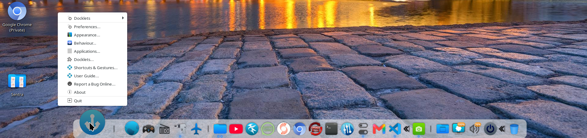
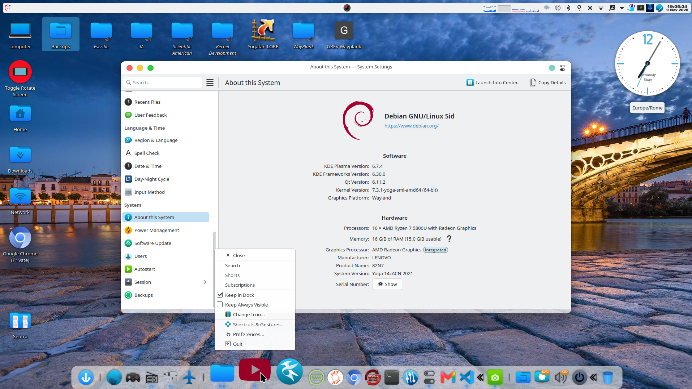
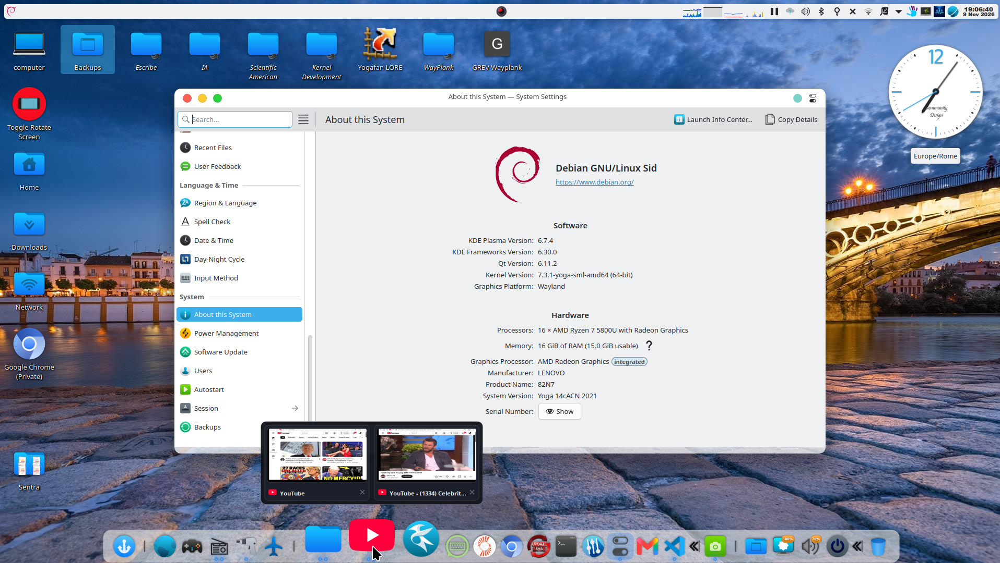
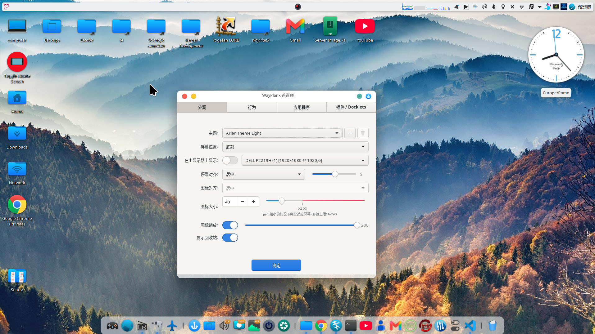

# WAYPLANK: THE ROAD TO WAYLAND DOCK

> A lightweight native Wayland dock, forked and modernized from Plank.
>
> Maintained by Sergio Melas (sergiomelas@gmail.com) © 2026
>
> [](LICENSE)
> [](Changelogs/CHANGELOG_v0.7.3.md)
> [](FAT/2026-11-22%20FAT%200.7.3.2.txt)
> [](po/README.md)
> [](README.md)


<sub>*WayPlank is an independent, non-commercial open-source project licensed under GPLv3 and is not affiliated with, endorsed by, or sponsored by Microsoft Corporation, Apple Inc., Google LLC, or The Linux Foundation. Windows, macOS, Chrome, Linux, and all related names/logos are trademarks of their respective owners.*</sub>

> *📌 **Public Beta 4 Hotfix (`v0.7.3.2`) — `100.0%` 4-Platform FAT Qualified (`529/529` — `2026-11-22`):** Concluded & frozen across **Windows 11 (`Win32/DWM`)**, **KDE Plasma 6 (`KWin`)**, **GNOME Shell (`Mutter`)**, and **`Labwc` (`wlroots`)** in [`FAT/2026-11-22 FAT 0.7.3.2.txt`](FAT/2026-11-22%20FAT%200.7.3.2.txt) (`529/529` applicable passed: `463 [ok]` + `66 [ko->ok]`, `8 [NA]`, `0 [ko]`). **`v0.7.3.2` (Public Beta 4 Hotfix)** delivers `< 0.5 s` Windows startup (`lnk-index-cache.ini`), Windows Taskbar suppression (`ITaskbarList::DeleteTab`), WinRT GSMTC Media Player, per-app Windows COM `IApplicationDocumentLists` Recent Files, instant Linux folder `Change Icon...`, live Light/Dark popups, cross-dock folder-pinned app suppression, per-family Chromium profiles, universal non-destructive `Rename Shortcut...`, unified `VERSION` GResource metadata, and `572/572` 8-language localization (`build/wayplank.exe` `24 MB` Zero-DLL at 25 stock Windows OS DLLs + `build/WayPlank-0.7.3.2-Setup.exe` `8.9 MB`) — see [**PROJECT ROADMAP & THE WAYLAND MILESTONES**](#project-roadmap--the-wayland-milestones).*

> [!TIP]
> ## 🐧🪟 WAYPLANK `v0.7.3.2` — PUBLIC BETA 4 HOTFIX (`100.0%` 4-PLATFORM QUALIFIED)
> Powered by **19 qualified milestones** (**112,000+ lines of legacy X11/Autotools code purged**, **84,000+ new lines of modern Wayland/Windows HAL & Core code added** since `v0.1.0` — **142,900+ lines total** with architecture docs, FAT & 8-language i18n, **188 unique bugs squashed**, and **`100.0%` 4-platform qualification (`529/529`)** across Windows 11, KDE Plasma 6, GNOME & Labwc), **`v0.7.3.2` (Public Beta 4 Hotfix)** hardens and unifies both Linux Wayland and Windows (`7 ⟷ 11+`) from a single 100% OS-agnostic Core ([`CHANGELOG_v0.7.3.md`](Changelogs/CHANGELOG_v0.7.3.md) • [`FAT/2026-11-22 FAT 0.7.3.2.txt`](FAT/2026-11-22%20FAT%200.7.3.2.txt)):
> - 🏛️ **3-Zone Dichotomic HAL & Pure Vala Boundary Translators (`MOC-0.7.2-HAL-001`, [`Architecture/README.md`](Documentation/Architecture/README.md))**: Strict separation of **Zone 1 Agnostic Core** (`src/`, `lib/`), **Zone 2 Pure Vala Contracts** (`hal/Interfaces/`: `IDockShell`, `IWindowBackend`, `IThumbnailProvider`, `IBusBackend`, `ISystemTelemetry`, `IPlatformRuntime`, `IAppSystem`), and **Zone 3 Native OS/Compositor Drivers** (**`hal/Freedesktop/` shared Linux 🐧 & BSD 😈 userland**, `hal/Linux/`, `hal/Windows/`, and planned `hal/BSD/`), enforced at every build by the **8-Gate Dual-Zone HAL Purity Firewall (`0` leaks)**.
> - 🐧🪟 **Unified Linux + Windows Delivery (`BuildDeb.sh` • `BuildRpm.sh` • `BuildWin.sh` • `BuildNsis.sh`, [`HAL_WINDOWS_BACKEND.md`](Documentation/Architecture/HAL_WINDOWS_BACKEND.md))**: Produces native Linux `.deb`/`.rpm` packages alongside the 100% Linux-cross-compiled Zero-DLL `build/wayplank.exe` (`24 MB`, **25 stock Windows OS DLLs only**, `< 0.5 s` persistent `.lnk` index startup, built-in static `lunasvg` SVG loader, off-thread 60 FPS `PrintWindow` preview cards, `SHAppBarMessage` struts, Windows Taskbar suppression via `ITaskbarList::DeleteTab`, `IShellLinkW` + `AUMID` + per-family `Local State` multi-profile tracking, WinRT GSMTC Media Player, CoreAudio/WMI+DXVA2/WinHTTP/Recycle Bin/Ejector) and 64-bit `build/WayPlank-0.7.3.2-Setup.exe` (`8.9 MB` LZMA with auto-close upgrade).
> - 🌐 **Zero-Timer `inotify` Browser Session & 6-Layer Identity Engine (`#20`, `#30`)**: `0ms` launch-intent attribution + kernel `GFileMonitor` (`inotify` / `ReadDirectoryChangesW`) per-family Chromium profile resolution (`Chrome:`, `Edge:`, `Brave:`, `Vivaldi:`, `Chromium:`, `Opera:`) with **`0` polling timers** and **`65,025/65,025` (`100.0%`) SHA-256 identity-matrix parity** across browser profiles, PWAs, Flatpaks, AppImages, and CLI VMs.
> - 🪟 **Mutter 51 Hot-Unplug VSync Safety, Focus-Preserving Preferences & Live Light/Dark Popups (`#32`, `#34`)**: `Meta.LaterType.BEFORE_REDRAW` first-frame deferral eliminating `gnome-shell` `SIGABRT` on monitor cable hot-unplug (`v072_bridge_2`), active focus retention on `PreferencesWindow` across `Position`/`Screen` changes (`focus_on_map=false`), single-monitor Mutter struts, `AnticipateZoom` input-mask clamping, and live Light/Dark `SystemTheme` synchronization across `HoverWindow`, `FolderMenuWindow`, and `WindowCardsWindow`.
> - 📌 **Single-Process Multi-Dock Engine (`dock1`–`dock4`), Folder Drawers, Universal `Rename Shortcut...` & Smart Accordion (`›|` / `«|`) (`#26`, `#35`)**: Up to **4 concurrent docks** inside one `wayplank` process with Multi-Seat logical `Screen 1..4` assignment, 2D `(Screen, Edge)` collision gray-out, `Open Dock...` $\leftrightarrow$ `Close This Dock` / `Delete This Dock...`, interactive **Preferences Dock Selector Dropdown**, `dock1`-exclusive WayPlank anchor icon & unpinned running apps (`TransientDockItem`) with automatic secondary-dock cleanup when emptied, direct **cross-dock & running-app-to-folder drag**, folder-pinned app suppression of duplicate unpinned icons across all docks, universal non-destructive **`Rename Shortcut...`** (`launcher-names.ini`), `Add Folder...` chooser, bidirectional `Pinned <-> Folder` moves, `_Docklets` `Apply` button, global $O(\log N)$ `AppUsageService`, and First-Run Onboarding (`Classic` vs `Explorer`).
> - 🛡️ **Non-Destructive Fault-Tolerant Unified Registry (`~/.config/wayplank/latch-state.ini`, `#33`)**: Stores all 43 global preferences (`[DockPreferences]`), 7 SR Flip-Flop / accordion latches (`[LatchState]`), and per-dock `[MultiDock]` topology in a single `latch-state.ini` with seamless `v0.7.1` migration, fork-isolated syntax probing, RAM-only fault defaulting (preserving faulty `latch-state.ini` and `.dockitem` files 100% untouched on disk until an explicit user UI edit across all 9 [`Test environments.sh`](FAT/Test%20Files/Freedesktop/Environment/Test%20environments.sh) profiles), `NULL`-terminated `GStrv` safety, and static `WeakRef` `SurfaceCache` maintenance.
> - 🌍 **Monolithic Single-Binary Engine, Unified `VERSION` Metadata & 8-Language In-RAM Localization**: **16 docklets**, **6 themes**, **104 embedded SVGs**, structured root `VERSION` compiled into `GResource` (`meta/VERSION` via `ReleaseMetadata.vala`), self-deploying **GNOME & KWin bridges**, and **`572/572` strings** in `zh_CN`, `it`, `es`, `fr`, `ca`, `de`, `uk`, and `en` + browser auto-translated [User Guide](Documentation/USER_GUIDE.md) and 2-Tab Credits / Pango CJK Easter Egg (`Ctrl + Alt + Shift + Click` on the `About WayPlank` emblem).

---

> [!IMPORTANT]
> ### 🏛️ Community Burn-In, Architecture Review & Translations (`v0.7.x`)
> - ❄️ **Core Feature Freeze (Open to Community Requests):** WayPlank's internal Linux feature roadmap is frozen for stability on the road to `v0.8.x` RC; new features through **December 31, 2026** are driven by community requests in [GitHub Issues](https://github.com/sergiomelas/WayPlank/issues) and [Discussions](https://github.com/sergiomelas/WayPlank/discussions).
> - 🔌 **Call for HAL Architecture Review (`v0.7.2`–`v0.7.4`):** Review the [**Master Architecture Overview (`Architecture/README.md`)**](Documentation/Architecture/README.md) along with [**`HAL_COMPOSITORS.md`**](Documentation/Architecture/HAL_COMPOSITORS.md), [**`HAL_BUSES.md`**](Documentation/Architecture/HAL_BUSES.md), [**`APPLICATION_IDENTITY_ENGINE.md`**](Documentation/Architecture/APPLICATION_IDENTITY_ENGINE.md), [**`HAL_LINUX_BACKEND.md`**](Documentation/Architecture/HAL_LINUX_BACKEND.md), [**`HAL_WINDOWS_BACKEND.md`**](Documentation/Architecture/HAL_WINDOWS_BACKEND.md), and [**`HAL_BSD_BACKEND.md`**](Documentation/Architecture/HAL_BSD_BACKEND.md).
> - 🌍 **Call for Translators (`po/generate_translations.py`):** Add or refine languages directly in the structured Python dictionary in [`po/generate_translations.py`](po/generate_translations.py) (see [`po/README.md`](po/README.md) and [`CONTRIBUTING.md`](CONTRIBUTING.md)).

---

## 📢 Overview & Engineering Philosophy

Plank was unmaintained and broken on Wayland. WayPlank brings it back with a native Wayland architecture (`gtk-layer-shell` on **KDE Plasma 6 / KWin** and **Labwc / wlroots**, plus an auto-deployed companion bridge on **GNOME Shell / Mutter**) while preserving Plank's fast Cairo rendering engine and zero-configuration startup.

Every architectural change and bug fix goes through strict ISA-88 Factory Acceptance Testing across all three compositors—full protocols and defect logs are published in [`FAT/`](FAT/) and [`Changelogs/`](Changelogs/).

## 🤝 Acknowledgments & Contributors

A huge thank you to our 400+ users, issue reporters, and translators!

* **史有虎 (IFtiger-hu)** ([@IFtiger-hu-hub](https://github.com/IFtiger-hu-hub)): Author of the WayPlank community fork, contributor of native openSUSE/Fedora/RHEL RPM packaging (`BuildRpm.sh`), dock overflow smooth scrolling architecture, and launcher deduplication engine.

👉 For contribution tracks, translation credits, and the live issue tracker, see [**CONTRIBUTING.md**](CONTRIBUTING.md).

## 📖 Documentation

* 📚 [User Guide & Complete Reference Manual](Documentation/USER_GUIDE.md)
* 🏗️ [Master System Architecture Overview (`Architecture/README.md`)](Documentation/Architecture/README.md)
* 🏛️ [Master Compositor & Shell HAL Architecture (`HAL_COMPOSITORS.md`)](Documentation/Architecture/HAL_COMPOSITORS.md)
* 🚌 [Master IPC & System Bus HAL Architecture (`HAL_BUSES.md`)](Documentation/Architecture/HAL_BUSES.md)
* 🎯 [6-Layer Application Identity Engine & `IAppSystem` (`APPLICATION_IDENTITY_ENGINE.md`)](Documentation/Architecture/APPLICATION_IDENTITY_ENGINE.md)
* 🐧 [Linux Kernel Backend As-Built Specification (`HAL_LINUX_BACKEND.md`)](Documentation/Architecture/HAL_LINUX_BACKEND.md)
* 🪟 [Windows Compositor/Bus Backend & Zero-DLL `wayplank.exe` Blueprint (`HAL_WINDOWS_BACKEND.md`)](Documentation/Architecture/HAL_WINDOWS_BACKEND.md)
* 😈 [FreeBSD Kernel Backend Blueprint — `v0.7.4` (`HAL_BSD_BACKEND.md`)](Documentation/Architecture/HAL_BSD_BACKEND.md)
* 🤝 [Contributing Guidelines & Live Issue Tracker (`CONTRIBUTING.md`)](CONTRIBUTING.md)
* 🌍 [Monolithic Localization & i18n Guide (`po/README.md`)](po/README.md)
* 🖥️ [Compositors & Nested Desktops Cheatsheet (Freedesktop)](FAT/Test%20Files/Freedesktop/WAYPLANK_COMPOSITORS_CHEATSHEET.md) • [Windows & VM Testing Cheatsheet](FAT/Test%20Files/WAYPLANK_WINDOWS_TEST_CHEATSHEET.md)
* 🗺️ [Community Fork Integration Roadmap *(Historic)*](Documentation/Historic/WAYPLANK_FORK_INTEGRATION_ROADMAP.md)
* 📖 [X11-to-Wayland Technical Migration Report *(Historic)*](Documentation/Historic/wayplank_x11_to_wayland_report_en.md)
* 🛡️ [Lifetime Master Bug & Defect Register](FAT/WAYPLANK_LIFETIME_BUG_REGISTER.md)
* 🧪 [Factory Acceptance Testing (`FAT/`) Protocols](FAT/) & [Technical Changelogs (`Changelogs/`)](Changelogs/)

---

## 📸 Screenshots



<details>
<summary><b>🔍 Click to view full desktop integration (1920x1080), detail 1</b></summary>

<br>



</details>

<details>
<summary><b>🔍 Click to view full desktop integration (1920x1080), detail 2</b></summary>

<br>



</details>

<details>
<summary><b>🌍 Click to view native multi-language localization showcase (Simplified Chinese — zh_CN)</b></summary>

<br>



</details>

---

# Universal Build & Installation Guide (Any Linux Distribution)

## 1. CORE DEPENDENCIES

To compile Wayplank from source and enable all docklets, ensure your distribution provides the required development libraries and runtime tools:

### Build Dependencies (Compiler & Headers):
- Vala compiler (`valac >= 0.40`)
- GTK+ 3.0 development headers (`gtk3` / `libgtk-3-dev`)
- GTK Layer Shell (`gtk-layer-shell` / `libgtk-layer-shell-dev`)
- Wayland Client library (`wayland` / `libwayland-client0` / `libwayland-dev`)
- JSON-GLib 1.0 (`json-glib` / `libjson-glib-dev`)
- LibGee 0.8 (`libgee` / `libgee-0.8-dev`)
- GLib 2.0 (`glib2` / `libglib2.0-dev`, includes `glib-compile-resources`)
- `pkg-config` / `base-devel` / `build-essential`

### Runtime Dependencies & Docklet Tools:
- **Screenshot Docklet (Labwc / wlroots / XFCE on Labwc):** `grim`, `slurp`
- **Screenshot Docklet (KDE Plasma):** `kde-spectacle`
- **Screenshot Docklet (XFCE / Generic X11):** `xfce4-screenshooter` or `flameshot`
- **Screen Brightness Docklet (Hardware control fallback):** `brightnessctl` (optional)

**Quick Install Commands:**
- **Debian / Ubuntu:**
  ```bash
  sudo apt install build-essential valac libgtk-3-dev libgtk-layer-shell-dev libwayland-dev libjson-glib-dev libgee-0.8-dev libglib2.0-dev grim slurp
  ```
- **Arch / Garuda Linux:**
  ```bash
  # Remove legacy upstream plank first if installed (avoids stale GSettings schema conflicts):
  sudo pacman -Rns plank 2>/dev/null || true
  sudo pacman -S --needed base-devel vala gtk3 gtk-layer-shell wayland json-glib libgee glib2 dconf grim slurp
  ```
- **Fedora / RHEL:**
  ```bash
  sudo dnf install gcc vala gtk3-devel gtk-layer-shell-devel wayland-devel json-glib-devel libgee-devel glib2-devel grim slurp rpm-build
  ```
- **openSUSE (Tumbleweed / Leap):**
  ```bash
  sudo zypper install gcc vala gtk3-devel gtk-layer-shell-devel wayland-devel json-glib-devel libgee-devel glib2-devel grim slurp rpm-build
  ```

---

## 2. COMPILATION

### Option A: Universal Automated Build Script (Recommended for Any Distro)

Wayplank includes an automated standalone build script that compiles all Vala sources, C bridges, and GLib resources directly without distribution-specific dependencies:

```bash
chmod +x BuildBin.sh
./BuildBin.sh
```

The resulting standalone binary is generated in `build/wayplank`.

---

### Option B: Manual Step-by-Step Compilation

If you prefer building manually in your terminal (mirroring every step of `./BuildBin.sh`, including in-RAM `.mo` localization catalogs, embedded stock themes, and `VERSION` metadata):

```bash
# Step 1: Generate and compile embedded localization catalogs (.mo) into GResource XML
python3 po/generate_translations.py
rm -rf data/locale
EMBEDDED_LANGS=""
LOCALE_XML_ENTRIES=""
for po in po/*.po; do
    lang="$(basename "$po" .po)"
    mkdir -p "data/locale/${lang}"
    msgfmt "$po" -o "data/locale/${lang}/wayplank.mo"
    EMBEDDED_LANGS="${EMBEDDED_LANGS:+${EMBEDDED_LANGS}:}${lang}"
    LOCALE_XML_ENTRIES="${LOCALE_XML_ENTRIES}		<file compressed=\"true\">locale/${lang}/wayplank.mo</file>\n"
done
awk -v entries="$LOCALE_XML_ENTRIES" '/<\/gresource>/ { printf "%s", entries } { print }' \
    data/plank.gresource.xml > data/.plank.build.gresource.xml

# Step 2: Compile GLib schemas and embedded GResource C source (themes, icons, UI, and .mo catalogs)
glib-compile-schemas data/glib-2.0/schemas
glib-compile-resources --sourcedir=data --target=lib/resources.c --generate-source data/.plank.build.gresource.xml
rm -rf data/locale

# Step 3: Compile native monolithic Wayplank binary (Vala + C bridges)
PKG_VER="$(sed -n '1p' VERSION | tr -d '[:space:]')"
PKG_DECO="$(sed -n '2p' VERSION | sed 's/^[[:space:]]*//;s/[[:space:]]*$//')"
mkdir -p build
valac -g \
    --gresources=data/.plank.build.gresource.xml \
    --gresourcesdir=data \
    --vapidir=vapi/core \
    --vapidir=vapi/freedesktop \
    --pkg posix --pkg gio-unix-2.0 --pkg gtk+-3.0 --pkg gtk-layer-shell-0 \
    --pkg json-glib-1.0 --pkg gee-0.8 --pkg compat --pkg unix-compat --pkg config --pkg wlr-bridge \
    -X -D_GNU_SOURCE -X "-Dsetproctitle(x)=" \
    -X -DGETTEXT_PACKAGE=\"wayplank\" \
    -X -DPACKAGE_VERSION=\"${PKG_VER}\" \
    -X "-DPACKAGE_VERSION_DECO=\"${PKG_DECO}\"" \
    -X -DWAYPLANK_EMBEDDED_LANGS=\"${EMBEDDED_LANGS}\" \
    -X -include -X include/config.h \
    -X -Ilib -X -Ihal/Freedesktop/Wlroots -X -Iinclude -X -w -X -lm -X -lwayland-client \
    $(find hal/Interfaces hal/Freedesktop hal/Linux lib src -name "*.vala" | sort) \
    lib/resources.c \
    lib/gtk-compat.c \
    hal/Freedesktop/Wlroots/wlr-foreign-toplevel-management-protocol.c \
    hal/Freedesktop/Wlroots/wlr-toplevel-bridge.c \
    -o build/wayplank
rm -f lib/resources.c data/.plank.build.gresource.xml
```

---

### Step 4: Install Binary and Desktop Assets

Once built (via Option A or Option B), install the binary, desktop entry, hicolor icons, and GSettings schemas *(all 5 stock themes and 8 language catalogs are already embedded in RAM inside the binary)*:

```bash
# 1. Install the binary into /usr/local/bin and link it as plank
[ -f build/wayplank ] && sudo install -Dm755 build/wayplank /usr/local/bin/wayplank || sudo install -Dm755 wayplank /usr/local/bin/wayplank
sudo ln -sf /usr/local/bin/wayplank /usr/local/bin/plank

# 2. Create the target directories safely (on distros where /usr/local/share subdirs do not exist yet)
sudo mkdir -p /usr/local/share/applications
sudo mkdir -p /usr/local/share/icons/hicolor
sudo mkdir -p /usr/local/share/glib-2.0/schemas

# 3. Install the desktop launcher and hicolor SVG icons
sudo install -Dm644 data/wayplank.desktop /usr/local/share/applications/wayplank.desktop
for sz in 16x16 22x22 24x24 32x32 48x48 64x64 128x128 scalable; do
    sudo install -Dm644 data/icons/wayplank.svg "/usr/local/share/icons/hicolor/${sz}/apps/wayplank.svg"
    sudo install -Dm644 data/icons/plank.svg "/usr/local/share/icons/hicolor/${sz}/apps/plank.svg"
done

# 4. Copy and compile the GSettings schemas
sudo install -Dm644 data/glib-2.0/schemas/net.launchpad.plank.gschema.xml \
    /usr/local/share/glib-2.0/schemas/net.launchpad.plank.gschema.xml
sudo glib-compile-schemas /usr/local/share/glib-2.0/schemas/
```

---

## 3. AUTOMATED DEBIAN/UBUNTU PACKAGE CREATION

If running Debian, Ubuntu, or derivative distributions, run the automated packager to create a native `.deb`:

```bash
chmod +x BuildDeb.sh
./BuildDeb.sh
# Install with automatic dependency resolution:
sudo apt install ./build/wayplank_0.7.3.2_amd64.deb
# Or via dpkg:
# sudo dpkg -i build/wayplank_0.7.3.2_amd64.deb && sudo apt install -f
```

---

## 4. AUTOMATED OPENSUSE / FEDORA / RHEL RPM PACKAGE CREATION

If running openSUSE (Tumbleweed / Leap), Fedora, or RHEL-based distributions, run the automated RPM packager:

```bash
chmod +x BuildRpm.sh
./BuildRpm.sh

# Install on openSUSE with zypper:
sudo zypper install ./build/wayplank-0.7.3.2-1.x86_64.rpm

# Or install on Fedora/RHEL with dnf:
sudo dnf install ./build/wayplank-0.7.3.2-1.x86_64.rpm

# Or install via rpm directly:
sudo rpm -Uvh ./build/wayplank-0.7.3.2-1.x86_64.rpm
```

> 💡 **Headless / CI Environments:** You can bypass interactive prompts across all build scripts using `WAYPLANK_NO_PROMPT=1` (e.g. `WAYPLANK_NO_PROMPT=1 ./BuildRpm.sh`).

---

## 5. WINDOWS ZERO-DLL CROSS-COMPILATION (Linux Host ➔ Windows 7 ⟷ 11+)

WayPlank cross-compiles its native Windows monolith (`build/wayplank.exe`, **0 external DLLs**) **100% on Linux** using MinGW-w64 and a gitignored 4-Tier 16-library static sysroot (`./deps/win32/sysroot`, including a built-in static `lunasvg` SVG loader compiled directly into `libgdk_pixbuf-2.0.a`).

### Host Cross-Build Dependencies (Linux)
In addition to the standard Linux build tools (`valac`, `meson`, `ninja`, `cmake`, `pkg-config`, `make`, `curl`, `tar`, `xz`, `python3`, `msgfmt`, `glib-compile-resources`, `glib-compile-schemas`):
- **Debian / Ubuntu:**
  ```bash
  sudo apt update && sudo apt install -y gcc-mingw-w64-x86-64 g++-mingw-w64-x86-64 meson ninja-build cmake
  ```
- **Fedora / RHEL:**
  ```bash
  sudo dnf install -y mingw64-gcc mingw64-gcc-c++ meson ninja-build cmake
  ```
- **Arch Linux:**
  ```bash
  sudo pacman -S --needed mingw-w64-gcc meson ninja cmake
  ```

### Option A: Automated Windows Cross-Build Script (Recommended)

```bash
chmod +x BuildWin.sh
./BuildWin.sh
```

- **First run:** Downloads and statically cross-compiles all 16 upstream libraries (Tiers 1–4 + `lunasvg` static SVG loader) into `./deps/win32/sysroot` (gitignored and cached via per-library `.built` stamps), then transpiles Zone 1 + Zone 2 + `hal/Windows/`, links `build/wayplank.exe`, strips it, and verifies via `x86_64-w64-mingw32-objdump -p` that **only evergreen Windows OS DLLs** are imported.
- **Subsequent runs:** Reuses the cached sysroot and rebuilds `build/wayplank.exe` in seconds.
- **Helper flags:**
  - `./BuildWin.sh --build-sysroot` — build/cache the 4-Tier static sysroot only.
  - `./BuildWin.sh --rebuild-lib <name>` — force-rebuild a single sysroot library (e.g. `gdk-pixbuf` or `gtk3`).
  - `WAYPLANK_NO_PROMPT=1 ./BuildWin.sh` — non-interactive / CI mode.

### Option B: Manual Step-by-Step Windows Cross-Compilation

If you prefer executing the Windows cross-build steps manually after preparing the static sysroot:

```bash
# Step 1: Build and cache the 4-Tier 16-library static MinGW sysroot (one-time)
./BuildWin.sh --build-sysroot

# Step 2: Generate embedded .mo locales, gschemas.compiled, and GResource C source
python3 po/generate_translations.py
rm -rf data/locale
EMBEDDED_LANGS=""
EXTRA_XML_ENTRIES=""
for po in po/*.po; do
    lang="$(basename "$po" .po)"
    mkdir -p "data/locale/${lang}"
    msgfmt "$po" -o "data/locale/${lang}/wayplank.mo"
    EMBEDDED_LANGS="${EMBEDDED_LANGS:+${EMBEDDED_LANGS}:}${lang}"
    EXTRA_XML_ENTRIES="${EXTRA_XML_ENTRIES}		<file compressed=\"true\">locale/${lang}/wayplank.mo</file>\n"
done
glib-compile-schemas data/glib-2.0/schemas
EXTRA_XML_ENTRIES="${EXTRA_XML_ENTRIES}		<file compressed=\"true\">glib-2.0/schemas/gschemas.compiled</file>\n"
awk -v entries="$EXTRA_XML_ENTRIES" '/<\/gresource>/ { printf "%s", entries } { print }' \
    data/plank.gresource.xml > data/.plank.win.gresource.xml
mkdir -p build/win_c
glib-compile-resources --sourcedir=data --target=build/win_c/resources.c --generate-source data/.plank.win.gresource.xml
rm -rf data/locale

# Step 3: Transpile Zone 1 + Zone 2 + hal/Windows/ Vala sources to portable C (0 Unix/Wayland packages)
valac -C -d build/win_c \
    --gresources=data/.plank.win.gresource.xml \
    --gresourcesdir=data \
    --vapidir=vapi/core --vapidir=vapi/windows \
    --pkg gtk+-3.0 --pkg gee-0.8 --pkg json-glib-1.0 --pkg compat --pkg config --pkg win32-bridge \
    $(find hal/Interfaces hal/Windows lib src -name "*.vala" | sort)

# Step 4: Compile Windows manifest resource, cross-compile C, link static Zero-DLL PE32+, strip & verify
PKG_VER="$(sed -n '1p' VERSION | tr -d '[:space:]')"
PKG_DECO="$(sed -n '2p' VERSION | sed 's/^[[:space:]]*//;s/[[:space:]]*$//')"
WIN_PKG_CONFIG="./deps/win32/sysroot/bin/x86_64-w64-mingw32-pkg-config"
x86_64-w64-mingw32-windres -DWAYPLANK_VER_STR="\"${PKG_VER}\"" -I hal/Windows hal/Windows/wayplank.rc -O coff -o build/win_c/wayplank.res.o

x86_64-w64-mingw32-g++-posix -static -static-libgcc -static-libstdc++ -mwindows -O2 \
    -D_WIN32_WINNT=0x0601 -DWINVER=0x0601 \
    -DGLIB_STATIC_COMPILATION -DGOBJECT_STATIC_COMPILATION -DGIO_STATIC_COMPILATION -DGMODULE_STATIC_COMPILATION -DCAIRO_WIN32_STATIC_BUILD \
    -DGETTEXT_PACKAGE=\"wayplank\" -DPACKAGE_VERSION=\"${PKG_VER}\" "-DPACKAGE_VERSION_DECO=\"${PKG_DECO}\"" \
    -DWAYPLANK_EMBEDDED_LANGS=\"${EMBEDDED_LANGS}\" \
    -Ilib -Iinclude -Ihal/Windows/Compositor -include include/config.h -w \
    $("$WIN_PKG_CONFIG" --cflags gtk+-3.0 gee-0.8 json-glib-1.0) \
    $(find build/win_c -name "*.c" | sort) lib/gtk-compat.c $(find hal/Windows -name "*.c" | sort) \
    build/win_c/wayplank.res.o \
    -L./deps/win32/sysroot/lib -Wl,--start-group \
    $("$WIN_PKG_CONFIG" --libs gtk+-3.0 gee-0.8 json-glib-1.0) \
    -llunasvg -lgtk-3 -lgdk-3 -latk-1.0 -lpangowin32-1.0 -lpangocairo-1.0 -lpango-1.0 \
    -lharfbuzz -lfribidi -lcairo-gobject -lcairo -lpixman-1 -lfreetype \
    -lgdk_pixbuf-2.0 -lpng16 -lepoxy -lgee-0.8 -ljson-glib-1.0 \
    -lgio-2.0 -lgobject-2.0 -lgmodule-2.0 -lgthread-2.0 -lglib-2.0 \
    -lintl -liconv -lpcre2-8 -lffi -lz -Wl,--end-group \
    -limm32 -lwinmm -lgdi32 -lmsimg32 -lshell32 -lshlwapi -lcomctl32 -lcomdlg32 \
    -lole32 -loleaut32 -luuid -ldwmapi -luxtheme -lws2_32 -lwinhttp -liphlpapi \
    -ldnsapi -lsetupapi -lhid -lwtsapi32 -ldxva2 -lpowrprof -luser32 -ladvapi32 -lkernel32 -lm \
    -o build/wayplank.exe

x86_64-w64-mingw32-strip --strip-all build/wayplank.exe
x86_64-w64-mingw32-objdump -p build/wayplank.exe | grep "DLL Name:"
rm -f data/.plank.win.gresource.xml
```

- **Automated 64-Bit Windows Installer (`BuildNsis.sh`, Optional — requires `sudo apt install nsis`):**
  ```bash
  chmod +x BuildNsis.sh
  ./BuildNsis.sh
  ```
  Invokes `./BuildWin.sh` and packages `build/wayplank.exe` into **`build/WayPlank-0.7.3.2-Setup.exe`** (`~8.9 MB` LZMA) supporting both System-Wide Admin (`C:\Program Files\WayPlank`) and Per-User (`%LOCALAPPDATA%\Programs\WayPlank`) installs, Start Menu/Desktop shortcuts, optional Autostart, and a clean `Uninstall.exe`.

### Windows Deployment & Runtime Paths
- **Zero-Installer Portable Run:** Copy `build/wayplank.exe` anywhere on Windows `7 ⟷ 11+` and double-click — no external DLLs, no GTK/MSYS2 runtime, and no installer required.
- **Auto-Extracted GSettings Schema:** `%LOCALAPPDATA%\WayPlank\glib-2.0\schemas\gschemas.compiled` *(automatically unpacked from embedded `GResource` on startup)*.
- **Windows Config & User Data:** `%LOCALAPPDATA%\WayPlank\` / `%APPDATA%\WayPlank\`.

---

# RUNTIME DIRECTORIES & CONFIGURATION MIGRATION

Wayplank operates under its own isolated namespace and standard XDG locations:

- Configuration Directory & Unified Registry: `~/.config/wayplank/` (`latch-state.ini`: `[DockPreferences]`, `[LatchState]`, and `[MultiDock]`)
- Per-Dock Application, Folder & Docklet Launchers: `~/.config/wayplank/dock1/launchers/` *(up to `dock4/launchers/` when additional docks are opened via `Open Dock...`)*
- Global Usage Ranking Vector (Smart Pinned Accordion): `~/.local/share/wayplank/app_usage.json`
- Local User Themes: `~/.local/share/wayplank/themes/` *(all 6 built-in stock themes are embedded directly in binary `GResource` RAM; legacy Plank user/system paths `~/.local/share/plank/themes/` and `/usr/share/plank/themes/` remain readable for custom themes)*

**Theme Configuration:**
Wayplank inspects both system and user theme paths natively. To change dock appearance:

```bash
wayplank --preferences
```

**Debug & Verbose Logging:**
To inspect running window hooks and debug output:

```bash
wayplank -d
```

---

# PROJECT ROADMAP & THE WAYLAND MILESTONES

- [x] Phase 1 (Completed) v0.1.0: Decoupled Standalone Fork
  - [x] Complete breakaway from unmaintained upstream Plank.
  - [x] Full namespace migration to 'wayplank' (configs, directories, launchers).
  - [x] Modern monolithic build system replacing broken autotools/autogen scripts.
  - [x] Multi-distro compatibility and standalone Debian packaging pipeline.

- [x] Phase 2 (Completed) v0.2.0: Application Discovery and Dock Lifecycle
  - [x] Implemented generic application discovery from running processes and desktop files.
  - [x] Added persistent pinned application handling and temporary running application icons.
  - [x] Implemented running-instance marking and multi-instance application management.

- [x] Phase 3 (Completed) v0.3.0: Declaration of Independence from X11 & Native Wayland Integration
  - [x] Implementation of Wayland native protocols.
  - [x] Complete phasing out of X11/XWayland dependencies. Support one compositor.
    This will be Kwin because it is the one I know the best.
  - [x] Full fractional scaling and native Wayland compositor window tracking.

- [x] Phase 4 (Completed) v0.4.0, v0.4.1, v0.4.2: KWin Stabilization, Monolithic Docklets & Bug Fixes
  - [x] Hardened KWin scripting bridge, overlap detection, and multi-monitor tracking.
  - [x] Implemented 8 embedded monolithic docklets (Trash, Clocks, Battery, CPU/RAM, Show Desktop, MPRIS, Volume).
  - [x] Bi-directional KWin & Plasma D-Bus trash bridge synchronization.
  - [x] Resolved icon bounce regressions, portal file launching, and process replacement (`--replace` / `-r`).

- [x] Phase 5 (Completed) v0.4.3: Multi-Compositor HAL & Support for Other Compositors (Labwc, wlroots, Mutter)
  - [x] Defined and implemented the modular Hardware Abstraction Layer (`WindowBackend` / `WindowControl`).
  - [x] Added native Labwc & wlroots support via `zwlr_foreign_toplevel_manager_v1` protocol and C bridge (v0.4.3).
  - [x] Zero-configuration runtime dynamic compositor auto-probing (Labwc vs KWin vs Mutter).
  - [x] Reactive Cairo indicator dots and cross-compositor Show Desktop toggle engine.
  - [x] State-based Dodge & Honest UI Matrix for Labwc (`DODGE_MAXIMIZED`, UI filtering, transparent fallback; validated on LXQt 2.x and XFCE 4.20).
  - [x] Native GNOME Shell / Mutter bridge integration (Phase 1): monolithic self-deploying GNOME Shell extension via D-Bus (`MutterBackend`), window state tracking, zero-notification banners, centered dialogs, and edge positioning (v0.4.3).
  - [x] Strict HAL coordinate isolation: native Layer Shell margins for KWin/Labwc and dedicated absolute screen positioning for Mutter (v0.4.3).
  - [x] Finalize GNOME Shell extension bridge for window geometry retrieval to support Intellihide & Dodge on Mutter.

- [x] Phase 6 (Completed) v0.5.0 - v0.6.2.3: Visual Ergonomics, Advanced Theming & Community Features
  - [x] Comprehensive 16-docklet suite (14 in the 7×2 Docklets grid + Trash + Preferences, including Do Not Disturb, Network, Screenshot, Brightness, Weather, Removable Drive Ejector).
  - [x] Semantic categorized multi-zone dock layout (`[Folders] | [Docklets] | [Pinned Apps] | [Transients] | [Trash]`).
  - [x] Cairo folder launcher menus and full application drawers with active window indicators.
  - [x] Universal Cairo multi-window preview cards with live thumbnails on KWin and GNOME Mutter.
  - [x] Real-time dark/light theme switching with native Theme Manager and portal synchronization.
  - [x] Advanced ergonomics: remote URL drag-and-drop, hover-to-raise window activation, recent files jump lists.
  - [x] Configurable System Menu Access modes, Panel Mode (`ReserveSpace`), and Fullscreen Auto-Hide with 0px edge passthrough.
  - [x] Multi-distribution packaging parity (Debian `.deb` & openSUSE/Fedora `.rpm`).
  - [x] Incorporate community user contributions, bug reports, and UX requests ahead of Public Beta.

- [x] Phase 7 (Active — Public Beta Series Launched) WayPlank Public Beta (v0.7.x)
  - [x] **Official Launch of Public Beta 1 (v0.7.0) on GitHub (`FAT/2026-11-05 FAT 0.7.0.txt` concluded & frozen at `359/377` = `95.2% PASS`)!**
  - [x] Monolithic embedded gettext localization engine (`GResource`) with 100% in-memory string resolution (`522/522` strings across 7 languages + English, Zero Host Pollution) and browser auto-translated User Guide (`switch_lang.sh` compatible + China-safe fallback).
  - [x] Configurable Category & Docklet Layout Engine (`Apps & Layout` tab): two-position Docklets (`Docklets on Right` System Tray layout vs. Default Left), symmetric `WayPlank Always Left` (`MONLMIP Rank 1`) & `Show Trash` edge anchors, and one-click `Align by Type` in Free Mode.
  - [x] **`v0.7.1` / `v0.7.1.2` (Public Beta 2 + Burn-In Hotfix — CONCLUDED & FROZEN at 100.0% FAT Qualified, [`FAT/2026-11-13 FAT 0.7.1.txt`](FAT/2026-11-13%20FAT%200.7.1.txt) — `375/375` Applicable)**: First-Run Onboarding (`Classic` vs `Explorer`) & read-only `~/.config/plank` migration, Smart Pinned Apps Accordion (`›|`/`«|`), Chrome D-Bus multi-profile & browser-family isolation (`#30`), `latch-state.ini` 43-key persistence & `/usr/local` schema guard (`#33`), GNOME single-monitor hotplug strut sync (`#32`), `AnticipateZoom` headroom clamp (`#34`), universal `_Docklets` submenu (`#35`), and 2-Tab Credits / Easter Egg.
  - [x] Broaden community field testing across additional wlroots compositors (Sway, Hyprland, Wayfire).
  - [x] **`v0.7.2` (Public Beta 3 — CONCLUDED 2026-11-18 at 100.0% FAT Qualified: Concentrated Linux HAL/Bus Freeze & Single-Process Multi-Dock Engine, [`Changelogs/CHANGELOG_v0.7.2.md`](Changelogs/CHANGELOG_v0.7.2.md) & [`FAT/2026-11-18 FAT 0.7.2.txt`](FAT/2026-11-18%20FAT%200.7.2.txt) — `402` Tests Defined)**: Physical extraction of all diffused Linux compositor drivers ([`HAL_COMPOSITORS.md`](Documentation/Architecture/HAL_COMPOSITORS.md)), Session/System D-Bus endpoints ([`HAL_BUSES.md`](Documentation/Architecture/HAL_BUSES.md)), and `.desktop`/`/proc`/`/sys` adapters ([`APPLICATION_IDENTITY_ENGINE.md`](Documentation/Architecture/APPLICATION_IDENTITY_ENGINE.md)) into `hal/{Interfaces,Freedesktop,Linux}/` per [`Architecture/README.md`](Documentation/Architecture/README.md), plus the single-process **Multi-Dock Engine (`dock1`–`dock4`)** with full-width Preferences dock selector, 2D `(Screen, Edge)` collision gray-out, `dock1`-exclusive WayPlank icon & unpinned running apps, cross-dock drag/pinning, and Labwc zero-stall hardening — **Moves 1–6 (`M1` ➔ `M6`) 100% complete, 8-Gate HAL Purity Firewall `GREEN` (`0` leaks) & 65,025-case Identity Matrix `100.0% PASS`; live 3-compositor `FAT 0.7.2` `100.0% PASSED` (`397/397` applicable, `5 [NA]`, `0 [ko]`): GNOME `Mutter` `135/135`, KDE Plasma 6 `KWin` `134/134` & `Labwc` `128/128`**.
  - [x] **`v0.7.3` / `v0.7.3.2` (Public Beta 4 + Hotfix — CONCLUDED & FROZEN 2026-11-22 at `100.0%` 4-Platform FAT Qualified `529/529`, `0 [ko]`: First Unified Linux Wayland & Native Windows Zero-DLL Monolith, [`Changelogs/CHANGELOG_v0.7.3.md`](Changelogs/CHANGELOG_v0.7.3.md) & [`FAT/2026-11-22 FAT 0.7.3.2.txt`](FAT/2026-11-22%20FAT%200.7.3.2.txt) — `537` Tests Defined)**: Plugged complete native **Windows `7 ⟷ 11+`** drivers (`hal/Windows/{Compositor,Bus,AppSystem,Telemetry}/`), `./BuildWin.sh` (`24 MB` Zero-DLL `build/wayplank.exe`, 25 stock Windows OS DLLs only, built-in static `lunasvg` SVG loader + embedded GTK3 GSchemas), and `./BuildNsis.sh` (`8.9 MB` 64-bit `build/WayPlank-0.7.3.2-Setup.exe` with auto-close upgrade) directly into the frozen `v0.7.2` `hal/Interfaces/` contracts, followed by **`v0.7.3.2` Hotfix** (`< 0.5 s` startup `.lnk` cache, Windows Taskbar suppression, WinRT GSMTC Media Player, Windows COM `IApplicationDocumentLists` per-app Recent Files, instant Linux folder `Change Icon...`, live Light/Dark popups, folder-pinned app suppression, per-family Chromium profiles, universal `Rename Shortcut...`, unified `VERSION` GResource metadata, and `572/572` 8-language localization — **Windows 11 `136/136`, GNOME `Mutter` `133/133`, KDE Plasma 6 `KWin` `133/133`, `Labwc` `127/127` = `529/529` (`100.0%`), `8 [NA]`, `0 [ko]`**).
  - [ ] **`v0.7.4` (Public Beta 5 — Planned: Native FreeBSD Backend `hal/BSD/`)**: Reuses 100% of Zone 1 (`src/`, `lib/`), Zone 2 (`hal/Interfaces/`), and Freedesktop userland (`hal/Freedesktop/`) while plugging native kernel drivers in `hal/BSD/` (`sysctl`/`libprocstat` process inspection, `sysctl` CPU/RAM/Battery/Audio telemetry, FreeBSD runtime & packaging — see [`Architecture/README.md`](Documentation/Architecture/README.md)).
- [ ] Phase 8 (Planned) WayPlank Release Candidate (v0.8.x)
  - [ ] Strict Feature Freeze — no new architectural features, focusing purely on stability and hardening.
  - [ ] Systematic memory leak profiling (Valgrind / AddressSanitizer) and CPU efficiency audits.
  - [ ] Distribution packaging parity: official Debian (.deb), Fedora/openSUSE (.rpm), Arch Linux AUR PKGBUILD, and FreeBSD packages.
- [ ] Phase 9 (Planned) WayPlank Long-Term Production Stabilization (v0.9.x)
  - [ ] The official daily driver production milestone, rock-solid across all major Linux compositors (KWin, Mutter, Labwc), native **FreeBSD**, and native **Windows `7 ⟷ 11+`**.
  - [ ] Production maintenance releases (`v0.9.1`, `v0.9.2`, etc.) as Wayland protocols and driver stacks evolve.
- [ ] Phase 10 (Long-Term Horizon ~2 Years) WayPlank 1.0.0 Grand Milestone
  - [ ] The definitive landmark celebration after 2 years of proven daily production stability and mature protocol integration.
---

# 📝 Release Highlights & Changelog

> 🏛️ **HISTORIC MILESTONE CLOSURE — END OF THE ALPHA & PRE-BETA ERA (`v0.1.0` $\longrightarrow$ `v0.6.2.3`) & LAUNCH OF PUBLIC BETA 1 (`v0.7.0`):**  
> Following the final qualification and sign-off of **`v0.6.2.3`** on **November 1, 2026**, the foundational **Alpha & Pre-Beta Engineering Cycle** of WayPlank is permanently **CLOSED**. Across **15 consecutive releases** in 43 days, over **112,000 lines of legacy X11/Autotools code** were purged, a **3-compositor native Wayland HAL** (**KDE Plasma 6 / KWin**, **GNOME Shell / Mutter**, and **Labwc / wlroots**) was built from the ground up, **107 unique functional & architectural bugs** were squashed across **2,037+ formal ISA-88 test executions**, and all **368/368 applicable FAT validation points** achieved a **100% PASS** rate with **0 open defects**. WayPlank now officially stands in the **Public Beta Era (`v0.7.0` — Public Beta 1)**! 🚀

Here is a recap of the journey so far! For complete technical breakdown and FAT test matrix, see [`Changelogs/`](Changelogs/) and [`FAT/`](FAT/). 🚀

* 🚀 **v0.7.3.2 (Public Beta 4 + Hotfix — Unified Linux Wayland & Native Windows Zero-DLL Monolith `wayplank.exe` & 64-Bit NSIS Installer) — 2026-11-22 [CONCLUDED & FROZEN / 100.0% 4-PLATFORM FAT PASSED — 529/529 Applicable | `Changelogs/CHANGELOG_v0.7.3.md`]**:  
  **All 6 Windows Milestones (`W1` ➔ `W6`) + `v0.7.3.2` Public Beta 4 Hotfix live-certified across all 4 platforms (`529/529` = `100.0%`: Windows 11 `136/136`, GNOME `133/133`, KDE Plasma 6 `133/133`, Labwc `127/127`, `463 [ok]` + `66 [ko->ok]`, `8 [NA]`, `0 [ko]` • `build/wayplank.exe` `24 MB` at 25 stock Windows OS DLLs + `build/WayPlank-0.7.3.2-Setup.exe` `8.9 MB`):** `< 0.5 s` Windows startup via persistent `.lnk` index cache (`lnk-index-cache.ini`), Windows Taskbar suppression (`ITaskbarList::DeleteTab` + `taskbar_hidden` guard), 1st-click minimize, WinRT `GSMTC` Media Player, WMI+`DXVA2` brightness, Explorer icon stores, Windows COM `IApplicationDocumentLists` per-app Recent Files (with strict default-handler fallback), instant Linux folder `Change Icon...` (`Hal.Apps.is_folder_metadata_file()` + debounced `FileDockItem`/`ApplicationDiscovery` refresh + non-destructive `XdgAppSystem` cache pruning), live Light/Dark popups (`HoverWindow`/`FolderMenuWindow`/`WindowCardsWindow`), cross-dock folder-pinned app suppression, per-family Chromium `Local State` profiles (`Edge:`, `Brave:`, `Vivaldi:`, `Chromium:`, `Opera:`, `Chrome:`), universal non-destructive **`Rename Shortcut...`** (`launcher-names.ini`), unified `VERSION` GResource metadata (`ReleaseMetadata.vala`), `572/572` 8-language localization, `0` non-`_full` `Gdk.threads_add_*` calls, `0` Pitfall #14 UAFs, and `8/8` HAL Purity Firewall `GREEN`.
* 🚀 **v0.7.2 (Public Beta 3: 3-Zone Linux HAL & Bus Structural Freeze + Multi-Dock Engine) — 2026-11-18 [`Changelogs/CHANGELOG_v0.7.2.md`]**:  
  Complete 3-Zone Dichotomic HAL extraction (`hal/{Interfaces,Freedesktop,Linux}/`) across 7 pure Vala boundary contracts (`IDockShell`, `IWindowBackend`, `IThumbnailProvider`, `IBusBackend`, `ISystemTelemetry`, `IPlatformRuntime`, `IAppSystem`) with pre-compile 8-Gate HAL Purity & Isolation Firewall (`0` leaks) and `65,025/65,025` (`100.0%`) Identity Engine SHA-256 parity; single-process **Multi-Dock Engine (`dock1`–`dock4`)** in unified `~/.config/wayplank/latch-state.ini` (`[MultiDock]`) with Multi-Seat logical `Screen 1..4` lowest-index hotplug arbitration, **2D `(Screen, Edge)` collision gray-out** across `Position`, `Screen`, `On Primary Display`, and `Open Dock...`, full-width **Preferences `<Dock> - [Screen X - ]<Position>` dock selector dropdown**, `Open Dock...` $\leftrightarrow$ `Close This Dock` (preserve config) / `Delete This Dock...` (wipe config), **`dock1`-exclusive WayPlank icon & `dock1`-exclusive unpinned running apps (`TransientDockItem`)**, automatic secondary-dock self-deletion when emptied (`0` items = `Delete This Dock`), deterministic Mutter `1..4` dock slot reuse (`v072_bridge_5`), cross-dock Folder/App/Docklet drag & pinning, cross-dock pinned-suppresses-unpinned, strict `(Same Type) ∧ (Target Zone)` accordion unfold, `Add Folder...` dialog, bidirectional `Pinned <-> Folder` moves, global $O(\log N)$ dichotomic `AppUsageService` ranking vector, and non-destructive RAM-only fault recovery across 9 `Test environments.sh` profiles; zero-timer `inotify` Chrome session watcher, bidirectional `--app=URL` ↔ `--app-id=` web-app symmetry, Deduplicate-to-Last-Pinned, `.sh` wrapper / `Type=Link` URL-drop forwarding (`MOC Rev 2.1`), and `.DirIcon` bundle icon persistence (`MOC Rev 2.2`); Mutter 51 `BEFORE_REDRAW` cable hot-unplug `SIGABRT` fix (`v072_bridge_2`), focus-retaining `PreferencesWindow`, `_Docklets` submenu `Apply` button, per-PID `ProcessSnapshot` cache, per-output Labwc Dodge Maximized/Fullscreen, and **Labwc zero-stall / low-CPU hardening** (`AppMenuDbusService` registrar guard, reverse-DNS PID matching in `LinuxProcessInspector`, persistent `GTK_USE_PORTAL=0` with clean child `AppLaunchContext`, and safe `PositionManager` transient fallback).
* 🚀 **v0.7.1.2 (Public Beta 2 + Burn-In Hotfix) — 2026-11-14 [CONCLUDED & FROZEN / 100.0% FAT PASSED — 375/375 Applicable | `Changelogs/CHANGELOG_v0.7.1.md`]**:  
  First-Run Onboarding (`Classic` vs `Explorer`) with read-only `~/.config/plank` migration, frecency Pinned Apps Accordion (`›|`/`«|`), Chrome multi-profile D-Bus & browser-family isolation (`#30`), fault-tolerant 43-key `latch-state.ini` persistence & `/usr/local` schema priority (`#33`), GNOME Mutter single-monitor hotplug strut synchronization (`#32`, bridge `v5`), `AnticipateZoom` input-mask clamping (`#34`), universal `_Docklets` chooser submenu (`#35`), auto-translated HTML User Guide, `522/522` in-RAM localization, and 2-Tab Credits / Pango CJK Easter Egg.
* 🚀 **v0.7.0 (Public Beta 1) — 2026-11-06 [CONCLUDED & FROZEN / 95.2% FAT PASSED | `Changelogs/CHANGELOG_v0.7.0.md`]**:  
  Monolithic in-RAM `GResource` localization & stock themes, Category & Docklet Layout Engine (`Docklets on Right`, `WayPlank Always Left`, `Align by Type`), 26-style Icons Visual Effects suite (`300–1500 ms`), 3×3 `Session & Power` control center, GNOME live Primary Display, 60 FPS hover popup filtering (`0.1%` idle CPU), and `SIGWINCH` live package reload.
* 🌟 **v0.6.2.3 (Final Pre-Beta: Community & Visual Enhancements) — 2026-11-01 [COMPLETED / 100% FAT PASSED]**:  
  Universal Cairo multi-window preview cards with live thumbnails on KWin and GNOME Mutter, real-time light/dark theme switching, built-in Do Not Disturb docklet, configurable System Menu Access, Panel Mode (`ReserveSpace`), Fullscreen Inhibit with 0px edge click passthrough (Issue #10), two-stage hysteresis input mask (`AnticipateZoom`, Issue #12), QEMU multi-VM isolation with Labwc `/proc` cold-relaunch synthesis (Issue #14), dynamic top panel avoidance, folder launcher indicators, and recent files jump lists. Permanently closed the Alpha & Pre-Beta cycle!
* 🌟 **v0.6.2.2 (Round 2, Pre-Beta) — 2026-10-21 [COMPLETED / 100% FAT PASSED]**:  
  Remote web URL & browser shortcut DND delivery (`DesktopAppInfo.launch_uris`), hover-to-raise target window activation,  
  real-time dark/light portal color-scheme synchronization (`org.freedesktop.portal.Settings`), interactive Theme Manager  
  with native portal file chooser and archive installer (.zip/.tar.gz), strict FreeDesktop MIME type drop validation,  
  canonical launcher deduplication (`Posix.realpath` & `File.equal`), and clean KISS drag-off removal with instant poof animation.
* 🌟 **v0.6.2.1 (Round 1, Pre-Beta) — 2026-10-19 [COMPLETED / 100% FAT PASSED]**:  
  Native openSUSE/Fedora/RHEL RPM packaging (`BuildRpm.sh`), launcher deduplication & item reuse, ghost bridge window shield,  
  dock overflow smooth scrolling with tachometer redline capacity indicator, and multi-monitor DDC/CI sync with SP/PV decoupling.
* 💡 **v0.6.1 (Alpha) — 2026-10-15:** The Bug Hunting Release — Multi-monitor KWin brightness sync, unified Global System Pressure engine, drag-and-drop payload delivery & 0-byte MIME fix, docklet icon standardization & adaptive dynamic Gtk+ theme engine.
* ✨ **v0.6.0 (Alpha) — 2026-10-11:** Smart first-run auto-configuration (categorized English app drawers, auto-detected pinned apps, docklets & trash), universal "Change Icon..." dialog with FreeDesktop & GIO metadata, integrated User Guide, and clean release polish.
* 🚀 **v0.5.2 (Alpha) — 2026-10-09:** Cairo folder launcher menu, 14 built-in docklets, category layout grouping and deep audit fixing stack overflows & GObject assertions.
* 🛠️ **v0.5.1 (Alpha) — 2026-10-08:** Fixed KWin resume freeze on Plasma 6 with 50ms debouncer, native screenshot docklet and 100% FAT pass rate.
* 🖥️ **v0.5.0 (Alpha) — 2026-10-07:** Solved multi-monitor duplicate ID collisions, live monitor hotplugging and Mutter drag race fixes.
* 🧩 **v0.4.3 (Pre-Alpha) — 2026-10-05:** Modular Multi-Compositor HAL: dynamic auto-probing for KWin, Labwc (via `zwlr_foreign_toplevel`) and GNOME Shell bridge.
* 📦 **v0.4.2 (Pre-Alpha) — 2026-10-02:** First 8 monolithic docklets (Trash, Clock, Battery, etc.), total purge of X11 libs and `--replace` flag.
* ⚙️ **v0.4.1 (Pre-Alpha) — 2026-09-25:** Multi-monitor config persistence, secondary display tooltip fix and smooth zoom without micro-stutters.
* 🪟 **v0.4.0 (Pre-Alpha) — 2026-09-24:** KWin D-Bus scripting bridge, real-time window Dodge/Intellihide and layer-shell input region negotiation.
* 📌 **v0.3.0 (Pre-Alpha) — 2026-09-23:** Drag-and-drop icon pinning, running app dots and native compositor-safe window tracking.
* 🏗️ **v0.2.0 (Pre-Alpha) — 2026-09-22:** Native `gtk-layer-shell` integration, `/proc` process scanner and standalone packaging scripts.
* 🌱 **v0.1.0 (Pre-Alpha) — 2026-09-19:** Initial standalone fork from Plank, clean namespace migration to `wayplank` and XDG isolated paths.

👉 *Read the full detailed commits and milestone notes in [`Changelogs/`](Changelogs/).*
 

---

## ⚖️ License & Integrated Assets Attribution

Wayplank is free software licensed under the **GNU General Public License v3.0 or later** ([GPL-3.0-or-later](LICENSE)).

### 1. Core Project & Codebase
* **License**: GNU General Public License v3.0 or later ([GPL-3.0-or-later](LICENSE)).
* **Original Plank Codebase**: © 2011–2015 Robert Dyer, Michal Hruby, Rico Tzschichholz, and Plank contributors.
* **Wayplank Fork & Architecture**: © 2026 Sergio Melas (<sergiomelas@gmail.com>).

### 2. Integrated Fallback Assets & Vector Artwork
Wayplank incorporates high-definition vector assets compiled directly into the binary executable via GLib GResources (`/net/launchpad/plank/docklets/`) to provide self-contained, standalone operation on any desktop or minimal distribution:
* **Docklet Fallback Icons** (`data/docklets/`):
  * **Volume Scale**: Overamplified (>100%), High, Medium, Low, Muted (`volume-*.svg`).
  * **Battery Scale**: Full, Good, Low, Caution, Empty, Full-Charging, Good-Charging, Low-Charging, Caution-Charging, Empty-Charging, AC-Adapter, Missing (`battery-*.svg`).
  * **Brightness Scale**: High, Medium, Low, Base (`brightness-*.svg`).
  * **Weather Forecast Scale**: Clear, Few Clouds, Overcast, Showers, Snow, Storm, Fog (`weather-*.svg`).
  * **Clock & Time**: Analog Clock (`clock.svg`), Digital LED Clock (`digital-clock.svg`).
  * **System & Hardware**: Trash empty/full (`trash.svg`, `trash-full.svg`), Global System Pressure Monitor (`cpu.svg`), Network Monitor (`network.svg`), Do Not Disturb (`dnd.svg`), Show Desktop (`desktop.svg`), MPRIS Media Player (`mpris.svg`, `mpris-play.svg`, `mpris-pause.svg`), Screenshot (`screenshot.svg`), Session/Power (`session.svg`), Wayplank Preferences (`preferences.svg`), Removable Drive Ejector (`ejector.svg`).
* **Attribution & Upstream**: Derived from FreeDesktop & KDE Breeze icon specifications © KDE Community / Breeze Icon Artists, licensed under **LGPL-3.0-or-later** / **GPL-3.0-or-later**.
* **Zero Host Pollution**: All fallback icons are strictly compiled into the internal executable binary; no extra icon files are installed into `/usr/share/icons/hicolor/`, ensuring pure standalone behavior and complete distribution independence.


